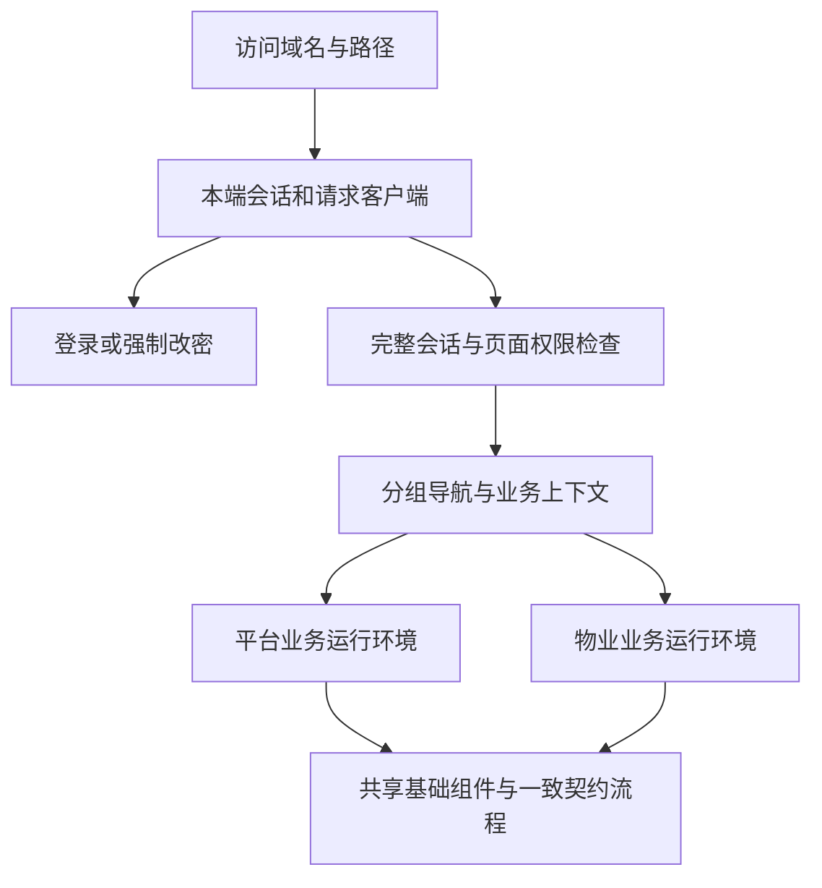

# 管理后台前端设计

## 工程与设计依据

`apps/admin-web/` 使用 Umi Max、React、Ant Design 和 ProComponents，两端共用工程与静态构建产物。产品的信息架构、视觉和交互以 [后台产品体验设计](../design/admin/experience.md) 为准；既有业务规则、数据边界和接口契约继续由对应业务设计及 [OpenAPI](../../openapi/openapi.yaml) 维护。

核心依赖固定版本并通过 pnpm 锁文件保证可重复安装，升级时显式修改并验证兼容性。

| 依赖              | 版本     |
| ----------------- | -------- |
| Umi Max           | 4.7.24   |
| React / React DOM | 19.3.0   |
| Ant Design        | 6.6.6    |
| ProComponents     | 3.1.14-2 |

ProComponents 保留 Ant Design Pro 模板选定的兼容版本，pnpm 对齐 Umi 插件的对应依赖。业务布局使用应用自身的顶栏、分组导航和业务上下文栏，主题通过 Ant Design Token 配置。

运行组件边界遵循 [系统架构](overview.md)，跨模块协作遵循 [代码组织](code-organization.md)。本文件维护前端组织、域名、会话与请求边界，不重复定义页面视觉和业务规则。

## 模块组织

位置均相对 `apps/admin-web/src/`。

| 模块                                                         | 职责                                                                                                       |
| ------------------------------------------------------------ | ---------------------------------------------------------------------------------------------------------- |
| `app/App.tsx`                                                | 按访问域名组装后台、身份守卫、权限守卫、布局、小区上下文、命令面板与主题；按端懒加载业务入口。             |
| `app/routes.ts`、`app/menus.ts`                              | 各端路由、读取权限、父级归属、公司范围标记及业务域菜单。详情继承父级导航。                                 |
| `app/navigation.ts`                                          | 受保护的应用导航、浏览器历史与未保存内容离开处理。                                                         |
| `app/Dashboard.tsx`、`app/styles.css`                        | 本端工作台投影及确认设计的视觉规范。                                                                       |
| `auth/session.tsx`、`auth/Pages.tsx`                         | 独立会话、登录、强制改密、退出和本人资料；按传入作用域绑定请求与缓存。                                     |
| `features/platform/`                                         | 平台公司接入、小区、公司管理员、平台账号、角色与审计；本端业务 API。                                       |
| `features/property/`                                         | 本公司资料、房屋与空间、业主登记、居民认领与绑定、计费依据、账单及线下收款；本端业务 API。                 |
| `features/platform/payments/`、`features/property/payments/` | 各端支付运行环境和 API；仅平台模块暴露商户配置、资金恢复、重新核对及外部处置写方法。                       |
| `features/platform/imports/`、`features/property/imports/`   | 各端导入运行环境、权限映射和可选范围加载。                                                                 |
| `shared/context.tsx`、`shared/hooks.ts`                      | 当前端上下文与查询机制；业务查询按端和当前账号隔离。                                                       |
| `shared/request.ts`、`shared/types.ts`                       | 同源请求、认证失效、CSRF、下载、上传进度、错误类型及稳定共用类型。                                         |
| `shared/ui.tsx`、`shared/forms.tsx`                          | 页面标题、卡片、状态、基础反馈、弹窗与表单变更判断。                                                       |
| `shared/imports/`                                            | 两端一致的通用任务契约、导入页面、预检确认、行问题、进度、文件和安全恢复机制；端专属范围通过运行环境传入。 |
| `shared/payments/`                                           | 两端一致的支付契约、读取传输与展示流程；写能力通过平台运行环境显式注入，物业运行环境不包含这些能力。       |

平台和物业业务模块不相互导入。共享模块不反向导入端业务或应用组装；共享页面仅消费传入的窄 API、权限判断与业务范围，不自行选择另一端身份或 API 前缀。ESLint 校验这些依赖边界。

两端相同的导入引擎契约可共享任务交互，生产业务类型由服务端目录决定；空目录禁止创建，不发布前端演示类型。支付共享读取与展示不扩大物业能力：物业 API 只提供读取方法，并剥除平台专属公司查询参数；写操作仅由平台运行环境注入，服务端仍独立校验权限和数据范围。

## 双后台与会话边界

平台作用域为 `platform_admin`，物业作用域为 `property_admin`。两端分别创建请求客户端、会话和 QueryClient；身份不能写入另一端作用域。菜单、路由、按钮和命令搜索使用所属端当前权限，空业务域不显示。

身份状态区分初始化、未登录、需要改密与已登录。初始化失败显示读取失败及重试，不提前展示旧身份菜单。需要强制改密时仅使用受限会话允许的接口，完成后重新读取完整会话。

账号切换、退出或认证失效时，取消本端请求并清理缓存和表单，阻止旧响应回填。一个后台的 401 不清理另一个后台的身份或缓存。安全操作后重新核实当前会话；服务端身份失效时立即结束本端工作区。

## 域名与页面路径

`UMI_APP_PLATFORM_HOST` 和 `UMI_APP_PROPERTY_HOST` 配置 hostname，不包含协议或端口，默认分别为 `platform.xlife.test`、`property.xlife.test`。域名精确匹配所属后台；根路径进入本端首页，未登录时进入 `/login`，不显示双端入口。

域名内使用 `/login`、`/change-password`、`/profile` 等相对根路径。平台公司接入使用 `/companies`、`/companies/:company` 和 `/communities`，系统管理使用 `/system/*`。物业使用本端房屋、账单、认领、绑定、导入和资金路径，具体路径与权限以 `app/routes.ts` 为唯一代码来源。

`localhost:5173`、`127.0.0.1:5173` 保留双端入口及 `/platform/*`、`/property/*` 前缀，用于本地开发。既有 `/platform/property/*` 接入地址继续解析。域名下的本端旧前缀地址兼容转换；另一端前缀和未知路径返回 404。回跳必须经过本端受保护路由白名单校验。

API 前缀为 `/api/platform` 和 `/api/property`，Cookie 路径与前缀一致。Nginx 仅转发当前域名所属的 API，另一端 API 路径返回 404，不回退前端页面。页面隐藏前缀不改变后端契约或 Cookie 隔离。部署配置遵循 [部署约定](deployment.md)。

## 小区范围与导航状态

物业顶部小区选择属于半全局业务上下文，按账号隔离保留。切换时先保护未保存表单，再清理当前页面选择并重新读取关联数据，防止旧范围响应回填。

房屋、账单、收款和导入按确认设计使用所选小区；没有可读小区时显示引导，不发送无范围列表请求。收款详情保留完整订单事实，不裁剪金额或明细；批次详情使用创建时锁定的范围，不因顶部选择而改写批次。工作台、小区资料、收款配置和核对结果明确标记公司范围，不受小区切换影响。

筛选、分页与必要的详情返回条件保存在 URL。返回列表恢复原查询条件。只有契约声明的查询参数可以发送给服务端；不支持的模糊搜索不能在前端伪装为服务端能力。无聚合接口的统计明确标记当前页，不能把当前页小计呈现为全部业务汇总。

## 请求、缓存与变更

成功响应直接读取资源或 `items/total/page/page_size`，错误按 [API 错误规范](../api/errors.md) 解析 Problem Details。API 路径限制在所属后台同源前缀，写请求附当前会话 CSRF。上传通过实际传输事件展示进度；总量未知时仅显示处理中或已处理数量，不编造百分比。

`useResource` 的查询键包含后台和当前账号。列表、详情及选项按权限和打开状态加载；ProComponents 或 Ant Design 表格使用受控数据，不再建立重复请求来源。需完整选项时逐页读取服务端数据，不能静默截断为前 100 条。

写入期间防止重复提交。服务端返回成功后更新相关查询；409 重新读取并保留用户输入，不自动覆盖新状态。涉及幂等的创建、上传及导入动作保留原请求键与输入，响应未知时先核实原资源，必要时重放原请求；不得自动换键新建替代操作。

商户配置变更携带原配置令牌；资金恢复、重新核对和外部处置携带原资源状态令牌。令牌过期后重新核对，不能自动刷新令牌继续提交。异步受理只表示任务已安排，完成与结果以服务端后续投影为准。

导入确认固定已发布预览版本和摘要，并显式保存普通错误与警告行策略。失败行重跑创建新批次后再次确认；未知结果恢复原任务。问题文件生成与下载固定预览版本和代次，过期或失效文件不能显示为当前可下载结果。详细业务规则见 [导入设计](../design/imports/overview.md) 和 [支付业务设计](../design/payment/bill-payments.md)。

表单输入、弹窗开关和操作状态归所属页面。点击遮罩、ESC、关闭按钮与取消使用同一变更判断；未修改、空白或还原后的表单直接关闭，有未保存内容时在原弹层提供继续与放弃，提交期间禁止关闭。完整交互以 [体验设计](../design/admin/experience.md#操作与流程) 为准。

## 异常与空状态

| 情况                         | 行为                                                       |
| ---------------------------- | ---------------------------------------------------------- |
| 初始化请求失败               | 显示失败与重试，保持身份未确定。                           |
| 已登录接口 401               | 按所属端取消请求、清理身份和缓存并进入登录。               |
| 强制改密                     | 使用服务端明确身份或错误进入改密流程。                     |
| 页面无读取权限               | 原内容区显示 403，不扩大数据范围。                         |
| 操作 403                     | 保留会话和输入，显示权限说明。                             |
| 资源 404                     | 显示不存在，允许返回或关闭后刷新。                         |
| 409                          | 显示冲突并重新读取相关记录，不自动覆盖或重试写入。         |
| 422                          | 显示可识别的字段问题或安全校验说明。                       |
| 429                          | 展示限流反馈，只在服务端承诺时显示等待时间。               |
| 网络中断、503 或未知写入结果 | 读取允许重试；写入先核实原记录，必要时使用原请求身份恢复。 |
| 列表为空                     | 区分无记录、无匹配和无业务上下文，有权限时提供对应入口。   |

## 开发构建与检查

Umi 管理路由入口、开发服务器、热更新与生产构建，产物输出到 `apps/admin-web/dist/`。应用路由和权限由 `app/routes.ts` 维护，Umi 只注册应用入口。生产部署使用前端路由回退，API 代理独立处理。

TypeScript 使用 5.9.3，保留 ESLint、Prettier、Vitest。Umi 生成文件不提交、不参与人工检查。测试位于 `apps/admin-web/tests/`，按 `app/`、`auth/`、`features/`、`shared/` 和实际工程配置职责组织，使用 `.test.*`；Vitest 仅收集该目录，TypeScript 和 ESLint 同时检查测试。

类型生成使用独立的 `src/.umi-types/`，`max setup` 与类型检查不会清理运行中开发服务器的 `src/.umi/`。TypeScript 继承该生成配置，保持 Umi 导出和路径别名一致。

开发服务器固定监听 `127.0.0.1:5173`。`scripts/dev.cjs` 加载 Umi 并登记批次身份和就绪状态，防止端口占用时自动改用其他端口；进程退出和清理沿用 [本地开发入口](local-development.md) 约定，具体命令见 [本地开发指南](../guidelines/local-development.md)。

验证以确认后的体验设计、有效业务规则和 OpenAPI 为依据，覆盖双端域名和路由、权限与会话隔离、真实接口参数、无小区门禁、弹窗变更判断、幂等及未知结果恢复、导入和资金流程，以及类型、Lint、测试、构建和启动停止。旧页面测试不作为新页面的布局或交互约束。测试执行和依赖隔离遵循 [测试规范](../conventions/testing.md)。
