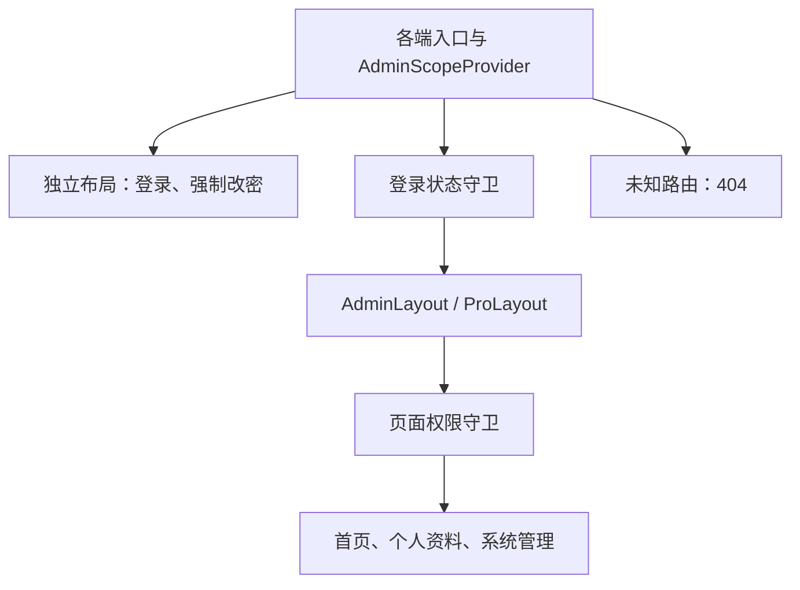

# 管理后台前端设计

## 工程与依赖

`apps/admin-web/` 以 [Ant Design Pro v6.0.3](https://github.com/ant-design/ant-design-pro/releases/tag/v6.0.3) 官方模板为基线，采用 Umi Max、React、Ant Design 和 ProComponents。运行组件与会话存储边界沿用 [系统架构](overview.md)。

核心依赖固定为以下版本，通过 pnpm 锁文件保证可重复安装；升级时显式修改依赖并验证兼容性。

| 依赖              | 版本     |
| ----------------- | -------- |
| Umi Max           | 4.7.24   |
| React / React DOM | 19.3.0   |
| Ant Design        | 6.6.6    |
| ProComponents     | 3.1.14-2 |

ProComponents 沿用该正式模板锁定的预发布版本，支持 Ant Design 6。pnpm 对齐 Umi 插件的 ProComponents 依赖，避免运行时混用不同组件主版本。

工程按实际需求保留模板能力，各端分别组装入口、业务页面、菜单和 API，共用认证机制、本人操作流程、基础组件和工具。认证与业务功能依据 OpenAPI 契约接入。

跨端代码组织、后端协作及测试归属见 [代码组织与账单支付接入](code-organization.md)。

平台后台的功能范围、页面与交互见 [管理后台基础框架设计](../design/admin/foundation.md)。

物业后台的登录与基础工作台见 [物业管理端登录与基础工作台设计](../design/property/workbench.md)。

## 前端模块与复用边界

模块位置相对 `apps/admin-web/src/`。`app/` 负责应用组装，`features/` 按所属后台和业务流程组织，`auth/`、`shared/` 和 `components/` 提供稳定的共用能力。

| 模块位置                                                                 | 职责                                                                                         | 双后台复用方式                                                              |
| ------------------------------------------------------------------------ | -------------------------------------------------------------------------------------------- | --------------------------------------------------------------------------- |
| `app/platform/`、`app/property/`                                         | 各端入口、API 前缀、域名、标题、主题、路由和菜单配置。                                       | 各端独立维护配置与页面注册。                                                |
| `app/admin-routes.ts`、`app/routing.ts`                                  | 应用注册、域名选择、Umi 路由转换、路径匹配与安全回跳。                                       | 注册入口显式组合两端；通用算法只接收配置，不内置端业务路径。                |
| `app/AdminAppProvider.tsx`、`app/AdminRouter.tsx`、`app/AdminLayout.tsx` | 将本端配置绑定导航上下文，组合身份守卫、权限守卫和布局。                                     | 共用组装机制，菜单分组、主题和导航读取本端配置。                            |
| `features/platform/`                                                     | 平台首页、管理员、角色、审计、物业公司、小区与公司管理员接入管理，以及对应 API 和业务 Hook。 | 平台独占管理能力；数据类型和纯展示能力按需复用。                            |
| `features/property/`                                                     | 物业工作台、本公司资料、小区和账务管理，以及对应 API 和业务 Hook。                           | 只持有物业端契约开放的能力，公司范围由服务端解析。                          |
| `features/auth/`、`features/profile/`                                    | 登录、强制改密、本人资料和本人密码管理。                                                     | 当前流程与契约一致，复用实现；请求和导航由各端入口绑定。                    |
| `auth/`                                                                  | 共用认证 API、Provider、会话恢复、身份状态和失效处理。                                       | 代码共用，各端显式提供作用域与 API 前缀，独立创建请求客户端和 QueryClient。 |
| `shared/`                                                                | 请求机制、共用数据类型、导航上下文契约、查询参数、分页、表单校验和变更机制。                 | 不注册端业务页面，不封装平台专属或物业专属接口。                            |
| `components/`                                                            | 权限守卫、403、404、读取失败、空状态和共用筛选展示。                                         | 通过输入与插槽组合展示，不查询平台专属业务数据。                            |

各端业务 Hook 校验当前身份作用域，只创建本端 API；物业端 API 不包含平台公司的创建、启停、开通管理员等方法。共用变更机制负责提交状态、错误处理和可配置的会话刷新，具体缓存失效资源由所属业务 Hook 指定。共用筛选组件通过插槽接收公司选择器，平台公司查询由平台模块执行。

各端业务模块不相互导入。共用机制、组件和本人操作流程不依赖具体端应用或业务模块；ESLint 校验普通导入、再导出和动态导入的边界。各端路由元数据同时供 Umi、菜单、面包屑、快捷入口和身份跳转使用，页面路径映射由所属端配置声明。权限与数据范围的执行边界见 [基础框架的范围与职责](../design/admin/foundation.md#范围与职责)。

### 账单支付模块

支付页面和交互规则由 [居民账单支付与资金处理](../design/payment/bill-payments.md#页面与交互) 维护，前端代码按所属后台组织：

| 位置，相对 `apps/admin-web/src/` | 职责                                                                                         |
| -------------------------------- | -------------------------------------------------------------------------------------------- |
| `features/platform/payments/`    | 平台收款配置、支付及资金记录、资金核对和恢复页面；本端 `api.ts`、`hooks.ts` 及表单组件。     |
| `features/property/payments/`    | 本公司支付及资金结果的只读页面，以及本端 `api.ts`、`hooks.ts`；不提供恢复写方法。            |
| `features/property/billing/`     | 保留账单与线下收款页面，兼容系统线上收款、支付占用及来源对应的操作限制。                     |
| `shared/payments/`               | 按实际复用提取相同契约类型、格式化函数和纯展示组件；不持有身份、不请求接口、不决定操作权限。 |

公司详情只提供收款配置入口，支付配置表单和交互归平台支付模块。物业数据使用服务端返回的受限投影，不接收平台完整对象后仅隐藏列。两端 API 与业务 Hook 分别维护，不因页面相似而合并管理能力。

支付查询沿用本端 React Query，筛选和分页放入 URL，配置表单与恢复原因归所属页面。配置创建重放保留原幂等键及原输入；配置令牌冲突后刷新核对，不自动覆盖。恢复请求返回 `202` 只表示已安排任务，页面继续读取实际结果。账单支付占用由服务端只读投影展示，不提供绕过占用登记收款的入口。

## 双后台边界

平台与物业共用工程和静态构建产物，由访问域名选择所属后台。两端各自使用 ProLayout、菜单、会话与权限上下文；共享组件不持有跨端身份状态。

- 平台作用域为 `platform_admin`，物业作用域为 `property_admin`；会话不能写入其他作用域。
- 路由与菜单权限由所属后台的会话上下文计算。前端权限用于页面展示与导航，服务端权限和数据范围执行要求见 [开发规范](../guidelines/development.md#安全)。
- 每端独立创建 QueryClient，并隔离 ProComponents 请求缓存。身份变更、退出、认证失效时，取消本端进行中的请求并重置本端缓存，避免旧身份响应回填。
- 请求客户端与认证失效处理绑定所属作用域；一个后台的 401 不清理另一个后台的会话或缓存。

### 域名与页面路径

`UMI_APP_PLATFORM_HOST` 和 `UMI_APP_PROPERTY_HOST` 分别配置平台与物业的 hostname，不包含协议或端口，默认是 `platform.xlife.test`、`property.xlife.test`。浏览器按 hostname 精确匹配，只注册当前端的页面；域名端的 `/` 直接进入本端首页，未登录时跳转 `/login`，不展示双端入口。

页面元数据同时生成 Umi 路由、菜单、面包屑、快捷入口和身份跳转。域名访问使用本端相对根路径：`/login`、`/change-password`、`/profile`；平台系统管理使用 `/system/*`，平台物业公司与小区管理使用 `/companies`、`/companies/:company_id`、`/communities`，物业小区查询使用 `/communities`。

直接访问 `localhost:5173` 或 `127.0.0.1:5173` 时保留双端入口和 `/platform/*`、`/property/*` 路由，平台物业接入页保留 `/platform/property/*`。该模式用于开发，不作为域名站点的入口。

Nginx 将当前域名所属的旧页面地址重定向到对应无前缀地址，保留查询参数；旧登录链接的 `return_to` 由前端转换为当前端路径后执行受保护路由白名单校验。另一端的旧页面前缀返回 404，前端也不注册另一端的页面。未知路径保持 404。

API 前缀仍为 `/api/platform` 和 `/api/property`，Cookie 路径与 API 前缀一致。Nginx 每个域名只转发本端 API，其他 API 路径返回 404，不回退到前端页面；页面路径隐藏前缀不改变后端契约或会话隔离。

## 作用域入口与路由组织

`PlatformApp` 和 `PropertyApp` 分别绑定本端应用配置，创建导航与作用域上下文并渲染子路由。登录、强制改密和后台页面都位于所属 `AdminScopeProvider` 内；应用层的 `AdminRouter` 组合身份与页面权限检查，后台页面进入 `AdminLayout`，登录与强制改密页面使用独立布局。

身份上下文区分初始化中、未登录、需要改密、已登录四种状态。登录守卫负责身份状态，页面权限守卫负责读取权限，按钮引用同一套权限码控制操作入口。

路由、菜单、面包屑和快捷入口读取统一路由元数据。菜单按页面读取权限过滤，至少一个子菜单可见时显示父分组，空分组隐藏。页面权限不足时在原路由内容区显示 403；未知路由进入所属后台的 404。平台的具体路径、菜单和导航规则见 [平台路由与导航](../design/admin/foundation.md#平台路由与导航)。

## 请求与接口契约

平台和物业分别使用配置的 API 前缀与请求客户端，通过 Cookie 访问对应后端。请求和响应遵循 [API 规范](../api/conventions.md) 与 [错误与异常规范](../api/errors.md)，前端适配项目契约。

成功响应直接读取资源，错误解析 Problem Details；列表组件在使用分页接口时将契约中的 `items/total/page/page_size` 转换为组件所需的数据结构。当前端尚无对应接口契约时，不自动请求模板演示服务或构造登录接口。

## 请求、缓存与表单状态

`auth/` 持有当前身份及认证操作状态，普通服务端查询和变更状态由本端 React Query 管理。筛选、分页等可恢复状态放入 URL；表单输入、抽屉开关和提交状态归所属页面。

ProTable 使用受控数据、加载状态和分页，不另行创建同一资源的数据获取流程。表单选择项同样通过本端 API 和 QueryClient 获取。

管理员、角色和审计查询仅在完整登录且有页面读取权限时执行；会话恢复和本人资料按对应访问条件读取。详情和选项在对应抽屉打开后按需加载，强制改密页只调用受限会话允许的接口。

账号资料变更刷新账号列表及目标详情；角色和权限变化刷新角色列表、目标详情及相关账号展示；管理变更使审计列表失效。权限目录与角色配置分别缓存，修改角色不改变权限目录。

安全配置写操作成功后，确认当前会话是否仍有效。自身会话已失效时，按 [双后台边界](#双后台边界) 清理本端身份、请求和缓存，同时清空表单并引导重新登录。

提交期间禁用重复提交。权限、启停和密码操作以服务端成功结果更新界面。主动离开未保存表单时确认是否放弃；身份失效时清空旧身份表单，避免继续展示或提交。

## 异常与空状态

| 情况                    | 前端行为                                                             |
| ----------------------- | -------------------------------------------------------------------- |
| 初始化请求失败          | 显示读取失败与重试，保持身份未确定，不提前展示旧身份菜单或管理数据。 |
| 已登录接口返回 401      | 合并处理同批认证失效，按本端状态清理规则处理并跳转本端登录。         |
| 需要强制改密            | 根据契约中的明确错误或会话状态进入强制改密页。                       |
| 其他 403                | 页面无访问权限时显示 403；操作失败在页面或表单说明，保留会话。       |
| 资源 404                | 详情区域显示记录不存在，支持关闭并刷新列表。                         |
| 未知路由                | 显示 404，提供本端首页或入口导航。                                   |
| 409                     | 显示业务冲突或保护说明，保留输入并重新读取相关资源，不自动重试写入。 |
| 422                     | 将可识别的字段问题映射到表单，其余使用安全的通用说明。               |
| 429                     | 按服务端限流说明展示；已提供等待时间时才展示等待提示。               |
| 读取失败、503、网络中断 | 提供手动重试；写入结果不确定时说明需要核实，避免自动重复提交。       |
| 列表为空                | 区分无记录和无匹配结果，有创建权限时提供创建入口。                   |

认证失效、请求与表单清理按 [请求、缓存与表单状态](#请求缓存与表单状态) 执行。登录失败、初始化时未登录响应和旧密码校验失败按各自操作语义处理，具体交互见 [登录与密码页面](../design/admin/foundation.md#登录与密码页面) 和 [个人中心](../design/admin/foundation.md#个人中心)。

## 开发、构建与检查

Umi 负责路由、开发服务器、热更新和生产构建，静态产物输出到 `apps/admin-web/dist/`。部署时 Nginx 对前端路由回退到 `index.html`，API 代理规则独立处理；部署边界见 [部署约定](deployment.md)。

工程保留 ESLint、Prettier 和 Vitest，TypeScript 使用 5.9.3，以满足现有 typescript-eslint 的兼容范围。Vitest 使用独立测试配置；Umi 生成文件不提交、不参与人工格式和 Lint 检查。

管理后台自动化测试及其初始化、框架替身文件统一放在 `apps/admin-web/tests/`。测试目录按被测模块组织：`app/`、`auth/`、`features/`、`shared/` 对应源码模块，`config/` 对应工程配置。测试文件保留 `.test.*` 命名，Vitest 仅从 `tests/` 收集测试；TypeScript 和 ESLint 同时检查测试代码。

管理后台开发服务器固定监听 `127.0.0.1:5173`。启动器通过 [Node 开发入口](../../apps/admin-web/scripts/dev.cjs) 加载 Umi Max，并沿用批次身份登记、就绪和停止机制；该入口将 Umi 开发子进程意外退出报告为失败，开发端口校验阻止 Umi 在端口冲突时自动改用其他端口。开发入口约束见 [本地开发入口设计](local-development.md)，操作见 [本地开发指南](../guidelines/local-development.md)。

验证覆盖各端 API 能力和导入边界、入口与双后台路由、权限和会话作用域、请求与缓存隔离、认证失效处理、类型检查、Lint、单元测试和构建，以及启动停止、端口冲突与清理回归。
