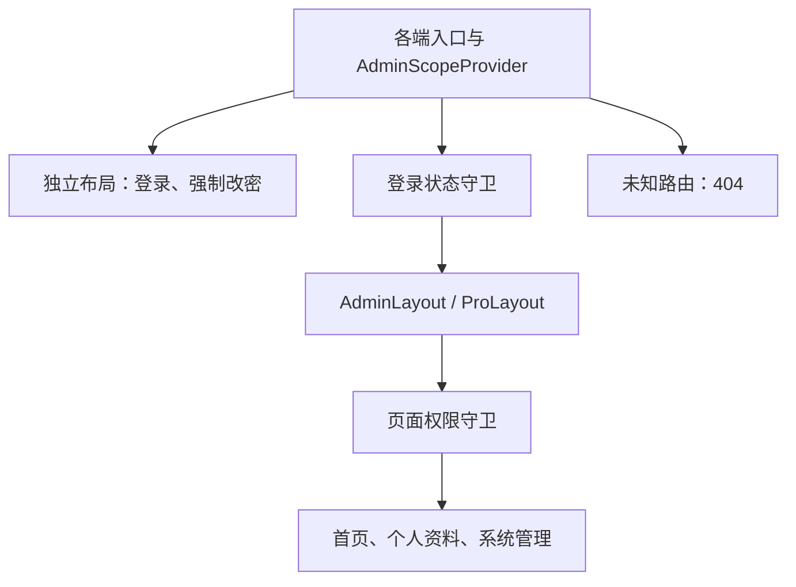

# 管理后台前端设计

## 工程与依赖

`apps/admin-web/` 以 [Ant Design Pro v6.0.3](https://github.com/ant-design/ant-design-pro/releases/tag/v6.0.3) 官方模板为基线，采用 Umi Max、React、Ant Design 和 ProComponents。运行组件与会话存储边界沿用 [系统架构](overview.md)。

核心依赖固定为以下版本，通过 pnpm 锁文件保证可重复安装；升级时显式修改依赖并验证兼容性。

| 依赖              | 版本     |
| ----------------- | -------- |
| Umi Max           | 4.7.24   |
| React / React DOM | 19.3.0   |
| Ant Design        | 6.6.6    |
| ProComponents     | 3.1.14-2 |

ProComponents 沿用该正式模板锁定的预发布版本，支持 Ant Design 6。pnpm 对齐 Umi 插件的 ProComponents 依赖，避免运行时混用不同组件主版本。

工程按实际需求保留模板能力，共用后台入口、认证和管理页面组件，各端分别组装自己的页面与菜单。认证与业务功能依据 OpenAPI 契约接入。

平台后台的功能范围、页面与交互见 [管理后台基础框架设计](../design/admin/foundation.md)。

## 前端模块与复用边界

模块位置相对 `apps/admin-web/src/`，沿用 `app/`、`auth/`、`shared/` 和 `components/`，管理页面按实际功能组织在 `features/admin/` 下。

| 模块位置                         | 职责                                                                       | 双后台复用方式                                                      |
| -------------------------------- | -------------------------------------------------------------------------- | ------------------------------------------------------------------- |
| `app/platform/`、`app/property/` | 各端作用域入口、首页和端配置组装。                                         | 两端独立入口，分别绑定当前作用域、路由根路径、标题和菜单。          |
| `app/admin-routes.ts`            | 纯路由元数据：页面引用、路径、标题、菜单可见性、允许的身份状态及所需权限。 | Umi 路由配置和 ProLayout 菜单从同一份元数据生成，按端显式注册页面。 |
| `app/AdminLayout.tsx`            | 后台布局、面包屑、导航、用户菜单和页面容器组装。                           | 共用组件，各端在自己的 Provider 下实例化。                          |
| `auth/`                          | Provider 和 Hook，管理身份恢复、登录、退出、改密后的失效处理及登录守卫。   | 代码共用，身份状态、请求客户端与 QueryClient 各端独立。             |
| `shared/admin-api/`              | 会话、账号、角色、权限目录和审计接口的类型与请求封装，适配 OpenAPI 响应。  | 绑定当前 Provider 的请求客户端，业务方法使用相对接口路径。          |
| `features/admin/auth/`           | 登录页、强制改密页和密码表单。                                             | 复用交互组件，通过当前作用域获取标题、请求和跳转路径。              |
| `features/admin/profile/`        | 个人资料和本人密码管理。                                                   | 复用页面和表单。                                                    |
| `features/admin/accounts/`       | 管理员列表、详情、创建、编辑、角色分配和重置密码。                         | 复用共同字段、列表和操作组件，物业专属数据范围组件在物业阶段组合。  |
| `features/admin/roles/`          | 角色列表、详情、编辑和权限配置。                                           | 根据当前后台权限目录呈现，共用配置交互。                            |
| `features/admin/audit/`          | 审计查询和只读详情。                                                       | 复用查询与展示，查询范围由所属 API 执行。                           |
| `components/`                    | 权限守卫、403、404、读取失败和公共确认交互等共用组件。                     | 负责展示，通过所在上下文调用操作。                                  |

公共页面通过 `useAdminSession` 和绑定本端客户端的 API 封装访问服务。物业接入时显式注册需要的页面，并补齐公司、小区的数据范围组件及后端约束；启用前提见 [基础框架的范围与职责](../design/admin/foundation.md#范围与职责)。

## 双后台边界

平台与物业共用工程和静态构建产物，通过 Umi 配置路由分别进入 `/platform/*` 和 `/property/*`。两端各自使用 ProLayout、菜单、会话与权限上下文；共享组件不持有跨端身份状态。

- 平台作用域为 `platform_admin`，物业作用域为 `property_admin`；会话不能写入其他作用域。
- 路由与菜单权限由所属后台的会话上下文计算。前端权限用于页面展示与导航，服务端权限和数据范围执行要求见 [开发规范](../guidelines/development.md#安全)。
- 每端独立创建 QueryClient，并隔离 ProComponents 请求缓存。身份变更、退出、认证失效时，取消本端进行中的请求并重置本端缓存，避免旧身份响应回填。
- 请求客户端与认证失效处理绑定所属作用域；一个后台的 401 不清理另一个后台的会话或缓存。

## 作用域入口与路由组织

`PlatformApp` 和 `PropertyApp` 分别创建作用域上下文并渲染子路由。登录、强制改密和后台页面都位于所属 `AdminScopeProvider` 内；后台页面进入 `AdminLayout`，登录与强制改密页面使用独立布局。

身份上下文区分初始化中、未登录、需要改密、已登录四种状态。登录守卫负责身份状态，页面权限守卫负责读取权限，按钮引用同一套权限码控制操作入口。

路由、菜单、面包屑和快捷入口读取统一路由元数据。菜单按页面读取权限过滤，至少一个子菜单可见时显示父分组，空分组隐藏。页面权限不足时在原路由内容区显示 403；未知路由进入所属后台的 404。平台的具体路径、菜单和导航规则见 [平台路由与导航](../design/admin/foundation.md#平台路由与导航)。

## 请求与接口契约

平台和物业分别使用配置的 API 前缀与请求客户端，通过 Cookie 访问对应后端。请求和响应遵循 [API 规范](../api/conventions.md) 与 [错误与异常规范](../api/errors.md)，前端适配项目契约。

成功响应直接读取资源，错误解析 Problem Details；列表组件在使用分页接口时将契约中的 `items/total/page/page_size` 转换为组件所需的数据结构。当前端尚无对应接口契约时，不自动请求模板演示服务或构造登录接口。

## 请求、缓存与表单状态

`auth/` 持有当前身份及认证操作状态，普通服务端查询和变更状态由本端 React Query 管理。筛选、分页等可恢复状态放入 URL；表单输入、抽屉开关和提交状态归所属页面。

ProTable 使用受控数据、加载状态和分页，不另行创建同一资源的数据获取流程。表单选择项同样通过本端 API 和 QueryClient 获取。

管理员、角色和审计查询仅在完整登录且有页面读取权限时执行；会话恢复和本人资料按对应访问条件读取。详情和选项在对应抽屉打开后按需加载，强制改密页只调用受限会话允许的接口。

账号资料变更刷新账号列表及目标详情；角色和权限变化刷新角色列表、目标详情及相关账号展示；管理变更使审计列表失效。权限目录与角色配置分别缓存，修改角色不改变权限目录。

安全配置写操作成功后，确认当前会话是否仍有效。自身会话已失效时，按 [双后台边界](#双后台边界) 清理本端身份、请求和缓存，同时清空表单并引导重新登录。

提交期间禁用重复提交。权限、启停和密码操作以服务端成功结果更新界面。主动离开未保存表单时确认是否放弃；身份失效时清空旧身份表单，避免继续展示或提交。

## 异常与空状态

| 情况                    | 前端行为                                                             |
| ----------------------- | -------------------------------------------------------------------- |
| 初始化请求失败          | 显示读取失败与重试，保持身份未确定，不提前展示旧身份菜单或管理数据。 |
| 已登录接口返回 401      | 合并处理同批认证失效，按本端状态清理规则处理并跳转本端登录。         |
| 需要强制改密            | 根据契约中的明确错误或会话状态进入强制改密页。                       |
| 其他 403                | 页面无访问权限时显示 403；操作失败在页面或表单说明，保留会话。       |
| 资源 404                | 详情区域显示记录不存在，支持关闭并刷新列表。                         |
| 未知路由                | 显示 404，提供本端首页或入口导航。                                   |
| 409                     | 显示业务冲突或保护说明，保留输入并重新读取相关资源，不自动重试写入。 |
| 422                     | 将可识别的字段问题映射到表单，其余使用安全的通用说明。               |
| 429                     | 按服务端限流说明展示；已提供等待时间时才展示等待提示。               |
| 读取失败、503、网络中断 | 提供手动重试；写入结果不确定时说明需要核实，避免自动重复提交。       |
| 列表为空                | 区分无记录和无匹配结果，有创建权限时提供创建入口。                   |

认证失效、请求与表单清理按 [请求、缓存与表单状态](#请求缓存与表单状态) 执行。登录失败、初始化时未登录响应和旧密码校验失败按各自操作语义处理，具体交互见 [登录与密码页面](../design/admin/foundation.md#登录与密码页面) 和 [个人中心](../design/admin/foundation.md#个人中心)。

## 开发、构建与检查

Umi 负责路由、开发服务器、热更新和生产构建，静态产物输出到 `apps/admin-web/dist/`。部署时 Nginx 对前端路由回退到 `index.html`，API 代理规则独立处理；部署边界见 [部署约定](deployment.md)。

工程保留 ESLint、Prettier 和 Vitest，TypeScript 使用 5.9.3，以满足现有 typescript-eslint 的兼容范围。Vitest 使用独立测试配置；Umi 生成文件不提交、不参与人工格式和 Lint 检查。

管理后台开发服务器固定监听 `127.0.0.1:5173`。启动器通过 [Node 开发入口](../../apps/admin-web/scripts/dev.cjs) 加载 Umi Max，并沿用批次身份登记、就绪和停止机制；该入口将 Umi 开发子进程意外退出报告为失败，开发端口校验阻止 Umi 在端口冲突时自动改用其他端口。开发入口约束见 [本地开发入口设计](local-development.md)，操作见 [本地开发指南](../guidelines/local-development.md)。

验证覆盖入口与双后台路由、权限和会话作用域、请求与缓存隔离、认证失效处理、类型检查、Lint、单元测试和构建，以及启动停止、端口冲突与清理回归。
