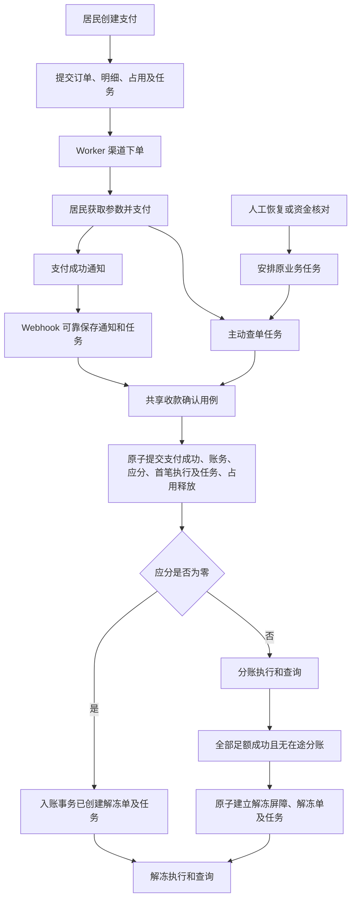

# 代码组织与账单支付接入

## 范围与依据

本文件规定后端、管理后台、居民小程序和测试的代码归属，以及账单支付接入现有模块的方式。目录表示职责分配，只在实现对应能力时创建文件，不表示其中所有路径均已实现。设计确认与实施授权遵循 [设计工作流](../standards/documentation.md#设计工作流)。

- 进程、技术栈和会话边界见 [系统架构](overview.md)。
- 后端分层、依赖、事务及任务执行边界见 [后端业务边界与公共能力](backend-services.md)。
- 管理后台与小程序的工程边界分别见 [管理后台前端设计](admin-web.md) 和 [平台微信小程序架构](miniapp.md)。
- 支付规则与交互见 [居民账单支付与资金处理](../design/payment/bill-payments.md)，表结构、锁序和资金不变量见 [支付数据设计](../design/payment/bill-payments-and-profit-sharing.md)。
- 接口以 [OpenAPI](../../openapi/openapi.yaml) 为准，测试分类与执行遵循 [测试规范](../conventions/testing.md)。

## 组织原则

保留一个后端包、五个运行进程、按层组织的目录。各端应用 Service 负责自己的身份、数据范围和用例编排，通过共用 Domain、Repository、Model、Integration 和纯 Mapper 协作，不相互调用应用 Service。

支付执行归 `services/worker/payments/`；Webhook 可靠保存通知和处理任务，其他入口安排或合并持久任务。渠道通知、主动查询、人工恢复和资金核对最终进入同一收款确认能力。共享账单入账归 `domain/billing/posting.py`，与支付编排分开。

沿用同步 SQLAlchemy、Psycopg、HTTP 客户端和 PostgreSQL 持久任务，不增加支付进程、消息中间件或通用应用框架。各层使用明确的普通输入和业务结果，不为每层复制完整实体或建立一套抽象接口。

## 后端目录与归属

路径相对 `services/backend/src/backend_app/`。未列出的现有业务保留原归属。

```text
backend_app/
├─ app_factory.py                         各运行入口的装配
├─ runtimes/                              五个进程入口
├─ api/
│  ├─ resident/
│  │  ├─ dependencies.py                公共居民身份与 HTTP 依赖
│  │  ├─ router.py                      居民路由组装
│  │  ├─ bills.py                       居民账单读取
│  │  └─ payments.py                    本人支付接口
│  ├─ platform_admin/
│  │  ├─ payment_configuration.py       配置接口
│  │  └─ payments.py                    记录、核对和恢复接口
│  ├─ property_admin/
│  │  ├─ billing.py                     账单及线下操作接口
│  │  └─ payments.py                    本公司配置及资金只读接口
│  └─ webhook/
│     ├─ router.py
│     └─ payments.py                    渠道通知及 ACK
├─ services/
│  ├─ resident/
│  │  ├─ bills.py
│  │  └─ payments.py
│  ├─ platform_admin/
│  │  ├─ payment_configuration.py
│  │  └─ payments.py
│  ├─ property_admin/
│  │  ├─ billing.py                     保留线下用例编排
│  │  └─ payments.py
│  ├─ webhook/payments.py                通知去重和可靠保存
│  └─ worker/payments/
│     ├─ orders.py                      下单、查单、关单及失效订单任务补齐
│     ├─ confirmation.py                唯一收款确认与入账用例
│     ├─ profit_sharing.py              分账执行和查询
│     ├─ unfreezing.py                  解冻执行和查询
│     └─ reconciliation.py              核对批次和任务生成、核对与恢复安排
├─ domain/
│  ├─ billing/
│  │  ├─ __init__.py                    保留原 billing.py 的公开导出
│  │  ├─ calculation.py                 原金额、账期和日期计算
│  │  └─ posting.py                     无管理员依赖的共享入账
│  ├─ payments/
│  │  ├─ configuration.py               配置适用性与规则计算
│  │  ├─ orders.py                      状态、占用和支付事实核验
│  │  ├─ funds.py                       应分履行及解冻前置条件
│  │  └─ reconciliation.py              匹配与差异判定
│  └─ housing.py                         共用房屋路径规则
├─ repositories/
│  ├─ billing.py                         账单锁、账务查询与写入
│  ├─ house_claims.py                    房屋授权查询
│  └─ payments/
│     ├─ configuration.py
│     ├─ orders.py                      订单、明细和当前占用
│     ├─ funds.py                       应分、分账及解冻
│     ├─ tasks.py
│     ├─ channel_records.py
│     └─ reconciliation.py
├─ models/
│  ├─ billing.py                         共享账务表
│  └─ payments/                          按相关表生命周期分组
├─ schemas/
│  ├─ billing.py
│  ├─ payments/
│  │  ├─ resident.py
│  │  ├─ management.py
│  │  └─ configuration.py
│  └─ mappers/
│     ├─ billing.py
│     └─ payments.py
├─ integrations/wechatpay/
│  ├─ client.py                          HTTP、签名、验签及错误分类
│  ├─ payments.py
│  ├─ profit_sharing.py
│  ├─ statements.py                      文件获取、摘要核验和解析
│  └─ notifications.py                   原始通知验签与解密
└─ tasks/
   ├─ runner.py                          领取、租约、周期回调触发和停止
   └─ handlers/payments.py               任务及周期检查到应用用例的分派
```

Model 按配置、订单、资金执行、调度证据和核对等生命周期组织，不要求一张表一个文件。请求与响应按实际契约组织，不将管理员完整对象作为居民响应的基础。微信协议字段只在 Integration 映射，领域和数据库继续使用通用名称。

居民公共依赖从身份路由提取到 `dependencies.py`，账单、支付、认领路由均依赖公共入口，不从其他业务路由导入身份处理。`app_factory.py` 只装配本进程路由，不承载业务流程。

### 共享账单能力

原 `domain/billing.py` 转为包，原计算移到 `calculation.py`，通过 `__init__.py` 保持公开导出。拆分依据是计算与入账的不同依赖和职责，不是文件行数。

`posting.py` 接收已经核验的收款事实、账单数据和 Repository，生成账单操作、结算明细并更新汇总及版本；不依赖管理员或居民会话、HTTP 请求、支付渠道，也不提交事务。线上和线下用例复用适用的收款写入部分，线下纠错编排仍属于物业 Billing Service。

物业 Billing Service 保留物业授权、线下操作、HTTP 幂等结果和管理员审计；在账单锁内检查支付占用，并限制纠错和撤销只能针对线下收款。支付确认 Service 同时协调支付 Domain 和账单 Domain，账单 Domain 不反向调用支付应用 Service。

账单 Repository 提供独立于管理员身份的资源保护和账务访问。系统入账使用系统操作者，读取和 Mapper 兼容空管理员 ID；不能为了复用线下入口伪造管理员。

### 入口与共享能力

| 入口       | 用例归属                    | 与共享能力协作                                                                                         |
| ---------- | --------------------------- | ------------------------------------------------------------------------------------------------------ |
| 居民端     | `services/resident/`        | 当前房屋授权与本人订单授权分别判断；创建订单和任务，读取本地结果，签发原订单调起参数。                 |
| 平台管理端 | `services/platform_admin/`  | 校验配置与恢复权限，核验渠道能力，提交配置和审计；恢复只安排原业务任务，外部处置仅记录差异结论与审计。 |
| 物业管理端 | `services/property_admin/`  | 本公司数据范围；支付及资金只读；线下账单写入检查当前占用。                                             |
| Webhook    | `services/webhook/`         | 使用 Integration 验签解密，可靠保存通知及任务后应答，不同步执行账务。                                  |
| Worker     | `services/worker/payments/` | 执行渠道操作、统一收款确认、分账、解冻和核对，不依赖前台身份会话。                                     |

本期不另设跨端支付应用 Service。共用业务规则位于 Domain，共用查询位于 Repository，共用协议位于 Integration。调起参数签名可以由居民应用 Service 调用 Integration，本地签名不重新下单。

## 支付调用链



1. 居民 Service 在当前授权及固定锁序下创建订单；幂等重放恢复原订单，不因客户端结果未知另建支付。
2. Worker Orders Service 保存调用尝试、在事务外下单，再可靠保存渠道证据并应用结果；下单与查询共用订单身份和原参数。
3. Webhook 通知处理任务和主动查询进入同一 `confirmation.py`。该 Service 在一个事务内协调支付 Domain 与账单入账，原子提交范围和幂等键见 [支付确认与账单入账](../design/payment/bill-payments-and-profit-sharing.md#支付确认与账单入账)。
4. Profit Sharing Service 履行已固定的应分事实；Unfreezing Service 只在资金前置条件满足后建立解冻单。逐接收方结果、未知状态和解冻屏障遵循 [分账及独立解冻](../design/payment/bill-payments.md#分账及独立解冻)。
5. Reconciliation Service 获取渠道事实，由 Domain 判断差异，保存批次、汇总和判定依据；恢复使用原业务任务，不建立另一条入账或资金成功路径。

每日核对首次生成、停机漏日补齐及失效订单检查，由现有 Worker 的周期回调进入对应 Worker Service；职责及提交边界见 [任务生成与补齐](backend-services.md#任务生成与补齐)。

普通 GET 只读本地事实。刷新、关闭、恢复均通过明确写操作安排或合并持久任务。Webhook 的成功 ACK 表示可靠接收，任务安排成功表示已安排，二者均不代表账务或资金已完成。

## 管理后台目录

路径相对 `apps/admin-web/src/`。请求、缓存、表单和权限机制沿用 [管理后台前端设计](admin-web.md)，不增加支付全局状态容器。

```text
src/
├─ app/                                  入口、路由、菜单、工作台与批准的主题布局
├─ auth/                                 每端独立会话、登录、本人资料和密码
├─ features/
│  ├─ platform/
│  │  ├─ PlatformPages.tsx、SystemPages.tsx、api.ts
│  │  ├─ imports/index.tsx                平台导入能力绑定
│  │  └─ payments/{index.tsx,api.ts}       平台资金读取与独占写方法
│  └─ property/
│     ├─ Housing.tsx、Billing.tsx、BillModal.tsx、Residents.tsx
│     ├─ Communities.tsx、api.ts          本公司资料及物业业务契约
│     ├─ imports/index.tsx                物业导入能力绑定
│     └─ payments/{index.tsx,api.ts}       物业资金受限只读投影
└─ shared/
   ├─ context.tsx、request.ts、hooks.ts、forms.tsx、ui.tsx
   ├─ imports/                           注入当前端能力的通用任务交互
   └─ payments/                          注入当前端能力的资金页面与展示
```

当前页面交互以[已确认后台体验设计](../design/admin/experience.md)为准。两端 `api.ts` 定义各自可调用操作；共享页面只接收所属端注入的窄能力，不导入平台或物业业务模块。物业资金运行时不提供写方法，并使用服务端受限投影，不能通过隐藏按钮实现隔离。

平台公司详情链接收款配置；商户绑定、规则、核验、恢复与外部处置通过平台支付运行时接入。外部处置独立收集原因、依据引用和差异令牌；受理、已记录与资金成功分别呈现。物业账单保留线下写入、版本和幂等核实，支付资金只读，不承载渠道执行。

## 居民小程序目录

路径相对 `apps/miniapp/src/`，沿用原生页面文件和既有居民子包。

```text
src/
├─ app.json                            页面注册
├─ shared/wechat/
│  ├─ payment.ts                       支付 SDK 协议适配
│  └─ ui.ts                            安全返回白名单
└─ packages/resident/
   ├─ api.ts、types.ts                 保留原身份及认领归属
   ├─ billing/
   │  └─ api.ts、types.ts、presentation.ts
   ├─ payments/
   │  ├─ api.ts、types.ts、presentation.ts
   │  ├─ controller.ts                支付交互协调
   │  └─ pending.ts                   原请求恢复
   └─ pages/
      ├─ home、house-detail、profile  入口
      ├─ bills、bill-detail
      └─ payment-confirm、payment-orders、payment-detail
```

支付确认页负责展示和按钮，`controller.ts` 协调原请求恢复、调起和结果刷新，SDK 适配只返回面板操作结果。恢复状态及调起参数的隔离要求见 [小程序身份、请求与状态](miniapp.md#身份请求与状态)。SDK 成功只触发服务端核实，取消或未知结果继续处理原订单。

账单页面检查当前房屋授权，本人订单页面使用本人订单授权；不对全部支付页面统一要求当前房屋绑定。居民响应使用单独的白名单 Mapper，不复用管理员完整记录。新页面注册、安全回跳和查询参数一并调整，不将调起参数放进导航。

后台与小程序不建立跨工程业务组件包，公共接口以 OpenAPI 约束。主包和业务子包之间继续遵守既有导入方向。

## 测试归属

保留现有测试分类和 Harness，不迁移无关测试。仅在确有用例时创建下列业务目录。

```text
services/backend/tests/
├─ unit/
│  ├─ domain/payments/                 计算、状态与事实核验
│  └─ integrations/wechatpay/          签名、解密及协议解析
├─ integration/
│  ├─ payments/                        用例、原子性和恢复
│  ├─ api/payments/                    身份、数据范围和回调协议
│  ├─ postgresql/payments/             原生约束、锁序和并发
│  ├─ migrations/                      实施后的结构验证
│  └─ runtime/                         停止、重启和租约接管
├─ contract/                           权威契约与各运行入口
└─ support/payments.py                 确有共用的构造器和渠道替身

apps/admin-web/tests/
├─ app/、auth/                         路由、会话、认证和资料
├─ features/{platform,property}/       各端契约、权限与业务交互
└─ shared/{imports,payments}/          任务策略、资金状态与提交保护

apps/miniapp/tests/
├─ resident/{billing,payments}/
└─ shared/wechat/
```

Domain 测试验证规则，应用集成测试验证状态和事务，PostgreSQL 测试验证实际锁与约束，API 测试验证各端隔离及协议，契约测试验证运行入口和 Schema。各层覆盖不同边界，不重复复制同一组断言。

支付重点覆盖多人及线下竞争、重复确认、入账回滚、迟到证据、租约接管、分账解冻屏障、跨日核对、居民隐私和客户端未知结果。共享入账变更同时执行线下账单回归。迁移和新表实施时同步更新数据库 Harness 的表集合校验；不能削弱契约检查来接受未实现接口。

周期检查集成测试覆盖首次建批次、停机漏日、多 Worker 重复触发、历史停用绑定及失效订单任务补齐；不依赖真实等待。核对测试区分同一订单的金额与手续费差异，验证逐次来源及判定快照的提交边界。外部处置的 API 与页面测试覆盖独立权限、并发令牌、审计、响应未知及物业写入拒绝，不将差异处置展示为资金到账。

真实渠道联调验证商户能力、协议和资金结果，替身不能替代；本地数据库和并发测试复用现有隔离 PostgreSQL 与同步机制。

## 扩展与接入约束

- 一个业务用例保持一个应用编排归属。新入口通过任务或 Domain 进入已有能力，不复制资金状态机。
- 按职责、依赖和变化原因拆文件，不设置机械行数阈值。协议、规则、授权、数据访问和展示分别留在对应层。
- 公共提取基于真实复用；普通数据结构和具体 Repository 优先，仅在实际替换或测试边界需要时定义窄接口。不引入万能 Service、Repository、通用任务 payload 或空扩展框架。
- 包公开导出保持有限，避免汇总导入引入循环；不通过 `common` 或 `utils` 隐藏业务归属。跨端导入、向上依赖和公开契约纳入既有检查。
- 合并支付沿订单明细和固定锁序扩展，多接收方沿应分与执行明细扩展；开放入口前另行确认业务规则。退款、进件和其他渠道不预建实现。
- 接入顺序遵循依赖：先统一账单契约和共享入账，再建立支付数据、任务及渠道能力；配置可用后才开放收款；支付确认闭环成立后接入分账、解冻和核对。页面以已确认契约和对应服务能力为前提。
- 必要改动限于共享入账、资源锁、线上来源与系统操作者、占用保护、居民路由依赖、运行入口装配及支付模块。现有身份会话、后台缓存隔离、线下语义和原生小程序保持；其他旧模块问题不作为支付实施前置重构。
