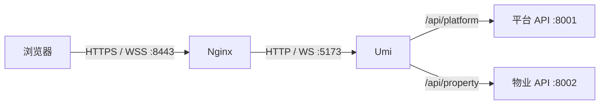

# 开发与部署约定

## 本地开发

- 默认复用本机已有 PostgreSQL 和 Redis；启动前由开发者确保实例已运行，并具备配置所需的数据库、账号和权限。
- 后端使用 `uv` 管理环境和进程。
- 管理后台使用 `pnpm` 和 Umi Max，工程设计见 [管理后台前端设计](admin-web.md)。
- 小程序使用微信开发者工具，TypeScript 源码先构建到 `dist/`。
- 依赖安装、配置优先级、启动停止、访问地址和质量检查操作集中维护在 [本地开发指南](../guidelines/local-development.md)。
- 开发入口的模块协作、批次与进程管理见 [本地开发入口设计](local-development.md)。

### 本地管理后台 HTTPS

本地域名站点复用 macOS 的 dnsmasq 和 Homebrew Nginx。`platform.ezcmty.test`、`property.ezcmty.test` 解析到回环地址，由 Nginx 在 `127.0.0.1:8443` 终止 TLS，再通过 HTTP / WebSocket 转发到 Umi 的 5173 端口；API 继续使用 Umi 的同源代理。该入口用于本机开发，保留两端既有路由、API 前缀和会话隔离。

- 证书使用本机 OpenSSL 生成。持久保存本地 CA，导入 macOS 系统钥匙串并设为可信；CA 签发有效期 365 天的服务端证书，SAN 明确包含两个后台域名。CA 和证书保存于用户目录的 `.config/local-https/`，目录仅当前用户可访问，私钥权限为 `600`，不进入仓库。续期复用 CA，更换站点证书后重载 Nginx。
- 后端可信 Origin 必须包含两个 HTTPS 地址及 8443 端口；保留 Origin 传递并继续执行现有 CSRF 校验。环境配置更新后重启对应应用服务。
- Umi 热更新根据页面来源使用同源 WSS，不固定连接 HTTP 开发服务器。本地域名通过浏览器或系统代理时，应配置直连。
- 8080 HTTP 入口在 HTTPS 验证期间保留；证书信任、页面、API、WSS 和后台边界验证通过后，可仅对这两个域名启用保留路径及查询参数的 HTTPS 重定向。
- 更改前备份站点配置和本地环境文件，先执行 Nginx 配置检查再重载；失败时恢复备份并重载。CA 导入需要 macOS 管理员认证，认证未完成时不得将浏览器信任验证报告为通过。

具体配置、证书命令和验收操作见 [本地域名站点](../guidelines/local-development.md#本地域名站点)。

## 单机部署

推荐使用 Linux LTS 和 Nginx，应用及依赖直接运行于服务器：

- Nginx 提供管理后台 `dist/` 静态文件和后端 API 反向代理，前端路由回退到 `index.html`，API 代理独立处理；静态目录和上游地址由部署环境配置。
- 后端使用 `uv` 管理运行环境，五个后端运行组件分别由服务器进程管理器管理，支持独立重启。
- 生产发布包和源码分发排除 `services/backend/devtools/` 及 `.dev/`；开发数据工具的隔离要求见[开发数据填充设计](development-seed.md)。
- PostgreSQL 使用服务器持久化数据目录；部署环境维护数据库账号和权限，通过 `pg_dump` / `pg_restore` 备份与恢复并验证恢复可用性。
- Redis 的用途和会话丢失策略见 [系统架构](overview.md#会话)。
- 数据库迁移作为发布步骤执行，迁移约束见 [数据库规范](../database/conventions.md)。

## 配置

配置通过环境变量注入。变量名称使用通用名称，例如 `APP_NAME`、`APP_DATABASE_URL` 和 `APP_REDIS_URL`，命名约束见 [系统架构](overview.md#项目命名)。

真实密钥只存在于本地未提交环境文件或服务器受控配置中。
