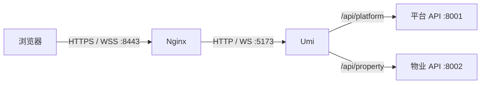

# 开发与部署约定

## 本地开发

- 默认复用本机已有 PostgreSQL 和 Redis；启动前由开发者确保实例已运行，并具备配置所需的数据库、账号和权限。
- 后端使用 `uv` 管理环境和进程。
- 管理后台使用 `pnpm` 和 Umi Max，工程设计见 [管理后台前端设计](admin-web.md)。
- 小程序使用微信开发者工具，TypeScript 源码先构建到 `dist/`。
- 依赖安装、配置优先级、启动停止、访问地址和质量检查操作集中维护在 [本地开发指南](../guidelines/local-development.md)。
- 开发入口的模块协作、批次与进程管理见 [本地开发入口设计](local-development.md)。

### 本地管理后台 HTTPS

本地域名站点复用 macOS 的 dnsmasq 和 Homebrew Nginx。`platform.xlife.test`、`property.xlife.test` 解析到回环地址，由 Nginx 在 `127.0.0.1:8443` 终止 TLS，再通过 HTTP / WebSocket 转发到 Umi 的 5173 端口；API 继续使用 Umi 的同源代理。该入口用于本机开发，保留两端既有路由、API 前缀和会话隔离。

- 证书使用本机 OpenSSL 生成。持久保存本地 CA，导入 macOS 系统钥匙串并设为可信；CA 签发有效期 365 天的服务端证书，SAN 明确包含两个后台域名。CA 和证书保存于用户目录的 `.config/local-https/`，目录仅当前用户可访问，私钥权限为 `600`，不进入仓库。续期复用 CA，更换站点证书后重载 Nginx。
- 后端可信 Origin 必须包含两个 HTTPS 地址及 8443 端口；保留 Origin 传递并继续执行现有 CSRF 校验。环境配置更新后重启对应应用服务。
- Umi 热更新根据页面来源使用同源 WSS，不固定连接 HTTP 开发服务器。本地域名通过浏览器或系统代理时，应配置直连。
- 8080 HTTP 入口在 HTTPS 验证期间保留；证书信任、页面、API、WSS 和后台边界验证通过后，可仅对这两个域名启用保留路径及查询参数的 HTTPS 重定向。
- 更改前备份站点配置和本地环境文件，先执行 Nginx 配置检查再重载；失败时恢复备份并重载。CA 导入需要 macOS 管理员认证，认证未完成时不得将浏览器信任验证报告为通过。

具体配置、证书命令和验收操作见 [本地域名站点](../guidelines/local-development.md#本地域名站点)。

## 单机部署

推荐使用 Linux LTS 和 Nginx，应用及依赖直接运行于服务器：

- Nginx 提供管理后台 `dist/` 静态文件和后端 API 反向代理，前端路由回退到 `index.html`，API 代理独立处理；静态目录和上游地址由部署环境配置。
- 后端使用 `uv` 管理运行环境，五个后端运行组件分别由服务器进程管理器管理，支持独立重启。
- 生产发布包和源码分发排除 `services/backend/devtools/` 及 `.dev/`；开发数据工具的隔离要求见[开发数据填充设计](development-seed.md)。
- PostgreSQL 使用服务器持久化数据目录；部署环境维护数据库账号和权限，通过 `pg_dump` / `pg_restore` 备份与恢复并验证恢复可用性。
- Redis 的用途和会话丢失策略见 [系统架构](overview.md#会话)。
- 数据库迁移作为发布步骤执行，迁移约束见 [数据库规范](../database/conventions.md)。

### 测试服务器基础环境

测试环境采用 Ubuntu 26.04 LTS，原生安装 Nginx、PostgreSQL 18、Redis、Python 3.14 和 uv，使用 systemd 管理服务。基础环境搭建与应用发布分开执行；安装组件不创建业务数据，不执行迁移、seed 或支付新单开放。

搭建前检查现有服务、监听端口、账号、目录、磁盘和 swap，复用符合要求的组件。数据库和 Redis 仅监听本机；SSH 访问验证通过后配置主机防火墙，保留实际 SSH 端口。云安全组由云平台单独管理。配置变更前保留原文件，验证配置后重载或重启；失败时恢复本次变更，不覆盖其他服务。

应用使用专用非登录账号 `appsvc`。发布目录位于 `/srv/xcmty/releases/`，受控配置位于 `/etc/xcmty/`，运行数据位于 `/var/lib/xcmty/`，本机临时备份位于 `/var/backups/xcmty/`；数据库沿用系统服务的数据目录。配置和备份限制访问，运行账号不授予 sudo 权限。基础环境验收包括组件版本、服务状态、本机连接、监听范围、防火墙和 SSH 可达性；域名、证书、业务库和应用进程在后续发布时验收。

组件维护、配置恢复和检查命令见[测试服务器基础环境操作指南](../guidelines/staging-environment.md)。

### 测试环境应用发布

代码通过运维登录账号的 `github-deploy` SSH 别名访问项目仓库，核验 GitHub 主机密钥和部署密钥认证后取得默认分支或指定版本，发布记录固定到提交 SHA。部署私钥不提供给应用运行账号。服务器无法直连 GitHub 时，可通过操作机建立仅监听服务器回环地址的临时 SSH 转发，继续使用服务器部署密钥及 GitHub 主机密钥校验；完成取码后关闭转发，不修改主机校验策略。

发布前完成[测试规范](../conventions/testing.md#分级执行与结果判定)规定的回归。后端在最终版本目录中安装锁定的 Linux 运行依赖，不复制 macOS 虚拟环境；保留 Alembic 配置与迁移文件。前端在操作机或 CI 构建，只发布静态产物。网络受限时可传输与锁文件哈希一致的目标平台依赖，不为部署重写锁文件。

首次部署创建专用空业务库，迁移角色与运行角色分离；运行角色只授予业务访问所需权限，不授予 DDL、超级用户或迁移角色成员资格。凭据随机生成并保存在服务器受控配置中，不放入命令参数、日志或发布包。迁移和初始化使用受控环境文件；迁移在启动 Worker 前完成。后续已有库的备份恢复和支付发布条件沿用[账单支付发布与恢复准备](../plans/payment/bill-payments-release.md)。

四个 API 各使用一个 Uvicorn 进程，监听本机 8001–8004，任务 Worker 独立运行；systemd 显式配置运行账号、工作目录、环境文件、异常重启和正常停止时间，直接执行版本目录中的 Python。切换 `current` 前验收依赖及迁移版本，切换后检查四端 `/readyz` 和 Worker 就绪日志。后台使用 `APP_ENV=staging`，支付新单保持关闭；可信 HTTPS 入口未就绪时只验收内部服务，不开放不安全的浏览器登录入口。应用回退以数据库兼容为前提，不通过删除数据或回退支付事实恢复。

发布、配置、管理员凭据和入口验收操作见[测试环境应用发布操作指南](../guidelines/staging-release.md)。

### 测试环境 IP 与端口 HTTPS 入口

测试服务器可在既有域名入口之外提供以下独立联调入口。两个后台使用分别构建的 IP 静态产物；四个 API、Worker 和域名静态产物沿用对应发布版本，不执行迁移或修改支付开关。

| 组件          | 公网入口                                                  | Nginx 监听地址  | 本机上游                                              |
| ------------- | --------------------------------------------------------- | --------------- | ----------------------------------------------------- |
| 平台后台      | `https://150.158.19.40:8001/`                             | `10.0.0.2:8001` | 平台 IP 静态产物；`/api/platform/` → `127.0.0.1:8001` |
| 物业后台      | `https://150.158.19.40:8002/`                             | `10.0.0.2:8002` | 物业 IP 静态产物；`/api/property/` → `127.0.0.1:8002` |
| 居民 API 联调 | `https://150.158.19.40:8010/api/resident/`                | `10.0.0.2:8010` | `127.0.0.1:8003`                                      |
| Webhook 联调  | `https://150.158.19.40:8020/webhooks/payments/wechatpay/` | `10.0.0.2:8020` | `127.0.0.1:8004`                                      |

公网地址通过云平台 NAT 映射到服务器网卡 `10.0.0.2`，不直接配置为本机监听地址。四个 Nginx listener 显式使用 `listen 10.0.0.2:<端口> bind ssl`，不使用 `0.0.0.0` 或通配监听；`bind` 保证与已有 `127.0.0.1:8001`、`127.0.0.1:8002` 后端监听分开。云端防火墙与主机防火墙分别放行这四个 TCP 入口，PostgreSQL、Redis 和四个 API 仍只监听回环。变更网卡或公网 IP 时必须同步调整监听、证书、来源白名单和防火墙并重新验收。

平台和物业从各自端口的 `/` 进入，使用现有域名模式的无前缀页面路由及 SPA 深链。前端按 hostname 选择入口，因此使用两份独立构建：平台产物仅将平台 hostname 设为 IP，物业产物仅将物业 hostname 设为 IP；每次构建同时显式设置两项 hostname，另一项保留对应域名。每个端口只提供所属组件的页面、API 和明确允许的健康探针，拒绝其他端的 API 及非预期 Host；API 前缀移除规则与域名入口相同，Webhook 保留原路径。页面去除前缀不改变 API 前缀、Cookie Path、Origin 或后端授权边界。

旧页面地址使用 `302` 和 `Cache-Control: no-store` 兼容迁移。平台端的 `/platform`、`/platform/` 及物业端的对应根路径跳转到 `/?_ip_entry=clean`，将原查询参数追加保留，利用不同的 URL 缓存键避开此前根路径 `308` 的浏览器缓存并防止循环；直接访问新 `/` 则返回 SPA，不额外添加查询参数。旧深链按现有域名路由去除所属端页面前缀，平台的 companies / communities 特殊 `sitePath` 映射优先处理，保留查询参数；另一端页面前缀返回 `404`。迁移不发送 `Clear-Site-Data`，不清理 Cookie 或浏览器 storage。

两份 IP 静态产物以同一选定提交的干净源码及锁定依赖构建，发布到 `/srv/xcmty/releases/<UTC时间>-<短SHA>-ip-admin-web/{platform,property}/`，由独立的 `/srv/xcmty/ip-admin-web` 软链接指向该完整产物对。8001、8002 的静态 root 分别为软链接下的 `platform/`、`property/`；IP 前端单独发布时不切换 `current`、后端或域名产物。后续每次前端发布同步构建域名通用、平台 IP、物业 IP 三份产物，记录提交、两项构建变量及各产物哈希；IP 产物成对校验并原子切换同一个软链接，保留上一对产物供独立回退。静态资源、缓存、文件权限和回退操作见发布指南。

IP 证书使用含 `150.158.19.40` IP SAN 的受信任证书，采用 Let’s Encrypt `shortlived` profile 和公网 80 的 HTTP-01 webroot 验证。独立 Certbot 5.8 运行环境、配置、工作目录、日志、lineage、成功 hook 和每 12 小时续期任务，与既有 Certbot 4.0 / DNSPod 域名证书流程隔离；不让旧客户端扫描 IP lineage。短期证书有效期为 160 小时，需完成真实 staging 验证、非交互续期及限定 Nginx 重载 hook 演练，并持续检查失败和到期时间；临时操作机代理不构成自动续期条件。

应用保持 `APP_ENV=staging`，平台和物业增加各自精确的 HTTPS IP 与端口 Origin，保留域名 Origin 和原始请求 Origin。Cookie 继续使用 Secure、HttpOnly、SameSite=Lax 及 `/api/platform`、`/api/property` 两个不重叠 Path；浏览器 Cookie 不按端口隔离，不将 Path 合并为 `/`。无有效证书或续期保障时不开放 IP 登录，不降级为 HTTP。居民和 Webhook IP 入口仅用于接口联调，不代替微信合法域名、渠道回调地址及真实资金验收。

安装、维护、分层验收与回退操作见[IP 与端口 HTTPS 入口指南](../guidelines/staging-release.md#ip-与端口-https-入口)。IP 入口与域名 443 入口分别验收，任一入口通过均不能替代另一入口的验证。

## 配置

配置通过环境变量注入。变量名称使用通用名称，例如 `APP_NAME`、`APP_DATABASE_URL` 和 `APP_REDIS_URL`，命名约束见 [系统架构](overview.md#项目命名)。

真实密钥只存在于本地未提交环境文件或服务器受控配置中。

### 测试服务器关键配置归档

测试服务器关键配置统一保存在根目录 `deploy/staging/`，按 Nginx、systemd、Certbot、环境模板及 PostgreSQL / Redis 项目片段分类。部署配置与模板由 `deploy/` 管理，`scripts/` 维护可执行工具。项目自定义配置保留可审查的完整源文件；应用、迁移、DNSPod 凭据及签发参数使用脱敏模板。域名与 IP 证书分别维护依赖锁和部署 hook，保留既定运行环境及续期隔离。

[配置索引](../../deploy/staging/README.md)记录仓库文件到服务器路径、属主、权限及验证方式，设计和运维流程继续由本文及既有指南维护。真实环境文件、密钥、证书、ACME 账号、日志、备份和构建产物不进入版本管理；系统默认配置、软件安装、swap、时区、SSH、防火墙和 DNS 沿用现有指南，不额外导出。数据库结构继续由迁移管理。

归档只调整项目中的配置来源与引用，不自动安装、覆盖或重启服务器组件。配置源与服务器有效文件逐项比对；示例模板单独检查字段、类型、占位符及敏感值排除。实际部署前仍须备份目标配置，先校验再生效；失败时恢复本次变更及原权限。
