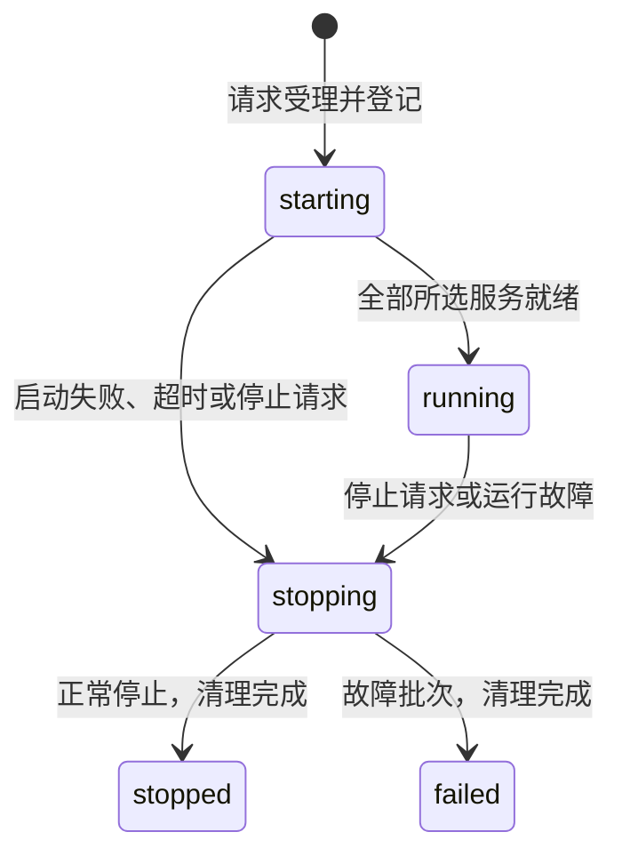
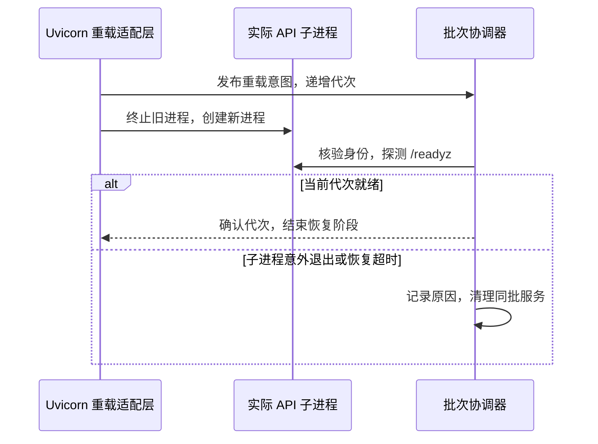

# 本地开发入口设计

面向 macOS 本地开发，统一管理安装、运行、构建和检查。服务批次包含四个 API、Worker、管理后台，单独目标只选择对应服务；小程序在微信开发者工具中运行。

命令、配置、地址和日志位置见 [本地开发指南](../guidelines/local-development.md)。应用边界沿用 [系统架构](overview.md)，PostgreSQL、Redis 默认复用本机实例，前提见 [部署约定](deployment.md#本地开发)。

## 任务编排与模块职责

`Makefile` 只编排任务，非文件目标声明 `.PHONY`。安装、构建和检查直接调用现有工具，按指南顺序执行，失败即返回非零；复杂启停逻辑集中在 [scripts/dev/](../../scripts/dev/)：

| 模块           | 职责                               |
| -------------- | ---------------------------------- |
| `__main__.py`  | 解析命令，连接统一启停逻辑         |
| `runtime.py`   | 每批一个协调器，负责日志与故障监控 |
| `processes.py` | 互斥、登记、身份校验与清理         |
| `services.py`  | 服务定义、配置与依赖检查、就绪探测 |
| `api.py`       | Uvicorn 重载适配与实际子进程观察   |

后端直接使用 `uv` 选定的 Python 解释器，管理后台通过 Node 入口加载 Umi Max，以观察实际进程并报告异常退出；前端入口见 [管理后台前端设计](admin-web.md#开发构建与检查)，API 另行观察 Uvicorn 子进程。

## 批次登记与并发控制

- **整批受理**：每次受理生成 UUID，立即预留完整服务集合。与已有或启动中的服务重叠时，整条请求拒绝，显示实例信息和停止方式，保留原批次，不复用或补启动。
- **串行登记**：以仓库绝对路径识别归属，通过 `flock` 和原子文件替换更新登记。停止期间拒绝新批次，重复停止等待已有请求完成；依赖检查和退出等待在锁外进行。
- **先登记后执行**：协调器、应用和探测进程均创建独立会话，在管道闸门处等待。身份登记并 `fsync` 后才放行 `exec`；登记失败或授权前父进程退出时，应用不会执行。

登记保留请求服务、实际进程及成员身份、就绪代次、状态和原因；运行文件位置见 [日志与运行状态](../guidelines/local-development.md#运行地址与日志)。配置凭据不写入登记或错误输出。

## 启动流程

受理前检查冲突、停止状态、管理后台依赖和固定端口。受理后先检查后端配置与依赖，再次确认端口并创建全部所选服务，随后并行等待就绪：

后端在 `services/backend/` 使用现有 Settings 和只读 `SELECT 1`、Redis `PING` 检查，配置优先级见指南。开发入口不启停系统服务、建库、创建账号、迁移或修改数据；单独启动管理后台跳过后端检查。端口冲突不接管或换端口；管理后台通过 [Umi 开发配置](../../apps/admin-web/config/plugins/dev-server.ts) 固定监听地址和端口，并校验 Umi 选择的实际端口。

配置错误立即失败；依赖或探测暂未通过时，在总期限内重试。仅全部就绪且无停止请求时报告成功。前后台共用脱离终端的协调器与日志文件：前台持续输出带服务标识的日志，后台等就绪后返回，关闭终端后继续运行；两者都显示地址、批次、日志位置和停止命令。

## 就绪判断

所有服务须实际进程存活，并满足以下条件：

| 服务     | 就绪条件                                                                                  |
| -------- | ----------------------------------------------------------------------------------------- |
| API      | `/readyz` 返回 200，服务标识匹配，`status=ok`，PostgreSQL、Redis 均为 `ok`                |
| Worker   | 只读依赖检查及实际任务表读取通过，调度已启动且注册了业务 Handler；本批日志出现 `service=worker`、`message=worker_ready scheduler=running task_handlers=N`，`N` 为正整数 |
| 管理后台 | `/` 返回 200，`Content-Type` 包含 `text/html`，页面非空                                   |

API 标识分别为 `platform-admin-api`、`property-admin-api`、`resident-api`、`webhook`，沿用 [现有契约](../api/openapi/components/schemas.yaml)。Worker 就绪表示持久调度和已注册的业务处理能力可用，不表示真实商户条件或资金验收已通过；不新增 HTTP 接口。日志配置要求见 [指南](../guidelines/local-development.md#初始化本地环境)。

探测子进程独立登记，避免阻塞协调器；HTTP 直连本机并忽略代理。超期或旧 API 代次的结果不能报告成功。首次就绪后监控进程存活，API 重载时重新探测，不持续轮询依赖状态。

## 时间限制

前台、后台和单独目标共用 [Timing](../../scripts/dev/services.py) 默认值：

| 项目                     | 默认值 |
| ------------------------ | ------ |
| 启动总超时               | 60 秒  |
| 单次就绪探测超时         | 10 秒  |
| 探测重试与协调器检查间隔 | 0.5 秒 |
| 热重载恢复等待           | 20 秒  |
| 正常退出等待             | 10 秒  |
| 强制终止确认等待         | 5 秒   |

使用单调时钟。启动期限从受理到全部就绪，包含依赖检查；重载恢复不因连续变更延长。这两类期限优先于单次探测。

## API 热重载与故障识别

复用 Uvicorn `WatchFilesReload` 和 `watchfiles`，通过原子事件文件传递重载意图、实际子进程身份、代次和恢复起点：

只有明确的重载意图允许旧进程退出；变更前已退出、新进程导入失败、意外零退出码均为故障。适配层每 0.1 秒观察实际子进程，协调器也核验身份并重读事件排除重载竞争，父进程存活不能掩盖故障。当前代次就绪才结束恢复，旧探测和连续变更不能延长期限。

监听范围见 [指南](../guidelines/local-development.md#运行地址与日志)，管理后台热更新由 Umi 负责。升级 Uvicorn、Umi 或监听依赖时须复验相应进程生命周期。

## 停止与故障清理

`Ctrl+C`、终端停止信号及故障清理只影响本批，`make stop` 停止全部登记批次。先请求根进程 `SIGTERM`，让其正常关闭子进程；根进程已退出时直接停止遗留成员。超时后核验剩余成员并发送 `SIGKILL`。

每次信号前核验当前用户的 **PID、进程组、精确启动时间**（macOS `libproc`，Linux `/proc`）。仅在已知身份可验证的独立进程组中发现成员，成员启动时间不得早于根进程；回收父进程前刷新成员，覆盖重载子进程和遗留进程。不依据端口、模糊名称或宽泛 `pkill` 清理。

协调器退出后的遗留归属由停止入口恢复清理，前台等待端也会清理意外退出的协调器批次。清理完成才归档并释放登记；正常停止返回零，故障返回非零。清理超时保留身份并报错；登记损坏时拒绝操作。没有服务或重复停止安全返回，过期且已无所属进程的登记可移除。

## 验证要求

使用 [隔离测试](../../services/backend/tests/integration/dev/) 和 [辅助进程](../../services/backend/tests/support/dev_helpers.py) 运行真实子进程，重点覆盖：

- 各启动目标、终端关闭后后台存活、重复与混合冲突、并发启停、配置优先级、端口冲突、就绪与超时。
- 正常重载、实际子进程故障、恢复超时及清理不影响已有独立批次。
- 按批次和全仓库停止、强制终止、陈旧 PID 不误杀、子进程退出、端口释放与再次启动。

完整应用另需连接已配置的本机 PostgreSQL、Redis 验证；工程检查遵循 [开发规范](../guidelines/development.md#质量检查)。
