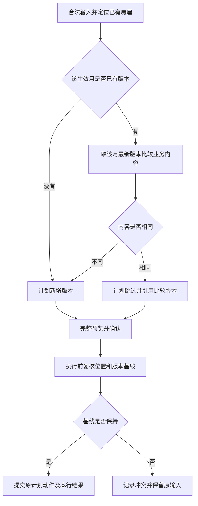

# 房屋计费依据批量导入方案

确认日期：2026-10-28。状态：已完成并冻结。实际交付及验证范围见[实施计划](../plans/20261028-fee-basis-import.md)。

## 目标与范围

为已有房屋批量设置计费依据：同房屋、同生效月的最新依据内容相同则跳过，不同则追加不可变版本。适用于首次设置、批量调价及同月更正。

| 项目 | 本次边界                                                                                         |
| ---- | ------------------------------------------------------------------------------------------------ |
| 入口 | 物业后台导入中心，新增“房屋计费依据”类型 `property_fee_basis_versions`，模板 v1，模式为 `create` |
| 范围 | 当前公司、当前小区；房屋须已存在，每批每套房屋最多一行                                           |
| 写入 | 只创建计费依据版本，不覆盖旧版本，不维护房屋档案，不自动生成账单                                 |
| 复用 | 沿用上传、完整预检、显式确认、逐行事务、任务恢复和错误文件流程                                   |
| 排除 | 不支持一房多期同批导入、任意列映射、自动串联房屋导入或整批回滚                                   |

现行规则依据：[计费依据与账单](../handbook/modules/property/billing.md)、[房屋定位](../handbook/modules/property/housing.md)、[批量导入](../handbook/modules/imports/README.md)、[导入执行与恢复](../handbook/modules/imports/execution.md)。本方案只定义新增类型的差异，不改变已有导入类型与手工新增依据的行为。

## 模板与输入

文件支持 CSV/XLSX。固定表头及顺序如下，版本、摘要、文件安全和保留期沿用[导入数据及文件](../handbook/modules/imports/data.md)。字段范围遵循[依据字段契约](../../openapi/components/billing-schemas.yaml)。

| 顺序 | 列名            | 填写要求                                                                                  |
| ---- | --------------- | ----------------------------------------------------------------------------------------- |
| 1    | 分区            | 无该层级时留空，空白不是通配                                                              |
| 2    | 楼栋            | 必填，现有完整名称                                                                        |
| 3    | 单元            | 房屋直属楼栋时留空，否则填写现有名称                                                      |
| 4    | 房号            | 必填，文本格式，保留前导零、大小写和内部字符                                              |
| 5    | 房屋外部编号    | 可空，只核验完整位置定位的房屋，不用于替代定位或回填                                      |
| 6    | 生效月份        | 必填，合法 `YYYY-MM`，支持历史、当前、未来月份，不默认导入月份                            |
| 7    | 房屋用途        | 必填，填写住宅、商业、办公、其他，分别对应 `residential`、`commercial`、`office`、`other` |
| 8    | 计费面积（㎡）  | 可空；填写时大于零，最多四位小数，上限 `99999999.9999`                                    |
| 9    | 月单价（元/㎡） | 可空；填写时非负，最多两位小数                                                            |
| 10   | 固定月费（元）  | 可空；填写时非负，最多两位小数，`0` 是有效固定金额                                        |
| 11   | 变更原因        | 去首尾空白后必填，最多 1000 字符，超长拒绝，不截断                                        |

- 每行是一份完整依据快照。空白可空值表示未提供该项，不继承旧版本；用途和原因等必填项不设默认值。
- 固定月费非空时优先采用；否则计费面积、月单价均须填写。不禁止固定月费与面积、单价同时填写；已填写字段均须合法。
- 元金额精确转换为整数分，不接受货币符号、不静默舍入；单价、固定金额及计算结果均检查既有金额范围。面积计费使用精确十进制，最终四舍五入到分。
- 先按完整位置匹配，再核验提供的外部编号；找不到、越界、定位异常或编号不符均报错，不创建或改选房屋。确认后固定房屋标识与位置快照，执行前复核。
- 新增、业务跳过及成功结果复用均遵循现有导入复核：检查当前权限、范围、原目标、位置和路径可用性，不增加停用豁免。
- 同文件内识别为同一房屋的全部行报重复，即使生效月不同，或其中一行有其他字段错误；不按文件顺序选取首行或末行。

## 判同与版本规则

先查找该房屋在输入生效月的全部版本，取其中版本号最大的版本作为比较对象；没有该月版本时新增。房屋全局最新版本号仅用于并发检查，不用于选择内容比较对象。

| 内容         | 判定规则                                                                         |
| ------------ | -------------------------------------------------------------------------------- |
| 比较字段     | 房屋用途、计费面积、月单价、固定月费全部相同才视为相同依据                       |
| 数值规范化   | 面积按十进制数值比较，`100` 与 `100.0000` 相同；金额按整数分比较；空值与零不同   |
| 固定金额优先 | 即使固定月费决定计算结果，面积和单价仍参与比较，不能丢弃已提交的资料变化         |
| 不参与字段   | 变更原因、创建人、创建时间、版本号不参与内容判同；仅原因不同则跳过，不修改原原因 |
| 校验顺序     | 完整校验后再判同；不能因预计跳过而豁免原因、金额或其他字段校验                   |
| 历史版本     | 不搜索任意历史版本判重；同月 A→B→A 必须追加第三个版本                            |
| 计算结果     | 月费相同不代表依据相同；面积、单价变化但乘积相同，仍须追加                       |

图示针对尚无成功事实的新执行；已成功逻辑操作先按原具体版本核验并复用，不再次走新写入基线判断。

不同生效月即使内容相同也保留新节点。例如已有“1 月 A”，导入“4 月 A”仍新增。以后补录“3 月 B”，3 月适用 B，4 月恢复 A；不能因为先前省略 4 月节点而改变这一边界。

版本号按整个房屋的追加顺序递增，生效顺序仍按月份判断。新增历史月不覆盖已有后续生效节点。新依据不重算既有账单，也不改变其依据引用；之后新建账单仍按现行规则选择适用版本。

## 预览、确认与结果

复用现有导入独立页面和小区上下文，不新增专用菜单或另一套导入流程。新建入口、类型选择和模板说明使用一致名称。

| 区域     | 必须呈现的内容                                                                                   |
| -------- | ------------------------------------------------------------------------------------------------ |
| 类型说明 | 仅为已有房屋追加依据；相同跳过、不同新增；同批每房一行；已建账单保持原值                         |
| 行预览   | 完整房屋位置、生效月、同月比较版本、旧标准与输入标准、具体字段变化、输入月费试算、计划动作及原因 |
| 生效提示 | 从输入月持续至下一已有生效月之前；无后续节点时持续适用。旧账单及已有未来生效安排保持不变         |
| 汇总     | 完整批次的新增、跳过及问题数量；警告、错误是问题维度，不与计划动作相加                           |
| 执行结果 | 区分新增版本、业务跳过、复用原成功、冲突、策略排除和未知结果，并能识别原目标版本                 |

旧标准与新标准使用安全白名单展示，不暴露内部准备快照或业主资料。无同月版本时明确显示“该月无版本”，不把其他月份的版本冒充同月旧值。生效区间与月费试算均是本次预览事实，不保证后续其他操作不会改变尚未建账的适用情况。

不把各行月费合计展示为新增应收或待缴，本次没有创建账单。历史月份、后续节点及已建账单影响采用信息提示，不另外增加默认排除行的警告策略。

确认策略、预览有效期和取消边界沿用[导入模块](../handbook/modules/imports/README.md)。执行时不能把原计划跳过静默升级为新增，也不能自动更换版本继续写入。

## 并发、幂等与恢复

### 固定准备与操作身份

| 事实                                   | 用途                                                 |
| -------------------------------------- | ---------------------------------------------------- |
| 房屋标识、原位置快照及可选编号核验条件 | 固定目标，防止同文字地址后来指向另一套房屋           |
| 完整规范化输入                         | 保留生效月、计费参数、原因及校验后的业务含义         |
| 同月比较版本及全房屋最新版本号         | 分别固定判同对象和预期写入基线；无历史时最新版本为 0 |
| 计划动作、原跳过目标及预览内容         | 固定确认所依据的事实，失败重跑不能替换               |
| 包含版本基线的操作输入指纹             | 区分原任务重试与新批次主动再次调价                   |

本模板以房屋标识作为同批重复检测的自然键。逻辑操作身份沿用现有公司、模板、操作类型、自然键和输入指纹组合；指纹包含完整规范化输入、目标定位事实及全房屋最新版本基线，不能只对计费内容计算指纹。

指纹只覆盖明确的操作输入与基线，不直接对包含展示文案、预览统计或执行状态的整个准备快照计算，以免派生信息改变操作身份。

例如首次 A 基于 v0 创建 v1，后续 B 基于 v1 创建 v2，再次主动导入 A 基于 v2 创建 v3。恢复首次 A 的任务仍绑定原操作和 v1，不再次追加。不同生效月及原因仍属于操作输入，内容判同不包含原因不代表操作身份可以忽略它。

普通未确认批次重预检可按当前事实重建基线。确认后、失败子批及原任务恢复继续使用固定准备，不能刷新基线绕过冲突。

### 提交与成功复用

- 复用既有资源锁序，依据写入独占房屋；锁后复核权限、启停、位置与全房屋最新版本号。新执行的新增和跳过均检查固定基线，即使变化后内容恰好相同也不静默接受。
- 依据版本、业务审计、逻辑操作成功事实、本批行结果、统计和断点在同一行事务共同提交。单行失败不撤销其他成功行。
- 手工与导入共用依据校验及追加规则，由各自编排负责事务；导入适配不另行提交，不改变手工新增的既有契约。
- 复用已有成功操作时，先核验原具体目标版本、原输入及当前权限、范围和位置条件；不把“原版本仍须全房屋最新”作为成功复用条件，避免后来正常调价使旧成功失真。
- 首次追加的本批行结果为 `created`；业务跳过和跨批复用原成功的本批行结果为 `skipped`。复用只记录本批结果，不追加依据或重复写入创建审计；原终态历史不随其他批次执行改变。

### 冲突与未知结果

| 情况                                   | 处理                                                             |
| -------------------------------------- | ---------------------------------------------------------------- |
| 预览后版本或定位变化                   | 记录业务冲突，不自动刷新版本，不改绑目标；新建批次重新预览确认   |
| 明确可重试的执行失败                   | 沿用失败子批规则，固定原输入、原操作和原基线，再次预检与确认     |
| 提交结果未知                           | 阻断原任务，优先核验持久操作事实及原具体依据版本，不创建替代版本 |
| 找到同月同内容版本，但无原操作成功证据 | 不能据此证明原新增成功，保留未知并继续按原任务核实               |
| 原计划跳过尚未形成结果                 | 只有原目标及固定基线仍可核验时才可确认跳过；否则不能猜测已完成   |
| 恢复时原操作已有成功事实               | 核验后恢复原结果，随后按原任务安全续行；不要求原成功版本仍最新   |

版本冲突不属于普通系统失败重跑。原已确认输入不能重新取最新版本后继续执行；需要采用新基线时必须新建批次。租约接管、失权、取消和到期恢复仍遵循[导入执行机制](../handbook/modules/imports/execution.md)及[证据保留规则](../handbook/modules/imports/data.md)。

## 权限与数据影响

| 能力                                 | 权限与范围                                                                   |
| ------------------------------------ | ---------------------------------------------------------------------------- |
| 类型发现、模板下载、新建及处理批次   | `property.fee_basis.manage`，仅物业后台、本公司小区                          |
| 历史、行值、预览、错误文件生成与下载 | `property.bill.read`，沿用当前依据读取范围                                   |
| 房屋定位                             | 使用账务所需的最小房屋信息，不要求房产读写权限，不返回业主资料               |
| 前端入口                             | 通用新建入口与具体类型操作判断均支持仅有依据维护能力的角色；服务端仍最终授权 |

依据维护包含必要账务读取，不要求账单经办、收款登记或完整房产维护权限。平台后台不开放本类型；原批次读取与处理仍分别执行当前权限复核。

本次沿用现有依据、导入批次、行、逻辑操作和审计实体，不新增数据库表、列或业务状态。准备基线和安全投影使用现有导入数据承载；逻辑操作目标绑定确切依据版本。无历史数据迁移、回填或自动补版本。

沿用[通用导入契约](../../openapi/modules/imports.yaml)和[预览数据结构](../../openapi/components/import-schemas.yaml)，补充新类型、权限及错误语义的说明，不新增专用 HTTP 入口或扩大已有权限。既有三种模板的版本和摘要保持不变；新模板随应用发布，停止新建时仍须保留历史处理所需定义。

## 验收条件

| 验证主题     | 可验证结果                                                                                               |
| ------------ | -------------------------------------------------------------------------------------------------------- |
| 基本写入     | 无依据新增首版；同月相同跳过；任一业务字段变化追加；原因变化不追加且不改旧原因                           |
| 规范化与校验 | 面积数值等价跳过；零与空值区分；固定月费优先且闲置参数仍判同；缺失原因、非法精度、范围或组合拒绝         |
| 版本时间线   | 同月 A→B→A 追加；未来版本不干扰历史月比较；不同月份相同内容保留节点；后续生效安排保持                    |
| 账单隔离     | 已建账单金额与依据引用不变；之后新建账单按目标月选择正确版本                                             |
| 房屋与重复   | 不存在、越界、编号不符、停用路径拒绝；同批同房不同月或含错误行时全部报重复                               |
| 并发与事务   | 预览后版本或定位变化阻止写入；竞争不重复追加；任一提交项失败整行回滚，其他成功行保留                     |
| 幂等与恢复   | 重复确认、重试和接管恢复原结果；后来调价不妨碍原成功核验；未知结果无证据时持续阻断；冲突不能靠子批换基线 |
| 授权与交互   | 仅依据维护角色可完成全流程；仅账务读取角色可读不可处理；前后端、平台与物业、公司和小区范围一致           |
| 展示与兼容   | 预览含差异与试算，汇总不冒充应收；既有模板及导入流程回归；相关手册与契约在交付时同步                     |

执行层级遵循[测试规范](../handbook/standards/testing.md)：规则与转换使用单元验证，原生约束、事务、并发和恢复使用隔离 PostgreSQL 验证；接口契约与后台关键流程分别验收。
