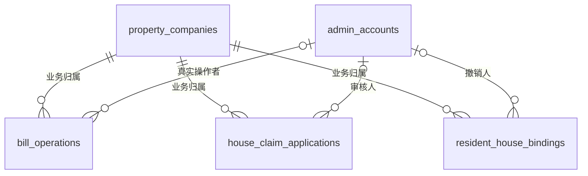
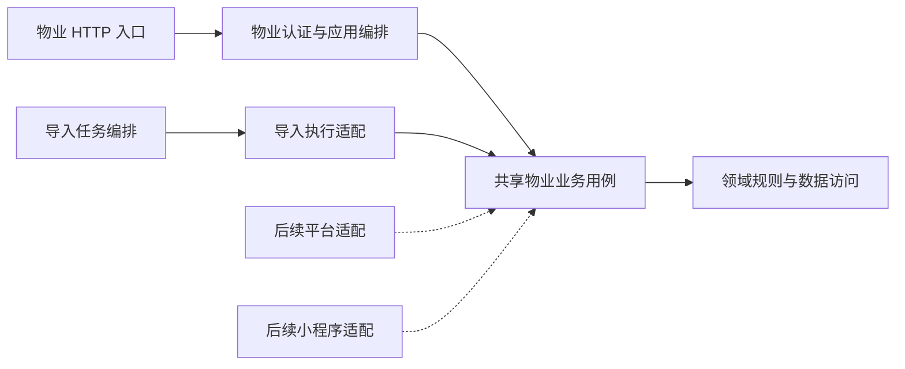

# 物业业务共享能力设计

确认日期：2026-10-29。方案已确认，已完成并冻结；平台后台与物业小程序接入不在本期范围。

## 问题与目标

当前物业业务与物业后台身份、公司上下文和页面请求适配直接耦合。部分业务表还要求操作者与业务属于同一家公司，平台账号没有公司归属，无法直接作为这类业务的操作者。

本期将业务归属与真实操作者分开，提取前后端共享物业业务能力，继续由现有物业后台和导入流程使用，为后续增加端内适配提供条件。

| 范围     | 本期交付                                                         |
| -------- | ---------------------------------------------------------------- |
| 数据库   | 仅将三处操作者复合外键替换为账号单列外键                         |
| 后端     | 共享房产、业主、计费依据、账单与线下账务、认领审核及绑定撤销能力 |
| 后台前端 | 共享对应页面、表单和展示，现有物业入口注入本端能力               |
| 兼容     | 保持现有接口、权限、数据范围、页面开放状态、事务与恢复行为       |

本期不新增平台物业业务接口、权限入口、菜单或公司选择流程；不接入小程序物业身份、绑定流程或业务分包。不新增主要依赖、运行进程、统一主体表、逐公司委托授权表或通用扩展框架。公司接入、账号角色、工作台、支付及导入控制面保持原有职责，不进行整体迁移。

业务规则沿用[物业模块](../handbook/modules/property/README.md)、[身份授权](../handbook/modules/identity/README.md)、[导入模块](../handbook/modules/imports/README.md)和[支付模块](../handbook/modules/payment/README.md)，仅以本方案明确的变更为例外。

## 数据与约束

### 实体关系

| 实体                       | 职责与关联                                                         |
| -------------------------- | ------------------------------------------------------------------ |
| `admin_accounts`           | 保存真实后台账号；平台账号没有公司归属，物业账号固定属于一家公司   |
| `bill_operations`          | 保存公司内的账单操作；人工操作引用真实账号，系统入账允许操作者为空 |
| `house_claim_applications` | 保存公司内的房屋认领申请；审核完成时引用真实审核账号               |
| `resident_house_bindings`  | 保存由认领审批产生的房屋资格；管理员撤销时引用真实账号             |

下图仅展示本次涉及的公司与操作者关系，其他业务归属关系继续保留。

### 三处外键变更

| 表                         | 约束                        | 当前引用                                                                             | 调整后引用                                      |
| -------------------------- | --------------------------- | ------------------------------------------------------------------------------------ | ----------------------------------------------- |
| `bill_operations`          | `fk_bill_operation_actor`   | `(property_company_id, actor_id)` 引用账号的 `(property_company_id, id)`             | `actor_id` 引用 `admin_accounts.id`             |
| `house_claim_applications` | `fk_house_claim_reviewer`   | `(property_company_id, reviewed_by_admin_id)` 引用账号的 `(property_company_id, id)` | `reviewed_by_admin_id` 引用 `admin_accounts.id` |
| `resident_house_bindings`  | `fk_resident_binding_admin` | `(property_company_id, ended_by_admin_id)` 引用账号的 `(property_company_id, id)`    | `ended_by_admin_id` 引用 `admin_accounts.id`    |

涉及字段保持现有属性，不新增或修改列。

| 字段                                            | 类型   | 可空 | 数据库默认值 | 含义及保留约束                                   |
| ----------------------------------------------- | ------ | ---- | ------------ | ------------------------------------------------ |
| `bill_operations.actor_id`                      | `uuid` | 是   | 无           | 真实人工操作者；系统入账为空，继续受操作类型约束 |
| `house_claim_applications.reviewed_by_admin_id` | `uuid` | 是   | 无           | 真实审核人；未审核时为空，继续受申请状态约束     |
| `resident_house_bindings.ended_by_admin_id`     | `uuid` | 是   | 无           | 真实管理员撤销人；继续受绑定状态约束             |
| 上述三表的 `property_company_id`                | `uuid` | 否   | 无           | 业务所属公司，不改为操作者归属公司               |

外键继续验证非空操作者存在，保持不级联删除。除三处外键外，不调整字段、索引、唯一约束、检查约束或触发器。

以下关系不变：

- 平台账号公司为空、物业账号与角色固定属于一家公司的规则，以及账号角色关联的后台和公司约束。
- 公司、小区、房屋、账单、认领申请与绑定之间的归属和来源约束。
- 账单创建人、作废人、计费依据创建人已有的账号单列外键。
- 导入创建者、请求操作者及事件操作者已有的后台类型与账号联合外键。
- 人工账务操作使用 `admin`，可信线上入账使用 `system`；不以访问渠道扩展账务操作者类型。

### 迁移与回退

遵循[数据库规范](../handbook/standards/database.md)，新增一个 Alembic 增量迁移，在事务中替换三处外键。已应用迁移保持不可变，不新增表或字段，不回填或改写业务数据。

恢复旧约束前，检查三表中非空操作者与业务公司是否不一致；存在不兼容记录时拒绝降级。空操作者不视为不兼容，其他状态约束继续生效。没有不兼容记录时允许恢复，不要求全表为空，不删除或冒名改写历史。

## 授权与业务上下文

数据库保证操作者存在，服务端负责动作权限和目标公司授权。解除三处外键不会授予任何账号新的业务权限。

| 来源           | 操作者与目标公司                                       | 本期处理                         |
| -------------- | ------------------------------------------------------ | -------------------------------- |
| 物业后台       | 真实物业账号；目标公司来自认证账号                     | 保持现行权限和本公司范围         |
| 导入任务       | 保留创建者真实身份与固定目标；执行时重新核验当前授权   | 继续使用现有物业导入范围         |
| 后续平台后台   | 真实平台账号公司归属仍为空；目标公司显式指定并单独授权 | 仅保留兼容条件，不提供入口或权限 |
| 后续物业小程序 | 独立微信会话解析选中的物业身份及所属公司               | 身份关联与业务接入另行设计       |

共享业务上下文表达真实操作者、认证来源、目标公司及适用小区、已核验业务能力和审计关联信息。它由服务端构造，不能由请求直接提交、反序列化或覆盖；不包含 Cookie、令牌或会话存储对象。目标公司必须明确，不能以空公司代表跳过范围过滤。

各端适配负责当前身份、权限和目标范围解析。只读请求使用本次 HTTP 认证形成的可信身份与权限快照。写入前在同一事务内按既有锁序保护相关公司、账号及业务资源，等待后重新核验身份状态、会话版本、有效权限和目标范围，能力不得超出本请求原授权。共享用例检查操作所需业务能力、资源归属、状态及版本，必须处于该授权保护范围内，不能将先前生成的权限集合当作永久授权。

异步任务保存稳定的创建身份和目标事实，执行时重建当前授权，不持久化登录凭据或一次性的授权结果。列表、总数、选项、详情及操作结果读取使用一致范围；按标识查详情不绕过公司隔离。

后续平台接入可由平台角色授予物业业务动作，目标公司作为独立范围。若需要逐公司独立授权，须另行设计授权关系；本期不新增该关系或授予平台物业业务权限。

## 后端组织与协作

### 组织变化

用业务模块及职责表达已确认的组织调整，不整体搬迁现有分层。

| 组织单元                           | 调整                       | 职责与边界                                                                 |
| ---------------------------------- | -------------------------- | -------------------------------------------------------------------------- |
| 共享物业业务包 `property_business` | 新增                       | 共享业务上下文、房产查询维护、计费依据、账单动作及恢复、认领审核和绑定撤销 |
| 四类既有共享创建能力               | 迁入共享物业业务包         | 房屋、业主、计费依据、账单创建保持独立职责，继续供手工与导入共用           |
| 物业端应用编排                     | 保留并提取共同业务         | 认证、权限和公司范围解析、协议适配、事务提交回滚及必要异常恢复包装         |
| 导入编排及执行适配                 | 保留，改用迁入后的共享能力 | 批次、预检、租约、行结果、任务进度、文件管理及恢复                         |
| 领域、仓储、请求响应转换           | 保留原有组织               | 共同规则、计算、范围查询、行锁、持久化和白名单转换                         |
| 平台及客户端应用编排               | 本期不接入                 | 不增加物业业务适配或相互调用                                               |

虚线仅表示后续可复用的依赖方向，不属于本期交付。现有运行进程与接口归属保持不变，不增加通用共享层、授权注册器或多端插件体系。

### 用例与事务

共享用例接收普通业务命令，返回业务结果及已加载事实；本端负责 HTTP 请求适配与响应交付。既有纯结果模型与白名单转换可作为共同业务投影复用，账单持久幂等快照沿用原格式，避免重复维护字段；转换自身不查询、授权或产生副作用。共用能力不依赖 HTTP 请求模型、本端会话对象，也不反向调用某个端的应用用例。后续契约出现差异时由所属端适配。精确契约仍以 [OpenAPI](../../openapi/openapi.yaml) 为准。

| 业务           | 共享内容                                                                       |
| -------------- | ------------------------------------------------------------------------------ |
| 房产与业主     | 范围查询、空间及房屋维护、业主维护、位置与启停校验                             |
| 计费依据与账单 | 依据追加、试算、建账、普通修改、线下收款、纠错、撤销、作废、流水及操作结果读取 |
| 认领与绑定     | 查询、审核、批准时创建绑定、撤销绑定、状态与版本校验                           |

事务归属延续[后端架构](../handbook/architecture/backend.md#事务与任务)：普通请求由本端应用编排提交或回滚，共享用例参与事务但不自行提交；导入保持原有行事务及任务事实提交关系。

- 业务记录、账务操作、相关明细及审计保持共同提交；批准申请和创建绑定保持原子性。
- 资源锁序、版本检查、支付占用、重复月账单、重复收款和重复冲正保护保持有效。
- 保持现有幂等键范围、输入摘要、操作者匹配、首次结果快照及唯一冲突恢复口径；提取前的历史请求仍可核验和恢复。
- 未知结果继续绑定原身份、公司、资源、输入和幂等键，不因模块调整或重试另建操作；未查到结果不等于失败。
- 导入的准备快照、成功复用、权限重验、失败重试及租约接管规则保持兼容，不以自然键或相同内容代替原成功证据。

详细规则分别沿用[账单与线下账务](../handbook/modules/property/billing.md)、[认领与绑定](../handbook/modules/property/resident.md)和[导入执行机制](../handbook/modules/imports/execution.md)。

### 审计与操作者展示

审计沿用已有来源、操作者、目标公司、业务目标和元数据，不改表结构。按真实账号来源记录；后续平台操作应使用平台来源并显式记录目标公司，不借用物业身份。本期物业操作继续按物业来源校验公司一致性。

业务记录关联的操作者名称，按已授权业务记录中的账号标识读取，不再要求账号属于目标公司；不能据此开放任意账号查询、平台账号资料或平台管理日志。系统入账与真实人工操作继续明确区分，不能因漏查平台账号而把人工操作显示成系统。

访问渠道等审计信息由服务端生成，并经现有元数据白名单写入；不记录凭据。本期不增加小程序专用审计事实或改变日志读取权限。

## 后台前端组织与运行能力

### 组织变化

| 组织单元                             | 调整               | 职责与边界                                                         |
| ------------------------------------ | ------------------ | ------------------------------------------------------------------ |
| 共享物业业务模块 `property-business` | 新增               | 承接房产、账单、依据、认领与绑定页面，以及关联表单、编辑容器和展示 |
| 业务类型与运行能力                   | 随共享模块维护     | 复用生成契约类型，定义实际使用的 API、动作判断、范围与页面协作能力 |
| 物业业务入口                         | 保留               | 页面开放与权限入口、本端运行能力组装                               |
| 物业请求适配                         | 保留               | 使用物业请求客户端，适配本端接口路径和权限编码                     |
| 应用壳层                             | 保留               | 后台识别、路由菜单、导航、公司及小区上下文、草稿保护               |
| 现有支付、导入、系统共享模块         | 保留               | 不因提取物业页面而合并或迁移                                       |
| 平台业务组与小程序                   | 本期不新增接入模块 | 不增加空适配、菜单、公司选择流程或物业分包                         |

沿用现有共用页面接收本端能力的模式，不创建另一套页面框架。公司和小区资料页面、工作台及端内系统管理继续保留所属职责。

### 页面能力与恢复

| 注入能力       | 用途                                                           |
| -------------- | -------------------------------------------------------------- |
| 业务 API       | 语义明确的查询和命令；接口路径由本端适配，不在共享页面直接拼接 |
| 动作判断       | 将共同业务动作映射到本端实际权限；前端判断不替代服务端授权     |
| 公司及适用小区 | 明确当前范围，缺少必要范围时不发业务查询，不回退为全量         |
| 查询身份       | 区分后台、账号、公司、小区、资源及筛选；写入后刷新受影响查询   |
| 导航与草稿保护 | 继续使用统一返回、详情定位、未保存提示及范围切换机制           |

共享页面不自行读取物业会话、创建物业请求客户端或切换后台。现有物业入口注入本端能力，本期仍访问物业 API，保持菜单、页面开放和公司范围规则。

账单待恢复提交改为描述业务动作、原范围、资源、输入和幂等键，由本端适配生成请求路径；不改变线上请求体、服务端输入摘要和操作结果格式。原请求的未知结果不能跟随新的公司、小区选择改变目标或重新生成键。

切换范围先保护未保存内容，再清理失效选择、分页、表单和查询；身份失效或权限变化继续取消请求并清理缓存，旧响应不能回填新身份或范围。详情直达按服务端核实的资源归属确定上下文。

交互和视觉沿用[后台架构](../handbook/architecture/admin-web.md)及[后台前端规范](../handbook/standards/admin-frontend.md)，不因共享提取改变已确认布局。

## 后续接入条件

| 后续主题   | 可复用内容             | 届时需要另行完成                                                             |
| ---------- | ---------------------- | ---------------------------------------------------------------------------- |
| 平台后台   | 共享后端用例及后台页面 | 平台业务权限、目标公司授权、接口适配、公司小区上下文、菜单路由与审计读取范围 |
| 物业小程序 | 共享后端用例及契约类型 | 物业身份关联、当前身份重验、客户端接口适配和原生小程序页面                   |

物业小程序优先通过现有身份关联机制引用物业账号，使用该账号的公司和岗位权限；微信会话与后台会话独立，不按手机号自动授权，也不复用后台登录凭据。账号、公司或身份关联失效应影响相应业务访问，不连带注销仍有效的其他身份。

绑定和换绑流程、一个物业账号允许关联的微信用户数量、后台密码状态对微信使用的影响、开放操作范围及是否需要独立员工主体，留待小程序方案确认。本期不为这些事项新增表、字段、唯一索引或占位实现；后台 React 页面不作为小程序页面复用。

## 验收条件

| 验证范围       | 可验证结果                                                                                                 |
| -------------- | ---------------------------------------------------------------------------------------------------------- |
| 数据库范围     | 结构差异仅为三处外键；非空操作者必须存在，公司和业务关联、状态、资金及历史保护保持有效                     |
| 迁移与降级     | 空库与带历史数据升级通过；有效业务记录可引用无公司平台账号；不兼容历史阻止降级，兼容历史允许恢复且数据不变 |
| 授权与范围     | 现有物业账号不能切换公司；越权、停用、会话或权限失效继续拒绝；列表、总数、详情和选项一致过滤               |
| 后端复用       | 手工与导入共用创建能力；共同规则仅维护一份；共享用例不依赖端内会话或自行提交事务                           |
| 事务与并发     | 业务、操作及审计共同提交；建账、收款、版本、审核与绑定竞争保持既有正确结果；等待期间失权得到重验           |
| 幂等与恢复     | 同键同输入恢复、同键异输入和异操作者冲突、历史结果核验、导入成功复用及未知结果恢复保持兼容                 |
| 审计与展示     | 人工身份与系统来源准确；名称来自已授权业务关联，不因操作者公司不同漏查，也不扩大账号及日志读取范围         |
| 前端           | 现有物业业务链路、必要范围、直达、缓存清理、草稿保护、冲突和未知结果恢复通过，布局保持一致                 |
| 契约与接入范围 | 现有接口集合、输入输出、安全要求与运行归属保持一致；平台和小程序未增加物业业务入口或可调用能力             |
| 文档           | 实际交付后同步相关手册与契约说明，完成验收后冻结方案并结案计划                                             |

数据库与迁移验收使用隔离 PostgreSQL；业务、契约和页面分别按[测试规范](../handbook/standards/testing.md)与[检查与验证](../handbook/development/verification.md)执行。平台账号引用只验证数据与共享边界，不代表平台端到端接入完成。
