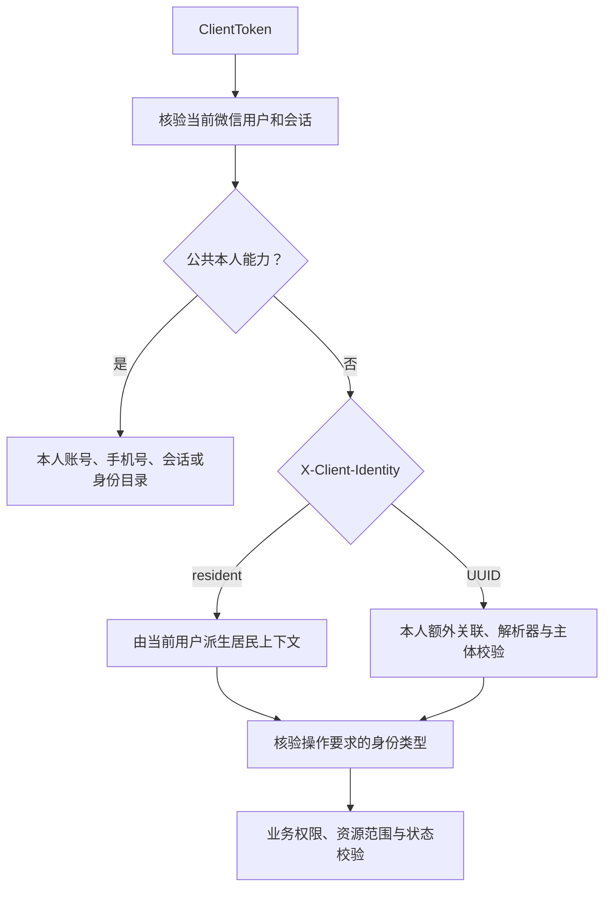

# 客户端 API 接入设计

## 范围与权威来源

本设计维护统一微信登录、本人公共能力、业务身份发现与选择，以及现有居民业务的接入边界。范围见 [统一身份框架](overview.md)，分层与发布迁移见 [技术架构](architecture.md)，通用关联与状态约束见 [数据库设计](database.md)，小程序分流及切换见 [交互设计](interaction.md)，实施依赖与验收见 [开发计划](../../plans/client/foundation.md)。

[OpenAPI 入口及其引用](../../../openapi/openapi.yaml) 是请求响应字段、必填参数、状态码、错误、响应头和运行端的唯一权威来源。本文件解释资源职责，不复制完整 Schema。命名、分页、错误和兼容约定遵循 [API 规范](../../api/conventions.md)。

本期生产仅开放居民业务，不增加物业、商家路由、任意身份绑定、换绑或撤销 HTTP 接口。未来类型通过已确认的授予流程、主体模型和解析器接入；框架本身不代替业务授权，也不根据客户端自报类型、主体、组织或手机号自动创建关联。

## 运行端与认证

小程序唯一入口为 `/api/client`，后端业务路径为 `/v1/<resources>`，运行端为 `client_api`。小程序不代理请求到其他 API 进程，管理后台和 Webhook 不接受客户端令牌。

`POST /v1/client-sessions` 只接受微信 code。服务端使用平台小程序配置解析微信用户，签发新的随机不透明 `ClientToken`；会话不保存可变的当前身份、公司、房屋列表或长期权限快照。居民从当前有效微信用户直接派生，登录不创建、补建或回填居民关联，不恢复额外身份的撤销历史。

客户端通过 `Authorization: Bearer <token>` 发送令牌。公共账号、本人手机号、当前会话及身份目录、详情只校验本人登录，不依赖已选择业务身份。即使公共请求附带业务身份头，也不能改变其本人范围。后台 Cookie、Origin、CSRF 和会话命名空间继续独立。

会话恢复只核验当前客户端登录；退出只撤销当前设备的 client 会话，不撤销额外身份关联或其他设备及后台会话。微信用户停用、用户会话版本变化、令牌过期或撤销按全局认证失败处理；额外身份变化不解释为客户端登录失效。

登录不要求 `Idempotency-Key`。结果未知时重新取得微信 code 登录，不自动重放一次性 code，也不能以 code 失效推断先前数据库未提交。微信 code、OpenID、AppSecret、会话令牌和支付凭证不进入 URL、诊断日志或身份投影。

## 资源与 Schema 索引

| 方法       | 路径                                                     | 职责与契约                                                    |
| ---------- | -------------------------------------------------------- | ------------------------------------------------------------- |
| POST       | `/v1/client-sessions`                                    | 统一微信登录；返回 `201 ClientSession`。                      |
| GET        | `/v1/client-sessions/current`                            | 恢复当前会话；返回 `200 ClientSessionState`，不重复返回令牌。 |
| DELETE     | `/v1/client-sessions/current`                            | 退出当前 client 会话；返回 `204`。                            |
| GET        | `/v1/miniapp-users/me`                                   | 本人账号。                                                    |
| GET / POST | `/v1/miniapp-users/me/phone-bindings`                    | 本人号码查询，或微信验证并绑定号码。                          |
| DELETE     | `/v1/miniapp-users/me/phone-bindings/{phone_binding_id}` | 解绑本人号码，沿用版本检查。                                  |
| GET        | `/v1/miniapp-users/me/identities`                        | 本人可用身份的分页目录；返回 `ClientIdentityPage`。           |
| GET        | `/v1/miniapp-users/me/identities/{identity_id}`          | 只读核验本人指定身份；返回 `ClientIdentity`。                 |

上述操作定义在 [小程序身份模块](../../../openapi/modules/miniapp-identity.yaml)，请求响应见 [小程序 Schema](../../../openapi/components/miniapp-schemas.yaml)。`ClientSession` 与 `ClientSessionState` 表达账号及会话有效期，身份目录独立读取，不因其分页或额外身份状态与根登录耦合。

`ClientIdentityId` 是统一身份选择键：派生居民固定为字符串 `resident`，额外授予身份为通用关联记录 UUID。`ClientIdentity.id`、详情路径参数 `identity_id` 和 [X-Client-Identity 参数](../../../openapi/components/client-parameters.yaml) 使用同一 Schema；不能用微信用户 UUID 或伪造 UUID 表示居民。

`ClientIdentity` 仅包含 `id/type/display_name`，不公开内部 `subject_id`、OpenID、组织、岗位或权限。居民条目的三项值固定为 `resident/resident/居民`；额外身份的 ID 必须为 UUID，类型不能为 `resident`。Schema 精确约束两类对应关系。额外身份的 JSON 字段 `type` 对应关联表的 `identity_type` 稳定码，不是可自由指定的角色；类型格式允许后续已接入业务，不把生产当前只有居民写成通用类型的封闭枚举。

## 身份目录与详情

有效 client 认证始终具有派生居民身份，无房屋绑定或通用关联表为空都不影响其存在；居民没有独立关联撤销状态。服务端合并派生居民条目与当前用户有效的额外关联，额外关联同时要求 `active`、类型已注册开放及主体可用。未注册、未开放或主体不可用的关联不进入目录。已注册解析器的依赖故障按依赖错误返回，不能忽略故障后返回缺项的目录。

合并后的全集先排序、计数再分页：居民固定首位，其余按关联 `created_at,id` 升序排列。记录与 `total` 使用同一查询快照和有效性范围，不能先按各来源分页再拼接，也不能先分页再丢弃无效关联。有效认证下 `total >= 1`，超出范围的页允许空 `items`。客户端按 [交互设计](interaction.md) 完整读取目录分页后再自动选择唯一身份或恢复上次选择；任一页失败时保留重试状态，不能把已加载部分当作完整目录，也不能因上次身份未在第一页而判定其失效。详情可用于选择前重验，不能替代目录完整性检查。

详情参数为 `resident` 时直接由当前有效微信用户派生居民条目，不查询关联表；参数为 UUID 时才在当前用户范围查询额外关联，再核验其当前有效性。成功返回与目录相同的最小投影，不返回权限快照。读取详情不代替后续业务请求的即时授权。

目录、详情和会话恢复均为只读 GET，不补建、激活或重授关联，也不改写服务端当前身份。前端可保存上次选择键，但必须完成目录加载并经过服务端核验；未识别的类型不进入其业务页面，也不回退成居民。

## 业务请求的身份选择

所有现有居民选房、认领、房屋绑定、账单和支付请求必须显式携带 `X-Client-Identity: resident`。该头是本次请求的选择依据，不是第二个凭证；服务端继续要求有效 `ClientToken`。

解析顺序为：根登录、选择键格式、身份有效性、端点要求的类型、具体业务权限和资源范围。`resident` 从当前用户生成居民上下文，不读取身份关联；UUID 按当前用户读取额外关联，并核验状态、已开放解析器及主体。额外身份有效但与居民操作不匹配时，返回 `403 client.identity_mismatch`，不能因为同一微信用户拥有居民能力就隐式转换。

客户端在异步业务操作开始时固定选择键；后续请求不能因界面切换改读新身份并继续提交。服务端不提供改写会话当前身份的切换接口，切换不签发新令牌。额外关联失效后停止原流程；同一微信用户合法取得同类型新关联后，按该业务恢复规则明确重新发起本人原业务核实或恢复，沿用原幂等键及输入，不恢复旧关联。居民流程则由当前用户及原资源授权决定，没有居民关联撤销再重授的过程。

`X-Client-Identity` 不属于原业务命令，不加入手机号、认领或支付的幂等摘要，也不把幂等作用域从微信用户改为关联记录。使用原键恢复仍须通过当前合法身份与本人资源检查；不能利用重放越过额外身份撤销。

## 现有居民操作适配

[房屋认领模块](../../../openapi/modules/house-claims.yaml) 中属于 `client_api` 的操作和 [居民支付模块](../../../openapi/modules/resident-payments.yaml) 的全部操作改用 `ClientToken` 与必填身份头。现有资源 URL、业务请求体、成功状态、投影、幂等键和用户外键继续使用既有定义。

| 操作组   | 路径范围                                                 | 身份之外继续执行的业务校验                     |
| -------- | -------------------------------------------------------- | ---------------------------------------------- |
| 居民选房 | `/v1/claimable-communities` 及空间、房屋子资源           | 只返回认领所需摘要及完整可用路径。             |
| 本人认领 | `/v1/miniapp-users/me/house-claims` 及详情、撤回         | 本人申请、原状态和版本。                       |
| 本人房屋 | `/v1/miniapp-users/me/house-bindings` 及详情、解绑       | 本人绑定、当前状态及版本。                     |
| 房屋账单 | 本人房屋绑定下账单、本人账单及收款明细                   | 当前房屋授权和业务范围。                       |
| 本人支付 | `/v1/miniapp-users/me/payment-orders` 及调起、核实、关闭 | 按各操作区分本人付款关系与必要的当前房屋授权。 |

居民身份不会重新授予已解绑房屋的当前账务权限。本人历史订单、原请求幂等结果及核实、关闭按既有付款人关系访问；新建支付和签发调起参数继续执行各自房屋授权要求，不能给全部支付接口增加统一房屋绑定守卫。原支付恢复使用原键，不因切换、退出、超时或取消请求推断服务端未执行。

物业后台的认领审核和居民绑定管理继续只属于 `property_admin_api`，保留 `AdminSession`、CSRF、权限与公司范围。将居民运行端演进为客户端运行端不开放这些后台操作，也不从后台会话构造 client 上下文。

## 错误、缓存与恢复

所有敏感成功和错误响应声明 `Cache-Control: no-store`，携带一致的 `X-Request-ID`。成功直接返回资源或分页结果，错误使用既有 RFC 9457 Problem Details；具体错误目录见 [错误 Schema](../../../openapi/components/errors.yaml)。

| 场景                                                      | 状态与错误                        | 客户端处理                                                  |
| --------------------------------------------------------- | --------------------------------- | ----------------------------------------------------------- |
| client 凭证缺少、过期、撤销，或微信用户不可用、版本不一致 | `401 auth.unauthenticated`        | 按根登录失效处理；认证失败头为 `WWW-Authenticate: Bearer`。 |
| 业务请求缺少身份头或格式错误                              | `422 VALIDATION_ERROR`            | 修正请求，不自动选择身份。                                  |
| 额外关联不存在或不属于本人                                | `404 resource.not_found`          | 不披露他人归属；不清根登录。                                |
| 本人额外关联撤销、类型未注册开放或主体不可用              | `403 client.identity_unavailable` | 停止对应业务流程，刷新目录并清理失效选择，保留根登录。      |
| 本人有效身份的类型不适用于该操作                          | `403 client.identity_mismatch`    | 停止错误调用并重新确认业务入口；不把有效身份当作撤销。      |
| 具体业务权限不足                                          | 既有 `403` 业务错误               | 按操作展示，不能一律清除业务身份。                          |
| 资源越界或不存在                                          | 既有 `404`                        | 按不可见资源处理，不泄露他人资料。                          |
| 状态、版本或幂等冲突                                      | 既有 `409` 领域错误               | 查询原资源或结果，不自动换键重放写入。                      |
| 明确限流                                                  | `429`                             | 仅按服务端准确返回的 `Retry-After` 等待。                   |
| 网络、依赖或未知异常                                      | 既有 `503/500` 或网络失败         | 保留登录与原写请求恢复信息，按所属业务规则核实。            |

只有根认证失效才能清理 client 会话，只有明确的身份错误才进入对应身份处理；不能把所有 403、404 或网络失败当作退出登录。全局 401 按发起请求时的会话代际处理，旧会话响应不得清掉新登录；同一会话切换业务上下文不屏蔽真实的根认证失效。

有效认证查询 `resident` 详情直接返回本人居民条目，不产生“居民关联不存在”或“居民关联已撤销”错误。微信用户不可用仍返回 401，房屋、账单及订单错误按原业务定义处理。

## 兼容切换与验证

原 `/v1/resident-sessions` 改为客户端会话资源，安全方案由 `ResidentToken` 改为 `ClientToken`，运行端由 `resident_api` 改为 `client_api`，对外前缀改为 `/api/client`。新增必填业务身份头和新的身份选择键属于破坏性契约调整，采用 `0.18.0` 契约修订；不能静默覆盖已有客户端的安全语义。

旧居民令牌不升级或复制为 client 令牌。进程、网关、客户端、配置和运行检查按 [技术架构的迁移与发布](architecture.md#迁移与发布) 边界协同切换，旧入口退出和旧本地支付恢复数据迁移由同一方案维护。新微信登录确认本人后再迁移同环境、同用户的非敏感恢复数据；不迁移旧令牌、权限或敏感草稿。居民不在关联表落库，数据库不创建或回填居民关联。

OpenAPI 静态 Lint、聚合及类型生成验证契约本身；实现阶段还须同步运行入口、Schema、生成错误目录和调用方，并完成逐进程契约比对。不得因实现尚未对齐而移除身份参数或放宽检查，也不得将静态校验声称为运行端已经通过。

验收覆盖公共接口不依赖业务身份、居民固定选择键、身份 ID 与类型对应、额外身份拒绝和类型不匹配的区分、跨用户 UUID 拒绝、目录先合并再分页及总数、原支付恢复与后台范围不变。多身份通过测试应用装配第二解析器验证，不向生产契约发布测试类型或具体物业业务。
