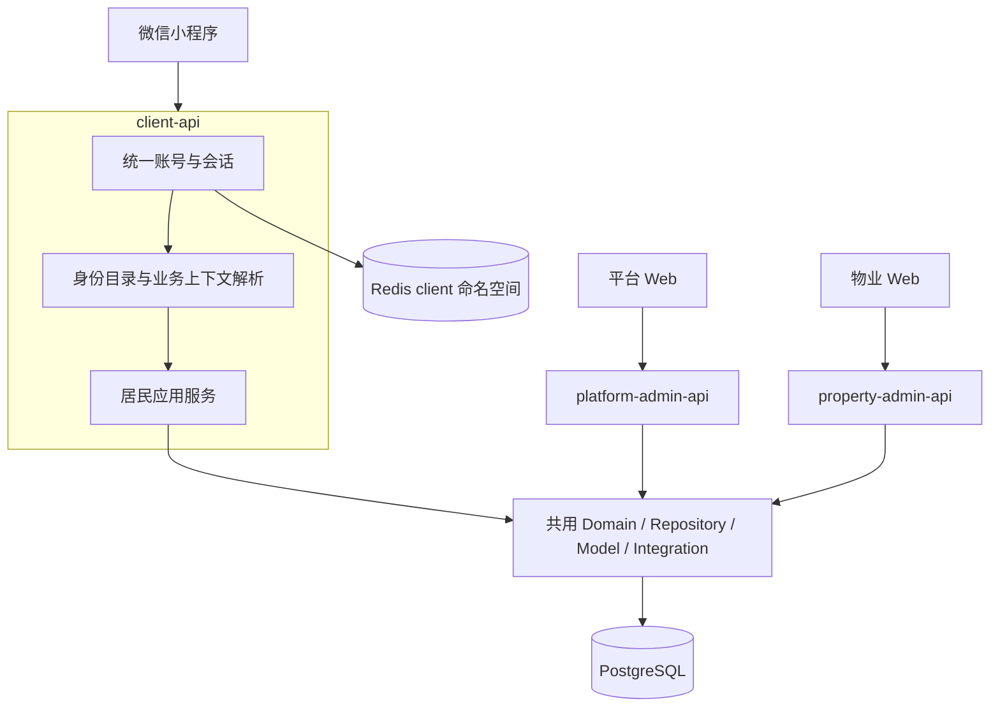

# 客户端统一身份技术架构

## 应用与进程

范围与身份语义见 [框架设计](overview.md)。`resident-api` 演进为 `client-api`，继续使用原客户端进程资源；平台管理、物业管理、Webhook 和 Worker 保持独立运行。小程序入口前缀为 `/api/client`，本地客户端 API 端口保持 8003，不新增认证服务或进程间认证协议。



client 应用直接组合共享代码及 Repository，不向后台 API 转发业务请求，不接受后台 Cookie。Redis 可以复用同一基础设施，但 client 认证会话只由 client 应用创建、读取、续期和撤销。后台不能以 client token 登录，client 也不能以后台会话访问。

## 目录与分层

以下为实现对应职责时使用的目标目录，非预建空模块要求；本期不创建物业或商家业务目录。

```text
backend_app/
├─ runtimes/client_api.py
├─ api/client/
│  ├─ router.py                 本进程显式装配
│  ├─ identity.py               会话、本人账号、手机号、身份目录
│  ├─ dependencies.py           client 认证与身份选择依赖
│  └─ resident/                 现有认领、账单、支付 HTTP 入口
├─ services/client/
│  ├─ identity.py               微信用户与会话、本人能力、目录编排
│  ├─ identities.py             可信关联生命周期与业务上下文编排
│  └─ resident/                 居民用例与事务
├─ services/contracts/client.py 携带会话的应用上下文
├─ core/client_sessions.py      Redis client 会话与认证限流
├─ domain/client/               纯身份选择、注册及解析契约
├─ repositories/miniapp.py      本人账号、手机号、通用关联访问
└─ models/miniapp.py            微信用户与通用额外身份关联
```

请求与响应沿用 `schemas/`，不为目录层重复复制完整实体。已有居民应用模块迁入 client 归属时保留业务职责和公开能力，禁止以迁移为由改写支付状态机或无关后台模块。

应用上下文与领域授权分开：`ClientContext` 表达已认证微信用户、用户版本及会话数据；居民业务上下文只携带当前用户和必要授权事实；额外业务上下文由对应解析器产生。Domain、Repository 不接收 Redis 存储对象或 HTTP 请求；共用授权不依赖后台 `StoredAdminSession`、Cookie 或 CSRF。

## 会话与公共本人能力

沿用现有随机不透明 Bearer token 和摘要索引机制，Redis scope 由 `resident` 切换为 `client`。会话保存用户 ID、认证时的 `miniapp_users.session_version` 及绝对到期时间，不存可变选中身份、完整房屋列表或长期权限快照。每个请求核验用户存在、启用及版本，空闲续期不能越过绝对期限；Redis 丢失允许重新微信登录。

默认空闲 7 天、绝对 30 天，配置统一为 `APP_CLIENT_SESSION_IDLE_SECONDS`、`APP_CLIENT_SESSION_ABSOLUTE_SECONDS`。登录、本人手机号和限流窗口分别使用 `APP_CLIENT_LOGIN_LIMIT`、`APP_CLIENT_PHONE_LIMIT`、`APP_CLIENT_RATE_WINDOW_SECONDS`，键空间改用 client 语义；居民认领提交仍使用 `APP_RESIDENT_CLAIM_LIMIT`。参数迁移保留原默认额度。微信 AppID、AppSecret、访问令牌刷新和手机号兑换继续复用既有 Integration，不重复建立微信客户端。

登录只负责兑换微信身份、创建或更新原用户及签发 client 会话，不创建居民关联，不要求手机号、房屋或额外身份。身份目录独立读取；目录查询失败不应导致已成功建立的登录被前端解释为失败或无身份。

本人手机号写入继续在数据库同事务保存绑定及成功验证记录，保持原幂等和一次性 code 处理，不移入 Redis。当前会话、本人账号、手机号与目录不依赖业务选择头，也不因某项额外身份失效而不可用。

## 身份解析与扩展

身份选择和精确错误以 [API 设计](api.md) 及 OpenAPI 为准。公共认证之后，业务依赖执行以下流程：

1. 校验身份选择键格式；`resident` 直接从微信用户派生。
2. 对 UUID 选择键，先按当前用户及关联 ID 读取，再核验有效状态，不能只按 ID 取行，也不能先过滤状态而把本人已撤销身份误判为不存在。
3. 查找服务端静态注册的业务身份解析器，校验业务主体和实际资格，生成普通业务上下文。
4. 校验所选身份类型适用于该操作，所属应用用例继续校验操作权限、资源范围及状态，写入时在事务保护下再次核验。

一个请求只生成一种业务上下文；额外身份的权限不能并入居民上下文，多个公司或业务主体之间也不合并范围。居民本人订单读取仍与当前房屋授权分开。

注册表是有限、明确的代码配置，生产首期只登记居民解析器。额外解析器接收微信用户与已加载的有效关联，负责描述可公开名称、验证所属业务主体、生成授权上下文，并说明写入时的保护锁。关联生命周期通过可信应用服务调用解析器验证，不依赖任意目标表名、SQL、权限字符串或客户端自报公司。

派生居民与有效额外关联必须先按统一规则归并，再按 API 规定计数分页；不能先分页关联表再追加居民。目录查询由 Repository 组合派生居民行和已注册业务的受限主体查询，以同一 SQL 语句的 `UNION ALL`、固定排序及分页计数保证列表与总数使用同一快照。业务的目录查询扩展须能表达在分页前执行的有效性条件，不能取完一页后由解析器逐条剔除；查询扩展留在数据访问层，不让 Domain 依赖 SQL 或事务对象。首期派生居民源和测试专用额外源验证该机制。

未注册类型不提供可用身份，注册解析器依赖故障返回依赖失败，不能悄悄漏项。身份名称仅使用所属业务允许公开的展示投影，内部主体 ID、凭证及完整授权不直接进入公共目录。

不引入通用规则引擎、插件加载或每业务独立 token。测试解析器仅通过测试构造参数或测试装配注册，不存在 HTTP 启用开关或生产测试数据。

## 事务、撤销与错误边界

通用关联的字段、约束、CAS 和锁序由 [数据库设计](database.md) 维护。可信授予必须验证目标主体；撤销及业务写入使用共同保护对象协调，防止撤销已提交后旧上下文继续写。业务解析器必须遵守统一父资源锁序，不自行提交调用方事务。

client 会话版本只负责微信账号级撤销；关联状态与版本保护额外身份，业务资源及当前权限由所属解析器和用例执行。读取当前关联版本只能证明本次读取的状态，不能替代“登录时版本与当前版本比较”的会话撤销。未来业务若要求授权变化后重新微信认证，须在其接入设计中明确凭证与版本绑定，不改变本框架的基础 token 语义。

只有 client token、微信用户或账号级版本失效使用全局认证失败。额外身份不可用时只清理对应失效上下文；有效身份类型不适用于端点时停止错误调用并核验入口，不把该身份视为撤销。越界业务资源按不存在处理。依赖故障可重试，不自动更换身份或重放未知写请求。

关联变更与对应业务审计必须在调用方事务内提交；审计保存用户、关联、业务主体、动作及请求标识等非敏感标识，不写 OpenID、手机号、code 或 token。本期不假定物业操作者或改写现有后台审计来源；具体审计入口由接入用例确定并纳入其契约。

## 居民适配

居民接口保留原资源路径与响应投影，改由 client 认证及 `resident` 业务上下文授权。本人公共能力从居民身份服务分离；居民房屋、认领、账单与支付按原规则调用共享领域和数据访问。

现有 Repository 对 `ResidentContext` 的技术类型依赖应改为普通用户标识和版本或窄业务授权结构，保留用户状态及锁内复核，不能仅为通过类型检查删除校验。账号用户、房屋绑定、付款人及幂等记录的归属 ID 均保持原值。

支付创建、参数签发、结果刷新和本人历史仍保持各自权限边界，Worker 收款确认不依赖前台登录。身份切换导致的请求取消不能解释为服务端回滚；原幂等键和已知订单继续用于安全恢复。

## 迁移与发布

本次为破坏性客户端契约演进：运行标识 `resident_api` 改为 `client_api`，入口 `/api/resident` 改为 `/api/client`，会话资源及安全方案改为 client 语义，居民业务增加显式身份选择。数据库保留原微信用户及全部居民业务记录，仅增加通用关联表；不回填居民关联。

实施同时调整 `app_factory.py`、运行入口、`no-store` 中间件条件、健康和就绪标识、开发服务定义、Makefile 目标、部署上游、环境配置、契约检查运行端清单及生成目录。端口保持 8003，不能在同一端口并行启动两个运行标识。操作指南和启动命令随对应实现一起更新，不将尚未实现的命令宣称为可运行。

新 client 会话不读取旧 resident scope；旧 token 不静默升级。首期切换面向尚未发布、仅开发联调的版本，直接使用 `/api/client`，不提供旧 API 兼容入口。以后已发布客户端如需过渡，须单独确定兼容范围、期限及退出条件，不能从首期直接切换推导为可删除线上入口；兼容仍应在同一 client 进程保留原居民授权边界，不增加独立认证进程。

小程序按新入口隔离认证存储。旧 token 可以要求重新微信认证，但房屋选择及原支付恢复记录不得连带丢失。旧存储迁移只允许发布配置明确认定同一环境，且新认证确认是原用户；不扫描任意域名或其他用户的数据。迁移幂等、可重复，成功后方可清理对应旧记录；未知支付先查原订单或原键，不换键重付。

发布前验证数据库新增迁移和旧用户数据保留，备份必要恢复数据；应用回滚保留关联和新增业务记录，有身份历史时不得降级删表。显式空表结构降级及保护锁见 [数据库迁移](database.md#redis-与发布迁移)。新旧会话互不兼容时明确重新登录，不把已有支付的恢复交给会话兼容推断。

## 验证

验证分类遵循 [测试规范](../../conventions/testing.md)。单元测试覆盖注册、身份选择、目录归并及前端代际；集成测试覆盖 API、真实数据库约束、用户隔离及事务；真实 Redis 验证 scope、到期和撤销；契约检查逐运行端比较 HTTP 操作与安全方案。

首期必须通过测试装配验证多类型、多主体、关联撤销与写入竞争、未知类型拒绝、解析器故障及生产未暴露测试入口。居民回归覆盖手机号、认领、房屋、账单、本人支付历史、未知支付恢复和 Worker 确认链路。不能将只有一个居民身份的正常登录当作多身份框架验收。
