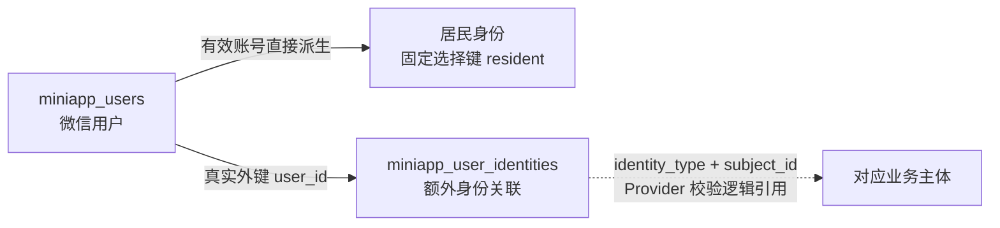
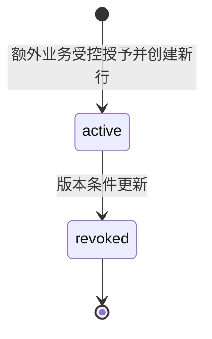

# 客户端身份数据库设计

## 范围与依据

本设计维护微信用户、额外业务身份关联及统一客户端会话的存储边界。架构见 [客户端基础框架](overview.md)，请求选择及错误见 [API 设计](api.md)，页面与恢复行为见 [交互设计](interaction.md)，实施顺序见 [开发计划](../../plans/client/foundation.md)。基础类型、主键、时间、外键和迁移遵循 [数据库规范](../../database/conventions.md)。

本期只接入从有效微信用户派生的居民身份。通用关联表支持额外业务身份，但物业、商家等生产 Provider、主体约束和具体授予流程在相应业务接入时确定；不预建对应角色、邀请或绑定接口。

## 表级概览

| 表                                 | 调整 | 职责                                                                   |
| ---------------------------------- | ---- | ---------------------------------------------------------------------- |
| `miniapp_users`                    | 沿用 | 平台 AppID 下的微信账号、全局启停和客户端会话版本。                    |
| `miniapp_user_identities`          | 新增 | 微信用户与额外业务主体身份的通用授予关联，保存撤销历史；禁止居民记录。 |
| 既有手机号、认领、房屋授权和支付表 | 沿用 | 保留原用户 ID、业务事实和外键，不改为引用身份关联。                    |

居民不记录在关联表中，不回填、不在登录时补建，也不能单独授予、撤销或重授。其可用性由当前微信用户及客户端会话决定，房屋、账单和订单仍分别执行原业务授权。未认领房屋不影响居民身份可用。

对外身份选择键统一为：居民使用固定字符串 `resident`，额外身份使用关联记录 UUID。不能生成居民伪 UUID，也不能将微信用户 ID 当作关联 ID。选择键不替代用户范围，缓存和业务读取仍按当前用户隔离。

## 微信用户 `miniapp_users`

沿用原表和主键，不因统一会话重建用户。该表保留以下完整结构：

| 字段              | PostgreSQL 类型  | 可空 | 默认与约束                                           | 含义                                            |
| ----------------- | ---------------- | ---- | ---------------------------------------------------- | ----------------------------------------------- |
| `id`              | `uuid`           | 否   | 应用生成 UUIDv7；主键                                | 微信用户 ID，创建后固定，原业务外键继续引用。   |
| `wechat_openid`   | `varchar(128)`   | 否   | 无默认；唯一；`C` 排序规则；存储值已去首尾空白且非空 | 平台 AppID 下区分大小写的微信标识，创建后固定。 |
| `enabled`         | `boolean`        | 否   | `true`                                               | 全局账号可用性，停用阻断全部客户端访问。        |
| `session_version` | `integer`        | 否   | `1`；正数                                            | 统一客户端会话撤销版本。                        |
| `last_login_at`   | `timestamptz(6)` | 否   | 应用生成当前 UTC 时间，首次等于创建时间              | 最近成功微信登录时间。                          |
| `created_at`      | `timestamptz(6)` | 否   | 应用生成当前 UTC 时间                                | 原账号创建时间，创建后固定。                    |
| `updated_at`      | `timestamptz(6)` | 否   | 应用生成当前 UTC 时间，首次等于创建时间              | 账号及登录事实最近修改时间。                    |

保留 `uq_miniapp_user_openid`、`ck_miniapp_user_openid` 和 `ck_miniapp_user_version`。本表不保存互斥业务角色、公司、岗位或全局姓名，不按手机号合并用户。

## 额外身份关联 `miniapp_user_identities`

### 字段与必要性

| 字段            | PostgreSQL 类型  | 可空 | 默认值                | 含义与约束                                                                           |
| --------------- | ---------------- | ---- | --------------------- | ------------------------------------------------------------------------------------ |
| `id`            | `uuid`           | 否   | 应用生成 UUIDv7       | 本次授予的稳定 ID；主键，对外为额外身份 UUID 选择键。                                |
| `user_id`       | `uuid`           | 否   | 无                    | 被授予身份的微信用户；外键指向 `miniapp_users.id`，不级联删除。                      |
| `identity_type` | `varchar(32)`    | 否   | 无                    | 显式注册的类型稳定码，`C` 排序规则；格式 `^[a-z][a-z0-9_]{0,31}$`，禁止 `resident`。 |
| `subject_id`    | `uuid`           | 否   | 无                    | 该类型的业务主体 ID，由注册 Provider 解释和校验。                                    |
| `status`        | `varchar(16)`    | 否   | `'active'`            | `active`、`revoked`；支持资格撤销而保留历史。                                        |
| `row_version`   | `bigint`         | 否   | `1`                   | 正整数；用于撤销条件更新和业务写入的版本复核。                                       |
| `revoked_at`    | `timestamptz(6)` | 是   | `NULL`                | 撤销时间；有效时为空，撤销后非空且不早于创建时间。                                   |
| `created_at`    | `timestamptz(6)` | 否   | 应用生成当前 UTC 时间 | 创建及授予时间，创建后固定。                                                         |
| `updated_at`    | `timestamptz(6)` | 否   | 应用生成当前 UTC 时间 | 首次等于 `created_at`，状态变更时更新。                                              |

`id`、`user_id`、`identity_type`、`subject_id` 和 `created_at` 创建后不可修改。表中没有待审批状态，授予即创建，因此 `created_at` 已表达授予时间，不重复设置 `granted_at`。

公司、角色、权限、显示名称和任意业务参数不冗余在本表中。身份摘要及业务范围由 Provider 按当前事实派生；表中不保存微信 code、OpenID、手机号或邀请凭证。授予操作者和来源由实际接入业务的审计记录追溯，不预设仅适用于物业的字段。

### 约束与索引

| 名称                                   | 定义及作用                                                                                        |
| -------------------------------------- | ------------------------------------------------------------------------------------------------- |
| `pk_miniapp_user_identities`           | 主键 `id`。                                                                                       |
| `fk_miniapp_identity_user`             | `user_id → miniapp_users.id`，禁止级联删除。                                                      |
| `ck_miniapp_identity_type`             | `identity_type ~ '^[a-z][a-z0-9_]{0,31}$'`，拒绝空码、空白及非规范形式。                          |
| `ck_miniapp_identity_non_resident`     | `identity_type <> 'resident'`，禁止居民身份入表。                                                 |
| `ck_miniapp_identity_status`           | `(status = 'active' AND revoked_at IS NULL) OR (status = 'revoked' AND revoked_at IS NOT NULL)`。 |
| `ck_miniapp_identity_revoked_time`     | `revoked_at IS NULL OR revoked_at >= created_at`。                                                |
| `ck_miniapp_identity_version`          | `row_version > 0`。                                                                               |
| `uq_miniapp_identity_active`           | 部分唯一索引 `(user_id, identity_type, subject_id) WHERE status = 'active'`。                     |
| `ix_miniapp_identity_user_status_time` | 索引 `(user_id, status, created_at, id)`，支持本人关联目录及历史的范围查询。                      |

同一用户、类型和业务主体最多一条有效关联；历史撤销记录不阻止依法重新授予。数据库不设置 `(identity_type, subject_id)` 全局唯一，一个业务主体可关联几个微信用户由具体业务决定。不可变归属、单向流转和版本递增由受控身份写入口保证，数据库外键、CHECK 和部分唯一索引保护字段合法性及并发创建。

### 主体完整性与 Provider 边界

`subject_id` 是多态逻辑引用，不能同时外键到不同业务表，不将其描述为数据库已保证的目标外键，也不设置居民分支。`user_id` 的真实外键只保证微信用户存在。

生产仅注册居民 Provider，其直接使用认证用户，不查询关联表。额外类型在正式接入后通过显式注册的 Provider 校验目标存在性、可用性及授权事实；业务用例继续执行具体操作权限和资源范围检查。类型码不转换为动态表名、SQL 或导入路径，数据库中出现规范码也不表示能力已开放。未注册、未开放或主体不可用的额外关联不得进入可用目录，不得回退为居民。

未来额外身份的授予须在所属业务事务中核验并按固定锁序锁定目标，禁止创建悬空关联；被关联主体不得物理删除。需要目标表的真实外键或特定数量限制时，在该业务接入设计中落实，不提前建立通用主体表、物业字段或授权 JSON。

## 生命周期、目录与失效

该状态机仅适用于额外身份。撤销按 `id + user_id + status = active + expected row_version` 原子条件更新，写入撤销时间、递增版本并更新修改时间。未命中按当前状态及契约处理，不覆盖并发结果；撤销为终态，不恢复旧行、不转移用户或主体。重授创建新记录和新 UUID，旧页面不能借用新授权。

登录、会话恢复、目录及详情查询都不创建、补建、激活或重授任何关联。首期提供通用关联读取、校验和撤销的内部框架，以测试专用 Provider 验证；不开放任意自助绑定、身份授予或撤销 HTTP 写接口。具体额外业务的授予策略延后。

目录归并一条派生居民项与本人有效、已开放、主体可用的额外关联，先完成有效性筛选与整体排序，再统一计数和分页，不能先分别分页再拼接。居民固定首位，其余按关联 `created_at,id` 升序排列。有效认证下 `total >= 1`，越界页允许空 `items`；空关联表或额外身份全部失效不影响居民项。精确字段及错误以 [API 设计](api.md) 和 OpenAPI 为准。

每次请求重新校验微信用户及会话版本。`resident` 直接派生当前用户的居民上下文，不存在居民关联状态或版本；额外 UUID 按 `id + user_id` 查询，再核验关联、Provider、主体及业务范围。不能以登录时目录或缓存权限代替当前校验。

| 情况                                               | 对外行为                                                                   |
| -------------------------------------------------- | -------------------------------------------------------------------------- |
| 微信用户、client 会话或全局版本无效                | 401，客户端认证失效。                                                      |
| 额外关联不存在或不属于当前用户                     | 404，不泄露归属或主体。                                                    |
| 本人额外关联已撤销、类型未注册或未开放、主体不可用 | 403 `client.identity_unavailable`，只影响该身份，保留居民及其他可用身份。  |
| 当前有效额外身份与端点要求的类型不符               | 403 `client.identity_mismatch`，本次请求不能使用该身份，不撤销身份或会话。 |

额外关联版本用于并发控制，不替代全局 `session_version`；将本次读取版本填入上下文，不等于已保存并校验登录时版本。用户停用及会话撤销不批量改写关联历史，额外关联撤销也不递增全局用户版本。

## 保护锁、事务与异常恢复

居民写事务沿用公司、物业操作者（需要时）、微信用户、手机号绑定（需要时）、小区、空间祖先、房屋及原业务资源顺序。对用户取得 `FOR SHARE` 身份保护锁，等待后刷新并复核启停、会话版本，持有至提交；没有居民关联查询或关联锁。用户启停及全局版本变化对用户使用排他锁，不能以 `FOR KEY SHARE` 代替需要阻止状态更新的共享保护。

额外业务或测试 Provider 涉及关联时，在微信用户之后、手机号及其他下游资源之前加入关联锁：用户 → 关联 → 下游资源。普通业务写入对用户和关联取得共享保护，撤销按相同顺序对关联取得 `FOR UPDATE`，状态或版本变化后旧上下文不得继续提交。同类多条记录按稳定 ID 排序；为定位上级资源可先只读解析不可变归属，锁后重新核验，不能先按客户端 UUID 锁关联再回头等待用户或公司。

关联撤销与业务写入序列化：先完成的写入可以合法提交；撤销先提交时，后续写入须看到失效状态并拒绝。全局用户失效同样通过用户保护锁协调，不追溯撤销已合法提交的操作。应用 Service 决定完整事务的提交或回滚，Repository 和 Provider 不自行提交。

微信外部调用在数据库写事务外完成。用户或登录事实提交后，Redis 会话签发失败不删除已提交用户；取得新微信 code 后复用原 OpenID 账号，居民继续派生，不产生身份行。提交结果未知时读取原用户或所属业务持久结果，不无条件再授予，不恢复撤销行。

异步业务流程固定原身份选择键，失效后停止后续提交；重新取得有效会话后，居民可使用 `resident` 和原幂等键、必要输入核实本人原业务。额外身份重授后的恢复条件由该业务确定，不恢复旧关联。取消请求、切身份或退出不表示写入未执行，不能生成新键重复付款。Worker 对已发生收款的确认、入账、分账及解冻继续按原资金规则处理，不因用户停用或会话失效丢弃资金事实。

## Redis 与发布迁移

统一会话使用独立 `app:session:client` 命名空间，随机不透明 Token 以摘要作为键，主体为 `miniapp_users.id`；数据只保存全局用户会话版本与绝对到期时间，Redis TTL 表达空闲期限，不保存当前身份、组织、权限或身份授权快照。时限及续期见 [客户端基础框架](overview.md)。Redis 丢失允许重新微信登录，不删除 PostgreSQL 业务记录。

新的 Alembic 迁移仅创建空关联表及约束，DDL 在 PostgreSQL 事务内完成，失败整体回滚；不修改历史迁移，不在应用启动时建表。首期不回填居民或额外身份行，新旧有效用户都直接派生居民；已停用用户仍按账号规则阻断。用户、手机号、房屋认领、房屋授权和支付的原 ID、事实及外键全部保留。

旧 `resident` Token 不升级、复制为通用 client Token，用户重新微信认证；旧新地址的同环境、同用户支付恢复数据过渡遵循 [API 设计](api.md) 与 [交互设计](interaction.md)。回退应用时保留新增表、关联和历史业务数据，不以删表、清库或重建订单恢复服务；数据库降级另行制定经确认的数据保留方案。

## 验证要求

- 真实 PostgreSQL 验证用户外键、禁止 `resident`、状态组合、正版本和有效部分唯一；并发同键授予至多一个有效关联，撤销与重授不复活旧 UUID。
- 验证空数据库及既有启用、停用用户的迁移，新表为空，原用户与全部业务 ID、外键和事实不变，迁移失败整体回滚。
- 新用户、重复登录、恢复及各类 GET 不写居民关联；零关联下可解析 `resident`，不能将用户 ID 或伪 UUID 当作居民选择键。
- 居民写入只保护用户及原业务资源，覆盖用户停用、版本变化竞争；测试专用额外 Provider 验证用户、关联共享保护与撤销排他锁的同序竞争及锁后复核。
- 同一会话的派生居民和测试额外身份完成目录、详情、交替请求及范围隔离；未知类型、跨用户 UUID、撤销及不可用主体准确拒绝，生产无测试类型或物业占位能力。
- 目录归并后统一排序、计数及分页，额外身份全部失效仍保留居民，越界空页正常；根会话失效与单个额外上下文失效不混用。
- 覆盖 Redis 丢失、签发失败及提交未知的恢复；保留原用户、原幂等键和真实资金事实，不重建账号、居民关联或重复付款。
