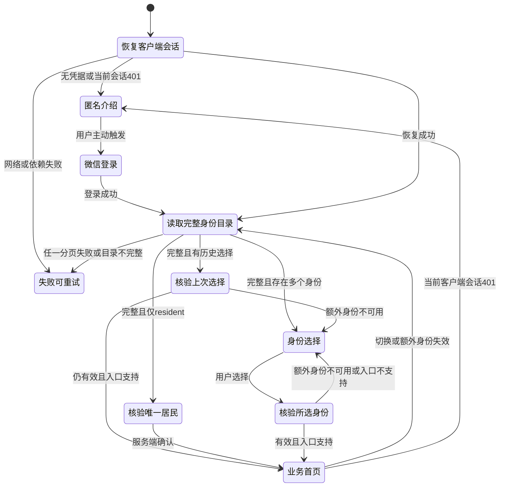
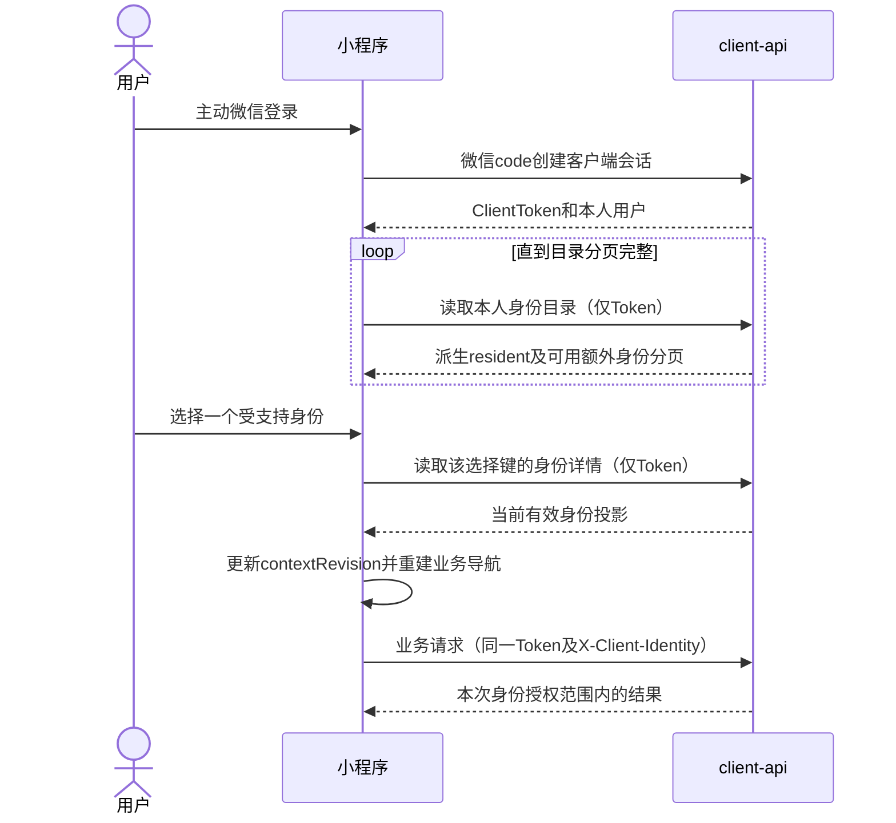

# 客户端登录、身份选择与状态隔离

## 范围与依据

本设计规定统一微信登录、身份目录、选择与切换、失效处理及居民业务适配的交互。运行边界见 [统一客户端架构](overview.md)，微信用户和额外业务关联见 [数据库设计](database.md)，请求字段、分页及错误以 [API 设计](api.md) 和 [OpenAPI](../../../openapi/openapi.yaml) 为准。居民业务内部的视觉和流程沿用 [居民小程序体验设计](../resident/miniapp-experience.md)。

每个客户端登录使用一份统一会话，业务身份切换不更换 Token。居民身份由有效微信用户派生，不写入通用关联表，也不能单独撤销。生产业务入口只注册居民；其他类型的授予、认证、改密、权限及页面在所属业务接入时确定，不改变现有后台规则，不增加物业占位入口或空分包。

## 页面与身份表示

| 页面               | 职责                                                                 |
| ------------------ | -------------------------------------------------------------------- |
| 平台入口           | 恢复客户端会话，读取身份目录并分流；展示加载与可重试失败状态。       |
| 统一登录           | 展示平台介绍并由用户主动触发微信登录，成功后进入身份分流或有效回跳。 |
| 身份选择           | 展示服务端确认的本人身份，核验选择后进入固定注册的业务首页。         |
| 本人手机号         | 按客户端会话管理本人号码，不依赖当前业务身份。                       |
| 居民主页面与业务页 | 保留匿名介绍；受保护操作要求客户端认证及居民上下文。                 |
| 居民个人中心       | 提供居民业务、公共本人能力、身份选择和退出账号入口。                 |

无会话时可浏览居民匿名介绍，不能伪造已登录身份或读取受保护数据。微信登录与手机号授权由用户主动触发；手机号、房屋或额外关联均不是派生居民身份的前提。

公共身份投影使用 `id`、`type`、`display_name`。居民选择键 `id` 固定为字符串 `resident`，`type` 同为 `resident`；额外身份的 `id` 为关联记录 UUID，类型为已受控注册的非居民稳定码。详情路径的 `identity_id` 与业务请求头使用同一选择键，不以用户 UUID 代替居民键。

同一额外类型的不同身份分别展示，不按类型合并。岗位角色和操作权限不作为身份切换项。名称只用于文字展示，类型只匹配客户端固定注册的业务入口；不接受服务端指定任意页面或把类型拼成导航路径。

客户端忽略当前版本不消费的新增响应字段。未来出现未支持的 `type` 时，显示明确的不可进入或更新提示，保留其他受支持身份的选择；不能将未知类型当作居民或动态加载业务代码。

## 登录与恢复

会话恢复区分初始化、未登录、已登录及读取失败。网络、超时或依赖不可用保留登录并提供重试，不能解释为未登录。登录结果、恢复响应与回跳均属于发起时的会话代际；旧请求不得覆盖新登录，包括同一用户刚获得的新 Token。

身份目录将派生的居民项固定在首位，其余有效且已接入的关联按 `created_at,id` 升序归并，统一计算 `total` 和分页。客户端必须完成全部分页读取后才能自动选择唯一身份或恢复上次选择，不能根据首批结果提前进入。任一页失败时保留加载与重试状态，不把已加载部分当作完整目录；记录重复、总数变化或集合不完整时重新读取或提示重试。

有效客户端认证的目录总数至少为一。空通用关联表、全部额外关联不可用或未注册，都不影响居民项。越界页 `items` 为空但 `total > 0` 是正常分页结果，后续页没有居民项也不表示居民身份缺失。完整目录总数为零或缺少应有居民项时，展示完整性异常并提供重试，保留会话及公共本人入口，不注销账号，也不在本地补造居民项。

完整目录只有居民时，读取其详情确认后直接进入居民首页。首次存在多个身份时由用户选择；本人上次选择仍在完整目录中且详情有效时可恢复。新增身份通过选择入口展示，不打断当前业务。上次额外身份不再有效时，重新选择服务端确认的身份；只有居民仍可用时按单身份流程进入。

## 选择、切换与导航

选择后先读取身份详情，确认当前会话、最新选择和固定业务入口仍有效，再提交本地选择、增加上下文代际、取消旧业务活动、清理敏感页面并重建导航栈。并发选择只允许最新一次完成，旧详情响应不能覆盖较新的选择或新会话。

服务端不维护可变的当前身份，也不增加切换写接口。切换不授予权限，额外身份失效后只能切回服务端目录或详情已确认的居民，不以本地固定键绕过认证。

登录回跳必须匹配固定页面及查询参数白名单，并与最终选择的业务类型相符。公共手机号页面只要求客户端会话；居民页面还要求居民上下文。无效、跨身份、未知、登录循环或未开放的目标返回身份分流，不接受服务端或 URL 指定任意页面。

居民主页面继续使用“首页、缴费、房屋、我的”导航，配置归居民业务。切换身份替换原业务导航栈，不能通过返回键重新露出已清理身份的表单和列表。通用壳与身份选择不静态导入业务分包代码，详细职责见 [小程序架构](../../architecture/miniapp.md#前端边界)。

## 请求与页面状态隔离

公共账号、手机号、会话、身份目录及详情只使用 ClientToken，不携带当前业务身份。居民业务请求必须显式携带 `X-Client-Identity: resident`；额外业务使用开始操作时选定的关联 UUID。服务端按端点要求校验选择键及业务类型，缺头或选错类型不能自动回退为居民。

| 标识              | 变化条件                                       | 保护范围                                   |
| ----------------- | ---------------------------------------------- | ------------------------------------------ |
| `sessionRevision` | 登录凭据替换、退出、用户变化或客户端认证失效。 | 登录、恢复、退出和所有请求不能影响新会话。 |
| `contextRevision` | 身份切换、当前额外身份失效或业务上下文清理。   | 旧身份业务结果不能回填新工作场景。         |
| 页面生命周期标识  | 页面隐藏、卸载或新读取。                       | 不可见页面和旧查询结果不能更新当前页面。   |

请求在启动时捕获用户及上述标识。公共本人请求只检查会话及页面生命周期，不因业务切换而失效；业务请求还固定选择键和上下文代际。多步异步业务不能中途读取新选择并继续写入。

响应先检查是否属于同一会话。同会话客户端 401 即使来自切换前的业务请求，也清理该会话；旧会话 401 不得清除新登录。处理全局认证失效后，再判断业务上下文及页面是否仍有效，迟到业务结果不得回填。

| 结果或事件                        | 处理                                                           |
| --------------------------------- | -------------------------------------------------------------- |
| 当前客户端会话401                 | 清理该会话令牌、请求和敏感状态，回到登录门槛。                 |
| `403 client.identity_unavailable` | 仅清理仍与请求对应的额外身份上下文并刷新目录，保留客户端会话。 |
| `403 client.identity_mismatch`    | 停止错误调用并重新核验业务入口，不将有效身份视为已撤销。       |
| 普通业务403                       | 展示操作无权限，不清空账号或全部身份。                         |
| 额外身份详情404                   | 该选择不可用，选择服务端确认的其他身份，不注销账号。           |
| 业务状态或版本冲突                | 刷新原资源，不自动重复写入。                                   |
| 网络失败或未知写结果              | 读取可重试，写入按原业务幂等规则核实或恢复。                   |

切换或额外身份失效时停止原业务轮询、取消所属请求、清理敏感列表与认领草稿，并卸载原导航。取消请求不代表服务端取消写入，不能自动重放未知写请求。居民没有可单独撤销的关联；微信用户停用或会话失效按全局认证规则处理，房屋授权变化继续按居民业务规则执行。

## 持久状态与支付恢复

持久状态按 API 环境、微信用户及所属业务隔离。仅保存客户端令牌及所属用户、上次身份选择键、居民选房 ID，以及支付设计允许的原幂等键、必要非敏感输入和已知订单 ID。固定居民键不代替用户隔离。姓名、手机号表单、微信 code、支付调起参数、签名和预支付凭证不持久化、不进入 URL 或日志。

| 事件                          | 清理与恢复                                                                                       |
| ----------------------------- | ------------------------------------------------------------------------------------------------ |
| 身份切换                      | 清理旧业务活动和敏感页面，保留同用户的原支付恢复依据。                                           |
| 当前会话失效或同用户Token替换 | 清理认证及敏感内存，确认同一用户重新登录后继续恢复原订单。                                       |
| 主动退出                      | 撤销本设备 client 会话，清理令牌、当前选择、敏感内存及导航；按用户隔离保留原支付非敏感恢复依据。 |
| 换用户                        | 清理旧用户活动并隔离其存储，新用户不能读取或重放旧用户数据。                                     |

身份切换不能调用退出账号的清理路径；主动退出和同用户会话重建也不能无差别删除原支付恢复依据。只有重新认证并确认同一用户后才能读取其原依据，换用户不导入或删除其他用户的原依据。原订单核实始终沿用原幂等键和输入，不因身份或 Token 变化换键付款。页面隐藏、切换或卸载后停止结果查询和 SDK 后续页面动作。

旧 API 地址参与既有存储键。迁移按 [客户端发布与迁移设计](architecture.md#迁移与发布) 执行：旧居民 Token 不自动升级为客户端认证，先完成新的微信登录并由服务端确认用户；只有版本内明确映射到同一部署环境、同一用户的数据才可迁移。不能按 URL 相似、同域名、端口或用户输入猜测环境。

只迁移非敏感房屋选择与原支付恢复信息，不迁移旧 Token、权限或敏感草稿。先校验并确认新副本写入成功，再清理相应旧键；失败保留原依据并提示重试或核实原单。跨用户、跨环境数据不合并、不重放。

## 验证

验证遵循 [测试规范](../../conventions/testing.md)，覆盖：

- 匿名介绍、主动登录、恢复失败重试、派生居民固定键、无关联或房屋也可进入居民业务。
- 完整目录读取、分页合并与总数、越界空页、分页失败、完整性异常；单身份直达、多身份首次选择及上次选择详情核验。
- 新增响应字段兼容、未知类型明确不可进入、固定导航与回跳白名单，敏感草稿和旧导航清理。
- 同 Token 交替业务请求、公共手机号不绑定身份、会话与上下文代际、旧登录恢复和退出响应隔离、同会话迟到401与身份级403。
- 身份切换及同用户重新登录保留原支付恢复；未知写入不自动重放，同环境同用户存储迁移及失败后原键保留。
- 测试装配第二解析器和测试页面验证额外类型、多身份、撤销及隔离；测试注册不进入生产路由、页面、类型白名单或契约，不创建生产假物业入口。
- 主分包边界、页面注册、类型、Lint和构建检查，以及体验版真机微信登录和手机号授权；替身不能替代真实微信协议验证。
