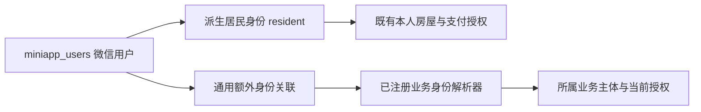
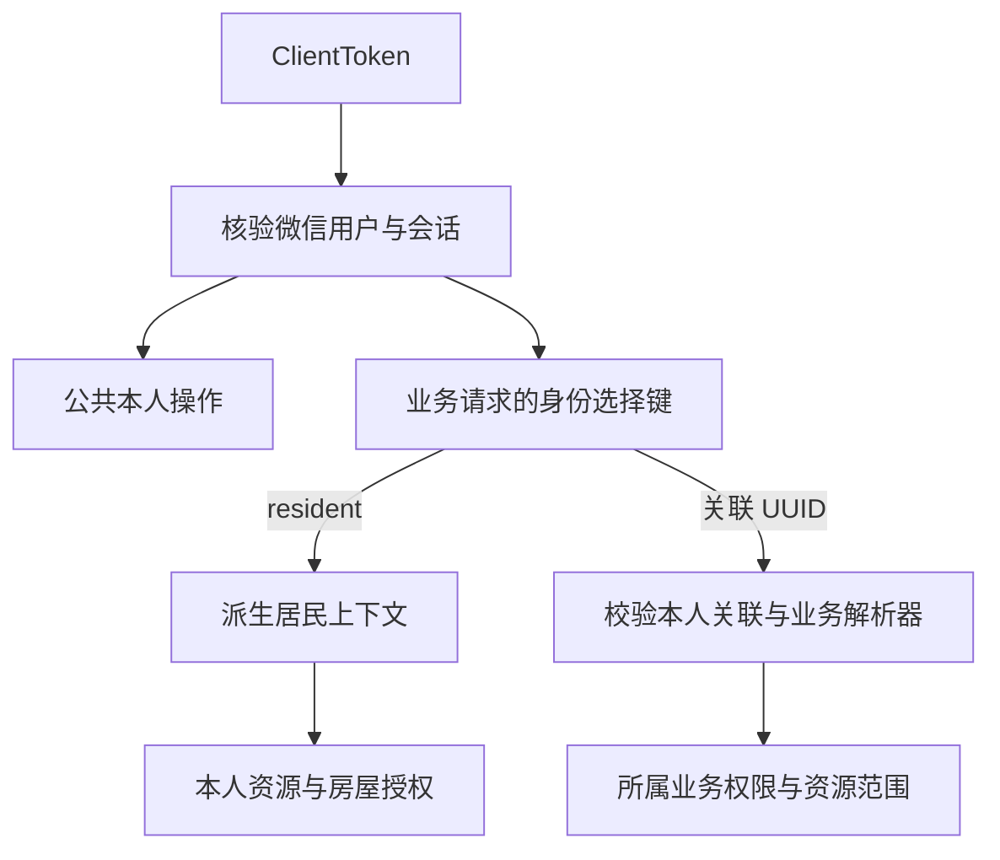

# 客户端统一身份框架设计

## 范围与依据

本设计将居民运行入口演进为统一 `client-api`，提供统一微信登录、本人账号能力、多业务身份识别与切换框架，并适配现有居民认领、房屋、账单和支付业务。小程序只访问这一客户端进程；Web 后台继续使用各自的认证与会话。

首期生产只开放居民业务。物业、商家等业务的身份授予、认证策略、管理接口、页面和业务接口由相应接入设计确定，不随框架建设开放。通用关联表不得包含物业专属字段，居民身份不写入关联表。

| 文档                                         | 职责                                             |
| -------------------------------------------- | ------------------------------------------------ |
| 本篇                                         | 范围、身份语义、框架边界及居民适配原则           |
| [技术架构](architecture.md)                  | 进程、分层、身份解析与扩展、事务、配置和迁移     |
| [数据库设计](database.md)                    | 微信主体、额外身份关联、字段、约束、锁与数据迁移 |
| [API 设计](api.md)                           | 公共与居民操作边界、身份选择、错误和兼容策略     |
| [流程与交互](interaction.md)                 | 登录、目录恢复、切换、导航和异常恢复             |
| [实施计划](../../plans/client/foundation.md) | 分阶段任务、依赖及验收条件                       |

系统级约定见 [系统架构](../../architecture/overview.md)、[后端业务边界](../../architecture/backend-services.md) 和 [小程序架构](../../architecture/miniapp.md)。精确请求、响应、安全方案及运行归属以 [OpenAPI](../../../openapi/openapi.yaml) 为唯一权威来源；各设计通过引用复用，不维护另一份完整契约。

## 用户、身份与权限

微信用户是登录主体，由现有 `miniapp_users` 和平台 AppID 下的 OpenID 唯一标识。保留该表及既有 ID，不按手机号合并用户，不增加互斥角色或单一公司字段。

业务身份表示用户进入某个业务场景的资格，不等于后台岗位角色，也不直接表达资源权限。身份目录由两类来源归并：

- **居民身份**：正常微信用户直接派生，选择键固定为 `resident`，无关联记录；没有已绑定房屋也可认领房屋。
- **额外业务身份**：由 `miniapp_user_identities` 中属于本人的有效关联及对应已注册业务解析器共同确定；选择键为关联行 UUID，业务主体、范围和权限由业务解析器核验。

居民不创建、补建或回填身份关联，也不以关联表是否有记录作为可登录、可选身份或可认领房屋的条件。额外关联不能通过 `identity_type=resident` 冒充居民。

身份目录表达当前可用的业务入口。身份类型由服务端代码注册；未注册类型、失效关联或不可用业务主体不产生有效身份。解析依赖故障不能伪装成“没有身份”。返回目录对派生居民及有效额外身份统一排序、计数和分页；启用用户至少有居民身份，不能只统计关联表。

## 认证与业务授权

一次客户端登录建立一个 client 会话，允许多设备分别登录；业务间切换不换 token、不创建子会话，不与其他进程交换或共享认证会话。会话只确认当前微信用户，不保存可变的“当前角色”“当前公司”或长期权限并集。

公共本人能力仅依赖 client 会话，包括当前会话、本人账号、手机号和身份目录。业务请求显式选择身份，服务端按本次请求解析对应业务上下文；身份选择本身不产生权限。

client 会话失效撤销整个客户端登录；某项额外身份失效只影响该身份。权限必须由当前业务事实计算，不能因为客户端记住了上次身份或目录曾经返回该身份而持续放行。涉及写入时在所属业务事务内复核保护条件，防止检查后撤销仍继续提交。

物业 Web 的密码、强制改密、账号角色和会话版本规则继续由现有后台设计维护。未来物业身份接入须另行明确这些规则如何适用于微信认证，本框架不修改其语义，也不伪造后台 Cookie、CSRF 或账号会话。

## 首期交付边界

首期框架包含通用关联模型、有限的身份类型注册与解析、身份目录、按请求选择与授权、关联生命周期的内部保护能力，以及小程序身份状态与切换机制。关联授予和撤销仅供可信应用用例组合调用；不提供客户端自助指定业务主体、任意类型注册或直接写关联表的 HTTP 接口。

居民作为真实生产接入，实现从统一登录到认领、房屋、账单及支付的完整适配。额外身份、多主体及失效竞争通过测试装配的解析器与页面注册验证；测试类型不进入生产注册表、迁移初始数据或开发业务种子。

后续业务接入需提供：业务主体与有效性规则、关联授予和撤销流程、所需锁和并发规则、可公开的身份名称、授权上下文、客户端业务操作与导航注册、审计归属及相应契约和测试。框架不通过动态表名、任意权限字符串、运行时插件下载或客户端 JSON 来推导这些规则。

## 居民业务适配与恢复

居民房屋认领、手机号绑定、房屋授权及付款人身份仍使用原 `miniapp_users.id`。既有业主匹配、人工审批、解绑、账单可见范围、幂等键、订单和资金状态机保持原业务语义，见 [居民接入设计](../resident/identity-and-house-claims.md) 和 [账单支付设计](../payment/bill-payments.md)。

切换业务身份只停止原业务的页面活动、轮询和后续操作，不撤销已发出的写入，也不丢弃同用户原支付的非敏感恢复记录。支付结果继续以服务端入账事实为准，Worker 不因当前前台身份或会话变化拒绝已发生收款。

旧居民 token 不自动转换为具有额外身份能力的 client token。入口与本地存储迁移必须区分认证凭证和业务恢复记录；同环境、经服务端确认的同一微信用户可以恢复原居民业务数据，不能跨用户、跨环境迁移。具体机制见 [技术架构](architecture.md#迁移与发布) 和 [流程与交互](interaction.md)。

## 验收边界

- 生产只有派生居民时，统一登录和全部居民流程正常，关联表可以为空。
- 以隔离测试装配验证多个额外身份、同类型不同主体、切换、错误类型及越权拒绝，不依赖生产物业接入。
- 覆盖 client 全局失效、关联撤销、业务失权、跨用户访问及写入竞争；故障不解释为空目录或未登录。
- 身份切换、会话替换、退出与用户变化分别清理对应状态，旧响应、草稿和缓存不能回填。
- 原支付幂等及未知结果恢复不因切换或入口迁移丢失；真实微信授权与真实扣款仍按所属设计单独验收。
