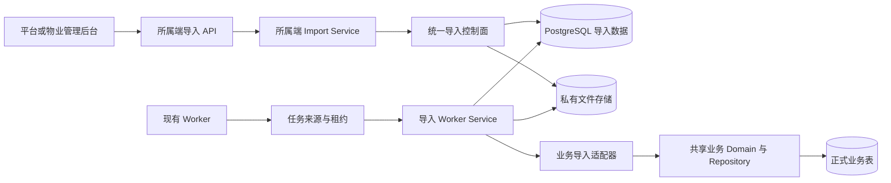
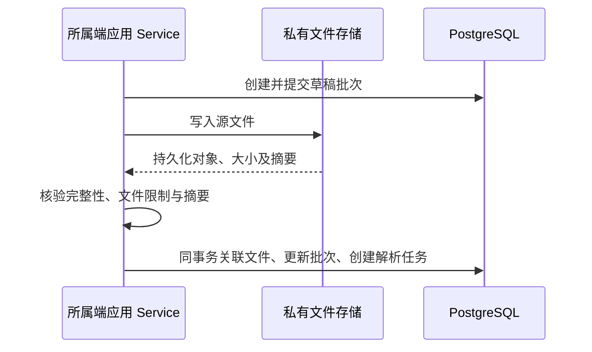

# 统一批量导入技术架构设计

## 范围与依据

统一导入采用“公共控制面 + 窄业务适配器”，接入现有后端包、平台和物业 API、管理后台及 Worker。公共能力处理批次、文件、解析、预检、预览确认、执行调度、恢复及历史；业务适配器转换文件输入、调用共享业务能力，并转换其校验、自然键、重复判断与创建结果。

通用框架的独立交付范围不包含具体业务。真实业务接入、相应共享能力提取、业务权限和入口按已确认的业务设计维护，见 [账单批量导入](../property/bill-imports.md) 和 [房屋批量导入](../property/house-imports.md)。没有已注册生产类型时保持空目录行为；测试定义及适配器只通过测试装配注入，不发布生产测试类型。

本文描述模块职责及接入方式，目录树不作为能力完成情况。OpenAPI 文件按下述组织维护；设计或契约落盘不授权代码、迁移或部署实施。

- 产品边界、业务规则和权限要求见 [统一批量导入设计](overview.md)。
- 数据事实、字段、状态、约束及 checkpoint 结构见 [导入数据设计](database.md)。
- 页面行为见 [页面交互设计](interaction.md)，资源与操作设计见 [API 设计](api.md)。
- 整体进程和依赖方向沿用 [系统架构](../../architecture/overview.md)、[后端业务边界](../../architecture/backend-services.md) 和 [代码组织](../../architecture/code-organization.md)。
- 前端、部署及验证分别遵循 [管理后台前端设计](../../architecture/admin-web.md)、[部署约定](../../architecture/deployment.md) 和 [测试规范](../../conventions/testing.md)。

完整导入契约由 [OpenAPI 入口](../../../openapi/openapi.yaml) 引用 [导入模块](../../../openapi/modules/imports.yaml) 和共享组件，按 [API 规范](../../api/conventions.md) 维护。权限目录与动作归属遵循 [后台授权设计](../admin/authorization.md)，在实施时先同步具体权限码及接口声明，再实现 Schema 和路由；本文不表示相关契约及代码已经调整。在实现阶段登记领域错误并生成错误目录，提交前通过各运行端一致性检查，不得忽略未实现接口。通用框架的依赖与验收见 [实施计划](../../plans/imports/implementation.md)。

## 运行边界与调用关系

保留 `backend_app` 一个 Python 包和现有五个运行进程。平台、物业 API 分别接入导入入口；解析、预检、执行、错误文件生成由现有 Worker 的持久任务执行，清理由该 Worker 的周期扫描执行。导入不新增独立服务、独立 Worker 进程或消息中间件。使用 PostgreSQL 持久任务；Redis 继续用于既有会话，不承担导入队列。



图中的正式业务写入通过已注册适配器进入对应共享业务能力，具体允许的类型和权限由业务接入设计限定。

平台 API 使用 `/api/platform` 外部前缀，物业 API 使用 `/api/property`，后端契约路径继续使用 `/v1/import-...`。OpenAPI 不在业务路径中重复写入后台前缀，运行端通过 `x-runtimes` 声明，操作权限按 `x-permissions` 表达。

上传、解析和预检只持久化导入暂存数据、问题、计划与任务。正式业务数据只能由用户确认后的执行任务写入。控制面不能动态拼接业务表名或依据配置绕过既有业务不变量。

## 分层与职责

| 位置                  | 职责与边界                                                                                                                                          |
| --------------------- | --------------------------------------------------------------------------------------------------------------------------------------------------- |
| API                   | 处理 HTTP 参数、multipart 接收、身份依赖、CSRF、状态码和 Problem Details，调用所属端应用 Service。不解析 CSV/XLSX，不执行 SQL、提交事务或写业务表。 |
| 平台 Import Service   | 校验平台身份、操作权限、可见范围、目标公司与小区，确定平台审计归属。                                                                                |
| 物业 Import Service   | 从服务端会话取得公司，校验小区归属、物业权限和公司范围，不信任客户端提供的公司身份。                                                                |
| 公共控制面            | 接收所属端校验后的普通上下文，完成批次创建、版本固定、文件关联、阶段任务安排、预览指纹校验、请求幂等、取消和失败行重跑。                            |
| Import Domain         | 维护领域类型、状态规则、基础校验、指纹、操作键和 checkpoint 结构规则，不依赖 HTTP Schema、应用 Service 或会话存储。                                 |
| Import Worker Service | 编排阶段任务，执行权限及范围复核、资源锁、分块事务、checkpoint 校验、批次结果和恢复安排。                                                           |
| 业务适配器            | 转换文件字段，调用共享业务的准备、校验、自然键、重复判断与创建能力，将结果映射为导入问题、操作计划和行结果。                                        |
| Repository / Model    | 执行 SQL、范围过滤、分页、行锁、持久化、任务领取和 checkpoint 存储，配合数据库约束。不决定用户授权、业务状态、错误码或业务重复策略。                |
| Schema / Mapper       | 定义请求响应结构，对已读取数据作白名单转换；不查询、授权、触发懒加载或写入。                                                                        |
| 文件 Integration      | 封装存储读写、摘要核验、文件协议和格式解析，输出普通数据及受控异常；不决定正式业务写入、业务重试或授权。                                            |
| Runner / Handler      | Runner 负责通用领取、租约、心跳和停止，Handler 按任务类型分发至 Worker Service，不复制导入或支付状态机。                                            |

两个后台独立组装身份、权限、范围解析器和应用 Service。公共路由工厂固定绑定调用端，不接受由请求切换后台或启用另一端管理能力的开关。公共控制面不重新解释登录身份，也不代替各端执行授权。

导入使用目标业务查看、维护或经办权限，不再注册通用导入动作权限。固定动作归属见 [导入授权](../admin/authorization.md#导入授权)：读取及错误文件生成、下载采用目标业务查看，创建至原任务恢复的处理流程采用目标业务维护或经办。各端只开放本端已注册且当前账号可操作的类型，新建与历史入口分别遵循上述规则，平台导入入口不能取得物业端业务写入能力。首期仅启用明确的公司、小区范围；房屋、账期组合和 `resource_set` 的有类型结构、集合上限与授权规则随具体业务接入定义。

公共控制面是导入流程复用位置，不是能够任意调用各端私有方法的通用 Service。事务提交由调用用例的应用 Service 或 Worker Service 明确负责，Domain、Repository、纯 Mapper 和业务适配器不自行提交。

Worker 不调用依赖 HTTP 身份上下文的 `property_admin` 应用 Service，也不伪造前台会话。如果原业务创建逻辑仅存在于该 Service，应在具体业务接入时提取必要的共享 Domain 或普通写入命令，由后台 Service 和导入适配器共同调用；原业务的锁序、唯一性、多表原子性和审计规则仍生效。

共享业务能力只接受普通命令、上下文及结果，不依赖导入包、模型、状态或错误码，也不依赖 HTTP Schema。业务校验和处理写入只维护一份，包含预检与执行共同使用的规则、内容一致性和业务操作记录；适配器不能复制关联 SQL、判重或入账逻辑。公共房屋定位归房屋领域，不放入导入目录，见 [完整位置定位与复核](../property/housing.md#房屋完整位置定位与复核)。

## 后端目录设计

下列树为拟新增模块及必要修改位置。未列出的现有模块保持原归属；只在实现对应能力且存在实际职责时创建文件。表级拆分用于表达建议归属，不把“一张表一个文件”作为强制规则。迁移名、版本化配置文件名和类型目录均为示意。

```text
services/backend/
├── src/backend_app/
│   ├── api/
│   │   ├── imports.py                  公共路由工厂与 HTTP 处理
│   │   ├── platform_admin/
│   │   │   └── router.py               显式挂载平台导入路由
│   │   └── property_admin/
│   │       └── router.py               显式挂载物业导入路由
│   ├── domain/
│   │   └── imports/
│   │       ├── __init__.py
│   │       ├── types.py                ImportScope、ImportContext、ImportPlan
│   │       ├── lifecycle.py            批次及任务状态规则
│   │       ├── validation.py           字段、格式、枚举及问题级别规则
│   │       ├── registry.py             注册表协议与领域模型
│   │       ├── fingerprints.py         配置摘要与预览指纹
│   │       ├── checkpoint.py           阶段结构与安全游标规则
│   │       ├── operation_keys.py       稳定操作键的生成和校验
│   │       └── errors.py               领域错误与稳定错误码
│   ├── import_definitions/
│   │   ├── __init__.py
│   │   └── catalog.py                  版本清单及 adapter_key 映射
│   ├── integrations/
│   │   └── import_files/
│   │       ├── __init__.py
│   │       ├── storage.py              私有文件存储抽象
│   │       ├── csv_parser.py           流式 CSV 及安全记录边界
│   │       ├── xlsx_parser.py          工作表与行读取
│   │       ├── checksums.py            文件摘要计算
│   │       └── errors.py               文件异常的安全转换
│   ├── models/
│   │   └── imports/
│   │       ├── __init__.py
│   │       ├── batch.py
│   │       ├── artifact.py
│   │       ├── operation.py
│   │       ├── row.py
│   │       ├── issue.py
│   │       ├── task.py
│   │       ├── request.py              导入请求幂等记录
│   │       └── event.py
│   ├── repositories/
│   │   └── imports/
│   │       ├── __init__.py
│   │       ├── batches.py
│   │       ├── artifacts.py
│   │       ├── operations.py
│   │       ├── rows.py
│   │       ├── issues.py
│   │       ├── tasks.py
│   │       ├── requests.py
│   │       └── events.py
│   ├── schemas/
│   │   ├── imports.py                  请求、响应、分页与操作参数
│   │   └── mappers/
│   │       └── imports.py              已加载数据的纯响应转换
│   ├── services/
│   │   ├── imports/
│   │   │   ├── __init__.py
│   │   │   ├── control_plane.py        创建、确认、取消、重预检、恢复及重跑
│   │   │   ├── catalog.py              可用导入类型和配置版本
│   │   │   ├── artifacts.py            上传、下载、对象元数据
│   │   │   ├── queries.py              批次、行、问题、事件查询
│   │   │   └── pipeline.py             安排阶段任务、推进流程
│   │   ├── platform_admin/
│   │   │   └── imports.py              平台授权及范围解析
│   │   ├── property_admin/
│   │   │   └── imports.py              物业授权及公司范围
│   │   └── worker/
│   │       └── imports/
│   │           ├── __init__.py
│   │           ├── parse.py            文件结构解析
│   │           ├── precheck.py         规范化、预检、预览统计
│   │           ├── execute.py          业务执行与结果持久化
│   │           ├── error_file.py       错误文件生成
│   │           ├── retention.py        周期扫描与有界幂等清理
│   │           └── adapters/
│   │               └── base.py         窄业务适配器协议
│   ├── tasks/
│   │   ├── runner.py                   通用领取、租约、心跳、停止
│   │   ├── types.py                    普通任务信封与租约类型
│   │   ├── sources/
│   │   │   ├── payments.py             保留支付任务领取语义
│   │   │   └── imports.py              导入任务来源
│   │   └── handlers/
│   │       ├── payments.py
│   │       └── imports.py              阶段分发及清理周期回调
│   └── runtimes/
│       └── worker.py                   注册支付与导入任务来源
├── migrations/
│   └── versions/
│       └── 20261022_import_control_plane.py
└── tests/
    ├── unit/
    │   ├── domain/imports/
    │   └── services/imports/
    ├── integration/
    │   ├── api/platform/imports/
    │   ├── api/property/imports/
    │   ├── postgresql/imports/
    │   └── runtime/import_tasks/
    ├── contract/
    │   └── imports/
    └── support/
        └── imports/                   测试定义与适配器，不装入生产注册表
```

OpenAPI 文件组织如下。入口人工维护 `$ref`，按业务模块组织操作，共享数据模型、参数和响应归入 `components/`。各操作的完整清单、Schema、错误和权限以 [OpenAPI 入口及其引用](../../../openapi/openapi.yaml) 为准，[API 设计](api.md) 解释其行为和边界。

```text
openapi/
├── openapi.yaml                       根入口，引用导入路径
├── modules/
│   └── imports.yaml                   导入操作、权限及运行端声明
└── components/
    ├── import-schemas.yaml            导入请求与响应模型
    ├── import-parameters.yaml         导入路径、查询及请求头参数
    └── import-responses.yaml          导入共享错误响应
```

不创建 `models/import_template_versions.py` 或 `repositories/imports/templates.py`；模板完整定义来自 `import_definitions`，运行事实仍存入数据库。

真实业务定义放入 `import_definitions/<import_type>/v1.json` 等不可变版本文件，适配器放入 `services/worker/imports/adapters/` 的对应业务模块。共享业务能力继续归属原领域及公共业务编排位置，只在对应业务接入范围内提取，不顺带重构其他业务。

## 版本化配置与适配器

### 配置来源与完整性

模板由研发维护，以 JSON 保存到 Git，使用标准库读取，作为包数据随应用 wheel 发布。通过包资源机制读取，不能依赖源码目录或当前工作目录。注册表由 `import_definitions/catalog.py` 提供，`domain/imports/registry.py` 只维护其窄协议和普通领域模型。模板文件由该配置生成，文件字节摘要与配置摘要分别承担文件完整性和定义一致性职责。

定义分别声明 `required_permissions`（目标业务维护或经办权限）和 `read_permissions`（目标业务查看权限），业务名称及包含关系遵循 [业务权限目录](../admin/authorization.md#业务权限目录)，不由权限码后缀推断，也不额外叠加导入动作权限。读取历史、生成及下载错误文件不要求重新具备维护或经办权限；处理动作复核目标业务维护或经办权限及适用的条件权限。权限码及对应配置在实施时统一同步，不保留旧原子权限映射或兼容分支。

配置至少表达稳定模板键、版本号、字段定义、必填性、类型、长度、格式、示例、枚举、规范化和基础校验规则、适配器绑定、允许范围、支持模式、展示说明及版本可用状态。文件基础必填、类型、格式和枚举使用声明式规则；业务跨字段、资源关系、状态和边界校验委托共享业务能力，不增加任意表达式 DSL 或全配置 ETL 引擎。

模板版本在配置、数据库和 API 中均为正整数，界面可显示为 `v1`；摘要统一为小写 64 位十六进制。应用启动及发布验证包括配置格式、字段键唯一性、版本有效性、规范化配置摘要和 `adapter_key` 存在性；API 与 Worker 必须能够加载相同定义及适配器绑定。批次只保存数据设计规定的模板身份三元组，不保存另一份完整定义快照。生产空注册表是合法状态；测试注册只通过测试装配传入，不能混入生产类型列表。

构建验证必须在独立环境安装 wheel，通过测试夹具包资源读取当前及保留旧版定义，并核验摘要、适配器绑定和恢复加载；不能只测试源码树内读取，也不能为此将测试业务装入生产 wheel。生产 wheel 验证已注册业务定义、适配器绑定与包资源读取机制；无业务装配时的空注册表行为由隔离测试验证。发布包、依赖锁及配置摘要应可核验。

版本代表完整导入契约。字段含义、必填性、枚举、规范化、业务校验、适配器写入行为以及会改变既有文件处理结果的修复，都应发布新版本；旧版本不原地改写。

创建、解析、预检、确认和执行均按批次固定的模板身份三元组加载，不按 `latest`、上传文件名或当前默认适配器猜测。定义缺失或摘要不符时停止继续写入，使用 `import.template_unavailable` 或 `import.template_drift` 表达原因，并按数据与交互设计的阻断语义处理。

发布制品须保留活跃批次、失败重跑和恢复所需的旧定义及对应适配器。回滚版本也必须支持仍在执行的批次；配置制品与应用版本应可归档和核验。数据库备份不能独立恢复完整模板语义，恢复流程须同时取得匹配的配置制品和适配器，禁止自动改用新版本。

配置文件方案适用于研发管理模板，不含管理员在线编辑、租户自主发布模板或脱离应用发布的动态版本系统。此类能力改变配置来源和发布职责，需另行设计。

### 适配器协议与扩展

适配器只暴露实际需要的窄能力：

```text
normalize(source_row)
prepare(normalized_input, context, fixed_prepared=None)
required_permissions(normalized_input, prepared=None)
plan(prepared)
revalidate(prepared, context, target=None)
execute(operation, context)
resolve_operation(operation_key, prepared, context)
```

该协议由导入框架及适配器使用，不向业务领域透传。数据库会话由调用方显式提供；适配器转换为所属领域的普通输入，并将返回值映射为框架结果。自然键和创建内容由业务能力维护，框架按固定规则生成操作键；不另维护一个未被使用的适配器操作键算法。缺乏稳定业务唯一键的类型不能开放默认创建。

Worker 在 `ImportContext.phase` 中显式提供当前任务阶段，供适配器区分预检与逐行执行的保护需求；该字段不透传业务能力。预检成块处理多行并持有相应操作锁，不在预检目标复核中取得后续逐行业务保护锁；执行期间复用成功结果或核实未知跳过时，可调用共享业务能力按完整锁序保护固定目标直至行事务结束，防止与手工修改交错。不能仅以是否传入既有目标判断当前阶段，也不能先锁下级业务资源再回头取得公司等上级锁。

`prepare` 显式返回准备数据、问题及可独立确定的业务身份；准备数据包含解析出的关联 ID、普通业务命令、核验快照和安全展示所需信息，不得通过修改输入参数或实例缓存传递。即使基础字段校验失败，也尝试取得可确定的操作类型及自然键，用于识别文件内全部重复行；身份不完整时不猜测，也不生成可执行操作。准备数据存入现有行规范化快照，`plan` 只消费已持久化准备数据，输出动作、自然键及创建内容指纹，不在执行时重新定位或重新计算原输入。内部准备数据与对外字段投影分开处理。

普通未确认批次重新预检时，允许重新准备并替换该行当前计划与操作引用，不修改或复用不同输入的操作事实。已确认批次不能重预检；失败重跑须复制原始输入、准备快照和原操作引用，使用 `fixed_prepared` 只复核当前条件，固定关联 ID、业务命令、原操作键与指纹。重跑复核不通过时保留原操作关联以供追溯，不为该行生成替代操作。

模板声明目标业务维护或经办权限，业务能力根据可独立解释的普通输入声明条件权限需求，由适配器转换为 `required_permissions`，所属端授权器执行；例如账单导入的正金额初始收款仍要求线下收款登记权限。该检查不以整行校验通过或生成完整准备命令为前提；其他字段错误不能使已可判定的权限需求被跳过，随后才进行错误或警告行策略筛选。涉及权限的值本身无法解释时，保留数据错误并禁止该行执行，不能猜测为零或合法输入。任一输入行缺少条件权限均阻断整批，不能借排除错误或警告行绕过。确认、执行、重跑、恢复及相关请求幂等结果复用前重新检查，直接复用 `succeeded` 或 `skipped` 操作也不能绕过。

`revalidate` 是只读当前条件及目标核验，委托共享业务能力，在执行及成功结果复用前调用；随后写入仍需在业务锁内复核不变量。复用目标核验不通过时，预检记录冲突；确认后执行记录本批次行失败及问题，不改变原成功操作的状态、目标、尝试次数或成功时间，也不开放失败重试。`resolve_operation` 按原操作核实持久事实，未查到结果不能自动认定失败；核实成功事实与当前是否允许继续写入分别处理。

文件内重复、系统已有一致内容和不同内容冲突的行为见 [产品设计](overview.md)，不能借通用引擎隐式更新现有资源。业务异常由适配器转换为安全问题或受控执行错误，业务领域不返回导入错误码。

需要业务展示的适配器成组提供 `presentation_fields`、`presentation` 和 `summary_fields`，仅返回声明字段的安全标量及汇总定义。框架按通用声明过滤投影和汇总，不识别具体账单字段；内部准备数据保存在 `_prepared`，独立业务身份保存在 `_identity`，二者均不能原样返回前端。响应结构只由 OpenAPI 维护。

适配器不读取 HTTP 请求、登录会话或跨端权限，不提交数据库事务，不管理任务租约，不把原始值、规范化值、自然键或业务对象写入 checkpoint。控制面也不通过继承层级、万能配置或动态 SQL 预设所有未来业务。

新增导入类型的变化范围原则上是：新增不可变模板版本、增加适配器、注册导入类型和权限、补齐业务校验及幂等验证。通用引擎无需为每个业务增加一套流程；更新、合并、覆盖、智能映射和整批全有或全无模式仍需独立设计。

## PostgreSQL 任务与现有 Worker 融合

### 多任务来源

现有 `tasks/runner.py` 从支付任务 Runner 扩展为接收多个任务来源的 Runner，支付任务保留已有领取和恢复语义，导入来源通过 `repositories/imports/tasks.py` 独立领取。任务信封只提供调度和租约所需普通信息，不增加能够装载任意业务数据的通用 payload。

```text
TaskRunner
├── PaymentTaskSource  → payments Handler → 支付 Worker Service
└── ImportTaskSource   → imports Handler  → 导入 Worker Service
```

拟注册的导入任务类型与 Service 对应关系如下。任务类型是分发标识，不取代数据库阶段、任务状态或批次状态定义。

| 任务类型            | Service                                 |
| ------------------- | --------------------------------------- |
| `import_parse`      | `services/worker/imports/parse.py`      |
| `import_precheck`   | `services/worker/imports/precheck.py`   |
| `import_execute`    | `services/worker/imports/execute.py`    |
| `import_error_file` | `services/worker/imports/error_file.py` |

所有文件使用同一持久化任务语义，小文件不另设同步执行分支。Runner 负责 `FOR UPDATE SKIP LOCKED` 领取、领取代次、租约、心跳及停止；Worker Service 负责业务保护锁、批次状态、分块提交、结果、重试或暂停原因。任务类型与数据库 `phase` 的对应关系按数据设计维护。

现有 Runner 同步分派支付任务，不能只增加导入 Handler 后让一次分派处理完整文件。Runner 按有限领取数量轮询各来源；导入每次仅处理有明确行数、耗时和内存边界的有限分块，在安全边界保存 checkpoint、安排后续可运行状态并归还调度权。领取和续租不因大批次或反复续跑被长期占用，已有支付领取、恢复、周期检查和心跳语义保持有效。容量与故障测试必须证明支付任务能及时领取和续租。

清理调用注册到现有周期检查机制，由 `services/worker/imports/retention.py` 扫描到期数据和孤儿对象；每次限定批次、行数或耗时，使用稳定对象身份及受保护状态推进，失败可再次扫描。清理不新增持久任务类型或数据库 `phase`，不占用导入批次的阶段任务。

### 租约与旧 Worker 保护

`attempt_count` 作为任务领取代次，配合任务状态和 `lease_expires_at` 防止旧 Worker 回写。续租、checkpoint 更新、暂停、完成和阶段结果回写均须匹配任务身份、当前代次和有效租约；业务写入事务也必须在这些条件成立时提交，不能只在任务最终完成时核验。

租约过期后可由新 Worker 接管。旧 Worker 续租或结果提交失败即停止当前执行，不能覆盖新代次的进度或文件。正常停机在安全分块边界停止接新任务，已提交事实由接管方恢复；进程崩溃、连接中断及提交响应未知按相同恢复语义处理。

任务领取代次不等于文件或输出生成代次。checkpoint 不重复保存租约代次；不额外引入 `lease_owner`、`lease_token` 或独立任务尝试表。一个任务同一时刻只有一个有效 Worker 租约；若以后需要并行处理文件分段，应使用独立子任务或分段任务，不能让多个 Worker 共写一个 checkpoint。

预检产生业务错误通常表示该预检任务已完成，行级问题留在问题表；基础设施故障、未知 checkpoint 或必须人工处理的故障暂停任务。批次状态、任务状态和业务操作状态分别表达流程、调度和写入事实，不互相替代。

批次采用数据设计与交互设计统一后的状态，解析、排队等进度通过 `phase` 表达。未知业务结果使批次进入 `blocked`，阻断原因表达“待核实”，并保留 `uncertain_rows`。任务暂停或页面阻断不能抹去已提交、未提交和未知结果的区别；存在未知结果时不得直接重跑或记为完成。

## 分块事务与断点恢复

### checkpoint 共同语义

checkpoint 表示“下一次尚未提交的处理单元”，而非含糊的“最后处理位置”。具体阶段结构由 [数据设计](database.md) 维护；创建任务时就写入合法 `schema_version: 1` 结构，不使用空对象或数据库空默认值。应用层按阶段检查字段白名单和类型，UTF-8 序列化后最多 8 KiB，数据库保证 JSON 对象结构。未知版本、非法结构、源对象代次或预览代次不符时暂停，不能静默从头或跳过。

checkpoint 只保存下一行、完整记录字节偏移、工作表、分段或分片编号、源文件代次、预览版本和输出代次。原始值、规范化值、自然键、错误全文、文件片段、业务对象、存储 URL 和堆栈均不进入 checkpoint。

每个分块在同一数据库事务中写入对应的行、问题、操作、统计和 checkpoint，并受有效租约保护。事务失败时 checkpoint 不前进。恢复可重复处理当前分块，由行唯一性、问题阶段及版本与定位的复合唯一约束、稳定操作键以及稳定文件分片标识保证幂等。

### 文件上传与文件元数据



文件字节在私有本地持久目录，数据库保存 artifact 元数据。文件系统与数据库不能假设处于同一事务：文件已写入但关联事务失败时，由可重试清理处理孤儿文件；不在文件完整性确认前向后续任务暴露可读取的成功文件。批次创建和上传分别使用请求幂等语义。

写请求通过独立的 `import_requests` 保存请求身份、参数指纹和首次响应，操作事实与响应记录同事务提交。创建指纹只覆盖创建参数，上传指纹覆盖文件摘要，确认指纹覆盖预览身份及执行策略；预览产生前文件摘要和预览有效期允许为空。同一键的不同参数返回冲突，同一请求重放恢复首次结果。文件生成或上传事务外的产物通过稳定引用与完整性校验重用，不能把文件写入等同于数据库提交。

### 解析

解析按安全分块读取文件，识别表头，写入原始行及结构性问题，更新解析统计、进度和 checkpoint。解析不创建正式业务数据。

- CSV 只能在完整字符、完整记录结束后保存字节偏移；带引号的跨行字段不能从任意缓冲区或换行处恢复。
- XLSX 保存工作表标识和下一行号，不记录 ZIP 压缩字节偏移；恢复时重新打开文件并跳过已提交行。
- 分块读取和数据库提交均有明确边界，重复恢复不能新增重复行或重复问题。

CSV 解析与 JSON 配置读取优先使用标准库。XLSX 使用成熟的有界读取库，不自行实现 ZIP/XML 解析器；multipart 接收及 XLSX 解析所需运行库须作为直接依赖进入后端依赖清单和锁文件。具体版本在实施时验证 Python 3.14、安装包、读取上限和安全设置兼容性，不依赖偶然存在的传递依赖。

### 预检与预览

预检读取已解析行，根据固定配置执行规范化和文件基础校验，通过适配器调用共享业务准备能力，显式取得准备数据、业务问题和条件权限需求，再生成计划及可执行操作。普通重检和固定输入重跑遵守适配器协议的不同边界。目标预览代次在任务创建时固定；规范化及准备结果、问题、操作引用和 checkpoint 在对应分块的同一事务中提交，只有完整预检成功后才原子发布新预览版本、指纹、统计与有效期。预检或重预检期间不暴露未发布结果，也不允许使用旧预览确认执行。解析问题固定属于版本 0，展示当前预览问题时同时纳入解析问题，不因预览版本递增而消失。

批次统计是可从本批次行结果和问题重算的查询缓存，不是另一份业务事实。确认时检查服务端范围、目标业务维护或经办及条件权限、配置身份、预览有效期、版本及指纹；将 `apply_policy`、是否包含警告行、预览身份、确认时间、执行任务和审计同事务保存，Worker 只读取已保存策略。执行分块继续核验当前权限、范围和业务状态，不能把预检通过理解为永久授权或独占资源。

### 正式执行与未知结果

执行只处理已确认的批次，按行或有限分块提交；单个业务实体的多表写入保持原业务事务完整。每个操作先锁定幂等账本，核验操作状态、原操作键和输入，调用共享 Domain 或写入命令，在同一事务提交业务数据、操作结果、本批次行结果快照、批次统计和 checkpoint。

```text
核验当前租约、批次、权限和范围
    ↓
锁定原逻辑操作并核验业务状态
    ↓
执行共享业务创建能力
    ↓
原子保存业务数据、操作结果、进度和 checkpoint
```

操作账本保存逻辑操作的当前结果；`import_rows` 保存本批次执行结果快照，并区分预检未通过、策略排除、业务跳过、执行失败和取消未执行。批次终态后，历史行结果和统计不随其他批次重跑改变。已成功操作在权限与 `revalidate` 目标复核通过后复用已有目标与结果；复核不通过只记录当前行失败，不改原成功账本。跳过和冲突由共享业务判定，适配器映射流程结果。

提交结果未知时先按原操作键及持久化业务目标核实，不能生成新操作键或新业务对象。其他批次已提交的成功操作不得被当前行的未知结果覆盖；当前行仍须复核目标后才可复用。恢复操作只核实并恢复原任务及原逻辑操作；未知结果未解除前不能作为失败行重跑。失败行重跑建立新批次，保留原批次历史并复用原逻辑操作及业务准备快照；只复核固定输入与当前条件，展示新预览，用户再次明确确认后才执行。

取消只阻止安全边界之后本批次尚未提交的工作，已经成功的数据不回滚。取消事实记录在本批次行结果，不把共享操作账本改为取消，避免影响其他批次。租约接管、取消与幂等共同保证局部失败可恢复；通用引擎不承诺跨分块撤销全部业务副作用。

### 错误文件

错误文件任务分片读取原始行和对应版本问题，输出原始行号、字段、稳定错误码、说明和修复建议。文件内容和错误全文不进入 checkpoint，错误详情不重复写入业务操作账本。

只在没有活动的解析、预检、执行任务时受理生成，在批次协调锁内固定预览与批次业务版本。checkpoint 保存 `source_preview_version`、`source_batch_row_version` 和 `output_generation`；发布及下载都与当前批次和任务核对，避免同一预览下混入不同时点的执行结果。文件自身进度不改变批次业务版本，确认、重检、取消或恢复推进事实后旧文件显示失效，重新生成使用新代次。

每个分片采用稳定的批次、阶段、输出代次和分片编号。只有存储分片持久化并核验成功后，才在数据库推进 checkpoint 和进度。事务失败后重复生成或核验同一分片必须幂等；新输出代次隔离旧分片，旧 Worker 不得覆盖新代次文件。全部分片完成及最终对象校验成功后，才将该代次作为可下载文件关联批次。

## 数据访问与事实来源

拟按以下职责组织 Repository；字段、唯一约束、部分索引、外键及状态只在 [数据设计](database.md) 定义。

| 数据职责                                       | Repository                           |
| ---------------------------------------------- | ------------------------------------ |
| 批次范围、配置身份、状态与统计                 | `repositories/imports/batches.py`    |
| 文件引用、代次和清理状态                       | `repositories/imports/artifacts.py`  |
| 稳定业务操作及结果                             | `repositories/imports/operations.py` |
| 原始输入、规范化值、预检计划和本批次行结果快照 | `repositories/imports/rows.py`       |
| 文件级、行级和执行问题                         | `repositories/imports/issues.py`     |
| 阶段调度、租约和恢复游标                       | `repositories/imports/tasks.py`      |
| 写请求指纹、首次响应和请求幂等                 | `repositories/imports/requests.py`   |
| 追加时间线                                     | `repositories/imports/events.py`     |

以上对应八张运行表：批次、文件、操作、行、问题、任务、请求和事件；表结构只在数据设计维护。

Repository 负责匹配查询条件、分页总数和数据范围，配合唯一约束、行锁及受保护更新；所有读写同样遵循公司和批次归属。事件只追加，批次状态和对应事件在同一事务提交。管理员确认、取消、下载及重跑沿用既有审计能力，时间线不能替代管理员审计。

索引围绕批次的范围、状态与创建时间查询，批次内原始行号与校验结果筛选，问题版本、级别和错误码，以及任务可运行时间和租约到期查找设置。操作幂等依赖公司范围内的稳定操作键，跨重跑批次仍指向同一逻辑操作。

批次主键为 `id`；操作通过行关联到批次，问题通过行关联定位 `source_row_no`，行校验使用 `validation_status`。对外的 `row_no` 和 `precheck_status` 属于响应投影，不增加同名存储列；操作也不增加单一 `batch_id`。索引和查询按数据设计的实际字段及关系建立。

## 前端目录与请求隔离

通用导入页面位于 `features/imports/`，由两个后台的路由分别注册，不放入另一后台的业务模块后跨端引用。页面接收当前端绑定的请求、权限和导航能力，范围选择器优先复用本端已有的最小业务查询；能力边界遵循 [依赖与最小查询](../admin/authorization.md#依赖与最小查询)，不能为选择范围或定位房屋而开放完整公司、房屋或业主档案，也不在导入 Feature 内另建业务查询体系。

下列均为拟新增或必要修改位置：

```text
apps/admin-web/src/
├── app/
│   ├── platform/
│   │   └── routes.ts                   平台导入中心、创建及批次详情
│   └── property/
│       └── routes.ts                   物业导入中心、创建及批次详情
├── features/
│   └── imports/
│       ├── api.ts                      基于当前端 AdminRequest 的 API
│       ├── hooks.ts                    查询、活动轮询及缓存失效
│       ├── types.ts                    类型、批次、行、问题、任务投影
│       ├── query-keys.ts
│       ├── ImportCenterPage.tsx
│       ├── ImportCreatePage.tsx
│       ├── ImportBatchPage.tsx
│       ├── components/
│       │   ├── ImportScopeBanner.tsx
│       │   ├── ImportTypePicker.tsx
│       │   ├── TemplateVersionPanel.tsx
│       │   ├── SourceFileUploader.tsx
│       │   ├── ImportProgress.tsx
│       │   ├── ImportStatistics.tsx
│       │   ├── PreviewTable.tsx
│       │   ├── IssuePanel.tsx
│       │   ├── ConfirmExecutionModal.tsx
│       │   ├── ImportTimeline.tsx
│       │   └── ErrorFileActions.tsx
│       └── presentation.ts             状态、级别和统计的纯展示转换
└── shared/
    └── api/
        ├── upload.ts                   CSRF、幂等键、进度与取消
        └── download.ts                 鉴权 API 流式文件下载
```

`features/imports/api.ts` 通过当前端 `AdminRequest` 构造相同导入契约操作，不创建跨后台全局客户端。两端授权范围、可见类型及能力仍由服务端分别决定；共享页面不能借参数请求另一个后台。通用上传和下载封装归 `shared/api/`，不依赖具体后台业务模块。

文件请求需扩展现有主要读取 JSON 的请求机制，同时复用当前后台 API 前缀、Cookie 和 CSRF、`Idempotency-Key`、认证失效处理、请求取消及所属 QueryClient。页面不直接绕过请求机制调用 `fetch`。身份变化或退出按现有隔离规则取消本端请求并清空本端缓存，旧响应不能回填新身份。

首期不修改业务列表。后续业务接入时，列表按目标业务维护或经办权限显示导入按钮，只构造导入类型和范围入口参数。域名模式页面为 `/imports/new?...`，开发双入口按现有路由映射，不改变域名路由。入口参数只帮助页面展示和预填，服务端创建批次时重新校验并固定范围。新建与历史入口按 [导入授权](../admin/authorization.md#导入授权) 分别判断；已打开的创建页在没有可新建类型时展示空状态并禁止新建，不提供伪业务或自动选择测试类型。只读账号仍可按目标业务查看权限访问已授权历史。

前端读取批次投影、行、问题及文件操作，不直接操作内部任务、操作账本或 checkpoint。筛选、分页、状态和错误码使用 URL 保存；仅活动批次轮询，间隔可由 2 秒逐渐退避至 10 秒，终态停止。写请求超时后使用原幂等键或批次查询核实结果，不换新键自动重提。

前端测试仍集中于现有 `tests/`，按源码职责组织；不放入业务源码或新增另一套收集入口：

```text
apps/admin-web/tests/
├── app/                               两端路由、入口和隔离
├── features/
│   └── imports/                       页面、查询及原请求恢复
└── shared/
    └── api/                           上传、下载与会话取消机制
```

## 文件生命周期、安全与容量

首期使用服务器私有本地持久目录，默认根路径 `/var/lib/xcmty/imports`，通过受控配置覆盖，沿用现有部署的运行账号和严格文件权限。API 与 Worker 访问同一持久目录，文件不放入发布目录、公共静态目录或仅在某一进程可见的临时目录。`storage.py` 隔离读写、原子发布、摘要和删除，不新增云存储、直传服务或短链基础设施。

源文件、错误文件、生成分片均使用服务端生成的私有引用；数据库不保存文件字节、永久下载 URL 或任意外部地址。下载仅通过所属端鉴权 API 流式返回，重新校验后台、公司、批次及字段权限，并使用安全文件名和禁止公共缓存的响应。文件路径不接受客户端拼接，不允许越出配置根目录；对象摘要、长度与 generation 在读取和发布时核验。

解析前校验文件实际类型、编码、大小、行数、表头、重复列、宏、外部链接及恶意内容；不能仅信任扩展名或客户端媒体类型。上传大小、行数和列数上限遵循 [API 设计](api.md)；XLSX 解压总量的首期工程上限为 100 MiB，并有界读取条目和单元格。容量调整须经验证。严格模板的可选列和列序兼容由版本配置决定，关键表头错误不得悄悄忽略。

预览和导出采用同一字段权限及脱敏规则，错误文件采取公式注入防护。生成文件固定其权限投影，下载者当前字段权限必须覆盖该投影；低权限用户不能复用高权限文件，必须拒绝或重新生成符合其权限的文件。日志、异常、事件安全元数据及普通审计不记录原始值、规范化值、自然键、文件内容或敏感信息。

草稿、预览有效期及到期可用操作遵循 [API 设计](api.md)；文件、分片、敏感快照的保留窗口、起算时间、清理字段和恢复保护条件遵循 [数据设计](database.md)。预览过期可重预检，但不能延长原批次保留窗口。

周期清理覆盖过期草稿、源文件、错误文件、孤儿文件、生成分片、敏感行快照及问题，并清理自然键等位置中的敏感信息。文件删除与数据库清理状态须可重试，删除失败不能伪记为完成。到期后关闭依赖这些快照的重跑和错误文件重建，下载返回明确过期结果。保留最小批次历史、统计、审计与幂等证据，不因文件或行数据清理级联断开历史和逻辑操作关系。

清理前在并发保护下核验活动任务、未知结果和恢复所需对象。存在活动任务或未知结果的批次整体暂缓敏感材料清理，不能只删其中一部分而破坏恢复；问题解除后再次扫描。期限到达后仍拒绝开启新的重跑、错误文件重建等依赖保留材料的操作，不因暂缓清理重新开放。孤儿文件只在确认无有效引用、生成租约或仍可提交的上传后删除，避免与文件关联事务竞争。

大文件使用流式或有界分块读写，页面分页读取行和问题，错误文件分片生成，避免把整文件和全部行常驻内存。分块大小、任务并发、租约与心跳间隔根据容量和故障恢复验证确定，保持单次分派、数据库事务及锁持有时间可控。发布恢复同时覆盖匹配的应用 wheel、旧模板与适配器、数据库和私有文件目录；数据库恢复不能替代文件和配置制品恢复。

## 接入依赖与工程验证

接入按依赖推进，不把目录创建当作功能完成：

1. 先落地平台、物业 OpenAPI，固定领域类型、适配器协议、状态及通用能力边界。
2. 建立八表模型、迁移、Repository、请求幂等和数据恢复边界；迁移遵循数据库规范。
3. 完成生产空注册表、测试装配、包资源加载及旧版本发布保留机制。
4. 扩展 Runner 的任务来源、有限分派和清理周期扫描，保持支付领取、租约和恢复行为。
5. 接入私有本地存储、上传依赖、CSV/XLSX 解析、预检及 checkpoint 恢复。
6. 用测试目录中的适配器验证正式执行、取消、未知结果核实、重预检、恢复和失败行重跑，不新增真实业务写入。
7. 实现两端 API、响应映射和前端导入中心、创建向导、详情；保持空目录、新建及历史入口的授权规则。
8. 完成真实 PostgreSQL 并发、任务接管、事务幂等、契约、前端隔离及支付任务兼容验证后，按部署约定发布通用能力。真实业务开放由后续业务接入独立验收。

测试沿用既有分类及隔离机制，不为各层复制相同断言：

| 验证范围           | 关键行为                                                                                                                                                                    |
| ------------------ | --------------------------------------------------------------------------------------------------------------------------------------------------------------------------- |
| 单元               | 配置校验与摘要、状态规则、操作键稳定性、阶段 checkpoint 校验、字段规范化、响应白名单及展示转换。                                                                            |
| 应用与 API 集成    | 草稿与上传分离、范围锁定、预览原子发布、解析问题版本 0 可见、策略固化、后台与公司隔离、空类型列表、目标业务查看与维护或经办授权、条件权限、下载脱敏与审计归属。             |
| PostgreSQL 集成    | 原生 JSONB/约束、行及问题去重、写请求重放与参数冲突、并发确认、操作键竞争、业务与账本原子提交、批次历史稳定、统计重算、分块事务回滚。                                       |
| Worker 生命周期    | 心跳、过期接管、旧代次回写拒绝、停止和重启、CSV 跨行及多字节恢复、XLSX 跳行恢复、错误分片复用及输出代次隔离、有限分派下支付及时领取和续租。                                 |
| 文件及配置故障     | 文件写入后数据库失败、孤儿清理与上传竞争、删除失败重试、活动或未知批次延后清理、到期能力关闭、文件损坏、配置缺失/漂移、checkpoint 结构和上限、安装 wheel 后旧版本恢复加载。 |
| 操作幂等与未知结果 | 用测试适配器验证成功操作复用、提交响应丢失后的持久事实核实、原任务恢复、失败行重跑复用原操作键并再次确认、取消不影响共享操作、系统已有数据的一致跳过及冲突拒绝。            |
| 契约与前端         | 各运行端接口集合、Schema、权限、媒体类型；本端 API 和缓存隔离、上传下载 CSRF、活动轮询、网络超时原请求恢复和旧身份请求取消。                                                |

数据库、锁、迁移和并发验证使用隔离 PostgreSQL；涉及共享会话协议或原子操作的检查使用真实 Redis，不能用替身代替其保证。进程和异步验证使用同步机制或有截止时间的条件等待，不依赖任意固定等待。新增表时同步维护数据库 Harness 的表集合检查，契约检查不得为未实现操作降低要求。

授权验证还须覆盖 [工程保障与验证](../admin/authorization.md#工程保障与验证)：只读账号生成、下载错误文件但不能处理批次；维护或经办账号完成全部导入步骤，涉及收款等敏感行为仍要求独立权限；API、Worker、幂等重放、成功结果复用及文件任务均使用当前授权，不能沿用创建时的旧权限。

后端执行相关 Ruff、mypy、pytest 和迁移验证，前端执行 TypeScript、ESLint、Vitest 及构建，契约执行项目既有 lint、bundle 和一致性检查。此处规定实施验收范围，不表示这些能力或检查在当前设计归档中已经完成。
