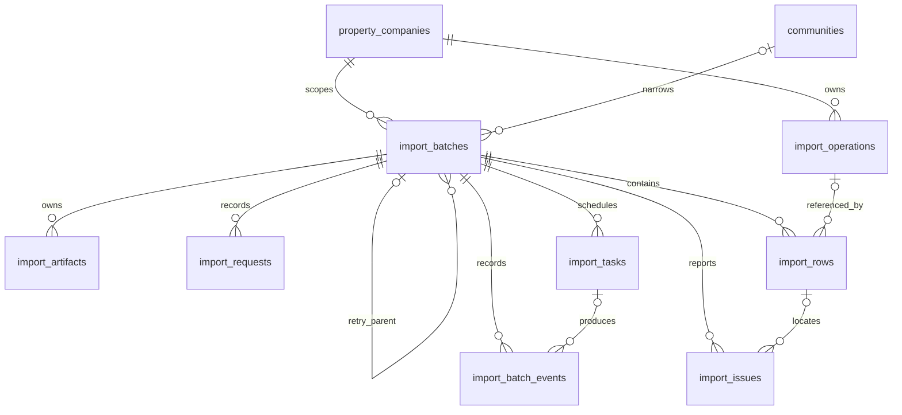

# 通用批量导入数据库设计

## 范围与职责

本设计定义通用批量导入的八张运行表、数据关联、统计职责、请求幂等、业务写入幂等账本及任务恢复规则。本期交付通用能力，以测试适配器验收，不接入具体业务。产品范围见 [总体设计](overview.md)，页面与对外状态语义见 [交互设计](interaction.md)，资源操作见 [API 设计](api.md)，配置注册表、适配器及 Worker 边界见 [技术架构](architecture.md)。

公共类型、主键、迁移、事务及分页约定沿用 [数据库规范](../../database/conventions.md)。管理员身份和审计沿用 [管理后台基础框架设计](../admin/foundation.md)，公司与小区关联沿用 [物业接入设计](../property/onboarding.md)。本篇字段规格不替代 [OpenAPI 契约](../../../openapi/openapi.yaml)；契约发布顺序遵循 [API 规范](../../api/conventions.md)。

## 表级概览

| 表                    | 职责                   | 主要关联与设计重点                                                           |
| --------------------- | ---------------------- | ---------------------------------------------------------------------------- |
| `import_batches`      | 导入批次聚合根         | 固定公司、目标范围、模板版本和模式；保存预览、执行统计及批次并发版本。       |
| `import_requests`     | 写请求幂等记录         | 隔离公司、后台、操作人和动作目标；保存请求指纹及首次响应，与操作同事务提交。 |
| `import_artifacts`    | 文件对象元数据         | 属于批次；保存源文件和错误文件的私有存储引用，不保存文件字节或下载 URL。     |
| `import_operations`   | 业务写入幂等账本       | 保存稳定操作键、自然键、规范化输入摘要及业务结果；可被多个重跑批次的行引用。 |
| `import_rows`         | 输入、预检及批次行结果 | 属于批次；保存输入、预检计划和本批次执行结果快照，保留稳定历史。             |
| `import_issues`       | 文件级、行级及执行问题 | 属于批次；行级问题关联同一批次的行，按预览版本保留问题记录。                 |
| `import_tasks`        | 持久化阶段任务         | 属于批次；保存阶段、领取代次、租约、调度时间、进度和 checkpoint。            |
| `import_batch_events` | 批次追加时间线         | 属于批次；记录状态与任务生命周期，使用批次内序号和事件键防重。               |

不建立 `import_template_versions` 或模板字段表。模板由版本化配置管理，数据库不保存模板定义快照。已有 `admin_audit_logs` 继续记录确认、取消、下载、重跑等管理员操作，不新增独立导入审计表。



`import_operations` 不直接从属于某个批次。行上的 `operation_id` 是批次与逻辑业务操作的关联入口；失败行重跑不复制已存在的逻辑操作。

## 统一约定

- 八张表的主键均为应用生成的 UUIDv7，存储类型为 `uuid`；外键与被引用主键类型一致。已有目标记录引用沿用对应表的 UUID 类型，不重新生成标识。
- 时间点均使用 `timestamptz(6)`，由应用生成 UTC 时间；`created_at` 独立保存，不从主键推断。可变表保存 `updated_at`，不可变或追加记录不增加该字段。
- JSON 文档使用 `jsonb`，顶层必须为对象；可空 JSON 字段仅在非空时检查对象类型。状态、类型和阶段使用 `varchar + CHECK`，不使用 PostgreSQL ENUM。
- 外键默认 `ON DELETE NO ACTION`，不因删除文件或清理临时数据而级联删除导入历史。外键引用端按查询与删除检查需要建索引。
- `char(64)` 摘要或操作键均保存小写 64 位十六进制值，使用 CHECK 校验；API 使用相同格式，不加 `sha256:` 等前缀。
- 原始值、规范化值、自然键和文件可能包含个人信息，不进入普通日志、异常堆栈、事件安全元数据或无授权的预览与下载。
- 下列字段表中「—」表示未定义数据库默认值；非空值由受控写入流程提供。基础字段的生成及不可变要求遵循数据库规范。

## 模板版本身份

`import_batches` 仅保存不可变的配置身份三元组：`template_key`、`template_version_no`、`template_config_hash`。不保存 `template_version_id`，也不保存完整模板配置或适配器快照。

`template_version_no` 在配置、数据库和 API 中均为正整数，界面可以显示为 `v1`。版本号是身份，不从日期或文件名推断。

配置摘要基于规范化后的完整配置计算，不是 Excel 文件字节摘要。模板内容、版本变化条件、加载核验、不可变发布及旧版本保留规则由 [技术架构](architecture.md#版本化配置与适配器) 统一定义；配置缺失或摘要漂移按 [交互设计](interaction.md) 阻断，不以新版本替换。

数据库不再自包含模板定义，也无法用外键验证版本存在。恢复数据库时需要取得匹配的配置制品和适配器；在线编辑与动态模板发布不属于当前数据模型。

## `import_batches`

批次保存目标范围、配置身份、预览确认信息、聚合状态及统计缓存。作用域、模板三元组和模式创建后不可修改。

### 身份与作用域

| 字段                   | PostgreSQL 类型 | 空值 | 默认值   | 用途                                                           |
| ---------------------- | --------------- | ---- | -------- | -------------------------------------------------------------- |
| `id`                   | `uuid`          | 非空 | 应用生成 | 批次主键。                                                     |
| `property_company_id`  | `uuid`          | 非空 | —        | 目标物业公司；所有业务导入必须明确绑定一家物业公司。           |
| `community_id`         | `uuid`          | 可空 | —        | 常用小区查询锚点；公司级批次为空。                             |
| `scope_type`           | `varchar(16)`   | 非空 | —        | `company` 或 `community`。                                     |
| `scope_snapshot`       | `jsonb`         | 非空 | —        | 服务端生成的不可变公司或小区范围快照，包含标识及必要展示信息。 |
| `template_key`         | `varchar(64)`   | 非空 | —        | 稳定模板类型标识。                                             |
| `template_version_no`  | `integer`       | 非空 | —        | 创建批次时固定的模板版本号。                                   |
| `template_config_hash` | `char(64)`      | 非空 | —        | 规范化后完整模板配置的摘要。                                   |
| `mode`                 | `varchar(16)`   | 非空 | `create` | 一期固定为创建模式。                                           |
| `apply_policy`         | `varchar(24)`   | 可空 | —        | 确认时持久化 `all_rows` 或 `valid_rows_only`；确认前为空。     |
| `include_warning_rows` | `boolean`       | 可空 | —        | 确认时明确是否包含警告行；确认前为空。                         |
| `parent_batch_id`      | `uuid`          | 可空 | —        | 失败行重跑的原批次。                                           |

`scope_snapshot` 不是客户端任意 JSON，也不是持续授权的唯一依据。服务端根据当前身份和资源查询结果生成快照，文件里的范围字段只能与其核对，不能扩大或替换它。公司范围只含目标公司，小区范围只含该公司及一个目标小区；首期不启用 `resource_set`、房屋或账期组合范围。

### 操作者与请求追踪

| 字段               | PostgreSQL 类型 | 空值 | 默认值 | 用途                                                            |
| ------------------ | --------------- | ---- | ------ | --------------------------------------------------------------- |
| `created_by_scope` | `varchar(32)`   | 非空 | —      | 创建批次的后台作用域，沿用 `platform_admin`、`property_admin`。 |
| `created_by_id`    | `uuid`          | 非空 | —      | 创建批次的管理员。                                              |
| `request_id`       | `varchar(64)`   | 非空 | —      | 创建请求链路标识。                                              |

所有写请求的请求键、指纹及首次响应由 `import_requests` 统一保存；批次表不维护第二份请求幂等状态。

### 状态与统计

| 字段                  | PostgreSQL 类型 | 空值 | 默认值  | 用途                                                        |
| --------------------- | --------------- | ---- | ------- | ----------------------------------------------------------- |
| `status`              | `varchar(24)`   | 非空 | `draft` | 批次聚合状态，值及阶段映射见下文。                          |
| `preview_version`     | `bigint`        | 非空 | `0`     | 每次成功完成预检递增的预览版本。                            |
| `preview_fingerprint` | `char(64)`      | 可空 | —       | 当前预览结果摘要，确认时必须匹配。                          |
| `total_rows`          | `bigint`        | 非空 | `0`     | 文件数据行数。                                              |
| `planned_create_rows` | `bigint`        | 非空 | `0`     | 预检计划新增行数。                                          |
| `planned_update_rows` | `bigint`        | 非空 | `0`     | 预检计划更新行数，一期固定为零。                            |
| `planned_skip_rows`   | `bigint`        | 非空 | `0`     | 预检计划跳过行数。                                          |
| `warning_rows`        | `bigint`        | 非空 | `0`     | 当前预览中至少有一个警告的行数。                            |
| `error_rows`          | `bigint`        | 非空 | `0`     | 当前预览中至少有一个错误的行数。                            |
| `created_rows`        | `bigint`        | 非空 | `0`     | 实际创建成功行数。                                          |
| `updated_rows`        | `bigint`        | 非空 | `0`     | 实际更新成功行数，一期固定为零。                            |
| `skipped_rows`        | `bigint`        | 非空 | `0`     | 实际跳过行数。                                              |
| `failed_rows`         | `bigint`        | 非空 | `0`     | 执行失败行数。                                              |
| `uncertain_rows`      | `bigint`        | 非空 | `0`     | 业务执行结果尚未核实的行数。                                |
| `cancelled_rows`      | `bigint`        | 非空 | `0`     | 因取消而未执行的行数。                                      |
| `processed_rows`      | `bigint`        | 非空 | `0`     | 已有确定行结果的行数，包含排除行；不含 pending、uncertain。 |
| `row_version`         | `bigint`        | 非空 | `1`     | 批次状态的乐观并发版本。                                    |
| `last_error_code`     | `varchar(128)`  | 可空 | —       | 最近一次批次级系统错误码。                                  |

计划动作、问题级别、执行结果分别是不同维度。「新增、更新、跳过」不能与「警告、错误」相加作为总行数；同一行可以同时属于计划新增和警告行。行数统计按行去重，不能以问题条数代替。

统计字段是可重算查询缓存。计划和本批次执行事实来自 `import_rows`，问题事实来自 `import_issues`。统计随受保护的数据事务更新，异常时从子表重算；不能按共享操作账本的当前状态重算历史批次。`selected_rows`、`excluded_rows` 和待处理行数由当前预检、确认策略及行结果派生，不重复加列。

批次状态限定为 `draft`、`uploading`、`prechecking`、`preview_ready`、`executing`、`completed`、`partial_failed`、`failed`、`blocked`、`cancel_requested`、`cancelled`、`expired`。解析阶段映射为 `prechecking`，确认后待领取和正在执行业务均映射为 `executing`；对外 `phase` 从当前阶段任务及其就绪、运行或暂停状态派生，不另存批次阶段。详细状态转换与行选择规则由 [交互设计](interaction.md) 定义。

`completed`、`partial_failed`、`failed`、`cancelled`、`expired` 是终态，必须有 `finished_at`。`blocked` 不是终态，不填写 `finished_at`；存在未知结果时保持 `blocked`，设置稳定待核实错误码并保留 `uncertain_rows`。取消不把未知结果改成失败或取消，核实后才可完成原批次。

`row_version` 在批次状态、预检发布、确认策略或本批次执行事实变化时递增，用于并发校验和错误文件输入快照绑定。错误文件任务自身的领取、进度、事件和产物登记不递增该业务版本，避免文件生成使自身快照失效。

### 时间

| 字段                  | PostgreSQL 类型  | 空值 | 默认值   | 用途                                                                         |
| --------------------- | ---------------- | ---- | -------- | ---------------------------------------------------------------------------- |
| `preview_expires_at`  | `timestamptz(6)` | 可空 | —        | 成功发布当前预览后赋值；之前为空。                                           |
| `cancel_requested_at` | `timestamptz(6)` | 可空 | —        | 请求取消时间。                                                               |
| `confirmed_at`        | `timestamptz(6)` | 可空 | —        | 用户确认执行时间。                                                           |
| `started_at`          | `timestamptz(6)` | 可空 | —        | 首次执行业务行的时间。                                                       |
| `finished_at`         | `timestamptz(6)` | 可空 | —        | 批次进入终态的时间。                                                         |
| `retention_until`     | `timestamptz(6)` | 非空 | —        | 统一文件、敏感快照及恢复窗口截止时间；普通批次创建起 30 天，重跑继承源截止。 |
| `created_at`          | `timestamptz(6)` | 非空 | 应用写入 | 创建时间。                                                                   |
| `updated_at`          | `timestamptz(6)` | 非空 | 应用写入 | 最近更新时间。                                                               |

确认者、取消者和下载者从 `admin_audit_logs` 查询，不在批次表重复保存管理员字段。

### 约束与索引

- `property_company_id` 外键关联 `property_companies.id`；`(property_company_id, community_id)` 复合外键关联 `communities(property_company_id, id)`；`(property_company_id, parent_batch_id)` 复合外键引用本表 `(property_company_id, id)`，防止跨公司重跑。
- `(created_by_scope, created_by_id)` 复合外键关联 `admin_accounts(scope, id)`。后台值由进程和身份上下文决定，不接受客户端任意指定。
- 保留 `UNIQUE(property_company_id, id)` 供请求及重跑关联使用。
- CHECK 限定 `mode = 'create'`，范围、策略、状态限于本篇列出的值；公司范围要求 `community_id IS NULL`，小区范围要求非空。`template_version_no > 0`。
- `confirmed_at` 为空时，`apply_policy` 与 `include_warning_rows` 均为空；非空时两字段均非空，确认后不可改变。确认、保存策略、安排 apply 任务、写事件和管理员审计在同一事务完成。
- `preview_version = 0` 时 `preview_fingerprint` 和 `preview_expires_at` 均为空；版本大于零时两者均非空。有效预览必须由成功预检原子发布，不能在创建草稿或上传时伪造摘要及有效期。
- 所有统计值及 `preview_version` 不小于零，`processed_rows <= total_rows`，`row_version` 为正。终态与 `finished_at` 是否非空保持一致；`uncertain_rows > 0` 时不得进入终态。
- 建立公司、作用域、状态、创建时间和模板身份相关索引，支撑导入历史的范围过滤与稳定分页；索引具体组合按实际查询和执行计划确定，避免与主键、唯一约束生成的索引重复。

## `import_requests`

每行保存一次已提交写操作的请求身份、规范化输入指纹和首次响应。它防止重复创建批次、重复上传登记、重复确认及重复安排任务；不替代业务操作账本。

| 字段                  | PostgreSQL 类型  | 空值 | 默认值   | 用途                                                       |
| --------------------- | ---------------- | ---- | -------- | ---------------------------------------------------------- |
| `id`                  | `uuid`           | 非空 | 应用生成 | 请求记录主键。                                             |
| `property_company_id` | `uuid`           | 非空 | —        | 当前目标公司。                                             |
| `actor_scope`         | `varchar(32)`    | 非空 | —        | `platform_admin` 或 `property_admin`。                     |
| `actor_id`            | `uuid`           | 非空 | —        | 发起操作的管理员。                                         |
| `request_scope`       | `varchar(64)`    | 非空 | —        | 稳定动作及目标身份，格式见下文。                           |
| `idempotency_key`     | `varchar(128)`   | 非空 | —        | 经 API 校验的请求键。                                      |
| `request_fingerprint` | `char(64)`       | 非空 | —        | 当前动作规范化输入的 SHA-256 摘要。                        |
| `batch_id`            | `uuid`           | 非空 | —        | 创建操作关联新批次，其余操作关联目标批次；重跑关联源批次。 |
| `http_status`         | `smallint`       | 非空 | —        | 首次成功响应的 HTTP 状态码。                               |
| `response_body`       | `jsonb`          | 非空 | —        | 首次成功响应的白名单 JSON 对象。                           |
| `created_at`          | `timestamptz(6)` | 非空 | 应用写入 | 与操作同事务提交的时间。                                   |

约束与索引：

- `property_company_id` 引用公司；`(actor_scope, actor_id)` 引用 `admin_accounts(scope, id)`；`(property_company_id, batch_id)` 引用 `import_batches(property_company_id, id)`。
- `UNIQUE(property_company_id, actor_scope, actor_id, request_scope, idempotency_key)`。后台、公司和操作人从已认证上下文及授权后的目标确定，不能使用客户端任意值。
- `request_scope` 仅允许 `create`，或 `source_file:{batch_uuid}`、`precheck:{batch_uuid}`、`confirm:{batch_uuid}`、`cancel:{batch_uuid}`、`retry_failed:{batch_uuid}`、`error_file:{batch_uuid}`、`recover:{batch_uuid}`。后七种的 UUID 必须等于 `batch_id`；创建时目标尚未生成，固定使用 `create`，不因生成批次 ID 改变请求唯一身份。
- `http_status` 限于契约中各动作的成功状态且处于 200–299；`response_body` 顶层为对象，字段按对应响应 Schema 白名单保存。只保存批次、任务、文件等安全标识、摘要、大小和确认结果，不保存文件字节、行值、自然键、范围展示名、敏感原文件名、私有路径、下载链接、令牌或错误堆栈。请求链路 ID 不作为冻结响应字段，重放请求使用当前链路标识。
- 请求内容及首次响应提交后不可变；建立 `(property_company_id, batch_id, created_at)` 和 `(actor_scope, actor_id)` 索引。唯一约束覆盖精确重放查询，不重复建立同组索引。

指纹按动作分别计算。创建仅包含模板三元组、范围和模式，不包含尚不存在的源文件或确认策略；上传包含目标批次、服务端核验后的文件内容摘要、大小和契约内其他上传参数；确认包含批次、预览版本、预览指纹、`apply_policy` 和 `include_warning_rows`。其他动作包含目标和该动作的全部有效请求参数；空值和默认值按契约规范化，排除请求键及链路标识。

先校验当前身份、权限和范围，再查询已有请求。同键同指纹返回首次状态码及响应；同键不同指纹返回幂等冲突。没有记录时，在动作事务中写业务控制面变更、任务、事件、管理员审计和完整请求记录，不预先持久化半成品请求状态。并发创建由唯一约束协调：竞争失败者回滚本次全部变更，再读取胜出记录并比较指纹；不能捕获唯一错误后继续提交已经失效的事务。

事务未提交或失败且没有动作结果时不保存成功响应；提交结果未知时以原键核查，不使用新键重复操作。文件写入发生在事务外，只有完整性核验完成后的元数据登记、解析任务安排和首次响应一起提交；孤儿临时文件由受控清理处理。原响应重放不保证其中资源仍在原状态，客户端随后读取当前批次、任务或文件状态。

## `import_artifacts`

仅保存源文件和错误文件等对象元数据。首期使用单机私有持久目录，由鉴权 API 读取；下载时重新校验权限、公司范围、保留窗口和对象状态，不返回存储路径或签名地址。

| 字段                     | PostgreSQL 类型  | 空值 | 默认值   | 用途                                       |
| ------------------------ | ---------------- | ---- | -------- | ------------------------------------------ |
| `id`                     | `uuid`           | 非空 | 应用生成 | 文件对象主键。                             |
| `batch_id`               | `uuid`           | 非空 | —        | 所属批次。                                 |
| `artifact_kind`          | `varchar(16)`    | 非空 | —        | `source` 或 `error_rows`。                 |
| `generation`             | `integer`        | 非空 | `1`      | 同一批次同类文件的生成代次。               |
| `source_preview_version` | `bigint`         | 可空 | —        | 错误文件固定的已发布预览版本；源文件为空。 |
| `storage_key`            | `varchar(512)`   | 非空 | —        | 私有存储键，不向客户端直接暴露。           |
| `original_filename`      | `varchar(255)`   | 可空 | —        | 源文件原始名称；错误文件名由系统生成。     |
| `media_type`             | `varchar(128)`   | 非空 | —        | 服务端确认的媒体类型。                     |
| `sha256`                 | `char(64)`       | 非空 | —        | 文件内容摘要。                             |
| `byte_size`              | `bigint`         | 非空 | —        | 文件大小，单位字节。                       |
| `row_count`              | `bigint`         | 可空 | —        | 文件包含的数据行数或错误行数。             |
| `expires_at`             | `timestamptz(6)` | 非空 | —        | 文件保留截止时间。                         |
| `deleted_at`             | `timestamptz(6)` | 可空 | —        | 对象已完成清理的时间。                     |
| `created_at`             | `timestamptz(6)` | 非空 | 应用写入 | 创建时间。                                 |
| `updated_at`             | `timestamptz(6)` | 非空 | 应用写入 | 文件清理状态更新时间。                     |

约束与索引：

- `batch_id` 外键引用 `import_batches.id`，`UNIQUE(batch_id, artifact_kind, generation)`。
- 每批最多一个 `source` 文件，通过按源文件类型限定的批次唯一约束保证；错误文件按生成代次区分，不能让新旧输出混用。
- CHECK 限定文件类型；`generation > 0`、`byte_size >= 0`、非空 `row_count >= 0`；`sha256` 为小写 64 位十六进制。`source` 要求 `source_preview_version IS NULL`；`error_rows` 要求该版本大于零。
- 对象删除与 `deleted_at` 更新必须可重试。删除对象失败时不能伪造清理完成。
- `expires_at` 使用批次的 `retention_until`，晚生成的错误文件不延长源输入的恢复窗口。
- 不保存文件字节、下载 URL 或 `storage_backend`。私有持久目录及安全读写约束由 [技术架构](architecture.md) 定义。

对象写入成功后，只有大小、完整性和摘要核验完成，才能在事务中登记 artifact、更新批次并创建解析任务。对象已写入但事务失败时，由清理机制识别并删除孤儿对象；外部对象写入不能假定与数据库事务原子提交。

错误文件统一生成固定最小安全投影，对行值按模板安全规则脱敏，不随生成者的较高字段权限扩展；问题说明也不得插入原始敏感值。生成和下载使用同一规则，避免低权限下载者读到高权限生成内容。文件状态由 artifact、任务状态、checkpoint 代次及保留截止时间派生；任务未完成前不得登记或发布半成文件，下载必须绑定已就绪代次。

生成仅在没有活动的 parse、precheck、apply 任务时受理，在批次协调锁内固定当前已发布预览与 `row_version`，写入 artifact 任务 checkpoint 的 `source_preview_version` 和 `source_batch_row_version`。分片发布及下载均核对这两个版本和当前 checkpoint 的 `output_generation`。确认、重新预检、取消或原任务恢复推进业务事实后，旧文件投影为 `stale` 并禁止下载；重新生成使用新代次，不新增文件失效状态列。

## `import_operations`

每行表示一项逻辑业务操作及其当前幂等结果，不表示一次 Worker 领取或一次执行尝试。多个失败重跑批次的行可以继续引用同一操作。

| 字段                   | PostgreSQL 类型  | 空值 | 默认值   | 用途                                                                |
| ---------------------- | ---------------- | ---- | -------- | ------------------------------------------------------------------- |
| `id`                   | `uuid`           | 非空 | 应用生成 | 逻辑操作主键。                                                      |
| `property_company_id`  | `uuid`           | 非空 | —        | 操作所属物业公司。                                                  |
| `operation_key`        | `char(64)`       | 非空 | —        | 服务端生成的稳定、不透明操作键。                                    |
| `operation_type`       | `varchar(64)`    | 非空 | —        | 适配器定义的操作类型，例如 `house.create`。                         |
| `natural_key`          | `jsonb`          | 可空 | —        | 业务自然键快照；创建时必填，仅允许按保留规则受控清空。              |
| `input_fingerprint`    | `char(64)`       | 非空 | —        | 规范化业务输入摘要。                                                |
| `status`               | `varchar(16)`    | 非空 | `ready`  | `ready`、`running`、`succeeded`、`skipped`、`failed`、`uncertain`。 |
| `target_type`          | `varchar(64)`    | 可空 | —        | 成功目标的业务类型。                                                |
| `target_id`            | `uuid`           | 可空 | —        | 成功目标的业务记录 ID。                                             |
| `attempt_count`        | `bigint`         | 非空 | `0`      | 此逻辑操作的业务执行尝试次数。                                      |
| `last_attempt_at`      | `timestamptz(6)` | 可空 | —        | 最近一次执行时间。                                                  |
| `processed_at`         | `timestamptz(6)` | 可空 | —        | 进入最终结果或未知结果的时间。                                      |
| `sensitive_cleared_at` | `timestamptz(6)` | 可空 | —        | 自然键按保留策略完成清理的时间；清理前为空。                        |
| `created_at`           | `timestamptz(6)` | 非空 | 应用写入 | 创建时间。                                                          |
| `updated_at`           | `timestamptz(6)` | 非空 | 应用写入 | 最近更新时间。                                                      |

约束与索引：

- `property_company_id` 外键引用 `property_companies.id`，`UNIQUE(property_company_id, operation_key)`。
- 非空 `natural_key` 必须为对象；`natural_key IS NULL` 与 `sensitive_cleared_at IS NOT NULL` 等价。操作键和输入摘要必须符合小写 64 位十六进制格式。
- `target_type` 与 `target_id` 同时为空或同时非空。目标属于不同业务类型，不用任意 JSON 保存业务结果；具体目标由这对字段定位，并由对应业务能力维护完整性。
- `attempt_count >= 0`；状态为 `succeeded`、`skipped`、`failed` 或 `uncertain` 时必须有 `processed_at`。自然键仅在所有引用批次均满足清理条件时清空，未知操作不得清理。
- 建立公司、操作状态及操作键相关索引。按批次筛选操作通过 `import_rows` 关联，不能在没有字段设计的情况下建立 `import_operations(batch_id, status)` 索引。

### 幂等账本规则

- `operation_key` 与业务自然键职责不同，不能直接把自然键当作请求键。重试、网络故障恢复和失败行重跑复用原操作键，不另建逻辑操作绕过已有结果。
- 同一可执行行最多关联一个操作。无效或冲突行不绑定可执行操作；同一行不能因为任务重领再次创建业务对象。
- 文件内自然键重复默认报错；系统已有相同自然键且内容一致时跳过，内容不同时报冲突，不隐式更新。具体自然键与重复判定属于业务适配器。
- 没有稳定业务唯一键的导入类型不能启用默认创建模式。数据库业务唯一约束仍负责兜底并发创建，账本不能替代业务表自身约束。
- 新批次引用已有操作时核对公司、操作类型和输入，不能借共享操作扩大范围或把不同输入视为同一次操作。
- 批次取消只写该批次行结果，不把共享操作账本改为取消。未被执行的操作可保留 `ready`，不影响其他批次继续引用；失败重跑只修改逻辑操作当前结果，不改原批次行结果。
- 错误详情统一进入 `import_issues`。不增加完整业务结果 JSON 或独立执行尝试表；尝试次数由本表记录，尝试时间线由事件与问题追踪。需要逐次调用证据时须另行设计。

执行业务操作前锁定操作记录并检查当前状态。已成功的操作返回既有结果；未知结果先按原操作键和业务持久化事实核实。正式业务写入与账本结果必须在同一事务提交，事务提交结果未知时不能盲目再次创建。操作尝试次数不是任务租约代次，旧 Worker 的失效保护仍依赖 `import_tasks`。

## `import_rows`

保存每行输入证据、规范化结果、预检计划及本批次执行结果快照。操作账本表示逻辑操作的当前结果，本表表示该行在本批次中的结果，两者用途不同。批次结束后，执行结果和结果时间不随失败重跑或共享操作状态变化而改变。

| 字段                   | PostgreSQL 类型  | 空值 | 默认值    | 用途                                                                                          |
| ---------------------- | ---------------- | ---- | --------- | --------------------------------------------------------------------------------------------- |
| `id`                   | `uuid`           | 非空 | 应用生成  | 行主键。                                                                                      |
| `batch_id`             | `uuid`           | 非空 | —         | 所属批次。                                                                                    |
| `source_row_no`        | `bigint`         | 非空 | —         | 原文件实际行号，从一开始。                                                                    |
| `raw_values`           | `jsonb`          | 可空 | —         | 创建时必填的原始单元格值；只允许按保留规则受控清空。                                          |
| `normalized_values`    | `jsonb`          | 可空 | —         | 服务端规范化结果；规范化完成后仅允许保留清理，不接受手工修改。                                |
| `validation_status`    | `varchar(16)`    | 非空 | `staged`  | `staged`、`valid`、`invalid`。                                                                |
| `planned_action`       | `varchar(16)`    | 非空 | `none`    | `create`、`update`、`skip`、`conflict`、`none`；一期不启用更新。                              |
| `operation_id`         | `uuid`           | 可空 | —         | 关联逻辑业务操作；无效或冲突行为空。                                                          |
| `warning_count`        | `integer`        | 非空 | `0`       | 当前预检版本的警告条数缓存。                                                                  |
| `error_count`          | `integer`        | 非空 | `0`       | 当前预检版本的错误条数缓存。                                                                  |
| `validation_version`   | `bigint`         | 非空 | `0`       | 当前校验结果对应的预检版本。                                                                  |
| `execution_status`     | `varchar(16)`    | 非空 | `pending` | 本批次结果：`pending`、`created`、`skipped`、`failed`、`uncertain`、`cancelled`、`excluded`。 |
| `result_at`            | `timestamptz(6)` | 可空 | —         | 本批次获得该结果的时间；待处理时为空，未知核实后更新。                                        |
| `sensitive_cleared_at` | `timestamptz(6)` | 可空 | —         | 原始值和规范化值同时完成保留清理的时间。                                                      |
| `created_at`           | `timestamptz(6)` | 非空 | 应用写入  | 创建时间。                                                                                    |
| `updated_at`           | `timestamptz(6)` | 非空 | 应用写入  | 最近更新时间。                                                                                |

约束与索引：

- `batch_id` 引用批次，`operation_id` 引用操作；服务端保证行和操作属于同一公司及允许的范围。
- `UNIQUE(batch_id, source_row_no)`；另保留 `UNIQUE(batch_id, id)` 供问题表复合外键引用。
- `source_row_no > 0`；非空 `raw_values` 和 `normalized_values` 必须为对象。清理前 `raw_values` 非空；`sensitive_cleared_at` 非空时两份值均为空，`raw_values IS NULL` 与清理时间非空等价。
- `warning_count`、`error_count`、`validation_version >= 0`，校验状态、计划动作、执行结果使用 CHECK。`execution_status = 'pending'` 与 `result_at IS NULL` 等价。
- `created`、`skipped`、`failed`、`uncertain` 必须有关联操作；`excluded` 可以没有操作。事务内校验操作结果与当前行快照一致，保留清理不改变结果及其关联。
- 建立 `(batch_id, validation_status, source_row_no)`、`(batch_id, execution_status, source_row_no)` 和 `operation_id` 索引；计划动作过滤按实际查询验证是否需要附加索引。

规范化按 [技术架构](architecture.md) 在预检阶段执行，不能由前端拼接或改写结果。重新预检使用新的校验版本，不覆盖旧问题。警告是 `import_issues.severity = 'warning'`，不是新增的行状态；对外 `precheck_status = warning` 可以由有效性和当前问题派生，不能据此添加另一份数据库状态。

确认时依据已保存的策略，预检未通过行写 `excluded`，策略排除的有效警告行也写 `excluded`；通过 `validation_status`、当前问题和 `include_warning_rows` 区分原因。执行中的业务跳过写 `skipped`，业务失败写 `failed`，取消后未执行的选中行写 `cancelled`，不能将这些情况混为一类。

取消尚未确认的批次时，将本批次已经暂存、尚未执行的 `pending` 行记为 `cancelled`，不要求这些行先经过策略选择；尚未解析的输入不伪造行记录。确认后的取消保留已确定的排除及执行结果，只取消尚未执行的选中行，避免留下与已结束批次矛盾的待处理行。

正式业务写入、操作账本结果、该批次行结果、统计及 checkpoint 同事务提交。提交结果未知时，先以新事务按原操作键重新读取持久账本、该批次行及业务事实；已经提交的成功或其他确定结果直接复用，不能为了补记未知而将其覆盖成 `uncertain`。只有仍无法核实的操作与行才标记 `uncertain`，原批次保持非终态；按原操作核实后再写确定结果。并发控制必须锁定批次、当前任务和操作，不能在未知结果未核实前进入终态。

失败重跑创建新批次和新行，只复制仍在恢复窗口内的可重试失败输入并引用原操作；新行从 `pending` 开始，重新预检、展示预览并再次确认。原批次输入和行结果保留，旧批次仍显示该次失败，不能改成重跑后的成功。已成功操作的目标引用不可变；原批次失败行不因账本后来成功而展示新目标。

## `import_issues`

保存文件级、行级及执行阶段的问题。错误码稳定，`message` 和 `suggestion` 保存当时的安全展示说明，不拼入原始敏感值；错误目录与 [错误与异常规范](../../api/errors.md) 和 OpenAPI 契约保持一致。

| 字段              | PostgreSQL 类型  | 空值 | 默认值   | 用途                                                   |
| ----------------- | ---------------- | ---- | -------- | ------------------------------------------------------ |
| `id`              | `uuid`           | 非空 | 应用生成 | 问题主键。                                             |
| `batch_id`        | `uuid`           | 非空 | —        | 所属批次。                                             |
| `row_id`          | `uuid`           | 可空 | —        | 行级问题关联的行；文件级问题为空。                     |
| `preview_version` | `bigint`         | 非空 | —        | 产生问题时的批次预检版本。                             |
| `phase`           | `varchar(16)`    | 非空 | —        | `parse`、`precheck` 或 `apply`。                       |
| `severity`        | `varchar(16)`    | 非空 | —        | `warning` 或 `error`。                                 |
| `code`            | `varchar(128)`   | 非空 | —        | 稳定错误码。                                           |
| `field_key`       | `varchar(64)`    | 可空 | —        | 模板字段编码。                                         |
| `column_name`     | `varchar(128)`   | 可空 | —        | 模板已知安全列名；未知列使用按列序号生成的安全占位名。 |
| `column_index`    | `integer`        | 可空 | —        | 原始列序号，从一开始。                                 |
| `cell_reference`  | `varchar(32)`    | 可空 | —        | XLSX 单元格位置。                                      |
| `message`         | `varchar(1000)`  | 非空 | —        | 用户可读问题说明快照。                                 |
| `suggestion`      | `varchar(1000)`  | 可空 | —        | 修复建议快照。                                         |
| `detail`          | `jsonb`          | 可空 | —        | 受控、非敏感机器信息，例如允许的枚举值。               |
| `created_at`      | `timestamptz(6)` | 非空 | 应用写入 | 创建时间。                                             |

约束与索引：

- `batch_id` 引用批次，`(batch_id, row_id)` 复合外键引用 `import_rows(batch_id, id)`，防止关联其他批次的行。
- 文件级问题的 `row_id` 为空；行级问题通过行 ID 定位，字段级问题再提供 `field_key`、`column_name`、`column_index`、`cell_reference`。非空 `column_index > 0`。
- 阶段和级别用 CHECK 限定；非空 `detail` 必须为对象且只含白名单非敏感信息。
- `parse` 问题固定使用 `preview_version = 0`；`precheck`、`apply` 问题使用正版本号。当前可见问题为解析版本零的问题与当前已发布版本的预检、执行问题并集，避免预览版本递增后隐藏文件结构错误。预检统计只计入解析及预检阶段，执行问题单独呈现。
- 使用 `UNIQUE NULLS NOT DISTINCT(batch_id, row_id, preview_version, phase, code, field_key, column_name, column_index, cell_reference)` 作为稳定问题身份。文件级空位置视为同一位置；不同阶段或位置是不同问题。级别、说明和建议不属于去重键，同一身份重放不得重复添加。历史问题保留原版本，不以新预检覆盖，不另加错误指纹字段。
- 建立 `(batch_id, preview_version, severity, row_id)` 以及支持批次内错误码筛选的索引。按原行号查询通过 `row_id` 关联 `import_rows.source_row_no`，不重复保存 `row_no`。

原始值与规范化值仅存于行表，问题响应通过关联行并按权限读取，不能在问题表重复保存。文件级问题可以没有行号和字段。可重试性由稳定错误分类和当前操作情况判断，不因 API 返回 `retryable` 就假定已有对应存储字段。

## `import_tasks`

每个批次每个阶段维护一项可恢复任务，任务负责调度、租约和恢复位置，不承担业务事实或管理员审计。业务错误通常使预检任务正常完成，错误保存在问题表；基础设施异常或需人工处理的任务进入 `paused`。

| 字段               | PostgreSQL 类型  | 空值 | 默认值   | 用途                                                     |
| ------------------ | ---------------- | ---- | -------- | -------------------------------------------------------- |
| `id`               | `uuid`           | 非空 | 应用生成 | 任务主键。                                               |
| `batch_id`         | `uuid`           | 非空 | —        | 所属批次。                                               |
| `phase`            | `varchar(16)`    | 非空 | —        | `parse`、`precheck`、`apply` 或 `artifact`。             |
| `status`           | `varchar(16)`    | 非空 | `ready`  | `ready`、`running`、`completed`、`paused`、`cancelled`。 |
| `next_run_at`      | `timestamptz(6)` | 非空 | —        | 下次可领取时间。                                         |
| `attempt_count`    | `bigint`         | 非空 | `0`      | 领取次数，同时作为任务执行代次。                         |
| `lease_expires_at` | `timestamptz(6)` | 可空 | —        | 当前领取租约截止时间。                                   |
| `progress_done`    | `bigint`         | 非空 | `0`      | 本阶段已处理数量缓存。                                   |
| `progress_total`   | `bigint`         | 非空 | `0`      | 本阶段总数量缓存。                                       |
| `checkpoint`       | `jsonb`          | 非空 | —        | 创建任务时写入合法的阶段 v1 游标，不保存业务数据。       |
| `last_error_code`  | `varchar(128)`   | 可空 | —        | 最近一次任务级系统错误码。                               |
| `started_at`       | `timestamptz(6)` | 可空 | —        | 首次执行时间。                                           |
| `completed_at`     | `timestamptz(6)` | 可空 | —        | 任务进入终态时间。                                       |
| `created_at`       | `timestamptz(6)` | 非空 | 应用写入 | 创建时间。                                               |
| `updated_at`       | `timestamptz(6)` | 非空 | 应用写入 | 最近更新时间。                                           |

### 约束与租约

- `batch_id` 引用批次，`UNIQUE(batch_id, phase)`；重试或恢复更新原任务，不无限追加同阶段任务。重新预检仅在未确认、无活动阶段任务且无未知结果时重置原 precheck 任务及合法初始游标；错误文件新一代仅在旧 artifact 任务结束或受控暂停后开始，不并行复用同一任务。
- CHECK 限定阶段和状态；`attempt_count`、`progress_done`、`progress_total >= 0`，`progress_done <= progress_total`。checkpoint 顶层必须为对象，`schema_version` 必须为数字 `1`；应用层校验阶段专属字段及大小。
- 阶段总量未知时先保持进度为 `0/0`，API 将未知总量投影为 `null`，不伪造百分比；确定总量后再累计已处理数量。总量和进度采用同一阶段单位，不能用字节数与行数混算。
- `status = 'running'` 时 `lease_expires_at` 非空，其他状态不得保留活动租约。
- 建立就绪任务 `(status, next_run_at, id)` 和运行任务 `(status, lease_expires_at, id)` 部分索引。
- 使用 `FOR UPDATE SKIP LOCKED` 领取或接管任务，递增 `attempt_count`、设置租约后立即提交，不在读取文件、解析或外部对象请求期间保持长事务。
- 续租、延期、暂停、取消、完成、进度及 checkpoint 回写，均须同时匹配任务 ID、领取代次、运行状态和有效租约。相关业务数据及结果也必须在受该代次保护的事务中提交。
- 租约过期或被接管后，旧 Worker 不得写入业务结果、推进游标或发布文件。租约不能撤回已经发生的外部请求，因此文件写入还要通过稳定分片键、生成代次和发布校验防重。

不增加通用 `payload`、`lease_owner`、`lease_token` 或独立任务尝试表。任务对象从 `batch_id` 取得，领取身份由 `attempt_count + lease_expires_at` 表达。Runner 负责通用领取与心跳，业务 Worker 负责业务锁、分块事务、状态和恢复规则，职责见 [技术架构](architecture.md)。

### checkpoint 格式

checkpoint 固定表示「下一次尚未提交的处理单元」。创建任务时必须初始化合法 v1 对象，不接受空对象；采用无空白 UTF-8 JSON 序列化，最大 8192 字节。应用按阶段拒绝未知字段、未知版本、非整数或越界游标，校验失败暂停任务并返回稳定系统错误，不能丢弃游标后从头执行。

各阶段都必须包含 `schema_version: 1`，其余精确字段如下，不增加任意载荷：

| 阶段            | 必需字段                                                                                                  | 初始化与恢复语义                                                                                          |
| --------------- | --------------------------------------------------------------------------------------------------------- | --------------------------------------------------------------------------------------------------------- |
| `parse`（CSV）  | `source_artifact_generation`、`cursor.kind = csv_record`、`cursor.next_byte_offset`、`cursor.next_row_no` | 代次为源文件代次；偏移从 BOM 和表头后的首条数据记录开始，行号为该记录的实际起始行号；偏移非负，行号为正。 |
| `parse`（XLSX） | `source_artifact_generation`、`cursor.kind = xlsx_row`、`cursor.sheet_name`、`cursor.next_row_no`         | 固定已校验工作表，行号为表头之后第一数据行；工作表必须与模板允许的工作表匹配。                            |
| `precheck`      | `target_preview_version`、`next_row_no`                                                                   | 创建或重预检时预留 `batch.preview_version + 1`，从第一输入行开始；失败恢复继续同一目标版本。              |
| `apply`         | `source_preview_version`、`next_row_no`                                                                   | 版本固定为确认的已发布预览，初始为第一输入行；仅执行策略选中的 pending 行。                               |
| `artifact`      | `source_preview_version`、`source_batch_row_version`、`output_generation`、`next_row_no`、`next_part_no`  | 固定已发布预览和本批次业务版本；输出代次为本次目标代次，初始行号为第一输入行、下一分片为 1。              |

版本和代次均为正整数；行号为正整数，分片号从 1 开始。行处理按 `source_row_no` 升序，空行不虚构记录；下一行号为下一未提交实际行号，完成后使用最大输入行号加一。无数据的源文件在解析阶段记录文件级错误，不进入可执行预览。

CSV 解析游标示例：

```json
{
  "schema_version": 1,
  "source_artifact_generation": 1,
  "cursor": {
    "kind": "csv_record",
    "next_byte_offset": 1048576,
    "next_row_no": 12001
  }
}
```

预检的每个分块将行校验结果和问题写入预留的目标版本。预检过程中不提供半成行结果或旧版可确认预览；所有分块完成后，在终结事务中原子发布 `preview_version`、`preview_fingerprint`、`preview_expires_at`、汇总和批次状态。发布前不递增公开预览版本；恢复同一目标版本的问题使用稳定唯一键防重，不能把未完成预检视为新预览。

apply 恢复必须匹配确认版本及批次已保存策略；artifact 完成时必须核对固定预览版本、本批次业务版本、输出代次和安全投影规则，才可发布对应 artifact。源文件唯一且不可替换，解析恢复仍必须核对其代次及摘要；代次不符时暂停，不用新文件继续原游标。

错误文件新代次在批次锁内取已登记 artifact 最大代次与原 artifact checkpoint 输出代次的较大值加一；首代为 1。即使上一代没有发布文件，也不复用其稳定分片命名空间，避免旧 Worker 或残留分片混入新输出。

checkpoint 禁止原始值、规范化值、自然键、业务对象、错误消息全文、文件片段、存储 URL 或异常堆栈。源对象及输出代次不是租约代次，不复制 `attempt_count`；领取有效性始终读取任务表。一个任务同一时刻只有一个 Worker 租约；并行分段不属于首期实现。

### 分块提交与文件安全边界

1. 在数据库事务外读取一个安全分块。
2. 进入事务，校验当前任务代次和有效租约，执行该分块的业务锁与数据处理。
3. 写入本阶段的行、问题、操作或文件元数据，更新进度与统计。
4. 将 checkpoint 推进到下一尚未提交的单元，在同一数据库事务提交。

事务失败时进度和 checkpoint 都不前进，恢复时可以重新处理当前分块。解析依靠 `(batch_id, source_row_no)` 唯一约束，问题按版本和稳定身份去重，业务执行依靠操作键及业务唯一约束，错误文件依靠批次、阶段、输出代次和分片编号生成稳定对象键。

CSV 字节偏移只能位于完整记录之后，兼顾带引号跨行字段和多字节字符，不能直接使用任意读取缓冲区边界。XLSX 以工作表标识和下一行号恢复，重新打开文件并跳过已完成行，不能使用 ZIP 压缩字节偏移。

错误文件分片必须先在存储中持久化并校验，才能提交对应 checkpoint。输出代次隔离新旧文件，旧 Worker 不得覆盖新代次或发布未完成文件。对象存储不能加入数据库事务，已上传但未登记的分片可重试核验或清理，不能因外部写入成功就越过数据库提交边界。

checkpoint、进度和统计只是恢复位置及缓存。`import_rows`、`import_issues`、`import_operations` 与业务表继续保存运行事实，不能用游标判断业务操作一定成功。

## `import_batch_events`

追加记录批次状态变化、任务领取与接管、文件生成等时间线，不修改历史事件，不替代管理员审计。

| 字段            | PostgreSQL 类型  | 空值 | 默认值   | 用途                                           |
| --------------- | ---------------- | ---- | -------- | ---------------------------------------------- |
| `id`            | `uuid`           | 非空 | 应用生成 | 事件主键。                                     |
| `batch_id`      | `uuid`           | 非空 | —        | 所属批次。                                     |
| `sequence_no`   | `bigint`         | 非空 | —        | 批次内严格递增序号。                           |
| `event_key`     | `varchar(128)`   | 非空 | —        | 事件幂等键，防止任务重试重复记录。             |
| `event_type`    | `varchar(32)`    | 非空 | —        | 状态变化、任务领取、任务接管、文件生成等类型。 |
| `from_status`   | `varchar(24)`    | 可空 | —        | 批次状态变化前的状态。                         |
| `to_status`     | `varchar(24)`    | 可空 | —        | 批次状态变化后的状态。                         |
| `actor_scope`   | `varchar(32)`    | 可空 | —        | 管理员事件的后台作用域。                       |
| `actor_id`      | `uuid`           | 可空 | —        | 管理员操作人；系统事件为空。                   |
| `task_id`       | `uuid`           | 可空 | —        | 关联任务。                                     |
| `task_attempt`  | `bigint`         | 可空 | —        | 产生事件的任务领取代次。                       |
| `safe_metadata` | `jsonb`          | 非空 | —        | 非敏感统计或原因白名单。                       |
| `created_at`    | `timestamptz(6)` | 非空 | 应用写入 | 事件时间。                                     |

约束与索引：

- `batch_id` 引用批次；`UNIQUE(batch_id, sequence_no)` 和 `UNIQUE(batch_id, event_key)`。
- 管理员事件的 `(actor_scope, actor_id)` 复合外键关联 `admin_accounts(scope, id)`；系统事件不伪造管理员。
- `task_id` 外键引用 `import_tasks.id`；服务端校验任务属于当前批次。
- `safe_metadata` 必须是对象，只允许安全白名单；禁止原始行值、文件内容、SQL、堆栈和敏感信息。
- 序号在批次状态更新的同一事务分配，按稳定批次记录协调并发，保证批次内顺序；状态、事件、任务确认不各自提交形成断裂。
- 索引覆盖 `(batch_id, sequence_no)` 和 `(task_id, created_at)`；已有唯一索引覆盖的访问路径不重复建立。

## 事务与异常恢复

上传、解析、规范化、预检和预览仅写导入运行表，确认前不得写正式业务数据。确认必须核对当前身份、范围、模板三元组、预览版本、指纹和有效期；每个执行分块前重新检查授权与范围。预检是当时的判断，不能代替执行时业务不变量和并发校验。

默认按行或有限分块提交，单个业务实体涉及的多表写入、逻辑操作结果及相关导入事实同事务完成。控制面不能动态拼接业务表名或绕过既有业务 Domain、Service 与事务规则。通用引擎不承诺整批全有或全无，也不回滚此前已成功的业务副作用。

| 场景                                      | 恢复规则                                                                                                           |
| ----------------------------------------- | ------------------------------------------------------------------------------------------------------------------ |
| 分块尚未提交时进程退出                    | checkpoint 保持原位置，重新读取并处理当前分块，由唯一约束及操作键防重。                                            |
| 分块已提交后进程退出                      | 从下一未提交单元恢复，读取持久化结果，不重复创建业务对象。                                                         |
| 数据库提交结果未知                        | 新事务按原键重读持久事实，复用确定结果；仅未核实部分标记 `uncertain`，批次为 `blocked`，不得覆盖已成功结果。       |
| Worker 失联、租约过期                     | 通过持久任务接管并递增代次；旧 Worker 的心跳、结果与 checkpoint 回写全部失效。                                     |
| checkpoint 未知版本、格式非法或位置不安全 | 暂停任务并暴露稳定系统错误，不能忽略游标继续写入。                                                                 |
| 模板缺失、摘要漂移或不支持旧适配器        | 阻塞或暂停，停止正式业务写入，恢复原配置后再按原批次身份处理。                                                     |
| 预览过期、业务数据或授权边界变化          | 拒绝旧确认，要求重新校验或预检；不能根据过期统计直接执行。                                                         |
| 预检发现业务错误                          | 问题写入 `import_issues`，任务通常正常完成；边界、权限及模板错误强制阻断，不能靠只执行通过行绕过。                 |
| 执行中请求取消                            | 在安全事务边界协作停止；确认前终结本批次已暂存待处理行，确认后终结尚未执行的选中行；已提交结果及共享操作保留。     |
| 暂停任务恢复                              | 重新校验权限、范围、配置及原 checkpoint，恢复原任务并递增下次领取代次；未知结果先核实，不把恢复等同重跑。          |
| 失败行重跑                                | 在恢复窗口内新建批次，只含原可重试失败行并复用原操作；重新预检和再次确认，原批次结果不变，未知或非幂等错误不重跑。 |
| 对象写入成功、登记事务失败                | 校验并复用稳定对象或由清理机制处理孤儿对象，不假定对象已正式发布。                                                 |
| 文件清理失败                              | 保留未完成清理状态并重试；不能提前填写 `deleted_at`。                                                              |

重试与同键重放仍校验当前权限和公司范围。批次取消不撤销已提交业务，未知结果也不能因取消而消失。不同后台、公司和账号的访问隔离由当前身份上下文执行，不能只凭批次快照或客户端参数授权。

## 保留与清理

源文件、错误文件、原始值、规范化值及自然键快照使用统一的 30 天恢复窗口：普通批次的 `retention_until = created_at + 30 天`；错误文件沿用批次截止时间，重跑批次继承源批次截止时间，不能借重跑无限续存敏感输入。到期后立即关闭源文件和错误文件下载、失败重跑与错误文件重建，不因清理尚未完成而继续开放。

现有 Worker 周期扫描到期批次，按有限分块清理，不增加 `retention` 任务阶段。清理前按稳定批次记录协调并发，重新检查无就绪、运行、暂停待恢复任务，无待核实操作或行，且不再允许读取输入的恢复操作；活动批次和未知结果证据整体延期清理，禁止只删除其中一个文件或部分敏感行使其无法恢复。到期但仍活动的批次不新增失败重跑或错误文件任务，原任务安全完成或核实后再清理。

文件清理先删除私有对象，成功后写 `deleted_at`，失败保留原状态重试。行清理在事务中将 `raw_values` 和 `normalized_values` 同时置空并写 `sensitive_cleared_at`。自然键只有在所有引用批次均到期、无活动或未知操作、无恢复需求时才置空并写清理时间。清理按文件和事务分块幂等执行，失败可从实际未清理记录继续；已到期的下载始终被服务端拒绝，不把分块清理过程暴露为部分可用输入。

输入与规范化结果在清理前保持不可变；清理后的 NULL 明确表示保留截止后的销毁，不伪装成空 JSON。批次、请求首次响应、行结果、操作键及输入摘要、业务目标、问题代码和安全说明、事件、管理员审计保留最小历史证据，不级联删除。清理时将 artifact 的 `original_filename` 置空，历史仅显示安全生成名。问题从写入起就只保存模板安全列名或按列序号生成的未知列占位名，不保存可能含个人信息的任意原始表头；无需通过变更问题身份来清理列名。

孤儿临时文件和未登记输出分片按私有命名空间及宽限期扫描，删除前核对无有效任务引用，不因没有 artifact 记录而删除正在写入的文件。具体目录、宽限期及容量保护见 [技术架构](architecture.md)。

不增加导入统计表、模板表、任意任务载荷或尝试明细表。更新、合并、覆盖及资源集合范围须单独定义业务规则和授权，不能靠启用已有 `update` 动作值开放。对外 `row_no` 读取 `source_row_no`，`precheck_status` 和 `retryable` 由当前预检及稳定错误分类派生；操作按批次查询通过行关联，不添加不存在的 `import_operations.batch_id`。

## 验证要求

实施时按 [测试规范](../../conventions/testing.md) 使用隔离 PostgreSQL 验证真实约束、迁移和并发行为，至少覆盖：

- 公司、小区、后台、行与问题的真实外键，跨公司或跨批次关联拒绝，以及所有字段类型、空值、默认值、CHECK 和唯一约束。
- 创建请求防重、上传及确认等动作的持久化重放、同键异输入冲突、文件内重复、已有自然键一致跳过与内容冲突。
- 确认前零业务写入、预览版本与指纹匹配、过期预览拒绝、执行时授权和业务并发变化、业务写入与账本原子性。
- 分块提交前后故障、提交结果未知、旧 Worker 租约失效、接管及续租竞争、checkpoint 不前移或恰好前移、重复处理防重。
- CSV 引号跨行与多字节边界、XLSX 工作表恢复、未知 checkpoint 版本暂停、源文件代次不符、错误文件分片持久化及输出代次隔离。
- 失败重跑复用原操作、再次预检和确认、原批次结果及统计不变，取消不影响其他批次的共享操作、未知结果不误判失败或终态。
- 统计重算、问题按预览版本与稳定身份去重、批次事件序号和事件键防重、同语句分页总数及空页准确性。
- 配置丢失与漂移、旧版本发布和回滚兼容、私有文件授权、孤儿对象清理、到期保留边界及敏感数据不进入普通日志。

相关列表与调度查询需用代表数据规模检查执行计划；迁移和实现必须验证本篇约束与 OpenAPI、状态机及配置制品一致。
