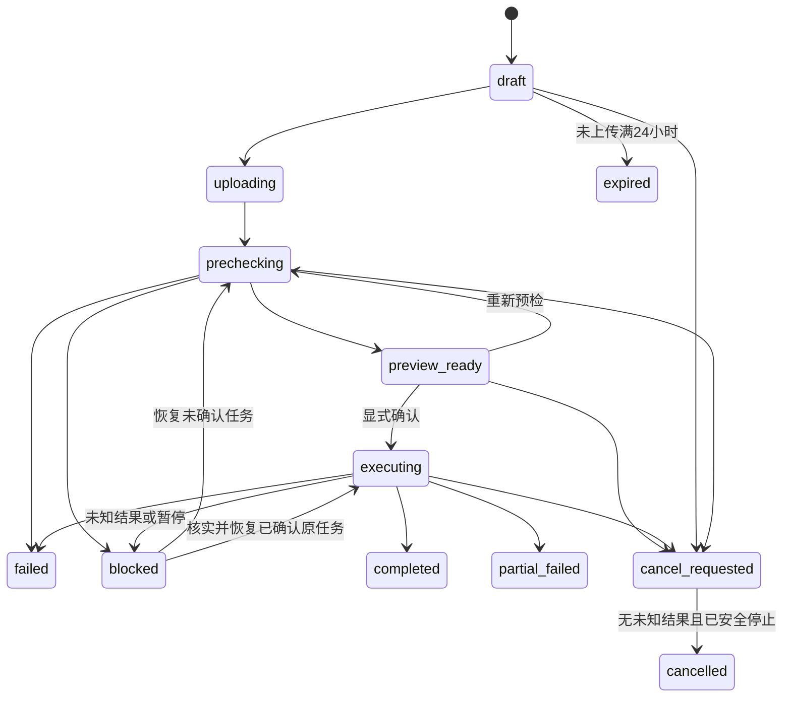

# 通用批量导入页面与交互设计

## 范围与依赖

本设计定义管理后台通用导入中心、导入向导、批次详情和错误恢复交互。产品范围与业务边界见 [通用批量导入设计](overview.md)，接口方案见 [导入 API 设计](api.md)，数据库字段与持久化约束见 [导入数据库设计](database.md)，组件职责与目录见 [导入技术架构设计](architecture.md)。

平台和物业分别注册页面、绑定身份、权限、API 客户端与本端 React Query。向导、预览、问题、详情、进度和结果展示可以复用，复用机制遵循 [管理后台前端设计](../../architecture/admin-web.md#前端模块与复用边界)。前端只操作批次及业务动作，不直接操作内部行、操作账本和任务表。

一期只开放 `create` 模式。不提供更新、合并、覆盖、任意文件智能字段匹配或在线模板管理。本轮不接入业务类型或生产适配器；测试适配器仅放在测试目录，用于验收通用流程。生产类型目录为空时展示“尚无可用导入类型”，禁用新建；不发布虚拟类型或可写业务数据的演示功能。

## 入口与导航

### 页面组织

导入中心包含历史列表、新建向导和批次详情。按本端域名注册页面，开发服务器映射遵循 [域名与页面路径](../../architecture/admin-web.md#域名与页面路径)。

| 页面     | 本端页面路径         | 主要职责                                         |
| -------- | -------------------- | ------------------------------------------------ |
| 导入中心 | `/imports`           | 查询历史、继续未完成批次、进入新建。             |
| 新建导入 | `/imports/new`       | 确定类型、范围和模板，创建批次并上传文件。       |
| 批次详情 | `/imports/:batch_id` | 进度、预览、确认、问题、结果、时间线和恢复操作。 |

在直连开发服务器时，路径使用所属后台的 `/platform` 或 `/property` 映射。页面前缀不改变 API 前缀；业务接口仍由各端客户端访问 `/api/platform/v1/...` 或 `/api/property/v1/...`。

### 后续业务入口约束

业务类型接入时可在对应业务列表增加“批量导入”入口，本轮不修改业务列表。入口上下文包含 `import_type`、`scope_type`、`scope_id`；它只用于定位页面，不能作为授权凭证。

页面固定显示导入类型、范围名称、来源页面和“范围已锁定”。首期范围仅为公司或小区；房屋、账期及资源集合在对应业务接入时单独设计。用户不能在向导中切换到其他范围，文件里的范围字段也不能覆盖锁定范围。服务端保存并校验范围，修改 URL、隐藏字段或重放请求不能改变批次范围。

### 从导入中心进入

依次选择导入类型、导入范围、模板版本、文件。范围类型取自导入类型的 `allowed_scope_types`，可用模式取自 `supported_modes`。公司、小区选择器复用当前后台已有 API。平台端明确选择目标公司，物业端公司来自身份且不可切换。拥有导入权限还须具备对应业务创建权限；两端不能通过共用页面跨越业务授权。

选定范围后展示锁定提示：“导入文件中的数据将仅处理到当前范围：幸福小区。”更换类型时清空模板与文件，重新确定允许的范围。批次创建后范围、模板身份和模式不可修改，需要改变时创建新批次。

## 导入向导

### 模板版本

模板面板展示模板名称、导入类型、版本号、发布时间、说明和版本变更说明。字段说明包含字段编码、显示名称、顺序、必填标记、数据类型、长度、格式、枚举值、示例、业务说明和规范化规则，并提供模板下载。

模板版本统一使用正整数，页面显示 `v1` 等标签；摘要为小写 64 位十六进制。默认选择服务端推荐版本。旧版本只有在服务端明确允许用于新批次时才可选择。采用严格版本化模板；列顺序变化、可选列缺失等兼容规则由模板定义，未知列、重复列和关键表头问题必须明确提示。

批次绑定 `template_key + template_version_no + template_config_hash`。后续解析、预检、展示和执行均使用该身份，不能自动升级到最新版本。

版本不存在、已停止用于新批次但历史仍依赖、摘要不一致和注册表不可用需要分别处理。历史版本的停用不等于可以丢弃其配置；无法加载原配置或发现漂移时显示配置不可用或任务暂停，禁止使用其他版本替代。

### 上传文件

先创建草稿批次，再上传源文件。支持 CSV、XLSX，最大 10 MiB、50,000 数据行、200 列；界面与服务端使用同一限制。未上传草稿在创建 24 小时后失效，不能继续上传。界面提供拖拽或选择文件、文件类型与大小检查、文件名和大小、上传进度、取消上传、网络失败重试，以及重新进入已上传批次的入口。未解析时行数显示为未知，不能以客户端估计冒充确定结果。

客户端可计算 SHA-256，最终文件身份、格式、大小与摘要由服务端确认。文件格式、编码、行数、表头、重复列、宏、外部链接和恶意内容检查由服务端承担。客户端检查不能替代服务端校验。

取消浏览器上传只表示停止当前传输；是否已经接收成功应查询批次确认。批次取消使用独立的取消动作，不把中断连接视为成功取消。

### 解析与预检

上传完整后自动进入持久化任务流程，依次展示文件接收、文件解析、字段匹配、格式校验、业务预检和生成预览。字段匹配遵循模板兼容规则，不开放智能字段映射。

上传、解析、规范化、预检和预览只写导入暂存与运行记录，确认前不写正式业务数据。页面明确提示：“当前仍处于预览阶段，尚未写入正式业务数据。”

小文件和大文件使用相同任务语义。用户可以离开，之后从历史或详情恢复查看。进度只展示当前阶段、已处理行数、确定或估算的总行数、可确定的百分比、最近更新时间及是否需要人工处理；不直接展示 `checkpoint`。暂停时显示安全说明和稳定错误码。解析/预检中不展示半成品行结果或可确认的旧预览，新版本必须完成后原子发布。

### 预览与定位

顶部固定展示总行数、新增、更新、跳过、警告、错误。新增、更新和跳过属于计划动作，警告和错误属于问题统计，同一行可以同时属于两组，不能简单相加。

一期更新数为 0，明确展示“创建模式，不会更新已有数据”。已有自然键的处理由业务适配器决定跳过或冲突：内容一致可作为幂等成功跳过，内容不同不能隐式更新。

预览表格按模板配置生成字段列，包含原始文件行号、原始值、服务端规范化值、计划动作、行校验结果和问题数量。计划动作展示新增、更新、跳过、拒绝等用户可读名称。

点击行后，以侧栏或抽屉展示原始值与规范化值、问题级别、字段编码、列名、列序号、可用的单元格位置、稳定错误码、说明、修复建议和是否可重试。文件级问题可以没有行号或字段。敏感值由服务端按权限脱敏，前端不得自行补齐。

支持查看全部、错误、警告以及按新增、更新、跳过、原始行号、字段和错误码筛选。筛选、分页及当前问题定位状态可通过非敏感 URL 参数恢复；原始行值与规范化值不进入 URL。

### 确认执行

确认弹窗展示导入范围、模板版本、创建模式、可能影响的业务范围、预览有效期、预计处理行数，以及新增、跳过、警告和错误数量。

预检有错误时默认禁止确认。仅当用户显式选择“仅执行通过行”并记录选择后，才允许跳过普通错误行。错误行本身不能执行；权限、作用域、模板等边界问题必须阻断整个批次，不能通过跳过错误行绕过。

警告行是否执行需要显式确认。确认 API 使用 `apply_policy=all_rows|valid_rows_only` 和必填 `include_warning_rows`。默认选择整体通过的 `all_rows`；用户显式选择 `valid_rows_only` 后才允许排除普通错误行。警告选择也须明确保存；未选择执行的警告行记录为策略排除。请求与数据库使用同一策略字段，不再维护另一种表达。

请求必须携带 `preview_version` 和 `preview_fingerprint`。文件、配置、范围或预检结果变化、预览过期、执行时业务状态变化时，不能直接依据旧预览写入；显示冲突，调用独立重新预检操作；重新预检完成后展示新版本并再次确认。预览有效期为生成后 24 小时，且不得超过批次保留截止时间。重新预检不改变文件、配置或范围，不延长 `retention_until`；已确认执行的批次不能重预检。

### 执行与结果

确认成功的 `202` 表示执行已安排。界面展示当前阶段、进度、成功、失败、跳过数量、最近更新时间，并允许离开后继续查看。

结果区域分别显示实际成功、失败、业务跳过、策略排除、取消未执行和结果未知等已记录结果，不能用预览新增数代替实际成功数。结果未知时显示待核实，按原操作键恢复，不宣称失败，也不生成新的业务操作。

执行统计及结果读取本批次行结果快照，后续重跑不会改写原批次结果。结束后提供执行结果、失败行下载、明确可重试失败行数量、业务错误数量、失败行重跑和操作时间线。取消只能阻止尚未提交的处理单元，已提交结果保留并显示部分完成；它不是业务回滚。

## 状态与操作边界

### 批次对外阶段

下表定义页面和 API 方案采用的批次阶段投影。阶段不是数据库任务或业务操作状态的替代；持久化字段及对应边界见 [数据库设计](database.md)。

| 阶段值             | 页面含义与操作边界                                                                                         |
| ------------------ | ---------------------------------------------------------------------------------------------------------- |
| `draft`            | 已创建、等待文件，可继续上传；未完成草稿可过期。                                                           |
| `uploading`        | 文件传输中，展示进度并允许停止当前上传。                                                                   |
| `prechecking`      | 解析和预检中，可离开并继续查看，不提供执行确认。                                                           |
| `preview_ready`    | 预检完成，可查看明细，满足权限、有效期和策略条件时确认；可请求取消。                                       |
| `executing`        | 已确认并进入执行流程，可查看进度；允许的取消为协作式停止。                                                 |
| `completed`        | 执行完成，展示实际结果、文件与时间线。                                                                     |
| `partial_failed`   | 部分操作成功、部分失败，展示已提交结果和符合条件的失败行重跑。                                             |
| `failed`           | 任务整体失败，保留已有结果，只有明确可重试的失败操作可重跑。                                               |
| `blocked`          | 原配置缺失、摘要漂移、未知结果或需人工处理，显示原因并阻止继续写入；未知结果显示“待核实”。                 |
| `cancel_requested` | 已请求取消，等待任务在安全边界停止，不能展示为取消完成。                                                   |
| `cancelled`        | 已安全停止，保留已提交结果并区分取消未执行行。                                                             |
| `expired`          | 未上传草稿超过 24 小时或未完成批次输入超过保留期限，不能继续上传或使用已清理文件；预览单独到期可重新预检。 |

主要流转如下。解析、排队和恢复通过 `phase` 表达，不新增批次状态；全部状态和阶段枚举见 [导入数据模型](../../../openapi/components/import-schemas.yaml)。

`uncertain` 保留为业务操作和本批次行结果的待核实状态。存在未知结果时，批次为 `blocked`，原因 `import.result_uncertain`，保留 `uncertain_rows`；不计为失败、成功或取消完成，不提供失败行重跑。核实和恢复只使用原任务、原操作键及已确认策略。配置及权限阻断尚未解决时不能恢复写入。

### 其他状态维度

页面分别表达执行策略、行校验、计划动作、问题级别、业务操作结果和任务进度。持久化枚举、字段及约束由 [数据库设计](database.md) 统一定义，API 返回受限投影，不要求与存储对象一一对应。

警告通过问题级别表达，可与计划动作并存，不新增持久化行状态。操作账本记录逻辑操作的当前结果，本批次行结果快照记录该批次结果；后续重跑更新共享操作时不改变旧历史。任务排队或完成不能代替业务成功。任务类型与恢复职责见 [技术架构](architecture.md)，确认策略表达见 [API 设计](api.md#重预检与确认)。

### 权限与可用动作

菜单、页面和按钮使用所属后台同一套权限上下文。后端始终重新校验导入类型、当前账号、物业公司、小区和资源范围；拥有批次读取权限不等于拥有执行、下载或重跑权限。两端权限分别使用 `platform.import.*`、`property.import.*` 的显式目录项，具体操作对应见 [API 权限](api.md#身份权限与范围)，不授予通配权限。导入权限与实际业务权限叠加，平台端不能获得原本无权执行的物业写能力。

确认、取消、重跑、生成和下载文件的入口同时受当前阶段、服务端允许动作和操作权限控制。`next_actions` 是可用动作提示，不能替代服务端鉴权。终态不能重新确认；不可取消或已完成批次的取消请求按冲突处理。取消返回 `202` 只表示请求已持久化，待安全停止后显示 `cancelled`。`blocked` 显示“核实并恢复原任务”动作，阻断原因解决后才允许受理，不能绕过配置、权限或范围检查。

解析、确认和每个执行分块前重新校验权限及范围。失去权限后不能因旧页面、旧缓存或旧按钮仍可见而继续写入。

## 历史、详情与恢复

### 历史列表与详情

历史查询支持导入类型、范围类型与范围、状态、创建人、有无错误、创建时间范围、分页和排序。至少展示导入类型、范围、模板版本、文件名、创建人、创建时间、状态、总行数、成功数、失败数和最近更新时间。

详情采用顶部状态区、统计卡片、行明细、问题侧栏或抽屉，以及事件时间线。时间线通过分页事件资源按时间和唯一 ID 稳定排序，展示批次状态变化、阶段任务及文件生命周期，不替代管理员审计。时间显示与 API 的 UTC 时间转换遵循现有后台约定。

### 错误文件

错误文件通过独立异步任务生成，界面区分待生成、生成中、可下载、已失效需重新生成、失败和已过期的情况。已发布预览前仅提供问题查询，不承诺可修复行文件；确认、恢复或重预检推进结果后旧文件立即失效，不能显示为最新执行错误。文件未就绪时不显示为下载成功；生成、查询状态与下载使用各自 API。

文件包含原始错误行、原始行号、问题字段、稳定错误码、错误说明和修复建议。生成时防止 CSV/XLSX 公式注入。错误文件使用固定最小安全投影，敏感字段始终脱敏，不按生成者权限增加明文；生成和下载都检查当前范围及读取权限，预览按服务端字段权限脱敏。下载前校验所属后台、公司、批次、字段和下载权限，并指定生成代次；通过鉴权 API 流式下载，响应禁止缓存并使用服务端安全文件名，不暴露私有路径或签发公开短链。

源文件、错误文件和行快照按保留策略处理。已清理内容应明确不可用，批次、事件和审计关联仍保留；不能显示可继续上传、确认或下载的假入口。源文件、错误文件及敏感快照到 `retention_until` 关闭读取、重跑和文件重建；普通批次截止为创建后 30 天，重跑批次继承源批次截止时间；重新预检、恢复、生成文件均不延长窗口。活动任务或未知结果所需内部证据延迟物理清理，但不恢复外部访问；最小历史和幂等证据保留。

### 失败行重跑与修复重传

失败行重跑只接受明确标记可安全重试的失败操作，并创建新的批次。新批次继承原范围、模板版本和配置摘要，保留父批次关联，复用原 `operation_key`，不能通过重跑改变范围、模板或重复创建成功记录。

新批次创建后重新预检、展示新预览并要求再次显式确认，不能沿用旧确认直接执行。原批次实际执行结果和统计固定不变；可重试行数是当前可用动作计数，允许随账本成功、权限或保留期变化减少；取消也只修改本批次未执行行，不能取消被其他批次复用的共享操作。未知结果先通过原任务恢复操作核实，普通业务错误不能自动重跑。修改错误文件后再上传属于普通新批次流程，可预填原范围和类型，但仍需要重新校验、预检和确认。

## 请求、缓存与异常

所有写操作使用稳定幂等键。提交期间禁止重复点击。超时或断网时显示“提交结果正在核实，请勿重复点击”，先查询批次或使用原幂等键与原输入恢复结果；不自动生成新键重新提交。

活动批次使用本端 React Query 轮询，间隔可从 2 秒逐步退避到 10 秒；无活动任务时停止进度轮询，保留手动刷新。第一阶段不新增 SSE 或 WebSocket。行、问题和文件状态按当前批次及页面需要读取，避免用另一个请求体系获取同一资源。

筛选、分页、状态和错误码放入 URL。表单、上传状态与抽屉归页面；两端使用独立 QueryClient、请求客户端和认证状态。退出、身份变更及认证失效时取消本端请求、清理缓存与表单，防止旧身份响应回填。具体机制复用 [请求、缓存与表单状态](../../architecture/admin-web.md#请求缓存与表单状态)。

| 情况                               | 页面处理                                                     |
| ---------------------------------- | ------------------------------------------------------------ |
| 401、强制改密、权限不足            | 执行本端既有身份守卫与操作错误规则；不清理另一后台状态。     |
| 批次不存在                         | 详情显示不存在，提供返回并刷新历史。                         |
| 预览过期、状态或幂等冲突、模板漂移 | 显示安全说明，刷新相关资源；不自动重试写入。                 |
| 文件过大、类型不支持、文件无效     | 定位到上传步骤，说明允许范围，保留已创建批次供查询。         |
| 行列问题                           | 通过问题资源定位原行、列和字段；不只展示一个全局 HTTP 提示。 |
| 注册表不可用或任务暂停             | 显示阶段、稳定错误码和安全原因，禁止切换其他版本继续。       |
| 读取失败、503、网络中断            | 提供手动重试；写入未知先核实原结果。                         |
| 空列表                             | 区分没有历史、没有匹配项和无可用导入类型；无类型时禁用新建。 |

## 验证要求

- 两种入口均锁定服务端范围；伪造 URL、文件范围字段和跨公司资源不能绕过校验。
- 严格模板、旧版本、配置缺失和漂移均有明确展示，批次不自动切换模板。
- 确认前无正式业务写入；统计维度可重叠，原始值、规范化值与问题定位对应正确。
- 普通错误行的部分执行必须显式选择，警告需确认，边界错误不能跳过；过期或失效预览不能执行。
- 用户离开、刷新和重新登录后，按当前权限恢复批次进度；两端缓存与身份不串用。
- 重复点击、超时重放和失败重跑不重复创建；未知结果不进入盲目重跑。
- 取消保留已提交结果，`202` 与取消请求都不提前展示完成；文件生成与过期状态准确。
- 敏感字段脱敏、公式注入防护、权限失效与保留策略在预览、下载和历史中一致。
