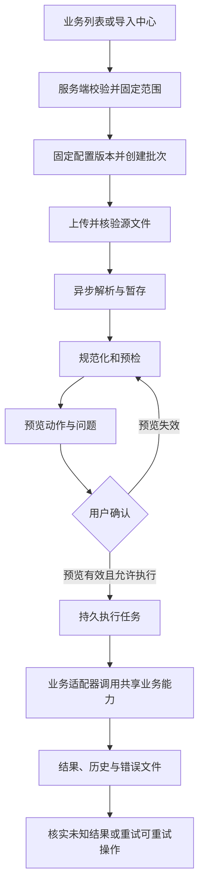

# 通用批量导入设计

## 目标与范围

管理后台共用一套批次级导入能力，通过业务适配器扩展不同数据类型。通用控制面负责导入流程与可靠性，具体业务继续维护自身规则和数据不变量。

开发范围为通用导入引擎、平台和物业管理后台的导入页面、运行保障与测试验证，不包含房屋、业主登记、账单等业务接入。生产环境不注册业务模板或适配器，导入类型目录返回空集合，页面显示暂无可用类型并禁用新建。测试仅在测试环境注入适配器与隔离数据，不提供生产测试类型或通过 HTTP 启用测试类型的入口。

业务列表的导入按钮、业务模板及共享业务写入提取，随各业务接入另行设计和实施。本设计中的业务示例只说明扩展边界。

| 文档                                                      | 职责                                                            |
| --------------------------------------------------------- | --------------------------------------------------------------- |
| 本篇                                                      | 产品范围、流程、作用域、重复处理与可靠性原则                    |
| [数据库设计](database.md)                                 | 八张表的职责、字段、约束、索引、请求幂等、操作账本与 checkpoint |
| [页面交互](interaction.md)                                | 导入入口、向导、预览、确认、进度、历史及恢复操作                |
| [API 设计](api.md)                                        | 资源、输入输出、权限、幂等、错误及文件传输方案                  |
| [技术架构](architecture.md)                               | 分层、拟新增目录、配置注册、适配器、Worker、存储与验证          |
| [OpenAPI 导入模块](../../../openapi/modules/imports.yaml) | 通用接口的精确请求、响应、权限和错误规格，由根契约引用          |

已有 [系统架构](../../architecture/overview.md)、[后端业务边界](../../architecture/backend-services.md)、[后台前端设计](../../architecture/admin-web.md)、[API 规范](../../api/conventions.md) 和 [数据库规范](../../database/conventions.md) 继续作为各专题的公共约束。[OpenAPI 契约](../../../openapi/openapi.yaml) 及其引用是 API 契约的唯一权威来源，已按模块与共享组件表达本设计；运行端尚未实现。遵循 OpenAPI First，依据契约实施，提交前保证契约与实现一致，不得跳过未实现接口的检查。具体依赖和验收见 [实施计划](../../plans/imports/implementation.md)。

## 方案选择与首期边界

采用「统一导入控制面 + 业务导入适配器」，以有限、明确的扩展点代替逐业务重复建设。

| 方案                    | 收益                                     | 代价与适用边界                                     |
| ----------------------- | ---------------------------------------- | -------------------------------------------------- |
| 各业务独立开发导入      | 单个需求初期投入少                       | 流程、权限、错误和幂等容易分叉，新增业务重复建设   |
| 统一控制面 + 业务适配器 | 共用流程，业务规则保持归属，扩展范围清晰 | 需要统一批次、配置、操作和任务语义；本项目采用     |
| 全配置 ETL / 低代码平台 | 支持复杂映射与流程配置                   | 需要规则语言、解释器、权限与回滚体系，超出当前需求 |

首期包括：

- 仅创建模式 `create`，严格的版本化模板。
- 服务端固定导入范围，源文件与业务数据隔离。
- 上传、解析、规范化、预检、预览、显式确认和异步执行。
- 持久任务、导入历史、错误定位、错误文件和失败行恢复。
- 请求级幂等、业务操作级幂等、分块提交和任务接管。

更新、合并、覆盖、任意字段智能匹配及全批原子回滚须独立设计。新增能力必须明确影响范围、授权与恢复语义，不能借用创建模式隐式开放。

## 总体流程

上传、解析、预检和预览只写导入暂存数据，不写正式业务表。执行必须发生在用户确认之后。所有文件使用相同的持久任务语义，小文件也不另建一套同步导入流程。

用户离开页面不影响任务。页面通过轮询读取进度，历史页面能够继续查看阶段、统计、时间线、行级结果与错误文件。

## 控制面与业务职责

| 通用控制面                                 | 业务适配器                                       |
| ------------------------------------------ | ------------------------------------------------ |
| 配置版本绑定、文件管理、批次与任务生命周期 | 字段定义、模板内容与适用范围规则                 |
| 上传、解析、暂存、预览、确认、历史         | 字段规范化、跨字段与业务关联校验                 |
| 作用域约束执行、任务进度、问题存储和下载   | 自然键、业务重复判断和创建操作计划               |
| 幂等账本、租约、恢复、统计及时间线         | 调用共享 Domain / 写入命令创建业务实体并映射结果 |

必填、类型、格式和枚举等基础规则可由配置声明。关联关系、业务状态和不变量由业务适配器及所属领域能力处理。通用引擎不能动态拼接业务表名、直接执行任意业务写入或绕过原有不变量。

适配器不管理 HTTP 身份、任务租约或事务提交。Worker 与后台应用 Service 通过共享业务能力复用规则；具体依赖见 [分层设计](architecture.md)。

新增导入类型的正常变化范围是：增加模板配置版本、实现业务适配器、登记类型与权限，并补充该类型的校验、幂等和必要验证。通用引擎无需针对类型堆叠条件分支。

## 作用域与权限

通用范围首期支持公司与小区，采用有类型的输入结构。物业公司的归属由当前身份确定；平台选择目标公司后仍须通过授权校验。房屋、账期组合及资源集合随对应业务另行设计，不开放任意客户端范围 JSON。

业务接入后的列表入口可预填并锁定当前范围；当前只建设导入中心的通用入口，不修改业务列表。

入口 URL 和前端参数仅提供上下文。服务端校验后保存范围快照，批次创建后不可切换目标。物业公司归属来自认证上下文，平台操作者也须显式通过目标范围校验。

文件中的小区、房屋或账期信息不得覆盖批次范围；存在相应字段时必须与锁定范围一致，否则产生 `import.scope_mismatch`。权限、作用域及模板级问题属于阻断问题，不能以「跳过错误行」绕过。

解析、确认及每个执行分块前重新检查权限和范围。创建时可访问不代表后续始终可写，下载、重跑及幂等重放也遵守当前身份、后台和数据范围。

导入权限与适配器要求的实际业务权限叠加。两端分别注册允许使用的类型，不能因共用导入能力扩大平台端或物业端的业务授权。

## 模板与预览

模板必须说明名称、类型、版本、字段编码与名称、必填性、类型、长度、格式、示例、枚举、业务含义、规范化规则及版本变更说明。

模板采用随应用发布的不可变版本配置；不建立模板版本表，不在数据库中保存整份配置快照。版本号统一为正整数，页面展示 `v1` 等名称，配置摘要统一为小写 64 位十六进制。批次固定配置标识、版本与摘要。历史版本缺失或内容漂移时阻断处理，不能自动回退到最新版本；装包、归档和发布机制见 [技术架构](architecture.md)。

严格模板可以声明列顺序变化、可选列缺失等兼容规则。未知字段、重复列及关键表头异常须明确提示，不做静默猜测。

预览提供「总行数、新增、更新、跳过、警告、错误」六项统计。首期更新数固定为零。新增、更新和跳过表达计划动作，警告与错误表达问题，两组可能重叠，不能把六项直接相加。

行明细展示源行号、原始值、规范化值、计划动作、问题级别、稳定错误码、字段或单元格位置及修复建议。页面明确提示当前尚未写入正式业务数据。

确认时再次展示目标范围、模板版本、创建模式、计划统计、影响范围与预览有效期。预览过期或依赖数据变化后重新预检，不静默替换执行计划。确认令牌与交互细节见 [页面交互](interaction.md) 和 [API 设计](api.md)。

默认有错误不能执行。允许「仅执行通过行」时必须由用户显式选择并记录；阻断问题始终禁止确认。

确认策略统一使用 `apply_policy` 和 `include_warning_rows`，与预览令牌、确认时间、执行任务及审计同事务保存。未确认的警告行不进入执行集合，策略排除、预检错误和实际业务跳过分别表达。

## 重复与幂等

| 情况                     | 创建模式的处理           |
| ------------------------ | ------------------------ |
| 文件内自然键重复         | 默认报错，提示定位重复行 |
| 系统中同自然键、内容一致 | 跳过，视为幂等成功       |
| 系统中同自然键、内容不同 | 冲突，禁止隐式更新       |
| 缺少稳定业务唯一键       | 不开放默认创建模式       |

请求幂等与业务幂等分别承担不同责任：

- 创建、上传、预检、确认、取消、重跑、文件生成和恢复等写请求由 `import_requests` 持久化请求键与首次结果；同键同输入恢复原结果，同键异输入拒绝。创建、上传和确认分别计算各自的请求指纹，创建时不要求尚未上传的文件摘要。
- 每个逻辑业务操作使用稳定 `operation_key`，由 `import_operations` 记录。网络重试、任务接管和失败重跑复用原操作，不以更换操作键再次创建。

自然键和数据库唯一约束还须防止不同批次重复创建。请求成功按钮禁用、Redis 锁或文件哈希都不能替代持久幂等账本和业务唯一性约束。

修改输入后的重新上传属于新的待检输入，不等同于原输入的自动重试；成功结果不能因再次上传而重复创建。操作键与行快照的关系见 [数据库设计](database.md)。

## 部分失败、未知结果与取消

按行或有界分块提交，单个业务实体涉及的多表写入保持原子性。批次可以部分成功，行级失败不要求回滚整批；已经成功的操作在重试时直接恢复既有结果。

正式业务写入、操作账本更新、本批次行结果及进度必须同事务提交。操作账本表达逻辑操作当前结果，行结果表达本批次执行事实；批次终结后行结果和统计不随其他批次重跑改变。checkpoint 只表达恢复位置，不能用任务游标推断业务已经成功。

提交或执行结果未知时保留 `uncertain` 语义，批次进入 `blocked` 并显示待核实原因，保留未知行数量且不写终结时间。先按原操作键核实持久结果。未查到结果不自动证明失败，不能盲目重新创建，也不能把未知操作放进普通失败重试集合。

自动重试只处理明确标记为可重试的失败。修正数据后重新上传和原操作恢复使用不同流程，具体限制见 [页面交互](interaction.md)。

失败重跑创建新批次，复用原操作键，重新预检并再次确认；已过期、输入已清理或无法加载原配置时不开放重跑。恢复入口只核实或恢复原任务，不能创建替代逻辑操作。

取消只阻止本批次尚未提交的工作，不回滚已成功行，也不把共享操作账本改成取消。执行途中取消必须显示已完成数量和保留结果；未知结果仍须核实，全批事务和外部副作用回滚属于独立业务设计。

## 问题、安全与恢复保障

问题支持文件级和行级定位。行级问题关联源行、字段编码、列序号或单元格，以及原始值、规范化值、稳定错误码、公开说明和修复建议。错误码设计见 [API 设计](api.md)，原始值通过受控业务投影读取，不能混入通用异常响应或日志。

源文件接收须限制格式、编码、大小、行数及解压资源，检查重复表头、宏、外部链接和恶意内容。错误文件包含问题行及修复信息，导出时防止 CSV/XLSX 公式注入。

预览、原始文件、错误下载、日志和审计分别执行敏感信息控制。文件访问受后台和数据范围保护，存储内部地址不作为公开访问地址。

文件使用单机私有持久目录和受鉴权 API 下载，不生成公开下载地址。错误文件采用固定最小安全字段投影，下载时仍检查当前权限，不能沿用生成者的更高权限。

源文件、错误文件和敏感快照统一使用 30 天保留窗口；清理不延长窗口。行值及操作自然键通过受控清理置空并保留清理标记，不能用空对象伪装原始证据。活动任务及未知结果所需数据不得部分清理；保留期结束后关闭重跑和错误文件重建，已确认的最小历史及幂等证据继续保留。时间基准、保护条件和清理机制见 [数据库设计](database.md) 与 [技术架构](architecture.md)。

持久任务使用租约、心跳和执行代次，防止旧 Worker 覆盖接管后的结果。checkpoint 仅存恢复坐标与生成代次，不存业务行、敏感内容或业务幂等结果；断点与相应进度同事务提交。文件对象和数据库无法共同提交时，通过元数据核验、代次和孤儿对象清理恢复。

管理员审计复用现有审计能力，批次时间线单独记录生命周期，两者不能互相替代。字段、约束、恢复实例及验证要求分别由 [数据库设计](database.md) 和 [技术架构](architecture.md) 维护。
