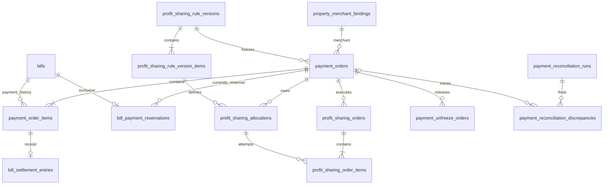
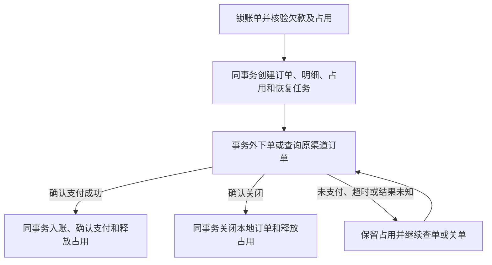

# 账单支付与分账数据设计

## 范围与依据

居民通过平台小程序缴纳已获授权房屋的账单，包括房屋历史欠费。平台作为支付服务商，物业公司作为其下收款商户；商户申请在线下完成，系统绑定已经取得的商户号。当前一家公司只有一个有效商户绑定，一次支付付清一张账单的全部剩余欠款，物业公司承担渠道手续费，平台按公司配置的比例收取服务费。

本设计保留同一收款商户下合并多月账单、按小区选择收款商户及多个分账接收方的结构。当前仅向平台分账，不提供部分金额付款、退款、线上商户进件或返利抵扣。

本文件维护支付新增表、与账务的关联、资金操作状态及恢复规则。业务规则、权限、渠道流程、资金核对及页面交互以 [账单支付业务设计](bill-payments.md) 为准，接口以 [OpenAPI](../../../openapi/openapi.yaml) 为准。既有账务表的字段和不变量以 [账单设计](../property/billing.md) 为准；居民身份及房屋授权以 [居民接入设计](../resident/identity-and-house-claims.md) 为准。

数据库类型、事务与迁移遵循 [数据库规范](../../database/conventions.md)，分层与进程职责遵循 [系统架构](../../architecture/overview.md) 和 [后端业务边界](../../architecture/backend-services.md)。验证遵循 [测试规范](../../conventions/testing.md)。本设计不定义对外 API 契约和居民页面的明细可见字段。

## 设计原则

- 账单保存应收事实和结清汇总，支付订单保存收款过程，支付占用独立保存当前排他关系。
- 商户身份和分账规则版本不可变。支付创建时绑定确切版本，后续商户更换或费率调整不改变旧订单的执行依据。
- 支付成功后才生成应分事实和分账执行记录；应分金额与渠道执行尝试分开保存。
- 居民缴费完成、平台分账完成、物业剩余资金解冻分别确认。分账或解冻失败不撤销已确认的居民收款。
- 结果未知时恢复原业务单，不能用新单号重新扣款、重复分账或提前释放支付占用。
- 状态、金额和身份有权威来源；不重复保存可直接关联取得的字段和可推导汇总。

## 命名与基础字段

字段使用渠道中立的业务名称。渠道专有参数、状态及枚举由 Integration 映射，不作为领域字段命名依据。

| 内部字段                       | 当前微信支付协议映射 | 用途                             |
| ------------------------------ | -------------------- | -------------------------------- |
| `service_provider_merchant_no` | `sp_mchid`           | 平台在渠道的服务商商户号。       |
| `merchant_no`                  | `sub_mchid`          | 实际收款物业的渠道商户号。       |
| 支付表 `order_no`              | `out_trade_no`       | 系统生成的支付业务单号。         |
| 分账、解冻表 `order_no`        | `out_order_no`       | 系统生成的资金操作业务单号。     |
| `channel_transaction_no`       | `transaction_id`     | 渠道确认的支付交易号。           |
| `channel_order_no`             | `order_id`           | 渠道分账或解冻单号。             |
| `channel_detail_no`            | `detail_id`          | 渠道资金明细编号。               |
| `prepay_token`                 | `prepay_id`          | 发起客户端支付所需的预支付凭证。 |

内部关联使用 `*_id`，业务单号使用 `*_no`。当前接收方类型使用业务枚举 `merchant`，与渠道的商户接收方枚举映射；接收关系 `service_provider` 与渠道服务商关系枚举映射。原始渠道状态保存在必要的渠道响应中，内部状态由已验证事实归一化。

以下基础字段在各表明细中省略：

| 字段         | 类型与约束                    | 适用范围                                                                               |
| ------------ | ----------------------------- | -------------------------------------------------------------------------------------- |
| `id`         | `uuid`，主键，应用生成 UUIDv7 | 除当前占用关联表外的新增表。                                                           |
| `created_at` | `timestamptz(6)`，非空        | 所有新增表，包括当前占用关联表。                                                       |
| `updated_at` | `timestamptz(6)`，非空        | 商户绑定、支付订单、分账执行单及明细、解冻单、任务、通知、对账批次及差异等可变状态表。 |

金额使用 `bigint` 整数分，比例使用 `integer` 基点 `*_bps`，100 基点表示 1%。费率及计算结果使用整数或精确十进制计算。标识非空且不得是空白字符串；幂等键与摘要沿用项目既有格式。外键不级联删除。

## 数据表概览

新增 15 张表，扩展 2 张既有账务表，复用账单和管理员审计表。

| 表                                     | 处理方式           | 职责与设计思路                                                         |
| -------------------------------------- | ------------------ | ---------------------------------------------------------------------- |
| `property_merchant_bindings`           | 新增               | 物业公司与渠道收款商户绑定；更换商户保留旧绑定，历史支付引用原记录。   |
| `profit_sharing_rule_versions`         | 新增               | 公司级不可变分账规则版本；变更新增版本。                               |
| `profit_sharing_rule_version_items`    | 新增               | 规则版本内的接收账号和比例；当前平台一条，支持多条。                   |
| `payment_orders`                       | 新增               | 一次支付请求、金额、付款人、冻结配置及确认结果。                       |
| `payment_order_items`                  | 新增               | 支付与账单的金额分配；当前一条，支持未来合并。                         |
| `bill_payment_reservations`            | 新增               | 当前账单支付占用；存在即占用，释放删除。                               |
| `profit_sharing_allocations`           | 新增               | 支付成功后产生的不可变应分金额，不与执行重试混算。                     |
| `profit_sharing_orders`                | 新增               | 一次使用独立业务单号的渠道分账执行。                                   |
| `profit_sharing_order_items`           | 新增               | 本次分账尝试履行的应分金额及接收方实际结果。                           |
| `payment_unfreeze_orders`              | 新增               | 独立的剩余资金解冻执行及确认结果。                                     |
| `payment_tasks`                        | 新增               | 持久调度、查询、重试与执行租约，支持进程重启恢复。                     |
| `payment_channel_requests`             | 新增               | 一次渠道 HTTP 调用尝试的参数、响应与结果可信度。                       |
| `payment_channel_notifications`        | 新增               | 已验签通知的去重、持久接收和处理状态。                                 |
| `payment_reconciliation_runs`          | 新增               | 按渠道账单范围保存核对批次、来源摘要与汇总，原范围可重核对。           |
| `payment_reconciliation_discrepancies` | 新增               | 保存可追溯的资金差异、原业务关联及处置结果，不将差异直接改成资金成功。 |
| `bills`                                | 复用，补充占用保护 | 保留应收、结清汇总和版本模型，不增加支付占用字段。                     |
| `bill_operations`                      | 扩展               | 支持系统发起的幂等线上入账操作。                                       |
| `bill_settlement_entries`              | 扩展               | 关联支付明细，作为已缴金额依据并约束重复入账。                         |
| `admin_audit_logs`                     | 复用               | 管理员商户绑定、规则版本及人工处置的审计。                             |

图中展示核心业务关联；当前占用另通过支付、账单组合外键证明订单包含该账单。

## 商户与规则

### 物业商户绑定

`property_merchant_bindings`：

| 字段                           | PostgreSQL 类型  | 空值 | 用途                                                               |
| ------------------------------ | ---------------- | ---- | ------------------------------------------------------------------ |
| `property_company_id`          | `uuid`           | 非空 | 所属物业公司。                                                     |
| `service_provider_merchant_no` | `varchar(64)`    | 非空 | 本绑定使用的服务商商户号，保留历史执行身份。                       |
| `merchant_no`                  | `varchar(64)`    | 非空 | 本绑定实际收款商户号。                                             |
| `merchant_name`                | `varchar(256)`   | 非空 | 绑定时的商户名称，用于人工核对。                                   |
| `enabled`                      | `boolean`        | 非空 | 是否允许新支付采用该绑定；停用不阻止旧支付查单、关单、分账或解冻。 |
| `max_ratio_bps`                | `integer`        | 可空 | 渠道确认的最大分账比例缓存，未知时为空。                           |
| `ratio_checked_at`             | `timestamptz(6)` | 可空 | 上限最近一次成功核验时间，与上限缓存成对填写。                     |
| `created_by`                   | `uuid`           | 非空 | 创建绑定的管理员。                                                 |
| `idempotency_key`              | `varchar(128)`   | 非空 | 公司内创建绑定的持久幂等键；重放仍返回原绑定。                     |
| `request_fingerprint`          | `char(64)`       | 非空 | 规范化创建输入摘要，防同键改变商户或并发期望。                     |
| `row_version`                  | `bigint`         | 非空 | 管理配置版本，初始为 1；每次启停变更递增，比例缓存刷新不递增。     |

约束与使用：

- `(property_company_id, id)`、`(property_company_id, idempotency_key)` 唯一，供支付复合外键引用及创建防重；公司、创建者分别关联既有记录，`row_version > 0`。
- 公司在 `enabled = true` 条件下唯一。更换绑定先停用旧记录，再启用新记录，同事务提交。
- 新绑定以停用状态创建；完成渠道条件核验后显式激活。尚无分账规则时允许激活，但配置仍不可收款，原因是 `rule_missing`；已有规则超出新商户上限时同样可激活已核验商户，但原因是 `ratio_exceeded`。只有完整规则适用于该绑定后才可收款。
- 公司、服务商商户号、收款商户号和绑定名称创建后不可原地更换；启停及上限缓存允许受控更新。新身份建立新绑定，不删除历史绑定。
- `max_ratio_bps` 在 0 至 10000 范围；不能用未知或失效缓存证明新费率合法。规则校验及新支付还需核对渠道能力与接收关系。
- 一期按公司解析绑定。未来按小区选择时扩展绑定适用范围和唯一约束，支付订单仍只引用一个确切绑定。

### 分账规则版本

`profit_sharing_rule_versions`：

| 字段                  | PostgreSQL 类型 | 空值 | 用途                                               |
| --------------------- | --------------- | ---- | -------------------------------------------------- |
| `property_company_id` | `uuid`          | 非空 | 规则所属公司。                                     |
| `version_no`          | `bigint`        | 非空 | 公司内递增版本号，表示规则选择顺序。               |
| `calculation_version` | `smallint`      | 非空 | 标识计算基数、比例应用和舍入方式的确定性计算版本。 |
| `created_by`          | `uuid`          | 非空 | 创建完整规则版本的管理员。                         |
| `idempotency_key`     | `varchar(128)`  | 非空 | 公司内创建规则版本的持久幂等键。                   |
| `request_fingerprint` | `char(64)`      | 非空 | 规范化创建输入摘要，防同键改变规则或并发期望。     |

`UNIQUE(property_company_id, version_no)`、`UNIQUE(property_company_id, id)`、`UNIQUE(property_company_id, idempotency_key)`；版本号及计算版本为正数。规则头与全部条目同事务创建，创建即作为该公司的最新版本。锁公司行协调版本号分配，新支付锁后选择最新版本；回退也创建新版本。

规则头、条目和计算版本定义不可原地修改或删除。版本作为完整聚合一次提交；提交后也不能追加、替换或删除条目。支付引用后按原版本计算，不在支付表重复保存费率。不设置草稿、预约生效时间或 `is_current`。

### 分账规则条目

`profit_sharing_rule_version_items`：

| 字段               | PostgreSQL 类型 | 空值 | 用途                                                |
| ------------------ | --------------- | ---- | --------------------------------------------------- |
| `rule_version_id`  | `uuid`          | 非空 | 所属不可变规则版本。                                |
| `receiver_type`    | `varchar(32)`   | 非空 | 接收账号的业务类型，当前为 `merchant`。             |
| `receiver_account` | `varchar(128)`  | 非空 | 渠道可识别的接收账号；当前为平台商户号。            |
| `receiver_name`    | `varchar(256)`  | 非空 | 接收方名称，满足渠道核验及敏感字段加密要求。        |
| `relation_type`    | `varchar(32)`   | 非空 | 物业与接收方的业务关系，当前为 `service_provider`。 |
| `rate_bps`         | `integer`       | 非空 | 此接收方适用的分账比例，范围为 0 至 10000。         |

`UNIQUE(rule_version_id, receiver_type, receiver_account)`，防止同版本重复配置同一接收账号。规则版本关联真实外键；同版本比例合计不得超过渠道允许上限，跨行校验在受控写入与数据库保护中完成。

计算基数与舍入方式由规则头的 `calculation_version` 统一标识，不逐条重复存储。渠道手续费由物业承担，不能将订单总额与付款人实付金额的差值当作渠道手续费。启用对应配置前须完成该物业商户与接收方的渠道关系建立；平台服务商身份本身不替代接收关系。

### 配置并发与创建重放

配置令牌不另行落库：由公司全部历史绑定的 `(id, row_version)` 规范排序及最新规则版本 ID 计算摘要。历史绑定不删除，令牌能识别启用后又停用等往返变更；比例缓存刷新不改变令牌。

配置写入均携带 `expected_configuration_token`。绑定及规则创建先校验管理员身份、权限与公司范围，再按公司内幂等键查重：同键同输入返回原资源当前状态，不重新激活绑定或发布旧规则；同键不同输入返回冲突。只有新请求才检查配置令牌。激活、停用使用当前状态的比较交换，不提供历史请求重放承诺；响应丢失后读取配置核实，旧令牌可返回冲突。

外部能力和接收关系核验不持有数据库锁；提交前锁定公司并重新比较令牌、核验结果适用对象及当前规则，再原子写配置和审计。两个并发写入不能都覆盖同一期望；不可将网络调用期间读取的旧配置直接提交。

## 支付订单与明细

### 支付订单

`payment_orders`：

| 字段                     | PostgreSQL 类型  | 空值 | 用途                                               |
| ------------------------ | ---------------- | ---- | -------------------------------------------------- |
| `property_company_id`    | `uuid`           | 非空 | 支付的账务归属公司。                               |
| `payer_user_id`          | `uuid`           | 非空 | 发起支付的小程序用户，关联 `miniapp_users.id`。    |
| `merchant_binding_id`    | `uuid`           | 非空 | 本次支付确定的收款商户身份。                       |
| `rule_version_id`        | `uuid`           | 非空 | 本次支付确定的分账规则版本。                       |
| `order_no`               | `varchar(64)`    | 非空 | 唯一支付业务单号，下单、查单和关单始终使用原号。   |
| `channel_transaction_no` | `varchar(64)`    | 可空 | 支付成功后取得的渠道交易号。                       |
| `amount_cents`           | `bigint`         | 非空 | 订单金额，必须为正且等于支付明细合计。             |
| `payer_total_cents`      | `bigint`         | 可空 | 渠道确认的付款人实际支付金额；允许与订单金额不同。 |
| `status`                 | `varchar(32)`    | 非空 | 内部支付状态，见下表。                             |
| `prepay_token`           | `varchar(256)`   | 可空 | 预支付成功后取得的支付凭证，不作为成功收款依据。   |
| `expires_at`             | `timestamptz(6)` | 非空 | 请求的支付有效截止时间，过期后触发查询或关闭。     |
| `paid_at`                | `timestamptz(6)` | 可空 | 渠道确认的真实支付成功时间。                       |
| `closed_at`              | `timestamptz(6)` | 可空 | 本地确认订单已终止且不可继续支付的时间。           |
| `idempotency_key`        | `varchar(128)`   | 非空 | 同一居民创建支付请求的持久幂等键。                 |
| `request_fingerprint`    | `char(64)`       | 非空 | 规范化业务输入摘要，防同键改变账单等输入。         |

| 状态        | 含义与处理                                           |
| ----------- | ---------------------------------------------------- |
| `pending`   | 本地订单已创建，尚未取得可供客户端使用的预支付结果。 |
| `unknown`   | 下单或查询结果不确定，保留占用并恢复原订单。         |
| `payable`   | 已取得支付凭证或渠道确认仍未支付；保持占用。         |
| `closing`   | 正在关闭或关闭结果尚待确认；保持占用。               |
| `succeeded` | 已确认支付成功并完成账单入账。                       |
| `closed`    | 已确认不可继续支付；也包括可靠阻止发送的本地取消。   |

约束与使用：

- `UNIQUE(order_no)`、`UNIQUE(payer_user_id, idempotency_key)`、`UNIQUE(property_company_id, id)`。
- `(property_company_id, merchant_binding_id)` 引用绑定的 `(property_company_id, id)`；规则版本同样使用公司复合外键。付款人关联真实用户。
- 当前单渠道下，`channel_transaction_no` 非空时唯一；同一商户建立新的绑定记录不能使同一渠道交易重复入账。接入其他渠道时按渠道命名空间调整此约束，绑定启用状态不参与历史关联。
- 公司、付款人、绑定、规则版本、订单号、金额、有效期和幂等输入创建后固定。预支付凭证及确认事实按状态受控更新，已确认成功不能被迟到的未支付或失败响应覆盖。
- `succeeded` 必须有交易号和支付时间，`closed` 必须有关闭时间；成功与关闭互斥。实付金额非负，未知时为空。
- 创建重放先校验当前居民身份，再按原付款人核实原订单范围；同键同输入返回原订单及当前状态，不要求仍有原房屋授权。新建必须校验当前房屋权限。同键不同输入返回冲突，不能因原订单关闭就用原键另建一笔。
- 当前渠道请求单号的长度与字符限制由 Integration 继续收紧，不能直接将数据库长度上限作为渠道允许上限。

### 支付明细

`payment_order_items`：

| 字段                  | PostgreSQL 类型 | 空值 | 用途                                                   |
| --------------------- | --------------- | ---- | ------------------------------------------------------ |
| `property_company_id` | `uuid`          | 非空 | 用于公司复合外键，防止订单与账单串公司。               |
| `payment_order_id`    | `uuid`          | 非空 | 所属支付订单。                                         |
| `bill_id`             | `uuid`          | 非空 | 本次支付缴纳的账单。                                   |
| `amount_cents`        | `bigint`        | 非空 | 本次分配到该账单的正金额，创建时等于锁后全部剩余欠款。 |

- `(property_company_id, payment_order_id)` 引用支付的 `(property_company_id, id)`，`(property_company_id, bill_id)` 引用账单同名组合。
- `UNIQUE(payment_order_id, bill_id)`、`UNIQUE(bill_id, id)`，分别供当前占用和结算明细关联。
- 明细创建后不可修改或删除；订单金额等于明细金额之和，同事务受控写入并由数据库保护校验。
- 当前恰好一条明细。未来合并时，必须逐账单解析收款配置并确认同一绑定，仅属于同一物业公司不足以证明同一收款商户。

## 账单支付占用

`bill_payment_reservations` 仅保存当前有效占用，不保存历史生命周期。

| 字段               | PostgreSQL 类型  | 空值与约束               | 用途                                                 |
| ------------------ | ---------------- | ------------------------ | ---------------------------------------------------- |
| `bill_id`          | `uuid`           | 非空，主键，外键关联账单 | 以账单为排他协调对象，每张账单至多一条当前占用。     |
| `payment_order_id` | `uuid`           | 非空，普通索引           | 当前占用订单；不单列唯一，允许未来一单占用多张账单。 |
| `created_at`       | `timestamptz(6)` | 非空                     | 当前占用建立时间。                                   |

复合外键 `(payment_order_id, bill_id)` 引用 `payment_order_items(payment_order_id, bill_id)`，证明订单包含账单。此表直接使用内部账单 ID 为主键，不增加代理 ID。

行存在即占用，释放时删除；不增加状态、金额、付款人、过期时间或释放时间。历史由订单、明细和渠道调用保存。占用建立与释放不更新账单、不递增账单版本、不生成账单操作。

释放仅限以下情况：

1. 确认支付成功，且全部账单入账与释放占用在同一事务内完成。
2. 渠道确认订单已关闭等不可继续支付终态，本地关闭与释放同事务完成。
3. 确定从未发送且已可靠阻止所有后续发送的本地订单取消。

前端取消、请求超时、查询返回未支付、支付有效期到达、任务失败或租约过期均不单独构成释放条件。不能按占用时长、Redis 锁期限或定时清理直接删除记录。删除必须同时匹配 `bill_id` 和原 `payment_order_id`，防止迟到任务释放另一订单的占用。

有占用时禁止新增另一笔线上支付，以及冲突的线下收款、纠错、冲正和作废；不影响金额的资料维护仍遵循既有账单规则。唯一约束只防重复占用，不能替代所有账务写入口取得账单锁后的占用检查。

## 分账应分与执行

### 应分金额

`profit_sharing_allocations`：

| 字段                   | PostgreSQL 类型 | 空值 | 用途                                         |
| ---------------------- | --------------- | ---- | -------------------------------------------- |
| `payment_order_id`     | `uuid`          | 非空 | 已确认成功的支付订单。                       |
| `rule_version_item_id` | `uuid`          | 非空 | 该支付冻结规则中的接收方条目。               |
| `amount_cents`         | `bigint`        | 非空 | 按原计算版本确定的正数应分金额，重试不改变。 |

`UNIQUE(payment_order_id, rule_version_item_id)`、`UNIQUE(payment_order_id, id)`。真实外键分别关联支付与规则条目；额外校验条目的规则版本等于支付引用版本，不能只验证两条记录分别存在。

支付成功入账时，按原规则为金额大于零的接收方创建不可变记录，接收账号、比例和名称通过不可变规则取得。零金额条目不创建应分记录；所有条目计算为零时可直接进入解冻流程。无应分记录不能单独用来推断支付已完成应分计算，应结合支付成功和成功事务保证判断。

不保存应分总额、累计成功额或完成标记。应分总额从此表取得，履行情况从执行明细中的确认成功金额取得。

### 分账执行单

`profit_sharing_orders`：

| 字段               | PostgreSQL 类型 | 空值 | 用途                                                           |
| ------------------ | --------------- | ---- | -------------------------------------------------------------- |
| `payment_order_id` | `uuid`          | 非空 | 本次执行所属支付，也是分账与解冻协调的父记录。                 |
| `order_no`         | `varchar(64)`   | 非空 | 唯一业务单号；同一次执行网络重试使用原号、原参数。             |
| `channel_order_no` | `varchar(64)`   | 可空 | 渠道返回的分账单号。                                           |
| `status`           | `varchar(32)`   | 非空 | `pending`、`unknown`、`processing`、`finished` 或 `rejected`。 |

`UNIQUE(order_no)`、`UNIQUE(payment_order_id, id)`，关联支付真实外键。每笔支付最多一张非终态分账执行单，以 `pending/unknown/processing` 条件唯一索引保障。

`finished` 只表示渠道执行结束；是否履行成功以接收方结果为准。`rejected` 仅用于已确认没有受理执行的终态；通信失败、未经可信核验的响应或含糊错误必须保留为未知并查询原单。

执行单与完整明细、提交任务同事务创建。支付交易号、商户号、接收方等参数来自已经冻结的支付和规则。执行条目及金额发起后固定；实际参数白名单保存在渠道请求中，用于核查重试一致性。

### 分账执行明细

`profit_sharing_order_items`：

| 字段                      | PostgreSQL 类型  | 空值 | 用途                                                    |
| ------------------------- | ---------------- | ---- | ------------------------------------------------------- |
| `payment_order_id`        | `uuid`           | 非空 | 供复合外键约束执行单与应分记录属于同一支付。            |
| `profit_sharing_order_id` | `uuid`           | 非空 | 所属本次渠道分账执行。                                  |
| `allocation_id`           | `uuid`           | 非空 | 本次尝试履行的应分记录。                                |
| `amount_cents`            | `bigint`         | 非空 | 本次尝试分配的正数金额。                                |
| `result`                  | `varchar(32)`    | 可空 | 接收方确认结果 `success/failed`；未取得确定结果时为空。 |
| `channel_detail_no`       | `varchar(64)`    | 可空 | 渠道接收方资金明细编号。                                |
| `fail_reason`             | `varchar(1000)`  | 可空 | 已确认失败的原因，不将未知响应误记为失败。              |
| `finished_at`             | `timestamptz(6)` | 可空 | 渠道确认的接收方执行完成时间。                          |

- `UNIQUE(profit_sharing_order_id, allocation_id)`。
- `(payment_order_id, profit_sharing_order_id)` 引用执行单的 `(payment_order_id, id)`；`(payment_order_id, allocation_id)` 引用应分表同名组合。
- 同一应分记录的累计确认成功金额不得超过应分金额。在支付父记录锁下计算和写入，未知、在途金额不能再用于创建另一执行。
- 多接收方部分成功后保留旧执行事实，只有明确结束的失败部分才能新建另一执行单补足；禁止重新发送已成功金额。
- 同一次执行的条目和金额不可改写，结果仅按可信响应或查询单调确认，迟到消息不能将成功降为失败。

例如，A 应分 3 元、B 应分 2 元，首次 A 成功、B 失败，再次仅补 B。应分总额始终为 5 元；两次尝试金额合计可能为 7 元，不能据此确认已分金额。

## 剩余资金解冻

`payment_unfreeze_orders`：

| 字段                | PostgreSQL 类型  | 空值 | 用途                                                         |
| ------------------- | ---------------- | ---- | ------------------------------------------------------------ |
| `payment_order_id`  | `uuid`           | 非空 | 所属支付；明确失败后可保留多张历史解冻执行单。               |
| `order_no`          | `varchar(64)`    | 非空 | 独立于服务费分账的唯一解冻业务单号。                         |
| `channel_order_no`  | `varchar(64)`    | 可空 | 渠道返回的解冻单号。                                         |
| `status`            | `varchar(32)`    | 非空 | `pending/unknown/processing/succeeded/failed/no_remaining`。 |
| `unfrozen_cents`    | `bigint`         | 可空 | 渠道确认实际释放的非负金额，未知时为空。                     |
| `channel_detail_no` | `varchar(64)`    | 可空 | 原收款商户的渠道资金明细编号。                               |
| `fail_reason`       | `varchar(1000)`  | 可空 | 明确失败或不能继续处理的原因。                               |
| `finished_at`       | `timestamptz(6)` | 可空 | 渠道确认的解冻完成时间。                                     |

真实外键关联支付，`UNIQUE(order_no)`。同一支付最多一张 `pending/unknown/processing` 解冻单，以部分唯一索引约束；已有成功或确认无剩余结果后不再发起新单。分账与解冻单号分别使用固定不同前缀并设置格式 CHECK，保持渠道单号空间不重叠。

当前解冻接口释放全部剩余资金给原收款商户，不填写预期解冻金额，不增加任意接收方或解冻明细子表。`unfrozen_cents` 是确认结果，不能简单采用支付金额减平台服务费推算。

创建解冻单必须在支付父记录锁下确认：所有应分金额均已足额成功，且无待发送、在途或未知分账。解冻单与任务原子创建。**一旦存在任何解冻单，该支付永久禁止再创建分账执行**；解冻明确失败后也只恢复解冻流程。

解冻响应同样需要查询确认接收结果，不能仅凭执行结束标记成功。`no_remaining` 只表示已通过可信查询确认无待解冻金额，不代表本次执行成功释放了资金，也不代表平台服务费已经到账。缺失的应分金额不得因渠道无剩余资金而改记成功。

## 持久任务

`payment_tasks`：

| 字段                      | PostgreSQL 类型  | 空值 | 用途                                                                           |
| ------------------------- | ---------------- | ---- | ------------------------------------------------------------------------------ |
| `task_type`               | `varchar(32)`    | 非空 | 支付下单、查单、关单，分账提交及查询，解冻提交及查询，通知处理、渠道账单核对。 |
| `payment_order_id`        | `uuid`           | 可空 | 支付操作目标。                                                                 |
| `profit_sharing_order_id` | `uuid`           | 可空 | 分账提交或查询目标。                                                           |
| `unfreeze_order_id`       | `uuid`           | 可空 | 解冻提交或查询目标。                                                           |
| `notification_id`         | `uuid`           | 可空 | 通知处理目标。                                                                 |
| `reconciliation_run_id`   | `uuid`           | 可空 | 渠道账单获取、核验及核对的批次目标。                                           |
| `status`                  | `varchar(16)`    | 非空 | `ready/running/completed/paused`；暂停用于需人工修复的异常。                   |
| `next_run_at`             | `timestamptz(6)` | 非空 | 下次可领取时间。                                                               |
| `attempt_count`           | `bigint`         | 非空 | 初始为零，每次领取递增，同时作为执行代次。                                     |
| `lease_expires_at`        | `timestamptz(6)` | 可空 | 本次任务领取租约截止时间，失联后允许接管。                                     |
| `last_error`              | `varchar(1000)`  | 可空 | 最近执行错误的脱敏摘要。                                                       |

五个目标均使用真实外键，通过 CHECK 保证恰好一个非空且与任务类型匹配。各目标建立 `(task_type, 目标ID)` 条件唯一索引，包括对账批次；重试和轮询更新同一任务，不无限追加任务行。调度索引覆盖就绪任务的 `next_run_at` 和运行中任务的租约截止时间。

使用 `FOR UPDATE SKIP LOCKED` 领取，递增代次并设置租约后立即提交。续租、延期、暂停和完成均须匹配任务 ID、领取代次与有效租约，旧执行者不能覆盖已被接管的任务或更新资金结果；相关业务写入与任务确认在同一受代次保护的事务完成。

租约不阻止已经发送的网络请求，因此渠道操作仍需使用原业务单号与原参数。旧执行者不能另建业务单规避代次校验。网络调用期间不持有数据库事务；重启后从持久任务恢复，不能仅凭达到重试次数放弃资金结果确认。

不增加通用 `payload`、独立租约令牌或租约持有人。任务对象由外键取得，执行代次由 `attempt_count` 提供。

## 渠道调用与通知

### 渠道调用尝试

`payment_channel_requests` 每行表示一次实际 HTTP 尝试，不表示新的支付或分账业务单。

| 字段                      | PostgreSQL 类型  | 空值 | 用途                                                                               |
| ------------------------- | ---------------- | ---- | ---------------------------------------------------------------------------------- |
| `operation`               | `varchar(64)`    | 非空 | 渠道操作，如支付下单、查询、关单、分账、解冻、接收关系配置、比例核验或账单获取。   |
| `payment_order_id`        | `uuid`           | 可空 | 支付操作关联对象。                                                                 |
| `profit_sharing_order_id` | `uuid`           | 可空 | 分账操作关联对象。                                                                 |
| `unfreeze_order_id`       | `uuid`           | 可空 | 解冻操作关联对象。                                                                 |
| `merchant_binding_id`     | `uuid`           | 可空 | 接收关系配置、比例核验等商户级操作对象。                                           |
| `reconciliation_run_id`   | `uuid`           | 可空 | 渠道账单申请、下载与来源核验的批次对象。                                           |
| `request_snapshot`        | `jsonb`          | 非空 | 实际发送参数的必要业务字段白名单，用于重试核对。                                   |
| `outcome`                 | `varchar(32)`    | 非空 | `started/verified_response/transport_unknown/invalid_response`。                   |
| `http_status`             | `smallint`       | 可空 | 收到的 HTTP 状态码，不等同于业务执行成功。                                         |
| `channel_request_id`      | `varchar(128)`   | 可空 | 渠道返回的请求标识，用于渠道排查。                                                 |
| `response_snapshot`       | `jsonb`          | 可空 | 已核验的必要响应、渠道状态和错误信息白名单；账单下载还保存本轮差异判定的必要事实。 |
| `error_code`              | `varchar(128)`   | 可空 | 可检索的渠道或本地错误码，与结果可信度分别表达。                                   |
| `request_id`              | `varchar(64)`    | 非空 | 项目诊断链路标识。                                                                 |
| `finished_at`             | `timestamptz(6)` | 可空 | 本次尝试记录完成时间；账单下载包含判定快照完成，开始时间使用 `created_at`。        |

五个业务对象外键按操作恰好一个非空。按目标和 `created_at` 建立追溯索引。发送前先可靠保存 `started` 记录；之后进程中断意味着请求可能已发出，应按未知结果恢复。

请求身份、参数和操作一旦建立不改写，只补充结果；完成后保持不可变。取得可信响应不等于业务成功；未验签或未通过结构和商户、金额等核验的响应不能推进资金成功状态。

普通调用在可信响应保存后完成该次尝试记录，再由业务事务应用结果。账单下载需要额外保存本轮判定：先独立提交已核验的来源事实，设 `outcome=verified_response`、`finished_at=null`，此后来源身份与摘要不可改写；再在受当前任务代次及租约保护的核对事务中追加判定快照，并与批次、差异、任务确认及 `finished_at` 原子提交。仅取得有效文件不表示核对或尝试记录已经完成，不能提前封存快照后再改写。

判定事务回滚时保留来源证据，不发布部分核对结果。失去租约的旧执行者只能补存自身收到的来源证据，不能追加业务判定；未应用的来源记录可带未应用说明封存，不能伪装成核对完成。重启后需要重新获取文件时，为实际发生的新下载建立新尝试记录，不用新文件改写旧证据。文件正文不因此长期落库。

快照禁止保存私钥、API 密钥、Authorization、客户端会话、支付签名参数及可直接用于支付的凭证。必要字段脱敏或按项目敏感数据要求保护，不将完整原始报文直接落库。

### 渠道异步通知

`payment_channel_notifications`：

| 字段                      | PostgreSQL 类型  | 空值 | 用途                                               |
| ------------------------- | ---------------- | ---- | -------------------------------------------------- |
| `channel_notification_id` | `varchar(64)`    | 非空 | 渠道通知标识，唯一约束用于去重。                   |
| `notification_type`       | `varchar(64)`    | 非空 | 支付成功或分账动账等通知类型。                     |
| `payload`                 | `jsonb`          | 非空 | 验签、解密后的必要业务资源白名单，支持可靠补处理。 |
| `payment_order_id`        | `uuid`           | 可空 | 核验后关联的支付；归属未知时允许先隔离保存。       |
| `status`                  | `varchar(16)`    | 非空 | `pending/processed/ignored/quarantined`。          |
| `processed_at`            | `timestamptz(6)` | 可空 | 完成处理、忽略或隔离的时间。                       |

只接受验签通过的通知，因此不增加恒为真的验签标志。通知内容创建后不可修改，只维护处理状态及核验后的关联。通知与处理任务同事务可靠保存后返回渠道成功应答；重复通知在确认原记录已提交后应答成功，不重复入账或生成应分记录。

通知处理状态、业务结果和任务完成同事务更新；重试次数及租约只由任务表维护。无法关联或金额、商户不匹配的通知隔离处理，不能猜测匹配。分账到账通知仅作为接收方到账佐证，不替代整张分账单或解冻单查询。

## 资金核对台账

渠道账单范围、业务日期、跨日回补及异常恢复流程以 [资金核对](bill-payments.md#资金核对) 为准。下列两表保存核对批次与差异；完全匹配的每一行不另建本地副本。

### 核对批次

`payment_reconciliation_runs`：

| 字段                           | PostgreSQL 类型  | 空值 | 用途                                                                                                                          |
| ------------------------------ | ---------------- | ---- | ----------------------------------------------------------------------------------------------------------------------------- |
| `business_date`                | `date`           | 非空 | 渠道账单的业务日期，按各账单事件口径解释，不使用本地订单创建日期。                                                            |
| `statement_type`               | `varchar(32)`    | 非空 | `trade/profit_sharing/platform_fundflow`，分别核对收款、分账及平台资金。                                                      |
| `service_provider_merchant_no` | `varchar(64)`    | 非空 | 账单对应的服务商身份，包括历史身份。                                                                                          |
| `merchant_no`                  | `varchar(64)`    | 可空 | 交易、分账账单对应的实际收款商户号；平台资金账单为空。                                                                        |
| `status`                       | `varchar(16)`    | 非空 | `ready/running/completed/failed`；完成表示核对已执行，不表示没有差异。                                                        |
| `statement_hash_type`          | `varchar(32)`    | 可空 | 已校验来源摘要的算法，与摘要成对填写。                                                                                        |
| `statement_hash`               | `varchar(256)`   | 可空 | 最近一次成功取得并通过完整性核验的账单摘要。                                                                                  |
| `summary`                      | `jsonb`          | 非空 | 白名单汇总，含核对范围、来源行数、匹配/差异数量、金额与可信渠道手续费，以及按可靠归属公司生成的同口径分组，不保存原始账单行。 |
| `finished_at`                  | `timestamptz(6)` | 可空 | 本轮核对完成或失败时间；再次调度时重置。                                                                                      |

唯一约束采用 `UNIQUE NULLS NOT DISTINCT (business_date, statement_type, service_provider_merchant_no, merchant_no)`。交易、分账账单必须有商户号，平台资金账单必须为空，以 CHECK 限制；一期平台资金账单固定基本账户，未来多账户需将账户类型纳入范围键。状态和摘要成对关系使用 CHECK，完成前必须有通过核验的来源。

范围按实际渠道商户身份定义，不按商户绑定 ID 定义，防止同一商户有多条历史绑定时重复核对。同范围重核对沿用批次和任务；每次申请、下载及校验保留独立渠道调用记录和来源摘要。账单下载响应解析后，完成快照还保存本轮新建、解决或重开差异的稳定引用、核对维度、判定时间、来源摘要、应有值与实际值及必要状态；提交时序遵循 [渠道调用尝试](#渠道调用尝试)，完成后不可变。不能仅靠文件摘要追溯被覆盖的差异证据，也不能覆盖历史请求证据。最近错误与重试由任务维护，不重复增加批次错误字段。

平台账单可能包含本系统以外或尚未归属的业务，因此批次不保存单一 `property_company_id`。每轮核对必须同步保存按本地支付链可靠归属公司的汇总分组，包含匹配与差异计数、金额、实际手续费和口径；不能事后仅从差异表推导全部匹配资金。分组以实际出现的公司为边界，不嵌入原始行或无界事件历史；未归属行仅计入平台视图。

物业读取本公司交易、分账批次的汇总分组，不返回整批总数、金额、其他公司的商户号、原始账单或未归属差异；平台资金账单批次仅平台可见。商户号不能替代本地支付链的归属核验，也不能通过请求中的公司参数切换范围。临时下载 URL 不作为持久资金证据，完整原始账单长期归档需要独立的保留与访问策略。

### 核对差异

`payment_reconciliation_discrepancies`：

| 字段                           | PostgreSQL 类型  | 空值 | 用途                                                                                                               |
| ------------------------------ | ---------------- | ---- | ------------------------------------------------------------------------------------------------------------------ |
| `reconciliation_run_id`        | `uuid`           | 非空 | 发现差异的核对批次，真实外键。                                                                                     |
| `difference_type`              | `varchar(32)`    | 非空 | `channel_only/local_only/amount_mismatch/status_mismatch/unclassified`，区分单边记录、金额、状态及暂不可分类问题。 |
| `reference_key`                | `varchar(256)`   | 非空 | 核对维度与稳定业务标识规范化生成的引用，区分同一业务的不同核对问题；不含付款人个人信息。                           |
| `payment_order_id`             | `uuid`           | 可空 | 已可靠归属的本地支付，未知单边记录也允许保存差异。                                                                 |
| `profit_sharing_order_item_id` | `uuid`           | 可空 | 差异涉及的具体分账接收明细，避免将单个接收方差异误记为整单结果。                                                   |
| `expected_cents`               | `bigint`         | 可空 | 相同核对口径下的本地预期金额；未知用空值，不能填零。                                                               |
| `actual_cents`                 | `bigint`         | 可空 | 相同口径下的可信渠道金额；未知用空值。                                                                             |
| `evidence`                     | `jsonb`          | 非空 | 有边界的证据白名单，含状态、业务引用、核对口径、来源摘要和必要错误分类；不存完整原报文、隐私或凭证。               |
| `status`                       | `varchar(16)`    | 非空 | `open/observing/resolved`；观察中表示已安排原业务恢复，仍待可靠确认。                                              |
| `resolved_at`                  | `timestamptz(6)` | 可空 | 最近一次可靠核验完成处置的时间。                                                                                   |
| `resolved_by`                  | `uuid`           | 可空 | 最近一次处置关联的管理员，自动核验为空，真实外键。                                                                 |
| `resolution_note`              | `varchar(1000)`  | 可空 | 最近一次处置依据或分类说明，禁止凭空宣告资金成功。                                                                 |

`UNIQUE(reconciliation_run_id, difference_type, reference_key)`。支付与具体分账明细均使用真实外键；指定分账明细时必须有关联支付，并校验它沿分账执行单关联的支付与 `payment_order_id` 一致。金额允许正负以适配渠道资金账单，但必须明确同一口径；差异金额不能拿订单总额与扣费后资金直接比较。

`difference_type` 保持粗分类，`evidence.check_code` 表达实际核对维度，两者按下表组合；不能把金额、手续费等不同问题都挤在同一业务键下。

| 核对问题                       | `check_code`                                  | `difference_type` 与比较口径                                                                                           |
| ------------------------------ | --------------------------------------------- | ---------------------------------------------------------------------------------------------------------------------- |
| 单边支付、分账或资金记录       | 对应下列业务维度                              | `channel_only/local_only`；尚不能确定维度时用 `unclassified`。                                                         |
| 商户、应用、原单或接收身份不符 | `business_identity`                           | `status_mismatch`；只保存脱敏分类，不把另一主体的标识写入状态字段。                                                    |
| 支付金额不符                   | `payment_amount`                              | `amount_mismatch`；订单金额与渠道订单金额比较，不混用付款人实付金额。                                                  |
| 支付状态不符                   | `payment_status`                              | `status_mismatch`。                                                                                                    |
| 已收款但账单入账缺失或不一致   | `bill_posting`                                | 缺失用 `status_mismatch`，已存在但金额不同用 `amount_mismatch`；逐支付明细核对。                                       |
| 分账执行或应分履行不符         | `profit_sharing_amount/profit_sharing_status` | 分别用 `amount_mismatch/status_mismatch`；执行明细比较本次请求与渠道结果，履行核验比较累计成功与应分，不累计失败尝试。 |
| 解冻金额或状态不符             | `unfreeze_amount/unfreeze_status`             | 分别用 `amount_mismatch/status_mismatch`；只比较同口径可信结果，未知金额为空。                                         |
| 手续费结果不符                 | `channel_fee`                                 | `amount_mismatch`；只与可信手续费及其原比较依据核对，不从居民实付差额推算。                                            |
| 平台账户到账金额不符           | `platform_fundflow_amount`                    | `amount_mismatch`；按渠道资金记账口径比较。                                                                            |
| 尚无法分类                     | `unclassified`                                | `unclassified`；保留证据继续核实，不按匹配完成。                                                                       |

`reference_key` 由核对维度与规范化稳定业务标识组成，可使用规范化输入的 SHA-256 十六进制摘要。支付以原业务单号、入账以支付明细、分账以执行单及稳定接收明细、资金流水以渠道稳定记账标识定位；渠道已有稳定业务号时优先使用，补关联本地记录不能换键。不得把金额、状态、核验时间、文件摘要或文件行位置放入去重键；接收账号等敏感标识不以明文进入键。可靠重核对发现同一对象的差异类型或维度变化时，须同时核实旧问题是否消失，不能留下已失效的旧差异。

应分履行核验以稳定应分记录定位，与单次执行核验分开。手续费没有独立可信的比较依据时，只记录渠道实际值，预期金额为空，不凭估算费率生成金额不符差异。

`evidence` 复用 [OpenAPI 的证据白名单](../../../openapi/components/payment-management-schemas.yaml)：保存 `check_code`、判定时间及该次来源。文件证据携带该次 `source_digest` 和对应本地渠道调用记录 ID `source_request_id`；按单查询携带对应调用 ID，摘要可空；纯内部核验两者可空。调用 ID 不是渠道返回的 `channel_request_id`，引用本地不可变证据也不授予读取诊断快照的权限。批次的最近来源摘要不能替代历史判定来源；这些信息保存在现有 JSON 快照内，不新增列。

重核对按稳定键更新当前证据，不删除既有差异。差异消失并经可靠核对，或已核实可审计的外部处置依据后才转为已解决；再次出现重新打开，最近处置信息保留供追溯，不因打开而清空。人工恢复原因及此前人工处置保存在既有管理员审计中，自动核对依据从批次及不可变渠道调用记录追溯，不将当前状态行当作完整事件历史。来源缺失或核对失败不能批量清除差异。

差异恢复只调度关联原业务的查单、分账、解冻等任务，并安排重核对；操作及审计同事务提交。无法可靠关联的渠道单边记录仅平台可查看、分类及记录外部处置，不能猜测关联或手工补记资金成功。建立批次日期/类型索引、差异批次/状态及支付关联索引，物业查询在过滤可归属范围后统一计算分页与总数。

核对结果应用及外部处置统一先锁批次、再按稳定 ID 锁差异。需要协调原业务的恢复用例，先按既有业务锁序取得所需资源，再进入批次及差异锁，最后操作任务；禁止持有批次锁回头等待原业务锁。

外部处置在批次及差异锁内重新核验差异令牌、状态及当前核对是否在执行，不锁定或改写原资金对象。原因、外部依据引用、操作者、处置前后状态和该次证据引用进入既有管理员审计，差异只更新当前状态及 `resolved_at/by/note`；`resolution_note` 保存含依据引用的有界脱敏摘要，完整原因保存在审计中，不拼接无界历史。处置和审计同事务提交，原差异证据保留。详细适用条件见 [批次与差异生命周期](bill-payments.md#批次与差异生命周期)。

## 支付确认与账单入账

账单操作完整字段见 [账单操作](../property/billing.md#账单操作)，结算明细字段见 [收款及冲正明细](../property/billing.md#收款及冲正明细)。两表分别扩展系统操作与线上收款来源，不在支付表重复维护账单结清状态。

查单与通知共用成功确认入口，核对原商户身份、应用身份、业务单号、渠道交易号、订单金额及支付成功事实。客户端支付回调只触发查询，不直接作为入账依据。可信成功证据先保存在通知或渠道调用记录中，再执行入账；入账失败仍可恢复。仅当证据已通过完整业务核验而尚未完成入账时，对外派生 `confirmation_status=awaiting_posting`；它不新增支付状态，也不释放占用。

同一事务完成：

1. 按统一锁序锁定全部账单及支付订单，核对当前状态和原订单占用；重复成功确认读取既有结果，不重做账务。
2. 保存已验真的支付成功状态、渠道交易号和支付时间，状态变化在整笔事务提交前不对其他事务可见。
3. 为每条支付明细创建系统 `online_receipt` 操作，幂等键使用 `online_receipt_<payment_order_item_id>`；不能只用整笔支付订单号，否则未来合并时会触碰公司级幂等唯一约束。
4. 创建唯一线上结算明细，金额等于支付明细金额，业务收款日期从渠道支付时间按 `Asia/Shanghai` 取得。
5. 更新全部账单已缴汇总并递增相应账单版本。
6. 按冻结规则生成正金额应分记录，创建首笔分账执行及任务；零应分时创建解冻单及任务。
7. 仅释放属于该订单的全部账单占用并提交。任何一步失败全部回滚，重试仍使用原支付事实。

系统入账不伪造管理员；付款居民身份保存在支付订单，系统是账务确认执行者。既有后台操作历史、明细读取及展示应兼容系统操作者。

成功确认不重新要求居民仍绑定房屋、居民会话仍有效、公司或房屋仍启用。创建支付时已执行授权核验，之后发生的解绑或停用不能让已发生的真实收款被拒绝入账。

线上真实收款不能使用现有线下纠错或冲正撤销；没有退款设计时保持正向收款事实。账单汇总、明细合计及操作版本继续遵循既有数据库延迟约束。

## 事务与并发

### 锁顺序

沿用 [账单锁模式](../property/billing.md#锁模式) 与 [居民并发规则](../resident/identity-and-house-claims.md#原子状态变化事务与重试) 的上级资源顺序。支付相关顺序为公司、操作者或居民用户（用例需要时）、小区、空间祖先、房屋、房屋授权记录（需要时）、账单、支付订单；批量同类资源按稳定 ID 顺序取得锁。

创建支付先锁账单，再创建支付及其明细、占用和恢复任务；已有支付需要账单入账或释放占用时，同样先取得账单锁，再锁支付，不能反向。为确定锁对象可以先读取不可变关联，但取得锁后必须重新核验状态。

只操作分账、解冻的流程锁支付父记录即可，不再回头取得账单或上级资源锁。任务领取事务先独立提交；需要业务锁的执行结果写入先按业务锁序加锁，再以代次和有效租约校验任务，禁止持有任务锁等待另一条相反的业务锁路径。

上级保护锁沿用共享保护模式；管理配置变更使用现有排他协调点。成功入账仍取得必要的保护锁以序列化并发修改，但不因当前启停或授权状态拒绝真实支付确认。

### 原子提交与约束

- 订单、明细、当前占用和恢复任务同事务提交，避免已占用却没有恢复入口。合并订单全部占用成功或全部回滚。
- 线下收款、纠错、冲正、作废在锁账单后读取当前占用；数据库保护同样拒绝绕过应用的冲突写入。线上入账只允许该占用订单的对应明细。
- 账单支付占用只作为协调关系，不影响账务 `row_version`；实际线上收款必须增加账单操作、明细和业务版本。
- 创建分账执行与创建解冻单均锁支付父记录，检查已成功金额和在途执行，防止重复分配及分账、解冻竞争。
- 数据库保护覆盖不可变身份、规则和支付明细、应分事实、公司及支付归属、金额合计、成功结果不回退、成功金额不超应分和解冻屏障。跨行规则不能仅写普通 CHECK，应由统一写入口与数据库锁定、触发器等保护实现。
- 管理商户绑定、创建规则版本和人工处置使用既有管理员审计，与业务变更同事务提交。居民付款、渠道通知和 Worker 执行通过支付记录追溯，不伪装为管理员操作。

### 未知结果与异常恢复

数据库提交结果未知时，按原幂等键和业务单号恢复已提交事实。渠道请求结果未知时，查原业务单；未经确认不得生成替代支付或重复资金操作。支付未完成由查单、关单恢复；分账和解冻分别由自身查询任务恢复。

确定性配置错误可暂停任务并保留诊断，修复后继续原操作或在已明确失败终态后创建新执行。不能将请求次数耗尽当作资金业务完成。对照原商户、原支付、渠道流水和剩余待分金额定位异常，渠道自动解冻或其他异常资金变化不替代平台服务费成功凭证。

## 当前渠道接口映射

接口权威来源为 [微信支付合作伙伴接口目录](https://pay.weixin.qq.com/doc/v3/partner/llms.txt)。渠道细节在 Integration 实现，数据库表不直接使用微信协议字段。

| 内部操作     | 当前微信接口或通知                            | 数据用途                                                      |
| ------------ | --------------------------------------------- | ------------------------------------------------------------- |
| 支付下单     | `POST /v3/pay/partner/transactions/jsapi`     | 按原商户创建订单，设置 `settle_info.profit_sharing=true`。    |
| 支付确认     | 支付成功通知、按商户订单号查询                | 两种来源共用幂等成功确认；微信支付订单号查询作为按需补充。    |
| 支付关闭     | 商户订单号对应的关闭接口                      | 确认关闭后释放占用，关闭结果未知时继续查询。                  |
| 接收关系配置 | 添加分账接收方                                | 逐物业商户建立与平台的关系；删除接收方用于按需清理。          |
| 比例核验     | 查询最大分账比例                              | 更新绑定上限缓存，核验规则适用性。                            |
| 分账提交     | `POST /v3/profitsharing/orders`               | 固定 `unfreeze_unsplit=false`，不随分账请求自动释放剩余资金。 |
| 分账查询     | `GET /v3/profitsharing/orders/{out_order_no}` | 核对接收方结果；执行结束不等于接收成功。                      |
| 独立解冻     | `POST /v3/profitsharing/orders/unfreeze`      | 全部应分成功且无在途分账后发起，使用独立单号。                |
| 解冻查询     | 与分账查询相同接口，使用解冻单号              | 核对原收款商户接收结果和实际金额。                            |
| 资金核查     | 查询剩余待分金额、分账动账通知                | 辅助异常恢复与对账，不替代业务执行查询。                      |

当前渠道响应、通知须验签并核验业务身份，通知在可靠保存后按渠道时限应答。微信 `FINISHED` 只映射执行结束，接收方 `SUCCESS` 才映射接收成功；接收方 `CLOSED` 映射明确失败。

## 验证要求

设计实施时按 [测试规范](../../conventions/testing.md) 验证以下不变量，数据库约束及并发行为使用真实 PostgreSQL 多连接覆盖：

- 商户更换、规则升版和回退不改变旧支付引用；公司只能有一个有效绑定，规则版本分配不重复。
- 配置创建同键重放不重新激活旧绑定或发布旧规则；配置令牌识别往返变更，外部核验后的并发变化不能覆盖；规则提交后不能追加条目。
- 公司复合外键、账单与占用关联、支付与应分及执行归属、线上结算明细关联均拒绝串联错误。
- 同账单多人支付竞争最多产生一条占用；线上创建与线下收款、纠错、冲正、作废竞争不会重复收款或改变冻结支付金额。
- 未来多账单在任一占用冲突或入账失败时整体回滚，固定锁序无反向获取；占用变化不改变账单版本，真实收款仍满足金额和版本延迟约束。
- 同键重放、不同输入冲突、重复通知、通知与主动查询并发、乱序响应均不重复入账或生成应分记录。
- 下单超时、提交结果未知、前端取消、未支付、租约过期和进程中断均不提前释放；迟到任务不能释放其他订单占用。
- 用户解绑、公司或房屋停用后仍可确认原成功支付；查询接口继续执行自己的身份及数据范围校验。
- 线上实收不能被线下冲正；付款人实付金额差异不被误算为渠道手续费。
- 多接收方部分失败只补未履行金额；未知执行不重复分账，执行尝试金额不作为应分或成功总额。
- 零应分、分账完成与解冻创建竞争、解冻未知或失败重试、渠道无剩余金额等场景保持解冻屏障及成功凭证含义。
- 任务接管、过期执行者回写和续租竞争均受执行代次保护；已经发出的网络请求依靠原业务单幂等恢复。
- 非法签名、商户或金额不匹配、未知归属通知隔离，通知可靠落盘后应答；敏感凭证不进入日志或渠道快照。
- 对账范围唯一性正确处理空商户号，同商户不同绑定不重复建批次；重核对去重、跨日回补、差异重开与失败不清除差异；物业不能读取整批或未归属资金。
- 同一业务金额与手续费差异可并存；重跑保留稳定键及每次判定来源；来源先保存后崩溃、判定回滚或旧代次回写均不发布部分核对结果。外部处置与重核对竞争、旧令牌重放、响应未知和无本地关联均保留审计，不改写资金事实。
- 原生唯一索引、CHECK、外键、数据库保护和应用模型一致；以代表数据验证账单占用、任务调度及渠道追溯查询计划。
