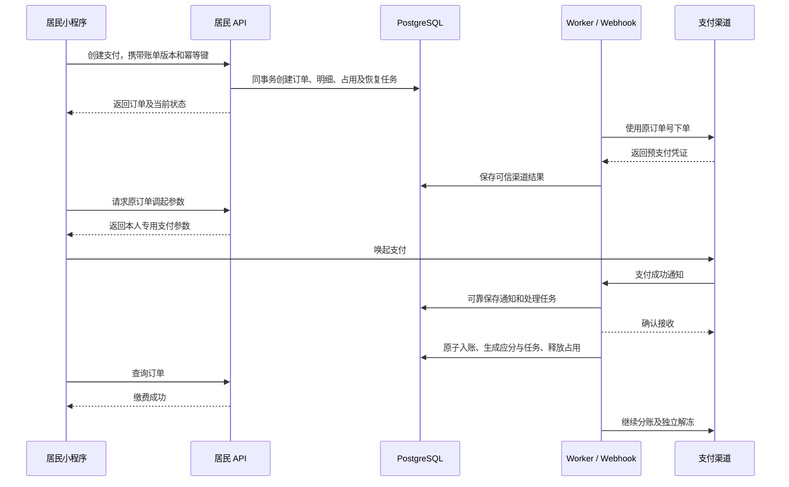
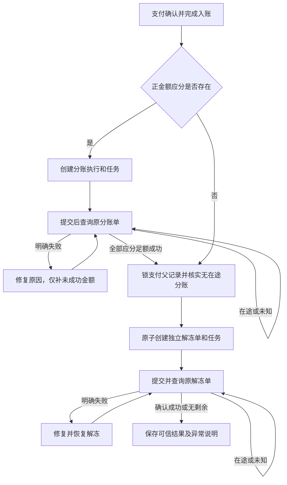
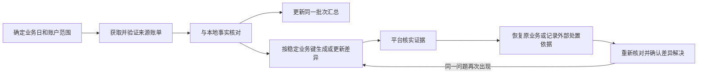

# 居民账单支付与资金处理

## 范围与权威来源

居民在平台小程序查看获授权房屋的账单，付清一张账单的全部剩余欠款。平台为支付服务商，物业公司为收款商户；平台按物业公司配置收取服务费，渠道手续费由物业承担。商户进件在线下完成，系统绑定已取得的商户号。

当前一家公司一个有效收款商户、一个支付订单一张账单、一个平台分账接收方。不提供居民自定义付款金额、退款、线上进件或返利抵扣。数据结构保留同一收款商户下合并多月、按小区选择商户和多个分账接收方的能力；这些能力不能仅凭结构存在就在当前入口开放。

本文件维护业务规则、可见范围、资金流程、异常处置和页面交互。其他权威来源如下：

- [支付与分账数据设计](bill-payments-and-profit-sharing.md)：表字段、数据库约束、持久任务、资金状态和事务锁序。
- [账单设计](../property/billing.md)：应收、结算明细、账单版本、线下登记及冲正规则。
- [居民身份与房屋认领](../resident/identity-and-house-claims.md)：居民身份、房屋绑定及授权有效性。
- [OpenAPI](../../../openapi/openapi.yaml)：各端接口的路径、输入输出、错误码、权限码、幂等及运行进程归属。
- [系统架构](../../architecture/overview.md)、[后端业务边界](../../architecture/backend-services.md)及[小程序架构](../../architecture/miniapp.md)：进程、分层、身份与缓存边界。
- [代码组织与账单支付接入](../../architecture/code-organization.md)：各端目录、共享收款确认与账单入账、任务及测试归属。

## 业务规则与可见范围

### 房屋账单与本人订单

房屋账单授权与本人支付授权分开判断。

| 能力                           | 授权与边界                                                                                           |
| ------------------------------ | ---------------------------------------------------------------------------------------------------- |
| 房屋账单列表、详情和当前余额   | 居民账号、公司、完整房屋路径和当前房屋绑定均有效；账期不受认领时间限制。                             |
| 房屋历史收款流水               | 当前房屋授权有效时可查全部历史，但只能取得下述脱敏字段。                                             |
| 新建支付                       | 满足房屋授权，账单有效、有剩余欠款、无当前支付占用，且收款配置可用。                                 |
| 查询本人支付记录及所付账单摘要 | 要求当前有效居民身份与订单付款人一致；不依赖房屋仍绑定，也不因房屋或公司后来停用而隐藏本人既有订单。 |
| 继续原订单支付                 | 同时满足本人订单授权、当前房屋授权及订单可继续支付的条件。                                           |
| 查询或关闭本人原订单           | 保留本人订单授权，查询和安全关单不依赖当前房屋绑定；不能关闭他人的订单。                             |

本人支付历史只返回该次支付涉及的固定账单摘要、支付金额与结果，不能凭此读取房屋当前余额、后来新增账单或他人流水。居民账号停用或居民会话失效仍按身份规则拒绝访问；后台继续确认已经发生的支付。

历史收款流水仅展示业务收款日期、登记时间、金额、线上／线下来源和调整标识。本人线上流水可链接本人订单；他人线上流水统一显示“其他缴费人缴纳”，不返回其姓名、手机号、OpenID、系统支付单号、渠道单号、付款凭证或调起支付参数。管理员自由文本说明不直接对居民公开，避免其中包含个人资料。线下冲正显示“线下登记调整”，不表示发生退款。

房屋绑定释放、撤销或房屋路径停用后，立即停止签发新的调起支付参数，查询并关闭相关未支付订单。已经签发的渠道凭证不保证即时失效，因此后续查到支付成功仍须入账。历史付款人变化不能改变房屋已有欠款归属。

### 付款金额与排他占用

支付金额由服务端在账单锁内计算为当前全部剩余欠款。账单可能已存在部分线下收款，本次只付清余款；居民不能改金额。客户端提交账单及预期账单版本，服务端发现余额或版本变化时返回冲突，由居民重新核对。

一张账单只能由一个当前支付订单占用。创建支付、支付明细、占用及恢复任务同事务提交；当前占用不修改账单版本。已有占用时，线下收款、纠错、撤销登记和作废在相同账单协调锁内拒绝新写入。占用具体约束和释放条件见[账单支付占用](bill-payments-and-profit-sharing.md#账单支付占用)。

本人正在支付时恢复原订单；他人正在支付时仅提示“该账单有支付正在处理中”，不公开对方订单信息。未来合并支付须逐账单确认同一实际商户绑定，按固定顺序锁定全部账单，全部占用成功或全部回滚。

### 服务费计算与配置适用性

计算版本 1 按本次支付订单金额、扣除渠道手续费前计算；每个接收方分别四舍五入到整数分，采用 half-up，不使用银行家舍入。

```text
接收方应分金额（分）
= HALF_UP（订单金额（分）× 接收方 rate_bps ÷ 10000）
```

例如订单 100 元、平台比例 300 基点，平台应分 3 元；居民支付 100 元，渠道手续费另由物业承担。渠道确认的付款人实付金额可与订单金额不同，不能把两者差额当作手续费。实际手续费只采用渠道账单等可信结果。

规则版本及其接收账号、比例、计算版本不可变，支付创建时固定引用。当管理员切换商户或发布规则时，只影响后来创建的订单。原订单的查单、关单、分账和解冻继续使用原商户、原规则，不能因旧绑定停用而改为新账号。

配置与执行同时满足以下约束：

- 规则比例合计不超过渠道已核实的上限；未知或失效的能力缓存不能证明配置适用。
- 下单前按真实订单金额试算，检查逐接收方舍入后的合计不超过该订单渠道允许的累计分账金额；不能只检查比例合计。
- 下单前试算只用于校验，不创建应分事实。支付确认成功的入账事务才按冻结规则生成正金额应分记录。
- 不适用配置在下单前拒绝，不静默调整比例、舍入方式或向居民加收费用。
- 扣费、结算状态或资金管控导致支付后的可分资金不足时，保留原应分事实并进入资金异常处理，不减少服务费或伪造成功。

## 管理权限与收款配置

### 权限与数据范围

平台管理端执行配置维护与资金恢复，物业管理端只读本公司配置及业务结果。权限分别控制配置读取、配置维护、支付读取、资金读取、资金恢复、核对读取和重新核对；读取权限不能隐含写入或恢复权限。具体权限码由各后台 OpenAPI 操作声明，平台权限与物业权限不混用。

| 能力                   | 平台管理员                                                   | 物业管理员                       |
| ---------------------- | ------------------------------------------------------------ | -------------------------------- |
| 商户绑定、启停和切换   | 配置维护权限；每次校验公司、并发令牌并审计。                 | 本公司只读。                     |
| 规则版本创建与历史查询 | 按配置维护／读取权限执行。                                   | 本公司只读，旧版本无编辑、删除。 |
| 支付及关联账单         | 授权公司范围。                                               | 仅本公司。                       |
| 分账、解冻结果         | 按资金读取权限查询。                                         | 仅本公司的业务结果。             |
| 主动恢复支付或资金处理 | 单独资金恢复权限，填写原因并审计。                           | 不开放。                         |
| 核对批次与差异         | 授权范围内查看，单独权限重新核对、恢复原业务或记录外部处置。 | 仅归属本公司的结果投影。         |
| 原始通知、渠道调用诊断 | 受限运维访问，凭证及敏感信息仍受保护。                       | 不开放。                         |

公司级收款配置是本公司共享配置，不据此扩大管理员对具体账单、付款人或流水的访问范围。当前物业后台按公司隔离，不引入指定小区授权。未来引入小区授权时，支付、分账、解冻及核对结果须沿关联账单过滤到授权小区，不能仅以公司一致放行。公司与账号停用、后台隔离、会话撤销继续执行既有认证规则。列表记录、总数、汇总和差异证据使用一致的数据范围过滤；越界资源按既有不存在语义处理。

平台基本账户核对批次属于平台整体资金视图，不能向物业暴露原始整批数据、其他公司的汇总或无法归属公司的渠道行。物业只看与本公司相关的局部结果；无法安全归属本公司的结果不进入该投影。

### 初始化与切换

首次收款配置按以下顺序完成，平台后台显示逐项可用性及明确原因：

1. 录入线下取得的商户号及商户名称，创建停用绑定；线下核实主体、授权与材料。
2. 核验渠道接入条件、为该商户建立平台接收关系并取得最大分账比例，再激活绑定。
3. 创建完整首版分账规则。
4. 有效绑定、可用规则、接收关系及渠道能力全部满足时，整体配置才允许收款。

允许激活绑定时尚无规则，此时整体 `ready = false`，并返回缺少规则的原因，不能因此提前允许下单。渠道能力查询成功不能替代线下商户主体核实。平台作为服务商也必须逐物业建立接收关系，不能省略此步骤。

当前创建规则时由服务端确定平台接收方账号、接收关系及计算版本，管理员仅配置已开放的比例。零比例合法；无正金额应分时仍须执行独立解冻。平台接收方本期不可由物业或居民指定。

商户身份字段创建后不可修改；录错或更换时新增绑定。启用新绑定、停用旧绑定在一个事务内完成，公司最多一条有效绑定。目标商户自身的接入条件、接收关系和比例上限必须核验成功。若旧规则超过新商户上限，允许切换绑定，但整体配置保持 `ready=false`，原因包含 `ratio_exceeded`；此时禁止新支付，待发布兼容规则后再收款，避免旧规则与新绑定互相阻塞恢复。绑定停用只阻止新订单采用该绑定；原订单在房屋授权及自身状态仍允许时继续采用原配置，查询、关单、真实收款确认及资金处理也继续。

### 并发与配置幂等

配置读取返回不透明配置令牌，覆盖公司全部绑定按稳定顺序排列的 `(id, row_version)` 及最新规则版本 ID；无绑定、无规则也有确定表示。任何绑定新增、启停或切换及规则发布都使令牌变化，避免先停用后恢复造成旧页面覆盖。单纯刷新渠道能力缓存不递增配置版本。

配置写入携带预期令牌。渠道核验在数据库锁外进行，最终在公司协调锁内重新校验令牌、主体状态与全部配置条件后提交，过期页面返回冲突。长网络调用不得持有公司锁。

商户绑定创建与规则版本创建使用持久幂等键和规范化输入摘要。同键同输入返回原资源，不因重放重新激活旧绑定或重新发布旧规则；同键不同输入返回冲突。先校验当前权限，再识别已提交重放，重放不重新应用原配置令牌。启停／切换使用预期令牌控制并发；提交结果未知时重新读取配置核实，不能以一次网络失败假定未生效。

## 渠道接入与支付确认

### 接入边界

沿用现有 `resident-api`、`platform-admin-api`、`property-admin-api`、`webhook` 和 `worker`，不引入独立支付进程、消息中间件或新基础设施。各端应用 Service 保留自己的授权编排，共用支付领域、Repository、Model 和 Integration。

当前通过普通服务商模式接入微信支付。请求使用平台小程序 AppID、服务商商户号、订单所属物业商户号，以及该 AppID 下付款人的 OpenID。服务商号来自服务端配置，物业商户由服务端解析账单归属，付款身份来自当前居民；客户端不能指定商户、付款人、规则或金额。

Integration 负责请求签名、响应验签、通知原始报文验签及解密、接收方名称等条件敏感字段加密。校验渠道商户身份、AppID、业务单号、交易号、金额、付款人及成功状态后，才能产生可信支付事实。领域和数据库使用通用名称，微信专有字段只在协议适配处映射。

密钥、APIv3 密钥、私钥、签名、OpenID、调起参数和预支付凭证不进入诊断日志或普通渠道快照。持久化请求及通知只保留恢复、核验和追溯所需白名单，业务响应不公开原始渠道报文。通知签名使用微信实际签名头及原始 body，不复用内部通用签名格式。

### 创建与调起

支付窗口为创建后 15 分钟，同时保存固定 `expires_at` 并传渠道有效时间。渠道受理或客户端退出不延长该窗口。预支付凭证自身有效期与渠道订单可付款状态分别处理，二者都不能单独作为已关闭证据。



创建接口提交可靠的本地订单和恢复入口，不要求同步完成渠道下单。所有普通 GET 只读本地事实，不能隐式创建渠道订单、关闭订单、签发调起参数或恢复资金任务。调起支付参数通过专门写操作签发，只能给当前仍可支付的本人订单，并设置禁止缓存。

居民创建支付以付款人为幂等范围，同键同输入返回原订单当前状态，即使该订单已经关闭也不新建。重新缴费使用新键。网络超时、503、客户端取消或支付面板返回失败，都不能作为换键重新付款的依据。刷新与关闭原订单合并到原有持久任务，不为每次点击创建资金业务。

### 可信收款与入账

小程序支付 API 返回成功只触发服务端核实，不能直接入账。查单与通知共用成功确认入口。验签、业务核验后的渠道收款证据先可靠保存，再执行[支付确认与账单入账事务](bill-payments-and-profit-sharing.md#支付确认与账单入账)。

| 已有事实                                 | 对居民展示             | 处理                           |
| ---------------------------------------- | ---------------------- | ------------------------------ |
| 尚未确认渠道收款                         | 待支付或结果确认中。   | 查原单，保持必要占用。         |
| 可信渠道证据已确认收款，本地入账尚未提交 | 已收款，正在确认缴费。 | 禁止再次付款，恢复原入账流程。 |
| 渠道收款及全部账单入账已提交             | 缴费成功。             | 分账和解冻独立继续。           |

“已收款待入账”由可信渠道证据与本地状态派生，不放宽 `payment_orders.succeeded` 的含义；该状态仍表示支付确认和账务已原子完成。原始未验签报文、客户端结果、异常文本或一次可信度不足的响应不能构成已收款证据。

入账事务确认原订单、商户和金额，写系统账单操作与唯一线上结算明细，更新账单汇总及版本，固定应分事实与后续执行任务，最后释放原占用。业务收款日期由渠道支付成功时间按 `Asia/Shanghai` 转换。任何一步失败都整体回滚，继续保留占用与可信证据；恢复不能因当前解绑、撤权或停用拒绝已经发生的收款。

线上真实收款不能通过线下登记纠错或撤销冲正。分账或解冻异常也不恢复居民欠费，不撤销已确认入账。

### 通知可靠接收

通知先验签、解密及校验格式，再以渠道通知标识去重。通知与处理任务同事务可靠保存后，在渠道要求的 5 秒内应答；重复通知确认原记录已提交后直接应答。成功 ACK 只表示可靠接收，不表示账务或资金执行已经完成。

可信但无法关联、金额不符或身份不符的通知持久隔离，不能猜测关联后入账。保存失败按渠道协议返回失败以触发重试；非法签名或格式按渠道协议处理，不套内部 Problem Details。支付通知和分账到账通知分别路由及处理，不能只凭相同事件名称推断业务类型。

平台分账到账通知只证明接收方视角的到账事实，不代替整张分账执行或解冻结果查询。

## 分账、解冻与异常恢复

### 分账及独立解冻

应分事实只在支付成功入账时创建；分账执行是对这些事实的一次渠道履行。后续执行累计次数与应分总额不是同一个概念，例如一方成功另一方失败时，只补失败方的未履行金额。



首次分账任务不早于支付成功约一分钟后执行；渠道尚未结算、存在管控或暂不可分时等待或修复，不承诺居民付款后立即分账到账。第一次执行与其任务可在入账事务内创建，由调度时间控制发送。

每次分账都使用固定业务单号、原金额及原接收方参数，当前明确传 `unfreeze_unsplit=false`。整单 `FINISHED` 仅代表执行结束，接收方 `SUCCESS` 才是成功；`CLOSED` 是明确失败。未知和在途金额不能再次分配；只有已确认失败的未履行金额可在安全条件下生成新的执行。

当前渠道每笔支付最多接受 50 次分账、每次最多 50 个接收方。受理次数与网络请求次数分开核查；结果未知时先查询，不能无限换号尝试或仅根据本地调用条数认定渠道额度。超过限制或不可恢复时保留异常和应分事实，进入平台处理。

所有应分足额成功且不存在待发送、在途或未知分账后，锁支付父记录创建独立解冻单及任务。零应分同样进入独立解冻。任何解冻单一旦建立，就永久禁止为该支付新增分账执行；解冻失败只恢复解冻。

解冻释放原商户的全部剩余冻结资金，实际金额只能采用可信渠道结果，不能按订单金额减服务费推算。解冻异步结果仍需查询；确认无剩余资金只表示没有待解冻金额，不证明本次解冻曾成功，也不证明平台服务费已经到账。

普通服务商订单默认在支付成功后 30 天自动解冻。未完成资金业务应在该期限前持续核查并进入异常处理；自动解冻或外部异常资金变化不允许把缺失服务费改记成功，也不能重新向居民收取。

### 恢复与释放条件

| 场景                               | 必须保留和执行的处理                                                   |
| ---------------------------------- | ---------------------------------------------------------------------- |
| 下单超时、进程中断或响应无法验真   | 保存未知事实，查原订单；按原号原参数恢复，不能创建替代支付。           |
| 查询未支付                         | 保留占用；到期或收到关闭意图后关单，再查询确认。                       |
| 查询订单不存在                     | 核查所有下单尝试及在途请求；不能凭一次不存在认定从未发送。             |
| 查询后关单前支付成功               | 按可信成功结果入账，不能清占用后新建支付。                             |
| 本地取消且从未发送                 | 只有可靠阻止现有及后续任务发送、确认无在途请求时，才能本地关闭并释放。 |
| 渠道确认已关闭等不可继续付款终态   | 本地关闭与匹配原订单的占用释放同事务提交。                             |
| 已收款但账务失败                   | 保留可信证据和占用，幂等重试原子入账，禁止再付。                       |
| 分账或解冻未知                     | 查询原执行；不能换号重复发起。                                         |
| 明确分账失败                       | 修复后仅补未成功金额，受解冻屏障和渠道次数限制。                       |
| 明确解冻失败                       | 保留历史执行与证据，按原支付安全恢复解冻。                             |
| 渠道资金变化、账单不匹配或受理限制 | 保留差异和原应分义务，平台核查，不能伪造成功。                         |

前端取消、支付窗口到期、未支付、网络超时、任务失败或租约过期均不单独构成占用释放条件。任务按持久化代次与有效租约接管；过期执行者不能写资金结果，已经发出的网络请求仍靠原渠道业务单号防重。具体机制复用[持久任务](bill-payments-and-profit-sharing.md#持久任务)及[事务与并发](bill-payments-and-profit-sharing.md#事务与并发)。

自动恢复采用有界退避，遵守渠道限频及可用的重试提示；配置错误可暂停，修复后继续安全流程。达到本地重试次数不能把未知结果视为失败或把资金业务标记完成。平台“恢复处理”仅确保这些既定流程继续，不允许指定成功状态、收款账号、金额，直接删除占用或跳过应分解冻。

## 资金核对

### 核对范围与证据

资金核对结合持续内部检查、每日渠道账单及异常按单查询。入账和资金执行不依赖每日对账才能完成，但对账发现的可信事实可以驱动同一安全恢复入口。

| 层次                 | 核对内容与限制                                                                           |
| -------------------- | ---------------------------------------------------------------------------------------- |
| 内部一致性           | 支付金额与明细、线上结算唯一性、账单汇总、应分与成功金额、解冻前置条件、占用及恢复任务。 |
| 渠道交易账单         | 原商户、支付订单号、交易号、订单金额、成功时间及真实手续费。                             |
| 渠道分账账单         | 分账单号、支付交易号、接收方、金额和确认结果。                                           |
| 平台基本账户资金账单 | 平台分账到账明细及其资金凭证；不作为物业全部结算流水。                                   |
| 解冻核验             | 查询解冻原业务单及支付剩余待分金额，结合内部应分履行判断。                               |

冻结和解冻不产生资金账单流水，不能因资金账单缺少一行就判断解冻失败。交易、分账和账户资金各按渠道定义的业务日期分别核对，再跨日关联；不得强制把支付日、分账日和入账日视为同一天。

每日核对渠道已可提供的前一业务日文件。文件尚未生成、渠道不可用或下载失败，批次保持待重试或失败，不能作为零交易完成。对迟到通知、跨日执行和迟到文件允许回补与重跑。下载地址只用于获取文件，校验渠道文件摘要后解析；不会将短期下载地址作为长期唯一证据。

首批任务生成、停机漏日补齐，以及授权失效后的待支付订单检查，由现有 Worker 的周期检查触发，具体职责见 [任务生成与补齐](../../architecture/backend-services.md#任务生成与补齐)。不依赖管理员先创建批次，也不依赖居民再次打开页面。

核对使用现有 Worker 和 PostgreSQL。持久保存必要的批次、来源摘要、核对结果和差异证据，敏感原始文件不进入普通日志。完整原始文件长期归档涉及单独的保留及访问策略，不能据本设计默认引入新的文件存储基础设施。

### 批次与差异生命周期

批次和差异的数据结构见[支付与分账数据设计](bill-payments-and-profit-sharing.md)。一个批次对应业务日期、账单类型、服务商商户号和可空收款商户号，使用 `NULLS NOT DISTINCT` 防重。交易及分账账单按真实商户号核对，平台基本账户批次的收款商户号为空；绑定记录更换不产生重复核对批次。



同一范围重跑复用批次，差异按核对维度、稳定业务标识及差异类型去重，具体映射见 [核对差异](bill-payments-and-profit-sharing.md#核对差异)。不能为每次重跑新增整套未关联差异，不能删除或覆盖已解决差异的处置依据；相同问题再次出现时重新打开。解决必须有重新核对结果或可审计的外部处置依据，不提供无证据忽略入口。

至少识别渠道有本地无、本地成功渠道无、金额不符、身份不符、入账缺失、应分履行不足、解冻不一致和手续费结果不符等差异。渠道记录无法关联本地订单时仍保留证据并隔离归属，不能丢弃或猜测补单。一个批次执行完成与“没有资金差异”分别表达。

差异通过可空外键关联原支付或分账执行明细；解冻、结算等事实沿支付关系追溯，不重复增加目标外键。未知本地目标允许为空。对账请求、解析处理及任务通过真实批次外键追溯，重试不依赖易失内存。每轮核对将必要的差异判定事实随该次已解析渠道响应保存为不可变白名单快照，包含新建、解决、重开的稳定引用、时间、来源摘要及本地与渠道比较值；当前差异证据更新后仍能追溯此前依据。文件摘要或一句错误文本不能单独解释处置原因。差异行保留当前处置结果；人工操作历史由管理员审计追溯，自动核对依据由批次及渠道请求记录追溯，不增加逐事件自动历史台账。

平台对账恢复只能安排查询、原子入账、既定分账／解冻恢复或重新核对。若渠道已释放资金而服务费未取得，按外部资金异常保留义务与处置记录，不生成虚构分账成功；外部处置不隐含本系统退款能力。

外部处置使用独立写接口，由有核对读取及资金恢复权限的平台管理员核实渠道、银行等外部处理结论，提交原因、可追溯的工单或凭证引用及当前差异令牌。非空引用本身不证明资金成功，管理员须核实依据；尚能通过正常业务流程确认的问题优先恢复后重核对。服务端复核当前差异和适用条件，将处置审计与差异的 `resolved` 及最近处置信息同事务保存；已解决、令牌过期或核对正在执行时拒绝提交。响应只表示差异处置已记录，不改变支付、账务、应分、分账、解冻或占用，不猜测补关联，也不屏蔽后续核对。旧令牌重放返回冲突；响应未知时先读详情和审计，不自动重新提交。同一问题再次出现仍重新打开，并保留既有处置历史。

## 页面与交互

### 居民端

入口位于居民首页及房屋详情的“账单缴费”，个人中心提供“我的缴费记录”。页面归属现有居民分包，不新增跨业务全局导航。单房屋可直接进入，多房屋先选房；切换房屋清理当前房屋筛选、草稿及旧请求结果。

| 页面         | 展示与交互                                                                                         |
| ------------ | -------------------------------------------------------------------------------------------------- |
| 房屋账单列表 | 默认待缴且不限账期，另有全部账单；显示账期、待缴金额和历史欠费标识。本期不开放多选合并支付。       |
| 账单详情     | 房屋、物业、账期、应收／已缴／待缴、脱敏收款流水和当前可用操作；历史流水独立分页。                 |
| 支付确认     | 核对房屋、账期、收款物业及本次全额余款，不能修改金额；不把平台服务费加到居民应付金额。             |
| 本人缴费记录 | 全部本人支付，包含解绑房屋和待确认订单；筛选及分页在当前用户范围内。                               |
| 本人支付详情 | 订单号、收款物业、所付账单摘要、金额、支付时间与确认结果；只提供服务端允许的继续、核实或关闭操作。 |

支付按钮禁用时展示明确原因，例如他人处理中、房屋授权失效、配置不可用或订单已到期正在核实，不能只用无解释的灰按钮。刷新后金额变化返回确认页重新核对，不静默按新金额支付。账单存在本人占用时直接恢复原订单。

| 客户端／服务端结果 | 页面行为                                                       |
| ------------------ | -------------------------------------------------------------- |
| 客户端报告支付成功 | 显示“正在确认缴费结果”，读取后端可信状态后才显示成功。         |
| 用户取消支付面板   | 表示取消本次面板操作，保留原订单，提供继续支付及核实结果入口。 |
| 网络中断或结果未知 | 显示“结果确认中，请勿重复付款”，恢复原订单，不创建新支付。     |
| 已收款待入账       | 禁止再次支付，显示收款已确认、缴费正在确认。                   |
| 确认关闭           | 返回账单重新读取余额，符合条件时可新建支付。                   |
| 分账或解冻异常     | 居民仍显示缴费成功，不暴露内部恢复操作。                       |

页面重开从服务端本人订单恢复。进行中的写请求保留原幂等键和必要非凭证业务标识，按 API 环境、居民身份隔离；不保存签名或预支付凭证。调起参数只在当前内存使用，不进入 URL、日志或持久化草稿。退出、401或用户切换时清理相应请求和状态，迟到响应不能回填其他身份。

房屋授权失效后停止房屋账务请求，跳转本人支付记录时只取得本人固定摘要。收款完成后刷新账单和本人记录；不能用旧创建响应覆盖后续入账状态。

### 平台管理端

公司详情提供收款配置入口，集中显示当前商户、规则版本、接收关系、最大比例核验及是否可收款。绑定列表保留全部历史；创建后按核验、激活、规则发布的顺序引导。激活但缺规则时明确提示不可收款。更换商户和发布规则前提示只影响新订单，提交后刷新配置令牌。

规则页展示版本、计算口径、平台比例及历史版本；创建完整新版本，旧版本不编辑、不删除。比例输入与基点精确转换，支持示例金额试算，但提示实际资金结果以渠道为准。配置冲突保留输入，重新读取后由管理员核对；不能自动把旧输入覆盖最新配置。

支付记录提供按公司、小区、房屋、订单号、渠道交易号、状态和时间的授权查询。详情按支付事实、账单入账、分账及解冻分别展示：

- 支付区展示可信收款金额、支付时间、当前订单及确认状态。
- 入账区展示对应账单结算事实及是否待恢复。
- 分账区分别展示应分义务和每次执行结果，避免重试累计被误认为服务费增加。
- 解冻区展示独立执行和可信结果；金额未知时显示待确认，不推算为已到账。
- 诊断区仅对受限权限展示安全摘要，不能提供签名、密钥或居民调起凭证。

资金异常页区分已收款待入账、分账异常、解冻异常和接近渠道期限等原因。操作使用“重新核实”“恢复处理”，显示将恢复原流程，要求原因；没有强制成功、直接清占用或跳过分账按钮。异步受理后显示任务已安排，后续查询真实结果，不能先显示资金成功。

核对工作台展示业务日期、账单类型、账户范围、批次状态、汇总及差异数。批次和差异分别分页；平台可按证据重新核对或恢复原业务。差异详情显示具体核对维度、该次判定的来源摘要、应有与实际、关联业务及当前处置结果；人工历史链接管理员审计，自动核对依据链接批次及渠道请求。外部处置表单独立于恢复表单，要求原因、依据引用及确认，提交成功后显示“已记录外部处置”，不提示资金已到账；冲突时重新读取核对，响应未知时先查详情和审计。已解决记录重跑后仍可追溯。

### 物业管理端

本公司收款配置只读展示商户、当前费率、历史版本和可收款状态。异常配置引导联系平台，不提供自行改号、改费率或接收账号入口。

收款记录限定本公司，展示支付、入账、平台服务费及解冻业务结果，手续费只展示可信账单结果。没有可信值时显示待核对，不能把订单金额减平台服务费标记为物业已到账。

核对页只显示本公司结果投影与可归属自身的差异，不提供平台完整账户文件、原始渠道通知和技术请求快照，也不提供恢复或差异关闭按钮。线下账单页面感知支付占用，操作冲突时提示先等待或由付款人核实，不能引导管理员绕过占用登记收款。

管理端筛选、分页与详情遵循现有后台路由和缓存边界；平台与物业会话、权限及缓存隔离。支付恢复或配置写入后读取当前资源，首次成功结果不能覆盖后续状态。所有管理员配置与恢复动作使用既有审计并保留原因。

## 渠道依据与验证边界

当前渠道接口以[微信支付合作伙伴目录](https://pay.weixin.qq.com/doc/v3/partner/llms.txt)为准。下单与有效期参见[小程序下单](https://pay.weixin.qq.com/doc/v3/partner/4012759974.md)，普通服务商分账次数、单次接收方数和自动解冻期限参见[分账常见问题](https://pay.weixin.qq.com/doc/v3/partner/4014547107.md)。渠道映射由数据设计统一维护，本文件不重复维护接口参数或协议 Schema。

验证遵循[测试规范](../../conventions/testing.md)，除数据设计的数据库及并发验证外，至少覆盖：

- 房屋历史账务授权、他人流水脱敏、解绑后本人摘要及房屋新数据隔离。
- 居民和后台身份、公司隔离及居民房屋授权、读取与配置／恢复权限隔离。
- 服务费 half-up 的半分边界、零应分、多接收方舍入合计、渠道上限及支付后资金不足。
- 配置初始化、商户切换、旧单冻结配置、持久幂等和配置令牌防止过期覆盖。
- 可信证据先持久、已收款待入账展示、通知与查单竞争及原子入账失败恢复。
- 客户端取消、超时、前后台切换、重开页面、授权撤销及原支付恢复，均不重复付款。
- 接口 GET 无资金副作用，回调专有签名、可靠接收、重复通知和隔离异常。
- 分账受理上限、部分失败、未知查询、自动解冻及缺失应分不被伪装成功。
- 跨日核对、迟到文件、未知归属记录、稳定差异去重、已解决差异重现及物业投影隔离。
- 页面和日志无调起凭证泄漏，旧响应不跨用户或后台回填；真机验收小程序支付。

外部渠道签名、生产商户权限、真实支付、分账到账及解冻需要按渠道条件完成联调；本地替身验证不能替代真实渠道验收。
