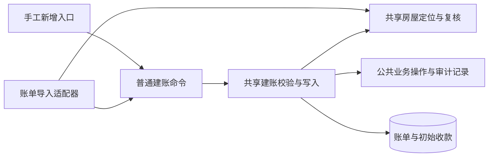

# 账单批量导入设计

## 范围与依据

物业端按小区批量新建物业费月账单，同时服务日常建账和历史迁账。两种场景共用一套模板和创建流程，支持初始已缴。批次固定当前公司的一个小区，每行对应一套房屋的一个自然月，允许历史、当前和未来月份。

首期由文件提供明确应收金额，使用 `amount_source=manual`，不关联计费依据。不包含按依据批量生成、修改已有账单、追加收款、作废重建、逐笔历史流水迁移或新增房屋。创建后立即形成有效账单，沿用现有居民可支付条件。

账单规则与共享建账能力以 [账单设计](billing.md) 为准；位置定位与复核以 [房屋完整位置定位与复核](housing.md#房屋完整位置定位与复核) 为准。导入生命周期、事务、重跑和保留期复用 [通用导入设计](../imports/overview.md) 及 [适配器协议](../imports/architecture.md#适配器协议与扩展)，权限目录与动作归属见 [后台授权设计](../admin/authorization.md)。API 契约遵循 [OpenAPI First](../../api/conventions.md#openapi-first-与契约一致性)，具体权限码及接口声明在实施时先同步契约；设计不表示相关代码或契约扩展已经实现。

## 一套业务逻辑、两个入口

| 位置           | 职责                                                                                                   |
| -------------- | ------------------------------------------------------------------------------------------------------ |
| 手工新增入口   | 将现有请求映射为普通命令，处理本端身份、HTTP 响应和事务提交。                                          |
| 账单导入适配器 | 将模板列映射为普通位置输入及建账命令，将业务结果映射为导入准备结果、计划、问题和行结果。               |
| 共享房屋能力   | 完整位置定位、辅助编号核验、位置快照和原房屋复核，供各业务调用。                                       |
| 共享建账调用链 | 维护命令校验、条件权限需求、归属及启停、金额和初始收款规则、原始建账事实比对、建账写入及业务操作记录。 |
| 通用导入框架   | 文件、阶段、预览确认、权限执行、租约、导入幂等账本、逐行事务、恢复与统计。                             |

业务领域接收普通类型，只依赖所属 Repository 和业务能力，不依赖导入定义、`ImportContext`、`ImportPlan`、导入模型、行号或导入错误码，也不依赖 HTTP Schema。关联查询、业务自然键、重复判定和业务写入不能在适配器中另写一套。通用框架不能出现账单类型分支或直接写入账单表。

业务校验供预检和正式执行共用，执行在既定资源锁内重新核验；预检只读正式业务数据。初始收款复用现有入账能力，操作、兼容结果快照和逐账单审计复用公共记录能力。手工与导入各自编排输入和流程，完整调用链及兼容要求见 [共享建账能力](billing.md#共享建账能力)。

## 类型、范围与模板

类型键为 `property_fee_bills`，仅在物业端开放，范围只允许 `community`，模式只允许 `create`。物业公司来自当前身份；文件不接受公司或小区字段。模板使用不可变版本配置，API 和 Worker 加载相同版本与摘要。

| 字段编码                 | 列名               | 必填 | 规则                                           |
| ------------------------ | ------------------ | ---- | ---------------------------------------------- |
| `phase_name`             | 分区               | 否   | 空值表示没有分区层级。                         |
| `building_name`          | 楼栋               | 是   | 完整位置的楼栋名称。                           |
| `unit_name`              | 单元               | 否   | 空值表示房屋直接位于楼栋。                     |
| `room_no`                | 房号               | 是   | 文本，保留前导零。                             |
| `house_external_code`    | 房屋外部编号       | 否   | 仅交叉核验已定位房屋。                         |
| `billing_month`          | 账单月份           | 是   | `YYYY-MM`，一个完整自然月。                    |
| `receivable_amount`      | 应收金额（元）     | 是   | 非负，最多两位小数，精确转换为整数分。         |
| `manual_amount_reason`   | 金额说明           | 是   | 作为手工金额原因，沿用账单原因长度与空白规则。 |
| `initial_paid_amount`    | 初始已缴金额（元） | 是   | 未缴明确填 `0`，空值不能默认为零。             |
| `initial_received_on`    | 初始收款日期       | 否   | `YYYY-MM-DD`，不得晚于当前业务日期。           |
| `initial_receipt_reason` | 初始收款说明       | 否   | 沿用初始收款说明规则。                         |
| `external_bill_no`       | 外部账单编号       | 否   | 文本，保留大小写和前导零，不作为身份。         |
| `due_date`               | 到期日             | 否   | `YYYY-MM-DD`。                                 |

文本长度、日期范围、金额上限与普通建账共用业务校验，不在模板适配器复制边界值。金额不能用浮点运算或舍入纠正超出两位小数的输入。XLSX 金额单元格的读取与转换必须验证精度；位置与编号按文本填写，不猜测已经丢失的前导零。

完整位置逐级精确匹配，不将缺失层级作为通配条件，不用房屋外部编号回退定位。外部编号提供时，必须与定位房屋现有编号一致；现有编号为空也不能通过辅助校验。上述语义仅在房屋领域维护。

## 初始已缴

初始已缴表示建账输入所声明的累计收款事实，不能将当前欠费直接当作原始应收。例如应收 300 元、初始已缴 100 元，建立后待缴为 200 元。

初始已缴为零时不生成收款明细；大于零时，与账单一并创建一条 `source_type=offline` 的收款登记，不发起渠道收款或分账。应收、已缴及零元账单规则沿用共享建账能力。

历史多笔收款允许汇总登记，说明其为累计已缴迁入，不代表逐笔流水已经迁移。日期不详时保存为空，不使用导入日期或最后一笔日期冒充汇总金额的收款日期。导入完成后的新增收款通过原收款用例处理，不能修改文件中的初始已缴后重新导入追加收款。

## 业务身份、重复与操作恢复

自然键为 `house_id + bill_type + period_start`，限定有效月账单，公司由批次隔离。房屋领域返回稳定 ID，账单领域返回自然键和原始建账内容；适配器只作协议转换。位置名称、房屋外部编号、源文件行号及批次 ID 不参与业务自然键或创建内容指纹。

创建内容使用明确白名单：房屋、费用类型、期间、金额来源、依据引用及计算预期、应收、金额原因、外部账单编号、到期日，以及初始收款金额、日期和说明。首期固定为手工金额、无依据引用和计算预期；零初始已缴统一表达为无初始收款。仅比较规范化后的原始创建事实，不读取当前已缴或待缴汇总作为创建内容。

| 情况                                 | 处理                                                               |
| ------------------------------------ | ------------------------------------------------------------------ |
| 文件内自然键重复                     | 所有重复行报错并定位，不默认取首行或末行。                         |
| 已有有效账单，原始创建内容一致       | 计划并执行为跳过，关联原账单，不追加收款或建账审计。               |
| 已有有效账单，内容不同或不能证明一致 | 普通行冲突，不更新原账单。                                         |
| 原导入操作成功，但原账单已作废       | 当前行报告业务冲突并提示原目标已作废；不改写历史成功，不自动重建。 |
| 已确认操作明确失败且可重试           | 新批次沿用原操作、准备快照和输入指纹，重新复核、预览并确认。       |
| 提交结果未知                         | 按原操作键核实持久业务事实，不创建替代操作。                       |

后续资料修改、收款或冲正不改写原始建账事实。原操作键生成及重放由通用框架负责；账单操作采用可回溯至该逻辑操作的稳定业务幂等键，不使用新批次或新行号制造新操作。手工请求原有指纹算法不被导入创建内容指纹替换。

房屋与账期已确定时，即使金额或说明无效，也应识别同一文件内的重复自然键并标记全部重复行，不能以排除错误行为由执行另一行。计划跳过固定原目标，写入锁内若发现该账单已作废或发生替换，应报冲突，不得转为新建。

未确认的普通重新预检可以重新定位并生成新准备结果；用户核对新预览后才可执行。确认后的恢复和失败重跑固定原 `house_id`、位置核验快照、普通命令、操作键和输入指纹，只复核当前条件，不重新定位、改绑或更换金额。

业务操作成功结果复用前也要进行当前权限及业务目标复核。原目标作废或位置、辅助编号变化时，只记录当前批次问题及行结果，保持原成功操作与目标不变。未知结果核实应先保留已经提交的成功事实，再决定当前批次能否继续，不能把当前写入条件不满足误判为原交易失败。

跳过既有账单不新增业务操作记录。该结果未知时，按原准备快照、固定目标和原始建账事实只读核实；目标仍有效且一致才恢复跳过，否则保持待核实，不创建替代账单。

## 权限与事务

类型处理采用“账单经办”，历史、结果及错误文件生成和下载采用“账单查看”，不再叠加逐阶段导入权限。账单查看包含计费依据读取及试算，账单经办包含建立账单和修改普通资料；两者均不自动授予线下收款、收款纠正、账单作废或计费依据维护权限，见 [业务权限目录](../admin/authorization.md#业务权限目录)。首期模板仍不关联计费依据，不因授权合并扩大导入范围。

初始已缴大于零的行额外要求“线下收款登记”，由共享业务能力声明，当前端授权器执行。权限需求独立于整行有效性：初始已缴可解释为正金额时，即使月份、房屋或其他字段有错，也须声明收款权限；不能先排除错误行再检查。金额本身无法解释时保留数据错误，不默认成零，也不执行该行。零已缴行不要求线下收款登记权限。

条件权限在数据准备后、确认、每行执行、重跑和恢复及相关幂等响应复用前重新核验，包括直接复用成功或跳过操作的分支。缺少任一输入行要求的业务权限属于整批阻断，不得通过通过行策略或排除警告行绕过。历史读取继续遵循当前读取权限和公司范围，不要求重新获得全部写权限。

公司、账号、小区、空间和房屋的状态与锁顺序沿用账单规则，历史迁账不隐式绕过启停限制。共享建账能力不提交或回滚，Worker 持有逐行事务，原子提交账单、初始收款、业务操作、兼容结果快照、逐账单审计、导入操作、当前行结果与进度。每个业务实体的写入与导入结果不可拆开提交。

数据表及有效账单唯一约束复用现有结构。准备快照使用已有 JSONB；为允许普通未确认批次重预检，需新增迁移调整导入历史保护触发器，许可范围及不可变边界见 [准备快照保护迁移](../imports/database.md#准备快照保护迁移)。该迁移不改变账单、收款或支付保护规则。

适配器将业务错误映射为安全的导入问题；普通数据冲突记录为行失败，权限和范围问题阻断批次。异常分类、未知结果及租约机制使用通用框架，不将任意异常当作可重试错误。

## 预览与业务入口

小区账单列表按账单经办权限提供入口，固定类型与当前小区；导入中心也可选择该类型。房屋详情内的账单列表不提供暗示房屋范围的批量入口。范围名称及房屋位置通过 [最小查询](../admin/authorization.md#依赖与最小查询) 读取，不依赖第一页小区选项，也不要求房产资料完整查看权限。

预览展示源行、匹配后的完整位置、月份、应收、初始已缴、待缴、动作及问题。确认展示最终执行集合中的预计新增应收、初始已缴与待缴合计，排除跳过行、无效行和策略排除行。合计由服务端对完整执行集合计算，警告选择变化后相应更新，不用当前分页推算整批。

业务展示采用批次 `business_preview` 及行 `business_values` 的受控只读投影，精确字段以 [OpenAPI](../../../openapi/components/import-schemas.yaml) 为准，不直接暴露内部命令或准备快照。汇总只表达预期新增影响，实际完成数量以本批次已提交行结果为准。首期不提供历史实际金额合计，不新增其持久金额快照；准备数据清理后关闭依赖它的预览金额投影，不能回读账单当前余额重算历史导入结果。

完成后提供返回目标小区账单列表的入口并刷新相关缓存。预览确认明确提示账单创建后立即生效；部分失败、取消、错误文件、源文件和敏感快照清理遵循通用设计。

## 验证要求

- 同一普通建账命令由手工与导入入口调用，校验、金额、状态、收款、操作和审计事实一致；提取后保留手工旧请求幂等、首次结果及显式输入字段审计语义。
- 覆盖完整路径的有无分区、单元，跨小区同名、前导零、缺失层级、辅助编号不一致及空值；定位与执行之间改名、改号、停用不能改绑其他房屋。
- 覆盖日常未缴、历史部分及全额已缴、零元账单、缺失初始已缴、超收、精度、日期未知和未来日期。
- 覆盖文件内重复、系统一致跳过、异内容冲突、后续收款后重导、作废后重导，以及两个入口并发创建同房月账单。
- 覆盖条件权限不足整批阻断、执行及成功结果复用前失权、失败重跑固定原准备输入、未知结果核实和原批次历史稳定。
- 账单查看可查询历史并生成、下载授权错误文件，但不能处理批次；账单经办可完成零初始收款的全流程，正金额初始收款仍单独校验线下收款登记，最小查询不泄露完整业主资料。
- 真实 PostgreSQL 验证业务、审计、操作与导入结果整体提交或回滚；同时验证模板安装制品加载、API 契约、完整预览合计及返回账单列表。
