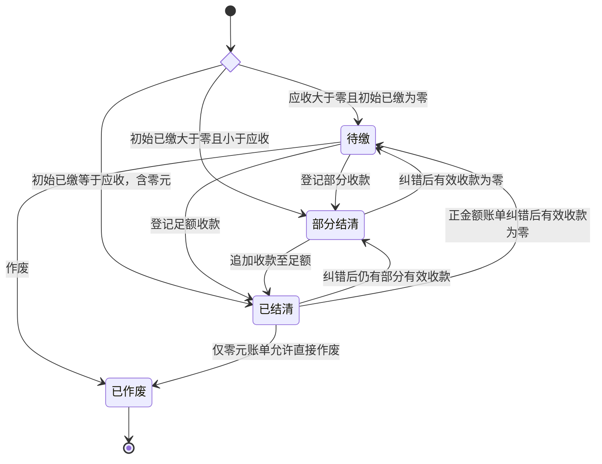

# 账单业务与数据设计

## 范围与职责

物业后台提供物业费账单的手工建立、计费依据维护、线下收款登记与登记纠错。账单通用结构支持后续扩展其他费用类型，计费依据专门服务物业费。

支持补建历史月份账单、建立当前及未来月份账单，以及建账时直接录入部分或全额已缴金额。不包含批量生成、导入、返利抵扣、实际退款、预收余额、滞纳金、月中调价或按天分段计算。到期日只用于后续提醒和逾期判断。

本篇维护共享账务结构与物业后台线下收款规则；居民线上支付、权限及资金流程见 [居民账单支付与资金处理](../payment/bill-payments.md)，支付占用及新增表见 [账单支付与分账数据设计](../payment/bill-payments-and-profit-sharing.md)。

公司、小区和房屋沿用 [物业接入设计](onboarding.md) 与 [房屋资料管理设计](housing.md)。身份、后台和公司隔离沿用 [物业工作台设计](workbench.md)。数据库、事务、审计和错误处理遵循 [数据库规范](../../database/conventions.md)、[后端业务边界与公共能力](../../architecture/backend-services.md)、[后台基础框架设计](../admin/foundation.md#审计与代码组织) 和 [错误与异常规范](../../api/errors.md)。API 契约的权威来源与实施顺序遵循 [API 规范](../../api/conventions.md)。

## 账单身份与期间

账单归属于房屋，不直接归属于某位业主。房屋业主资料变更不改变历史账单。创建时间与计费期间分别保存，允许任意历史、当前和未来月份。

本期同一房屋、同一月份只允许一张有效物业费账单；作废账单保留，允许作废后重新建立有效账单。期间采用左闭右开区间，本期起点为账单月份第一天，终点为下月第一天。

外部账单编号可选，保留大小写与前导零，去除首尾空白，空白值保存为 `NULL`。不设置唯一约束，不将其作为实体身份或幂等标识。

建账后，房屋、账单类型、期间、依据版本引用、金额来源、计算规则版本、应收金额和房屋位置快照固定。外部账单编号、到期日等资料允许通过有审计的操作维护。

无有效收款的账单允许作废重建。已有真实收款的应收调整需要独立的调账或退款规则，不能通过冲掉真实收款来作废账单。本功能不提供物理删除，也不恢复已作废账单。

## 计费依据版本

依据按房屋维护，版本内容不可变；修正通过新增完整版本处理。房屋内版本号递增，生效月份固定为月初。一个版本从其生效月份起沿用，直到下一个生效月份；同一生效月份允许追加纠错版本。

新建账单按以下顺序选择依据：先取不晚于账单月份的最近生效月份，再取该生效月份中版本号最大的记录。不能直接取房屋最大版本号，也不能用未来生效依据填补更早月份。

例如，V1 从 1 月起收取 200 元，V2 从 7 月起收取 250 元，V3 对同一个 7 月生效点修正为 240 元。新增 6 月账单选择 V1，新增 7 月及之后账单选择 V3；已经引用 V2 的账单继续引用 V2，金额不变。

不保存可修改的 `is_current` 或 `effective_to_month`。旧账单始终引用确切版本 ID，新增依据版本不重算旧账单。用途和面积表示该版本采用的计费事实，不与房屋档案进行双写。

## 金额与计算

应收金额采用自动计算或手工填写两种来源，均允许为零。手工填写允许不绑定依据，但必须填写原因；关联依据时，依据仅作为参考，最终应收以手填值为准。

固定金额非空时直接采用固定金额，包括固定金额为零。固定金额为空时，使用面积乘以每平方米月单价，最终结果以四舍五入方式舍入至整数分，只在最终结果舍入一次。

单价使用整数分／平方米／月，面积使用四位小数的精确十进制数量。服务端使用精确十进制计算，不使用二进制浮点数。自动计算记录计算规则版本；前端预览不替代服务端计算。

已缴汇总由收款与冲正明细产生，不接受直接编辑。建账时录入已缴与后续收款使用同一种明细模型，在建账事务中一并提交；初始已缴为零时不生成零金额收款明细。本期禁止超收，结清金额必须处于零与应收金额之间。

## 状态

生命周期为有效 `active` 和已作废 `voided`。有效账单的结清状态由金额决定：

| 结清状态            | 条件                               |
| ------------------- | ---------------------------------- |
| `unpaid`            | 应收大于零，结清金额为零。         |
| `partially_settled` | 结清金额大于零且小于应收。         |
| `settled`           | 结清金额等于应收，包括双方均为零。 |

作废要求结清金额为零，作废后待缴金额为零，结清状态为空。零元账单创建后直接已结清，不生成虚构收款。有效且有待缴金额、业务日期超过到期日时计算为逾期，不保存独立逾期状态，也不产生滞纳金。



纠错也可能保持原结清状态。作废后重建产生新的账单 ID，不是旧单恢复。[线上支付](../payment/bill-payments-and-profit-sharing.md#支付确认与账单入账) 独立维护支付过程，账单只依据确认结果入账；分账、解冻失败不撤销已确认收款。后续返利抵扣和退款也须独立维护业务过程，返利抵扣不得统计为现金实收。

## 数据表概览

| 表                            | 职责                                                           |
| ----------------------------- | -------------------------------------------------------------- |
| `property_fee_basis_versions` | 不可变的房屋物业费计费依据版本。                               |
| `bills`                       | 应收事实、确切依据引用、生命周期与当前金额汇总。               |
| `bill_settlement_entries`     | 只追加的收款及冲正明细。                                       |
| `bill_operations`             | 业务操作、明细关联、持久幂等与首次成功结果。                   |
| 已有 `admin_audit_logs`       | 统一管理员审计，记录归属、操作者、动作、目标和白名单变更信息。 |

各实体使用 UUIDv7 主键和独立非空 `created_at`，外键不级联删除。金额为整数分，日期为 `date`，时间点为 `timestamptz(6)`。以下字段之外的公共类型和格式遵循数据库规范。

### 计费依据版本

`property_fee_basis_versions`：

| 字段                   | PostgreSQL 类型  | 说明                                     |
| ---------------------- | ---------------- | ---------------------------------------- |
| `id`                   | `uuid`           | 主键，确切版本标识。                     |
| `house_id`             | `uuid`           | 非空，所属房屋外键。                     |
| `version_no`           | `bigint`         | 非空，房屋内递增版本号。                 |
| `effective_from_month` | `date`           | 非空，生效月份的第一天。                 |
| `house_usage`          | `varchar(32)`    | 非空，此版本采用的房屋用途，受控取值。   |
| `area_sqm`             | `numeric(12,4)`  | 可空，平方米；填写时大于零。             |
| `unit_price_cents`     | `bigint`         | 可空，每平方米月单价，非负整数分。       |
| `fixed_amount_cents`   | `bigint`         | 可空，固定月金额，非负；非空时优先采用。 |
| `change_reason`        | `varchar(1000)`  | 非空，建立或修正版本的原因。             |
| `created_by`           | `uuid`           | 非空，操作管理员外键。                   |
| `created_at`           | `timestamptz(6)` | 非空，登记时间。                         |

- `UNIQUE(house_id, version_no)`，版本号为正数。
- `UNIQUE(house_id, id)` 供账单建立复合外键。
- 生效日期必须为月初。
- 固定金额为空时，面积和单价均必须非空；固定金额非空时二者允许不填写。
- 非空校验显式表达，不能依赖求值为 `NULL` 的 CHECK 表达式阻止非法组合。
- 不允许普通 UPDATE 或 DELETE；应用入口与数据库保护共同保证不可变。

### 账单

`bills`：

| 字段                       | PostgreSQL 类型           | 说明                                                     |
| -------------------------- | ------------------------- | -------------------------------------------------------- |
| `id`                       | `uuid`                    | 主键。                                                   |
| `property_company_id`      | `uuid`                    | 非空，归属公司。                                         |
| `community_id`             | `uuid`                    | 非空，所属小区。                                         |
| `house_id`                 | `uuid`                    | 非空，所属房屋。                                         |
| `bill_type`                | `varchar(32)`             | 非空，本期仅 `property_fee`。                            |
| `period_granularity`       | `varchar(16)`             | 非空，本期仅 `month`。                                   |
| `period_start`             | `date`                    | 非空，期间起点，含当日。                                 |
| `period_end`               | `date`                    | 非空，期间终点，不含当日。                               |
| `external_bill_no`         | `varchar(128)`            | 可空，外部账单编号。                                     |
| `basis_version_id`         | `uuid`                    | 可空，确切的计费依据版本。                               |
| `amount_source`            | `varchar(16)`             | 非空，`basis` 或 `manual`。                              |
| `calculation_rule_version` | `smallint`                | 可空，自动计算时非空。                                   |
| `receivable_cents`         | `bigint`                  | 非空，应收金额，非负。                                   |
| `settled_cents`            | `bigint`                  | 非空，有效结清金额汇总，初始为零或建账时登记的已缴金额。 |
| `outstanding_cents`        | `bigint`，存储生成列      | 有效账单为应收减结清，作废账单为零。                     |
| `lifecycle_status`         | `varchar(16)`             | 非空，`active` 或 `voided`。                             |
| `settlement_status`        | `varchar(32)`，存储生成列 | 由生命周期和金额推导，作废时为空。                       |
| `due_date`                 | `date`                    | 可空，到期日。                                           |
| `house_label_snapshot`     | `varchar(512)`            | 非空，建账时的小区、空间路径和房号快照。                 |
| `manual_amount_reason`     | `varchar(1000)`           | 可空，手填金额时必填。                                   |
| `void_reason`              | `varchar(1000)`           | 可空，作废时必填。                                       |
| `voided_at`                | `timestamptz(6)`          | 可空，作废时间。                                         |
| `voided_by`                | `uuid`                    | 可空，作废管理员外键。                                   |
| `row_version`              | `bigint`                  | 非空，正数，并发编辑版本号。                             |
| `created_by`               | `uuid`                    | 非空，创建管理员外键。                                   |
| `created_at`、`updated_at` | `timestamptz(6)`          | 非空，创建及最近修改时间。                               |

约束如下：

- `0 <= settled_cents <= receivable_cents`。
- 自动计算必须关联依据与计算规则版本；手填金额可以不关联依据，但必须填写原因。
- 作废要求结清金额为零，作废字段与生命周期匹配。
- 本期期间必须从月初到下月月初，覆盖一个完整自然月。
- `(property_company_id, community_id)` 引用小区的 `(property_company_id, id)`；`(community_id, house_id)` 引用房屋的 `(community_id, id)`。
- `(house_id, basis_version_id)` 引用依据表的 `(house_id, id)`，保证依据属于该房屋。
- 新增被引用唯一约束：`communities(property_company_id, id)`、`houses(community_id, id)`；账单保留供下游引用的公司、ID 复合唯一约束。
- 有效月账单使用以下部分唯一索引：

```sql
CREATE UNIQUE INDEX uq_bills_active_house_month
ON bills (house_id, bill_type, period_start)
WHERE lifecycle_status = 'active'
  AND period_granularity = 'month';
```

金额汇总与版本号只由受控写入流程更新。冻结字段由数据库保护，账单不物理删除。未来新增账单类型或粒度时，仍需定义对应计算、唯一性和期间重叠规则并迁移约束。

账单不保存当前占用订单字段，当前支付占用由独立的 [账单支付占用表](../payment/bill-payments-and-profit-sharing.md#账单支付占用) 管理。建立或释放占用不修改账单，不递增账单版本，也不生成账单操作。

管理端账单读投影返回 `payment_in_progress`，由当前占用是否存在派生，用于提示冲突及限制操作；不增加账单存储字段，不返回占用者身份或占用订单号。该值是读取时的提示，写操作仍须在账单锁内重新检查占用，不能仅凭页面状态放行。

### 收款及冲正明细

`bill_settlement_entries`：

| 字段                    | PostgreSQL 类型  | 说明                                                                |
| ----------------------- | ---------------- | ------------------------------------------------------------------- |
| `id`                    | `uuid`           | 主键。                                                              |
| `bill_id`               | `uuid`           | 非空，所属账单。                                                    |
| `operation_id`          | `uuid`           | 非空，所属业务操作。                                                |
| `entry_type`            | `varchar(16)`    | 非空，`receipt` 或 `reversal`。                                     |
| `source_type`           | `varchar(16)`    | 非空，`offline` 或 `online_payment`，表示业务来源，不表示支付渠道。 |
| `payment_order_item_id` | `uuid`           | 可空，线上收款对应的支付明细；用于关联支付事实及防止重复入账。      |
| `amount_cents`          | `bigint`         | 非空，收款为正，冲正为负，不允许零。                                |
| `reverses_entry_id`     | `uuid`           | 可空，冲正引用原收款。                                              |
| `received_on`           | `date`           | 原收款业务日期；线下历史不详允许为空，线上按支付成功时间生成。      |
| `created_at`            | `timestamptz(6)` | 非空，登记时间。                                                    |

操作者和原因由关联操作记录提供。业务收款日期与系统登记时间分别保存，不用登记当天冒充历史收款日期。

约束如下：

- `source_type = 'offline'` 时，`payment_order_item_id` 必须为空；`source_type = 'online_payment'` 时，支付明细必须非空，且 `entry_type = 'receipt'`、`received_on` 非空。组合 CHECK 显式检查非空，不能依赖值为 `NULL` 的表达式拒绝非法组合。
- `payment_order_item_id` 非空时唯一，保证每条支付明细最多入账一次。
- `(bill_id, payment_order_item_id)` 引用 `payment_order_items(bill_id, id)`，被引用组合须有唯一约束，保证收款与支付明细属于同一账单。
- 线上收款金额必须等于关联支付明细的 `amount_cents`，关联支付订单必须已经确认成功。线上明细关联 `actor_type = 'system'`、`action = 'online_receipt'` 的账单操作，业务日期由支付成功时间按 `Asia/Shanghai` 转换，不能使用通知到达日期或任务处理日期。
- 收款不能填写冲正引用；冲正必须引用同一账单、`source_type = 'offline'` 的原始收款，金额与原收款相反，不允许冲正另一条冲正。线上真实收款不能通过线下纠错或撤销登记冲正。
- 同一原始收款最多被冲正一次，通过非空条件唯一索引约束。明细与操作通过复合外键保证属于同一账单，冲正与原条目通过复合外键保证属于同一账单。
- 跨行的支付成功、金额相等、操作来源及冲正规则由受控写入流程校验，数据库保护兜底。

线下登记纠错采用完整冲正后重新登记。金额或日期录错时，原条目、反向条目和新条目完整保留，冲正与新收款属于同一操作、同一事务。完全误登记只追加冲正。记错账单时先撤销原账单误登记，再在正确账单登记；本模型不提供一步原子跨账单转记。

明细只追加，不允许普通 UPDATE 或 DELETE。冲正用于登记纠错，不代替真实退款。

### 账单操作

`bill_operations`：

| 字段                  | PostgreSQL 类型  | 说明                                                                                      |
| --------------------- | ---------------- | ----------------------------------------------------------------------------------------- |
| `id`                  | `uuid`           | 主键。                                                                                    |
| `property_company_id` | `uuid`           | 非空，归属公司。                                                                          |
| `bill_id`             | `uuid`           | 非空，目标账单。                                                                          |
| `bill_version`        | `bigint`         | 非空，操作完成后的账单版本。                                                              |
| `action`              | `varchar(32)`    | 非空，建账、登记线下收款、纠错、撤销登记、作废、修改资料或 `online_receipt`（线上收款）。 |
| `idempotency_key`     | `varchar(128)`   | 非空，一次业务操作及重试使用相同值。                                                      |
| `request_fingerprint` | `char(64)`       | 非空，操作、目标及规范化请求内容的摘要。                                                  |
| `result`              | `jsonb`          | 非空，首次成功结果快照。                                                                  |
| `response_status`     | `smallint`       | 可空，管理员操作首次成功的 HTTP 响应状态；系统入账为空。                                  |
| `reason`              | `varchar(1000)`  | 可空，纠错、撤销、作废必填。                                                              |
| `actor_type`          | `varchar(16)`    | 非空，`admin` 或 `system`，区分管理员与系统发起的操作。                                   |
| `actor_id`            | `uuid`           | 可空，管理员操作的管理员外键；系统操作为空。                                              |
| `request_id`          | `varchar(64)`    | 非空，管理员操作取请求诊断标识，系统操作取处理链路标识；不承担幂等职责。                  |
| `created_at`          | `timestamptz(6)` | 非空，操作时间。                                                                          |

- `UNIQUE(property_company_id, idempotency_key)`。
- `UNIQUE(bill_id, bill_version)`。
- `(property_company_id, bill_id)` 复合外键保证公司和账单归属一致。
- 保留 `(bill_id, id)` 复合唯一约束供结算明细引用。
- `actor_type = 'admin'` 时，`actor_id`、`response_status` 必须非空，且动作不能为 `online_receipt`；`actor_type = 'system'` 时，动作限定为 `online_receipt`，`actor_id`、`response_status` 必须为空。组合 CHECK 显式表达这些条件。
- 完成后的操作记录不可变，不允许普通 UPDATE 或 DELETE。

物业后台相同幂等键和相同输入返回首次成功结果；相同键配不同输入返回冲突。重放仍校验当前身份、权限与数据范围。管理员操作记录、业务结果和管理审计在同一事务内提交；提交结果不确定时使用原幂等键恢复，不以新键再次登记。

系统线上入账使用 `online_receipt_<payment_order_item_id>` 作为幂等键，指纹只包含稳定业务输入，不包含本次处理链路标识。同一支付未来包含多张账单时，每条支付明细分别对应一次账单操作，避免公司级幂等键冲突。`result` 保存首次成功的业务结果，不伪造 HTTP 响应；`request_id` 用于关联回调或任务处理链路。系统操作不生成管理员审计，支付确认、收款明细、账单汇总与版本、操作记录及占用释放遵循 [支付确认与账单入账](../payment/bill-payments-and-profit-sharing.md#支付确认与账单入账) 同事务提交。

## 长度与校验

| 字段                                        | 数据库上限      | 前后端规则                                                       |
| ------------------------------------------- | --------------- | ---------------------------------------------------------------- |
| `bills.house_label_snapshot`                | `varchar(512)`  | 服务端生成并校验，前端按同一上限校验展示模型；不作为可编辑输入。 |
| `property_fee_basis_versions.change_reason` | `varchar(1000)` | 前后端均校验最长 1000 字符及非空要求。                           |
| `bills.manual_amount_reason`                | `varchar(1000)` | 前后端均校验最长 1000 字符，手填时非空。                         |
| `bills.void_reason`                         | `varchar(1000)` | 前后端均校验最长 1000 字符，作废时非空。                         |
| `bill_operations.reason`                    | `varchar(1000)` | 前后端均校验最长 1000 字符，按操作校验必填。                     |

长度限制同时进入 OpenAPI Schema、后端输入和输出模型及前端表单规则，不静默截断。房屋位置快照由服务端按建账时资料生成，不信任客户端提交的展示文字。

## 一致性与并发

物业后台写入沿用项目身份和父资源锁顺序，在事务中重新校验启停、会话、权限和归属。账单写入锁定目标账单并刷新当前金额和状态；建账与依据维护通过房屋行协调版本选择及版本号分配。加锁只针对必要表，唯一约束兜底并发创建。

线上支付与物业后台共享账单协调点。线下收款、登记纠错、撤销登记和作废在取得账单锁后检查当前支付占用，存在占用时拒绝新写入；不能仅依赖占用表唯一约束。订单创建、占用建立与释放、支付确认及后台恢复的规则见 [账单支付占用](../payment/bill-payments-and-profit-sharing.md#账单支付占用) 和 [事务与并发](../payment/bill-payments-and-profit-sharing.md#事务与并发)。已确认成功的支付须完成入账，不因居民后来解绑、会话失效或公司停用而拒绝记录已发生的收款。

自动计算的前端预览不能固定最终结果。提交时重新解析当月适用版本，预览引用已变化时返回冲突，不静默换价。依据版本维护与建账使用相同的房屋协调点。

每次收款或纠错在锁后计算最终净结清金额，验证范围，再追加明细、一次更新账单汇总与版本、写入操作并提交；管理员操作另在同事务内写审计。纠错的中间金额不对其他事务可见。并发收款不能超收，已冲正明细不能再次冲正，收款与作废不能交叉产生非法状态。

所有账单满足：

```text
settled_cents = SUM(该账单结算明细的 amount_cents)
```

普通 CHECK 不能保证跨表合计，通过统一写入口、同事务更新、不可变明细、真实数据库测试和对账查询共同保障。数据库在提交时通过延迟约束触发器核对汇总与明细合计、账单版本与操作版本，不一致则拒绝提交。不允许通过其他脚本直接修改汇总金额。

列表直接读取账单汇总，不逐条聚合收款历史。并发编辑使用账单版本号防止覆盖旧页面数据。公司和账号保护锁仍需保持身份撤销保证；公司级锁的范围和兼容性须结合写入负载验证，不能仅凭账单行锁推断吞吐。

## 查询与索引

| 查询             | 索引                                                                |
| ---------------- | ------------------------------------------------------------------- |
| 房屋某月适用依据 | `(house_id, effective_from_month DESC, version_no DESC)`。          |
| 公司、小区账单   | `(property_company_id, community_id, period_start DESC, id DESC)`。 |
| 房屋历史账单     | `(house_id, period_start DESC, id DESC)`。                          |
| 待缴账单         | 按公司、小区、月份的部分索引，限定有效且 `outstanding_cents > 0`。  |
| 到期提醒候选     | `(property_company_id, due_date, id)`，限定有效、有待缴且有到期日。 |
| 外部编号         | `(property_company_id, external_bill_no)`，限定非空。               |
| 账单收款明细     | `(bill_id, created_at, id)`。                                       |
| 账单操作历史     | `(bill_id, bill_version)`，由唯一索引支持。                         |

到期索引不使用 `CURRENT_DATE` 作为条件，查询传入业务日期。复合外键引用端按实际查询和删除检查需要补充索引。列表和总数采用同一 SQL 语句快照，空页返回准确总数；收款与操作明细独立分页，避免关联展开使账单重复。

以代表性数据执行 `EXPLAIN (ANALYZE, BUFFERS)` 验证索引，不预建分区或额外缓存。

## 验证

遵循 [测试规范](../../conventions/testing.md)，重点覆盖：

- 零元账单、固定金额为零、面积乘单价及最终舍入、手填不绑定依据。
- 历史月份选版、同月纠错、未来版本不提前生效、旧账单引用和金额不变。
- 建账即部分或全额已缴，建账、初始收款、操作和审计的原子性。
- 有效月账单唯一、作废后重建、真实已缴账单禁止直接作废。
- 重复提交、同键不同输入、提交结果未知恢复、重放时权限隔离。
- 并发收款、重复冲正、收款与作废竞争、依据维护与建账竞争。
- 不可变记录保护、复合外键、公司隔离、金额汇总与明细一致。
- 线上明细与支付明细的账单、金额及成功状态一致，同一支付明细唯一入账，禁止通过线下纠错冲正线上收款。
- 管理员与系统账单操作的条件字段，系统按支付明细幂等及处理链路诊断标识，系统入账与占用释放的原子性。
- 线上支付占用与线下收款、纠错、撤销、作废竞争，锁后检查占用，失败事务不留下部分入账结果。
- 512、1000 字符边界、超长拒绝、必填原因、前后端校验一致及不静默截断。
- 同语句分页和总数、明细独立分页、代表规模下的查询计划。

## 权限、启停与 API

新增物业权限：`property.fee_basis.read`、`property.fee_basis.create`、`property.bill.read`、`property.bill.create`、`property.bill.update`、`property.bill.void`、`property.bill_receipt.create`、`property.bill_receipt.correct`。建账附带正金额收款同时要求收款创建权限。账单读取允许查看本单引用的历史依据，不授予全部依据历史访问。公司范围只取认证上下文，越界按不存在处理。

小区、空间或房屋停用后，物业后台保留历史查询、账单资料修正、线下收款登记纠错和符合条件的作废；禁止新增依据、建账和追加线下收款。公司及账号停用按认证规则拒绝访问；已确认线上支付的入账不依赖当前居民或物业管理员的访问资格。

本篇列出的接口仅属于 `property_admin_api`，具体请求、响应、权限、错误及幂等性以 [OpenAPI 契约](../../../openapi/openapi.yaml) 为权威来源。基于 `/v1/communities/{community_id}` 的资源如下：

| 方法        | 相对路径                                                      | 职责                                       |
| ----------- | ------------------------------------------------------------- | ------------------------------------------ |
| GET / POST  | `/houses/{house_id}/property-fee-basis-versions`              | 分页读取、新增完整依据版本。               |
| GET         | `/houses/{house_id}/property-fee-basis-versions/{version_id}` | 读取确切版本。                             |
| POST        | `/houses/{house_id}/property-fee-calculations`                | 按月份只读试算，缺失依据返回不可试算结果。 |
| GET / POST  | `/bills`                                                      | 查询、建账，可附初始收款。                 |
| GET / PATCH | `/bills/{bill_id}`                                            | 详情、修改外部编号及到期日。               |
| POST        | `/bills/{bill_id}/voids`                                      | 作废。                                     |
| GET         | `/bills/{bill_id}/settlement-entries`                         | 分页收款及冲正流水。                       |
| POST        | `/bills/{bill_id}/offline-receipts`                           | 追加收款。                                 |
| POST        | `/bills/{bill_id}/offline-receipts/{entry_id}/corrections`    | 全额冲正再登记正确收款。                   |
| POST        | `/bills/{bill_id}/offline-receipts/{entry_id}/reversals`      | 撤销误登记。                               |
| GET         | `/bills/{bill_id}/operations`                                 | 分页业务操作历史。                         |

另提供 `GET /v1/bill-operation-results/{idempotency_key}`，限定当前公司、原操作人及当前操作权限，恢复首次成功状态码与结果。未查到已提交结果不表示原请求一定失败。

月份输入为 `YYYY-MM`，面积为最多四位小数的十进制字符串；金额为安全整数范围内的整数分，前端采用十进制字符串转换。业务日期按 `Asia/Shanghai` 判断，实际收款日期可空但不能在未来。用途取值为 `residential`、`commercial`、`office`、`other`。

新增依据携带 `expected_latest_version_no`，无历史为零，锁后校验防止无意覆盖。自动建账携带依据版本和预期规则版本、预期计算金额，服务端重算并比较。手填附依据时，版本属于同一房屋且生效月份不晚于账单月份，允许引用历史参考版本。

物业后台账单写入携带 `Idempotency-Key`，已有账单写入还携带 `expected_row_version`。相同已成功请求先重放，再判断用于新写入的版本或业务条件。幂等竞争失败须完整回滚后再读取原结果。创建版本为一，每次成功账单操作递增版本。系统入账使用支付明细级幂等键，不要求客户端提供账单版本；占用建立及释放不属于账单操作。空资料修改拒绝，固定字段不接受输入。

列表支持月份起止、房屋、空间后代、生命周期、结清状态、仅待缴、外部编号、到期日起止与逾期筛选，按月份与 ID 稳定排序。列表、明细和操作分别分页，页大小默认 20、最大 100。

## 页面与交互

物业新增账单一级菜单 `/bills`，按小区进入 `/communities/{community_id}/bills`，详情为其 `/{bill_id}`。单一可选小区自动选择，多个由用户选择；切换小区清空相关编辑及筛选。默认待缴视图不限制月份，另有全部有效、已作废视图。筛选和分页放入 URL。

新增账单使用抽屉，依次选择房屋与月份、金额来源、核对应收、填写外部编号和到期日、可选初始收款。自动模式显示完整依据和计算过程，手填要求原因。零元账单明确提示直接已结清，不生成收款。房屋、月份变化立即使旧试算失效，异步迟到结果不能覆盖新选择；依据变化返回冲突后保留输入，由用户重新核对。

详情展示概览、计费依据、独立分页收款流水及操作历史。追加收款支持填入剩余金额；纠错展示原金额、日期及修正后余额，撤销登记明确不表示退款。仅未冲正的线下收款开放纠错及撤销，线上收款展示来源及支付关联。作废要求原因，已作废只读，可预填房屋和月份新建。

房屋详情增加依据和账单页签。依据页展示按月试算、当前版本、历史版本、新增版本和复制为新版本；旧版本无编辑删除。同月新增提示不影响旧账单。账单页限定当前房屋，具备权限时可直接建账。

原因文本去首尾空白后按 Unicode 码点计数，前后端上限一致，超长不静默截断。位置快照只由服务端生成并校验，前端不提供编辑。

写入未知结果进入待核实状态，保存原请求及幂等键以查询或同键重试，按物业后台、公司和账号隔离；成功核实或身份退出时清理，不持久化未提交草稿。恢复结果后重新读取当前账单，不能用首次结果覆盖后续变化。成功写入刷新相关账单、明细、操作和审计缓存；依据新增只刷新依据与试算。

## 锁模式

物业后台账单模块按公司、账号、小区、空间祖先、房屋、账单的固定顺序加锁。公司、账号、小区和空间使用共享保护锁，与既有停用及资料写入的排他锁协调，允许独立账单写入并行。建账与新增依据对房屋取排他锁，已有账单操作对房屋取共享锁并对目标账单取排他锁。不先共享后升级，不隐式调用取得上级排他锁的旧通用写入口。锁后刷新状态与权限；共享保护模式须通过真实数据库并发测试验证。

居民创建支付、支付回调及任务入账沿用相同父资源顺序和账单排他锁，与支付父记录的完整加锁顺序见 [事务与并发](../payment/bill-payments-and-profit-sharing.md#事务与并发)。所有参与方在账单锁内检查当前占用；网络调用不得持有这些数据库锁。
