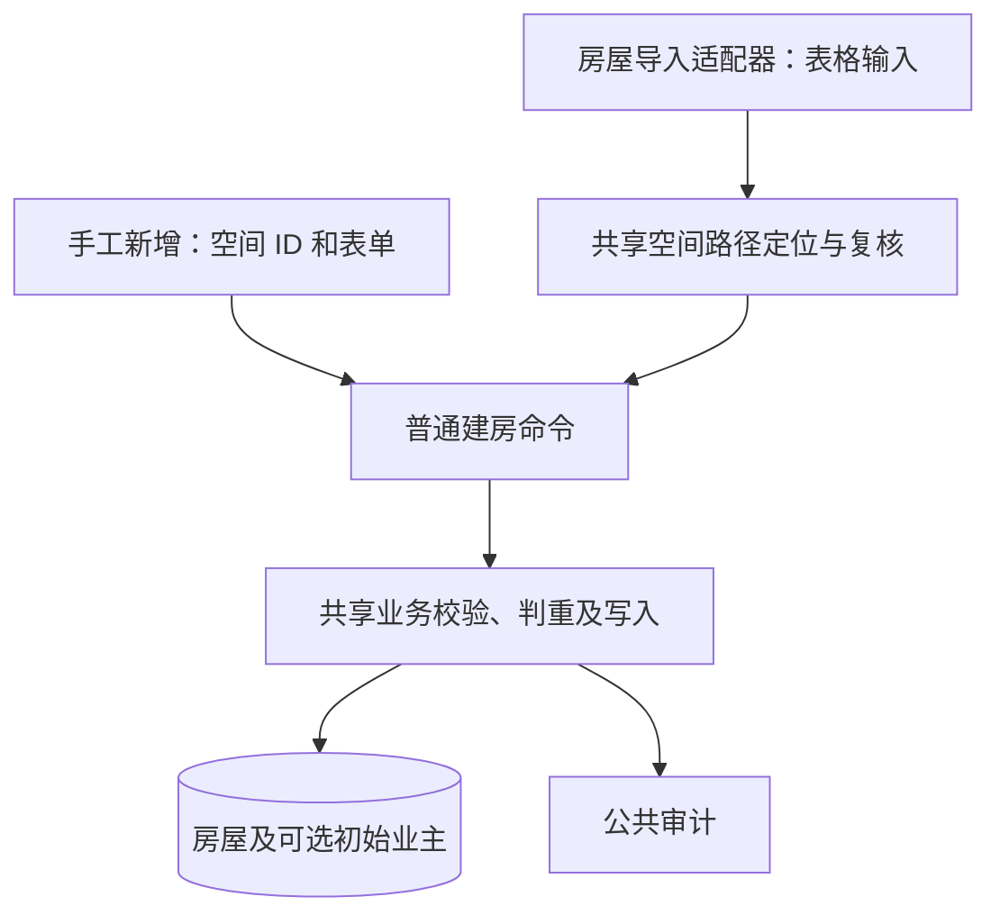

# 房屋批量导入设计

## 范围与依据

物业端按小区批量新建房屋档案。批次固定当前公司的一个小区，每行对应一套房屋，仅支持创建模式。分区、楼栋、单元须提前建好；路径缺失或不匹配时报告问题，不自动创建空间。

模板不包含业主信息，导入不创建、修改或清空业主登记。手工新增继续支持初始业主列表。房屋更新、空间迁移、启停变更及业主批量登记不属于本设计范围。

房屋业务规则及共享能力以 [房屋资料管理设计](housing.md) 为准；导入生命周期、预览确认、事务、操作幂等、恢复及保留期复用 [通用导入设计](../imports/overview.md) 与 [适配器协议](../imports/architecture.md#适配器协议与扩展)，权限目录与动作归属见 [后台授权设计](../admin/authorization.md)。API 精确规格以 [OpenAPI 契约](../../../openapi/openapi.yaml) 为准，遵循 [API 规范](../../api/conventions.md)，具体权限码及接口声明在实施时先同步契约。实施依赖与验收见 [实施计划](../../plans/imports/houses.md)。设计落盘不表示相关契约或代码已经调整。

## 一套业务逻辑、两个入口

| 位置           | 职责                                                                                                       |
| -------------- | ---------------------------------------------------------------------------------------------------------- |
| 手工新增入口   | 请求转普通命令，处理当前身份、会话、事务提交和 HTTP 响应。                                                 |
| 房屋导入适配器 | 表格转普通位置输入及建房命令，将共享业务结果转换为导入准备结果、问题、计划和行结果。                       |
| 共享房屋能力   | 维护普通命令、规范化、空间定位与复核、业务校验、权限需求、自然键、基础资料比较、房屋及初始业主写入与审计。 |
| 通用导入框架   | 维护文件、批次、阶段、预览确认、权限执行、租约、导入操作账本、逐行事务、恢复与统计。                       |

共享业务调用链遵循 [共享建房能力](housing.md#共享建房能力)，不依赖导入定义、上下文、计划、模型、行号、错误码或 HTTP Schema。适配器不复制关联 SQL、判重、字段边界、业务写入或审计逻辑，也不调用会自行提交事务的手工新增 Service。通用引擎不增加房屋类型分支。

## 类型、范围与模板

类型键为 `houses`，仅允许物业端、`community` 范围和 `create` 模式。公司由当前身份解析，小区由服务端授权后固定；文件不接受公司、小区、空间 ID、房屋 ID、启停或业主字段。未知列按通用严格模板规则报错。

模板以不可变版本随应用发布，API 和 Worker 加载相同版本及摘要。首版字段如下，业务字段边界引用普通建房能力，不在适配器重复维护。

| 字段编码        | 列名         | 必填 | 规则                                          |
| --------------- | ------------ | ---- | --------------------------------------------- |
| `phase_name`    | 分区         | 否   | 留空表示楼栋直接属于小区。                    |
| `building_name` | 楼栋         | 是   | 提前建立的完整楼栋名称。                      |
| `unit_name`     | 单元         | 否   | 留空表示房屋直接属于楼栋。                    |
| `room_no`       | 房号         | 是   | 文本，保留大小写、前导零和内部字符。          |
| `floor_no`      | 楼层         | 否   | 独立整数，可负；留空为 `NULL`，不从房号推算。 |
| `external_code` | 房屋外部编号 | 否   | 建档资料，留空为 `NULL`，不作为身份。         |

位置名称与房号去除首尾空白，不补后缀或拆解展示地址。房号、名称及外部编号按文本填写，不猜测已经丢失的前导零；楼层的文件表示只转换为普通整数，不舍入小数或猜测非法值。

外部编号是本次待写入及比较的房屋资料，不采用账单导入中“提供编号辅助核验已有房屋”的定位语义。空间路径规则统一使用 [空间路径定位与复核](housing.md#空间路径定位与复核)。

## 准备、判重与执行

预检只读正式业务表，调用共享能力解析父级空间，取得稳定节点 ID、结构化路径快照、普通建房命令、业务身份、资料指纹和已有目标。房号及父级已确定时，即使楼层或外部编号有错，也应识别文件内重复自然键；身份不能确定时不猜测。

自然键及当前资料比较口径见 [共享建房能力](housing.md#共享建房能力)。业主、启停状态、时间戳、源行和批次不参与本类型的创建资料比较；既有业主登记不影响房屋跳过。可选资料留空表示本次创建输入为空，不表示忽略该字段的比较。

| 情况                         | 行为                                            |
| ---------------------------- | ----------------------------------------------- |
| 文件内自然键重复             | 标记全部重复行，不取首行或末行。                |
| 当前没有同自然键房屋         | 计划新建。                                      |
| 当前同自然键房屋基础资料一致 | 计划跳过并固定该房屋 ID，不新增房屋或建房审计。 |
| 当前同自然键房屋基础资料不同 | 冲突，不更新资料，不补写或清空字段。            |

同一文件重复行即使内容相同仍报错。停用房屋仍占用房号，不因此建立第二套房屋；跳过不改变既有房屋及业主的状态。楼层或外部编号被手工修改后，再上传旧文件按当前资料判断，可能由跳过变为冲突，不回退资料。

正式执行在业务锁内重新检查身份、权限、公司、小区、空间路径、启停和唯一性。新建要求小区及空间路径实际启用。计划新建时若其他入口已建立同一房屋，由共享能力按当前资料返回跳过或冲突；计划跳过则固定原房屋 ID，原目标位置或资料发生不兼容变化时报告冲突，不改绑其他房屋或转为新建。

普通未确认批次重预检可以重新定位并产生新预览。确认后的恢复和失败重跑固定原空间 ID、路径快照、普通命令、操作键、输入指纹及已有目标 ID，只复核当前条件。空间改名、类型或关系不符、归属变化时拒绝原计划，不用旧名称重新匹配其他节点。路径启停重新判断，不仅比较 `updated_at`。

## 权限、事务与恢复

类型处理采用“房产资料维护”，历史、结果及错误文件生成和下载采用“房产资料查看”，动作归属见 [导入授权](../admin/authorization.md#导入授权)。空间、房屋及业主资料使用统一的房产资料查看、维护权限，不再叠加逐阶段导入权限或单独的创建权限；手工建房附带初始业主也使用同一维护权限。权限合并不改变本类型的输入边界：模板不包含业主，不创建空间或业主，不修改既有房屋。后台、公司和小区范围仍分别校验。

权限、范围及目标复核覆盖预检、确认、每行执行、重跑、恢复和成功或跳过结果复用。当前失权或越界按通用阻断规则处理，不能通过排除错误行绕过。历史读取遵循当前读取权限，不要求重新取得写权限。

锁序、唯一冲突识别和审计遵循 [房屋事务约定](housing.md#事务审计与验证)。共享业务能力不提交或回滚，Worker 在同一逐行事务中提交房屋、业务审计、导入操作、当前行结果及进度；当前类型没有空间或业主写入。失败后由事务负责人回滚，不能在失败事务内继续查询或将唯一冲突当作已经成功。

复用现有房屋表、唯一约束、导入操作账本和准备快照，不新增房屋原始创建快照、批次字段或数据库结构。原操作成功后的目标复核不通过，只记录当前批次问题，保留原成功事实，不生成替代操作。

提交结果未知时，先依据原导入操作账本及其同事务结果核实；当前同自然键存在一套房屋，不能单独证明本操作曾创建成功。适配器将固定目标的只读核验委托共享业务能力；缺少足以证明原操作结果的持久证据时保持待核实，不盲目重建。计划跳过的未知结果，只有原目标仍存在、位置及当前资料一致并满足当前授权时才能恢复为跳过。

业务数据冲突映射为安全的行问题，权限和范围问题阻断批次；重试资格、租约、取消、未知结果、保留期及清理继续由通用框架维护，不将任意异常归为可重试失败。

## 页面与预览

小区房屋列表按房产资料维护权限提供批量导入入口，锁定当前小区和房屋类型；导入中心也可选择该类型。空间树选中节点及房屋列表筛选不缩小批次范围，向导明确显示目标小区，各行由文件完整位置确定父级。小区名称通过 [最小查询](../admin/authorization.md#依赖与最小查询) 读取，不依赖第一页选项，也不要求额外授予完整小区资料读取权限。

预览展示源行、匹配后的完整位置、房号、楼层、外部编号、动作及问题；确认页提示须提前建立空间、本次仅新增房屋且不携带业主。使用现有受控 `business_preview` 与 `business_values` 投影，内部命令和路径快照不直接返回前端。统计复用通用新增、跳过及错误等计数，不增加业务金额汇总。

完成后提供返回目标小区房屋列表的入口并刷新房屋列表及相关缓存。路径缺失给出先维护空间、再重新预检或上传的修复提示。错误文件、部分失败、取消和输入清理沿用通用页面行为。

## 验证要求

- 两个入口共同调用普通建房能力，业务领域不依赖导入包或 HTTP Schema；适配器没有独立 SQL、判重及写入实现。
- 手工新增的请求响应、初始多业主、手机号规范化、冲突错误及显式输入字段审计保持既有业务语义，授权统一采用房产资料维护，任一业主失败均整体回滚。
- 覆盖分区、单元有无组合、同名不同路径、空层级不通配、跨公司和小区隔离、前导零、负楼层及空外部编号。
- 缺失空间、未知业主列及错误楼层均不创建空间、房屋或业主；预检和预览不写正式业务表。
- 文件内重复标记全部行，包括同身份但其他字段错误的行；当前资料一致跳过，不一致冲突，既有业主和房屋启停不被改写。
- 真实 PostgreSQL 覆盖手工与导入及跨批次并发、数据库唯一性、业务审计与导入结果整体提交或回滚。
- 覆盖确认后空间改名或停用、跳过目标改号或资料变化、旧位置被其他房屋占用、失权、固定准备输入重跑、成功历史稳定和未知结果核实。
- 房产资料查看可查询本类型历史并生成、下载授权错误文件，但不能处理批次；房产资料维护无需逐阶段授权即可完成导入，Worker 和幂等复用仍复核当前权限。
- 验证 CSV/XLSX、严格模板、安装 wheel 后定义与适配器加载、API 契约、权限按钮、范围展示、预览及返回列表；共享房屋定位变更同时执行账单导入回归。
