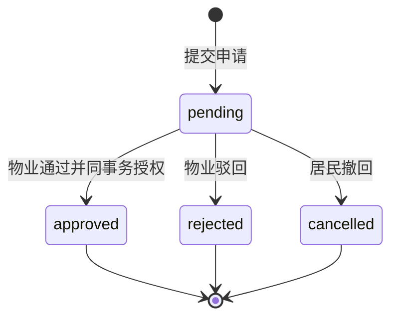

# 居民身份、手机号与房屋认领

## 范围与依据

本设计覆盖平台微信登录、可复用的多手机号绑定、居民房屋认领、物业人工审核、房屋解绑和撤销。居民、物业、商家共用小程序的隔离方式见 [平台微信小程序架构](../../architecture/miniapp.md)。物业组织、空间、房屋和业主档案沿用 [物业接入](../property/onboarding.md) 与 [房屋资料管理](../property/housing.md)。

工程、测试、数据库和 API 分别遵循 [开发规范](../../guidelines/development.md)、[测试规范](../../conventions/testing.md)、[数据库规范](../../database/conventions.md) 和 [API 规范](../../api/conventions.md)。请求响应、错误、权限、幂等及运行进程归属以 [OpenAPI](../../../openapi/openapi.yaml) 为唯一权威来源。

## 身份与手机号

服务端仅配置一个平台小程序 AppID 和 AppSecret；账号按区分大小写的 OpenID 唯一识别，不保存 `wechat_appid`，不依赖 UnionID，不按手机号合并用户。切换生产 AppID 涉及微信身份迁移，不能作为普通配置切换处理。

微信登录调用 `wx.login` 和 `code2Session`，成功后创建平台小程序账号及独立居民会话。手机号不作为登录前提。账号不包含互斥角色、物业归属或全局实名姓名；申报姓名只属于具体房屋申请。后续业务身份独立授权。

手机号采用微信快速验证组件 `getPhoneNumber`，支持选择已有号码或自行添加号码。用户也可先手填号码，再完成微信授权，服务端比较手填值与微信返回值，一致才保存绑定。只接受大陆号码，按现有业主规则接受 `+86`、`0086` 前缀并规范化为 11 位；不信任客户端自报手机号或 OpenID。兑换时传当前账号 OpenID，并检查返回水印 AppID 与服务端配置一致。

快速验证不保证每次实时核验。绑定表示该账号曾完成该号码的微信授权验证，不等于实名业主身份。一个用户可有多个有效号码，同一号码允许不同微信账号分别授权，不因此转移账号或房屋权限。

有效手机号绑定长期保存，本期不按时间自动过期，可免验证用于后续认领。用户解绑后停止用于新申请；重新绑定必须取得新的微信授权。手机号解绑不改变已提交申请及房屋授权。

验证成功后直接在 PostgreSQL 同一事务中保存绑定和成功验证记录，不在 Redis 保存临时验证凭证、原始手机号 code 或兑换结果。微信请求成功但数据库未成功保存且无持久成功记录时，重新微信授权；不能以一次性 code 无效推断数据库必然没有提交。

## 房屋认领与授权

居民先选已有房屋，填写姓名，选择本人有效手机号绑定后提交。请求以 `phone_binding_id` 指定当前可用号码，服务端检查归属和状态，再将号码写入申请 `applicant_phone`。申请不保存 `phone_binding_id`、`phone_verification_id` 或 `phone_verified_at`，不依赖手机号绑定的后续生命周期。

匹配限定在目标房屋，姓名去首尾空白后与规范化手机号同时精确匹配同一条有效业主登记。匹配结果保存提交时快照，不进行姓名模糊匹配。不论匹配、未匹配或尚无业主档案，均允许提交并人工审批；居民端不公开匹配档案。

未匹配申请核实后可独立通过，核实说明必填，不自动新增、修改或启用业主档案。业主资料后续单独维护，不改写申请快照，也不自动变更房屋授权。

支持一人多房、一房多人。一个用户与同一房屋最多一条待审申请及一条有效绑定；存在有效绑定时不能新建申请。驳回、撤回、主动解绑或物业撤销后，再次认领创建新申请，重新审批并创建新的绑定，保留历史。

房屋绑定为 `active → released`（居民主动解绑）或 `active → revoked`（物业撤销）。结束后不恢复旧绑定；源申请继续保留 `approved`，不表示当前仍有权限。

新增申请和批准要求公司、小区、空间祖先、房屋及账号可用。停用不批量改写历史状态；本人可查看历史、撤回及解绑，物业身份仍有效时可驳回及撤销。实际房屋授权要求账号、公司、完整房屋路径及绑定均有效；不依赖手机号仍绑定或业主档案仍匹配。下游房屋业务每次重新校验绑定，不能信任会话中的旧房屋列表。

## 数据模型

所有实体使用 UUIDv7 `id` 主键和独立非空 `created_at timestamptz(6)`。可修改表另有 `updated_at timestamptz(6)`。主键和归属固定，外键不级联删除，时间为 UTC，普通字符串区分大小写。手机号按现有业主资料方式明文存储，不进入诊断日志或审计元数据。

### 小程序账号 `miniapp_users`

| 字段              | PostgreSQL 类型  | 约束                                       |
| ----------------- | ---------------- | ------------------------------------------ |
| `wechat_openid`   | `varchar(128)`   | 非空、唯一、去首尾空白后非空，创建后固定。 |
| `enabled`         | `boolean`        | 非空，默认 `true`。                        |
| `session_version` | `integer`        | 非空，默认 1，正数。                       |
| `last_login_at`   | `timestamptz(6)` | 非空，首次等于创建时间。                   |

### 手机号绑定 `miniapp_phone_bindings`

| 字段                                     | PostgreSQL 类型  | 约束                                     |
| ---------------------------------------- | ---------------- | ---------------------------------------- |
| `user_id`                                | `uuid`           | 非空，账号外键。                         |
| `phone`                                  | `varchar(11)`    | 非空，CHECK 规范化大陆号码，创建后固定。 |
| `status`                                 | `varchar(16)`    | 非空，`active`、`unbound`。              |
| `first_verified_at` / `last_verified_at` | `timestamptz(6)` | 非空，首次不晚于最近一次。               |
| `unbound_at`                             | `timestamptz(6)` | 有效时为空，解绑时非空。                 |
| `row_version`                            | `bigint`         | 非空，默认 1，正数。                     |

`UNIQUE(user_id, phone)`；`UNIQUE(user_id, id)` 供复合外键引用；索引 `(user_id, status, created_at, id)`。同一账号同一号码重新验证时复用原记录并更新版本和时间；不可直接编辑号码。

### 成功验证记录 `miniapp_phone_verifications`

| 字段                                   | PostgreSQL 类型  | 约束                                   |
| -------------------------------------- | ---------------- | -------------------------------------- |
| `user_id` / `phone_binding_id`         | `uuid`           | 非空，复合外键限定本人绑定。           |
| `method`                               | `varchar(32)`    | 非空，本期限定 `wechat_fast`。         |
| `wechat_code_hash`                     | `char(64)`       | 非空，code 的 SHA-256，不保存原 code。 |
| `wechat_authorized_at` / `verified_at` | `timestamptz(6)` | 非空，微信授权时间和服务端成功时间。   |
| `idempotency_key`                      | `varchar(128)`   | 非空，本人请求幂等键。                 |
| `request_fingerprint`                  | `char(64)`       | 非空，规范化请求摘要。                 |
| `request_id`                           | `varchar(64)`    | 非空，追踪标识。                       |

`UNIQUE(user_id, idempotency_key)` 和 `UNIQUE(user_id, wechat_code_hash)`；索引 `(phone_binding_id, verified_at, id)`。只追加成功记录，绑定和记录原子提交；幂等重放读取现有绑定状态，不能重新激活已解绑号码。

### 认领申请 `house_claim_applications`

| 字段                                                | PostgreSQL 类型             | 约束                                                 |
| --------------------------------------------------- | --------------------------- | ---------------------------------------------------- |
| `user_id`                                           | `uuid`                      | 非空，申请账号。                                     |
| `property_company_id` / `community_id` / `house_id` | `uuid`                      | 非空，服务端解析且通过复合外键限定公司、小区和房屋。 |
| `house_label_snapshot`                              | `varchar(512)`              | 非空，服务端生成提交时位置。                         |
| `applicant_name`                                    | `varchar(80)`               | 非空，去首尾空白后非空。                             |
| `applicant_phone`                                   | `varchar(11)`               | 非空，规范化大陆号码快照。                           |
| `applicant_remark`                                  | `varchar(1000)`             | 可空，非空值去首尾空白后非空。                       |
| `match_status`                                      | `varchar(16)`               | `matched`、`unmatched`。                             |
| `matched_owner_id`                                  | `uuid`                      | 匹配时非空，否则为空；限定目标房屋。                 |
| `status`                                            | `varchar(16)`               | `pending`、`approved`、`rejected`、`cancelled`。     |
| `reviewed_by_admin_id` / `reviewed_at`              | `uuid` / `timestamptz(6)`   | 审核终态必填，其他状态为空；审核人限定同公司。       |
| `review_reason`                                     | `varchar(1000)`             | 驳回、未匹配通过必填；其余可空。                     |
| `cancelled_at`                                      | `timestamptz(6)`            | 撤回状态必填，其他为空。                             |
| `row_version`                                       | `bigint`                    | 非空，默认 1，正数。                                 |
| `idempotency_key` / `request_fingerprint`           | `varchar(128)` / `char(64)` | 非空，创建幂等键及摘要。                             |

`UNIQUE(user_id, idempotency_key)`；部分唯一索引 `(user_id, house_id) WHERE status = 'pending'`。为绑定来源引用保留 `(property_company_id, community_id, house_id, user_id, id)` 唯一约束。现有业主表补充 `(house_id, id)` 唯一约束，匹配外键不允许引用其他房屋业主。

索引为 `(user_id, created_at, id)`、`(property_company_id, status, created_at, id)`、`(property_company_id, community_id, status, created_at, id)`、`(house_id, created_at, id)`，其他外键按查找需要覆盖。

### 房屋授权 `resident_house_bindings`

| 字段                                                            | PostgreSQL 类型  | 约束                                             |
| --------------------------------------------------------------- | ---------------- | ------------------------------------------------ |
| `user_id` / `property_company_id` / `community_id` / `house_id` | `uuid`           | 非空，固定归属。                                 |
| `claim_application_id`                                          | `uuid`           | 非空、唯一；复合外键限定申请和上述全部归属一致。 |
| `status`                                                        | `varchar(16)`    | `active`、`released`、`revoked`。                |
| `granted_at`                                                    | `timestamptz(6)` | 非空，批准时间。                                 |
| `ended_at`                                                      | `timestamptz(6)` | 结束状态必填，有效时为空。                       |
| `ended_by_user_id`                                              | `uuid`           | 主动解绑时为本人；其他状态为空。                 |
| `ended_by_admin_id`                                             | `uuid`           | 物业撤销时为同公司管理员；其他状态为空。         |
| `end_reason`                                                    | `varchar(1000)`  | 撤销必填，主动解绑可空。                         |
| `row_version`                                                   | `bigint`         | 非空，默认 1，正数。                             |

部分唯一索引 `(user_id, house_id) WHERE status = 'active'`；列表索引为 `(user_id, status, created_at, id)`、`(property_company_id, community_id, status, created_at, id)`、`(house_id, created_at, id)`。不设置必填业主档案引用。

## 原子状态变化、事务与重试

撤回和审批均执行数据库原子条件更新：`UPDATE ... WHERE id = :id AND status = 'pending' AND row_version = :expected RETURNING ...`。只有返回记录的一方可成功，另一方返回状态已变化的 409；不能先普通读取状态再无条件更新，也不能把终态重复审批解释为成功。

批准时申请状态、房屋绑定、申请审核字段及 `admin_audit_logs` 审批记录必须同事务提交。绑定创建或审计写入失败则全部回滚；驳回同样原子更新申请并写审批记录。CAS 后若仍有业务检查失败必须回滚。已通过申请不会因房屋解绑改为撤回。

身份和路径沿用现有保护锁。统一顺序为公司、物业操作者（如有）、小程序用户、手机号绑定（如有）、小区、空间祖先、房屋、业主（如有）、申请、房屋绑定。条件更新是申请终态的最终仲裁；部分唯一索引兜底重复创建。不同状态修改入口不能使用相反锁顺序。

创建申请和手机号绑定要求稳定 `Idempotency-Key`。同键同规范化输入读取原业务结果的当前状态，不重复执行；同键不同输入返回冲突。重放先执行当前身份及本人范围检查，不因原手机号已解绑或原房屋已停用丢失已提交结果。创建申请的幂等与指向房屋的重复待审约束分别生效。

撤回或审核仅允许 `pending`，重复请求返回状态变化；解绑和撤销仅允许有效绑定，版本冲突不能覆盖新授权。未知写入结果先查询资源；创建使用原幂等键恢复。手机号成功提交可用持久验证记录恢复，未保存成功结果时取得新微信 code，不缓存临时凭证规避一次性限制。

居民操作由对应业务记录保存时间和操作者；物业审核及撤销另写现有后台审计，归属本公司。审计只保存目标、动作、状态、匹配标志等白名单，不保存姓名、手机号、自由文本原因或认证数据。

## 会话与配置

居民使用随机不透明 Bearer 令牌和现有 Redis 独立 `resident` 命名空间；令牌仅保存摘要。建议空闲期 7 天、绝对期 30 天，可配置；会话保存账号版本，请求重新检查账号启用及版本。退出撤销当前居民会话，Redis 丢失允许重新微信登录。

服务端配置 `APP_WECHAT_MINIAPP_APP_ID`、`APP_WECHAT_MINIAPP_APP_SECRET`、居民会话时长和限流。小程序构建 AppID 与服务端一致，不能由请求体指定。微信访问令牌依照返回有效期缓存在 Redis，通过短锁协调刷新；兑换手机号不使用 Redis 凭证或结果缓存。真实密钥仅存受控环境配置。

微信 Integration 校验外部响应，区分无效 code、拒绝、依赖不可用和结果未知；日志不输出 URL 查询串、原始异常、code、OpenID、手机号、密钥或令牌。登录、手机号绑定及申请提交按来源或账号限流，返回准确的可重试等待信息。

## API 和权限

居民路径包含独立 `/v1/resident-sessions`、本人 `/v1/miniapp-users/me`、本人手机号绑定、本人申请和房屋绑定，以及只返回选房摘要的 `/v1/claimable-communities`。选项仅展示完整启用路径，不公开业主、账单、面积和他人认领数据。详情和列表仅解析本人资源。

获授权房屋的账单缴费、历史收款脱敏与解绑后本人支付记录规则见 [居民账单支付与资金处理](../payment/bill-payments.md#房屋账单与本人订单)；本人历史支付不重新授予该房屋的当前账务读取权限。

物业提供 `/v1/house-claims` 的列表、详情与审核，以及 `/v1/resident-house-bindings` 的列表、详情与撤销。公司从当前物业身份解析，不能请求切换；越界返回 404，列表和总数使用相同范围。

新增 `property.house_claim.read`、`property.house_claim.review`、`property.resident_house_binding.read`、`property.resident_house_binding.revoke`。审核同时需要读取申请权限；撤销同时需要读取绑定权限。申请读取不授予既有业主读取，比较档案继续要求 `property.house_owner.read`。

请求、响应使用现有成功资源和 RFC 9457 Problem Details。所有列表分页和稳定排序遵循 API 规范，敏感响应 `Cache-Control: no-store`，请求标识前后一致。JSON 拒绝未知字段，不接受客户端自报公司、用户、原始认领手机号、匹配或审批结果。

## 页面交互

登录页展示平台介绍和微信登录，成功回到本端允许的目标页面；已有会话恢复失败可重试，不误判未登录。手机号授权按需触发，不在启动时强制获取。

居民首页展示有效房屋卡片、待审提示和认领入口，个人中心提供我的房屋、申请、手机号和退出。选房先搜索小区，再逐级展示分区、楼栋、单元和房屋，允许省略层级；楼栋同时有单元和直接房屋时分组呈现。找不到既有房屋时联系物业维护，不自行建房。

认领为选房、填写资料、确认三步。姓名必填；一个有效号码默认选中，多个由用户选择；新增号码支持微信号码和手填后授权。手填与微信返回不一致时保留输入并提示重新选择。最后展示位置、姓名、脱敏号码和人工审核提示。提交成功清理草稿并进入申请详情。

申请详情展示状态时间线；待审提供撤回，驳回展示原因和重新申请。居民不显示内部匹配结果。房屋详情展示绑定、当前可用状态和主动解绑；手机号管理展示号码、验证时间、添加和解绑，明确不影响已有申请或房屋权限。历史记录只读。

小程序的品牌、视觉、紧凑间距、固定底部导航与抽屉交互遵循[美好社区小程序体验设计](miniapp-experience.md)。状态使用颜色与文字，底部按钮适配安全区和键盘；首次加载骨架屏，错误就近提示，用户取消授权保留表单，提交期间防止重复操作。

物业后台提供 `/house-claims`、`/house-claims/:claim_id`、`/resident-house-bindings`、`/resident-house-bindings/:binding_id`。申请列表默认待审，可按小区、房屋、状态、匹配结果和时间筛选；手机号在列表脱敏。详情展示申请资料、历史匹配和审核说明，有业主读取权限才加载现有档案。未匹配通过、所有驳回和物业撤销必须填写原因。撤回与审批竞争失败时刷新状态并提示已变化，不允许旧页面覆盖。

## 验证要求

- 并发首次登录账号唯一，居民和后台会话、公司范围及旧响应隔离。
- 手机号多绑定、前缀规范化、code 与用户和 AppID 校验、手填不一致、解绑重绑和长期复用。
- 微信成功但保存失败后重新授权；成功提交后的持久幂等恢复；Redis 没有手机号临时凭证或兑换结果。
- 一人多房、一房多人，匹配和未匹配均待审，无业主资料仍可独立通过，申请不关联手机号绑定生命周期。
- 原生部分唯一索引、复合外键、状态与必填 CHECK、迁移和模型一致性。
- 真实 PostgreSQL 多连接验证撤回与批准、撤回与驳回并发，分别覆盖双方先成功；恰有一方成功且另一方返回状态冲突。
- 批准创建绑定或审批日志失败时申请仍待审，无残余绑定或审批记录；重复审批不生成第二份授权。
- 停用、解绑、撤销、再次认领和历史快照；跨用户、跨公司、读取与审批权限及业主资料隔离。
- 页面选房层级、加载与失败恢复、表单、状态竞争反馈、导入边界、会话缓存清理、构建与逐进程契约一致性。
- 体验版真机验收微信登录和手机号快速授权，记录真实微信验证与替身测试的区别。
