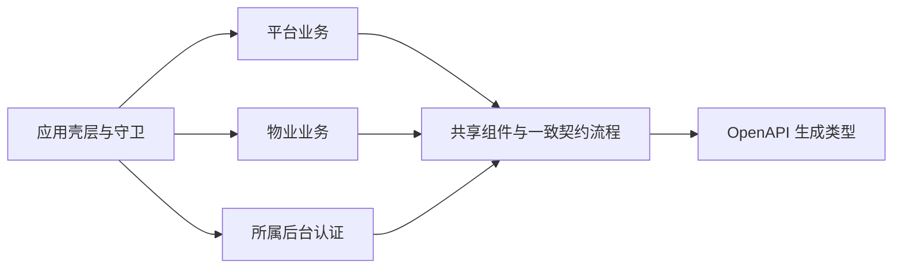

# 管理后台前端

平台与物业后台共用一套 React、Umi Max、Ant Design 和 ProComponents 工程及静态构建，认证、请求、业务权限和数据范围分别隔离。账号及岗位规则见[身份授权](../modules/identity/README.md)，登录及改密见[后台身份](../modules/identity/admin.md)。

## 职责与依赖

| 职责       | 边界                                                                                 |
| ---------- | ------------------------------------------------------------------------------------ |
| 应用壳层   | 识别后台、路由守卫、布局、主题、小区上下文及命令搜索。                               |
| 认证       | 当前端登录、受限改密、本人资料、会话核实与失效清理。                                 |
| 所属端业务 | 本端页面、请求能力、权限、公司及小区范围。两端业务不互相依赖。                       |
| 共享能力   | 基础展示、表单、请求及一致的物业业务、系统管理、支付、导入流程，不反向依赖业务组装。 |

共用页面显式接收本端能力，不能自行切换后台；物业资金运行能力只提供本端读取，不因共享组件取得平台写入。HTTP 结构使用生成契约类型，精确接口由 [OpenAPI](../../../openapi/openapi.yaml) 维护。

房产、账单、计费依据、认领与绑定页面及关联表单使用共享物业业务模块。物业入口注入语义 API、业务动作判断、公司及小区范围、查询身份、导航与未保存保护；共享页面不读取后台会话、不拼接本端接口路径、不直接判断后台权限编码。公司资料、工作台、系统管理和应用壳层保留所属职责。

共享能力当前由物业入口使用；平台和小程序尚未接入这些物业业务。页面复用不扩大后台权限或跨端数据可见性。

## 当前导航与页面开放

| 后台 | 业务入口                                                                                               |
| ---- | ------------------------------------------------------------------------------------------------------ |
| 平台 | 工作概览；物业公司、小区管理；支付记录、资金对账、收款配置；账号、角色、操作日志。                     |
| 物业 | 工作概览；物业账单、线上收款、对账结果；房屋档案、认领审核、房屋绑定；账号、角色、操作日志；导入中心。 |

- 菜单、搜索、快捷入口、直达和登录回跳共同判断权限与开放状态，空分组隐藏。
- 平台收款配置有独立入口及公司下入口；当前平台导入中心不开放。
- 物业“小区资料”“收款信息”独立页面关闭，不挂载业务查询，但必要公司、小区上下文仍可取得，平台对应能力不受影响。

物业顶部小区按账号保留选择。房屋和账单使用明确小区，公司范围页面标明不随所选小区缩小；直达详情按真实资源确定上下文。页面权限不能扩大数据范围，也不能以隐藏按钮替代服务端授权。

## 产品布局与视觉基线

| 项目       | 当前选择                                                                                                                                 |
| ---------- | ---------------------------------------------------------------------------------------------------------------------------------------- |
| 工作区     | 深色固定顶栏、白色分组侧栏、浅色业务区；64px 顶栏、216px 侧栏、55px 业务上下文栏。宽度不超过 1350px 时侧栏为 200px。                     |
| 后台身份   | “平台管理中心”深蓝 `#10284F`；“物业工作空间”靛青 `#24294D`，保留名称而非只用颜色识别。                                                   |
| 认证页     | 所属后台深暗渐变及柔和光晕，登录和强制改密使用独立布局。                                                                                 |
| 主题与密度 | 专业蓝、靛青、岩蓝强调主题，标准和紧凑密度；不改变固定后台身份色。                                                                       |
| 字号与控件 | 基础 14px、页面标题 24px、面板标题 14px；标准表格 13px、紧凑表格 12px，标准控件高 34px。                                                 |
| 留白与圆角 | 标准工作区左右 28px、宽屏 36px、紧凑 24px；不超过 1350px 的标准布局为 22px。面板内边距 22px，控件、面板、弹窗圆角分别为 6px、9px、10px。 |
| 内容结构   | 面包屑位于业务上下文栏，内容从页标题区开始；详情继承父导航和返回上下文，宽表在容器内滚动。                                               |

组件、间距、列表、表单关闭、未保存保护、日期时间及反馈要求统一见[后台前端规范](../standards/admin-frontend.md)，业务页面继承壳层，不自建导航或小区选择器。

## 域名、API 与直达

| 入口                | 当前识别方式                                                                         |
| ------------------- | ------------------------------------------------------------------------------------ |
| 配置的后台 hostname | 按 `UMI_APP_PLATFORM_HOST`、`UMI_APP_PROPERTY_HOST` 精确匹配；页面从本端根路径进入。 |
| 回环地址开发入口    | 根页面提供双端入口，业务分别使用 `/platform`、`/property` 前缀。                     |
| 未配置 hostname     | 不识别为后台；当前不能按同一 IP 的不同端口区分两端。                                 |

默认 hostname 为 `platform.ezcmty.test`、`property.ezcmty.test`。本端旧前缀有兼容解析，跨端、未知或关闭路径不进入业务页；回跳仅接受本端允许页面。

- 默认 API 前缀分别为 `/api/platform`、`/api/property`，应与 Cookie Path、可信 Origin 和代理配置一致。
- 本地站点只代理所属后台 API，另一后台 API 返回不存在；这不改变后端各自身份校验。

统一请求入口限制目标为同源本端 API 前缀，普通请求拒绝 HTTP 重定向。上传、下载沿用所属端认证和请求取消保护，写请求按当前会话附带 CSRF 校验信息。

## 请求、缓存与恢复

两端分别持有认证状态、请求客户端和查询缓存。公共读取将后台及账号纳入查询身份；直接业务查询也受所属端独立缓存及身份变化清理保护，按资源继续区分公司、小区和条件。不能假定所有页面仅靠同一种查询键格式隔离。

| 情况               | 当前机制                                                                           |
| ------------------ | ---------------------------------------------------------------------------------- |
| 身份或权限变化     | 取消本端请求、清理本端缓存及表单，旧响应不能回填；另一后台不受影响。               |
| 范围变化           | 清理旧资源选择与查询，避免旧小区响应回填新范围。                                   |
| 普通请求           | 默认不自动重试写入；读取失败有明确重试入口，不伪装为空列表。                       |
| 写入成功           | 刷新受影响查询，展示服务端实际结果，不乐观伪造资金完成。                           |
| 状态冲突或未知结果 | 保留输入；有幂等身份的业务恢复原请求，版本操作重读事实，不自动换键或替换令牌重发。 |

共享物业查询显式纳入后台、账号、权限及公司身份，按资源继续区分小区和条件。范围或权限变化使原业务实例失效，旧请求结果不能触发新范围的导航或清理新草稿。待恢复账单提交保留业务动作、原公司小区、资源、输入和幂等键，由本端请求适配生成路径，不能跟随当前选择改写目标。

异步受理只表示已安排。业务状态与恢复分别见[物业](../modules/property/README.md)、[导入](../modules/imports/README.md)、[支付](../modules/payment/README.md)。

## 开发与构建

开发服务器固定使用回环地址 5173 端口，端口占用时失败，不自动换端口。类型准备与开发运行使用不同临时输出，避免相互清理；生成内容不人工维护或提交。生产构建输出静态资源，两端使用同一构建产物。

类型、边界、前端测试和构建分别检查；静态检查不能替代页面与交互验收。环境和操作入口见[本地准备](../development/local-setup.md)，验证范围见[质量检查](../development/verification.md)。
