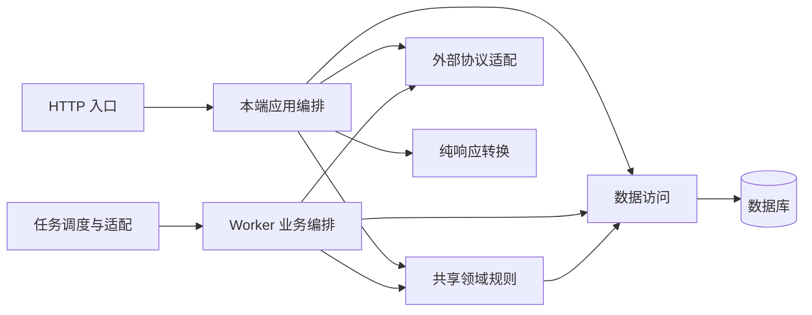
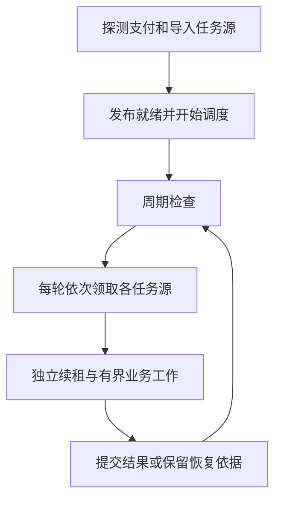

# 后端职责与协作

运行进程见[系统架构](overview.md)。本页维护技术边界，授权、资金和导入规则分别由[业务模块](../modules/README.md)完整定义。

## 职责与依赖

| 职责           | 负责                                         | 禁止                                             |
| -------------- | -------------------------------------------- | ------------------------------------------------ |
| HTTP 入口      | 输入、认证依赖、CSRF、响应与渠道应答         | 直接访问数据库、提交事务或决定资金结果           |
| 本端应用编排   | 权限、范围、调用顺序、状态协调和事务         | 调用另一端应用用例或私有能力                     |
| 共享领域       | 业务计算、不变量与共同写入，接收普通业务数据 | 依赖 HTTP 模型、会话存储或渠道网络，自行提交事务 |
| 数据访问       | 范围过滤、查询、行锁与持久化                 | 决定用户授权、调用渠道或提交事务                 |
| 数据模型       | 持久结构、关联及约束                         | 承载网络、调度或完整业务用例                     |
| 请求响应与转换 | 契约表达及已加载数据的白名单转换             | 查询、授权、隐式加载或业务副作用                 |
| 外部协议适配   | 签名验签、解密、结构校验与事实转换           | 决定入账、资金重试或业务状态                     |
| 调度与任务适配 | 领取、租约、生命周期及目标分派               | 复制业务状态机或统一决定所有业务重试             |

- 平台、物业、客户端和 Webhook 各自固定身份边界，不提供切换后台的业务开关。
- 共同规则通过领域与数据访问复用；手工、导入入口共享创建规则，导入只做输入适配和批次控制。
- 认证会话由本端编排管理，领域规则不接收会话存储；响应转换不扩大字段与权限范围。
- 公司、账号等可信上下文由服务端解析，列表、总数、选项和详情统一过滤。

## 事务与任务

| 操作         | 技术边界                                                         |
| ------------ | ---------------------------------------------------------------- |
| 普通业务写入 | 应用编排决定提交与回滚，领域及数据访问参与同一事务               |
| 请求清理     | 异常或取消时回滚、释放；正常返回不自动提交，清理失败不覆盖原异常 |
| 并发保护     | 按用例固定资源顺序，加锁后复核身份、状态、版本及范围             |
| 外部调用     | 不持有业务锁或未结束事务，事实保存与结果应用分开                 |
| 任务领取     | 独立短事务，提交领取后执行，不持任务锁等待业务锁                 |
| 结果应用     | 业务锁后复核执行代次与有效租约，业务结果与任务确认共同提交       |
| 租约接管     | 独立连接续租，过期可接管；旧执行者不得推进业务结果               |

支付的提交集合、锁序和渠道证据边界见[支付数据与事务](../modules/payment/data.md)，导入分块与未知结果见[导入执行机制](../modules/imports/execution.md)，不在架构复制业务不变量。

## 共用 Worker

| 任务源 | 执行内容                                 | 周期工作                             |
| ------ | ---------------------------------------- | ------------------------------------ |
| 支付   | 下单、查单、关单、通知、分账、解冻及核对 | 到期与授权变化核实、缺日核对批次补齐 |
| 导入   | 解析、预检、执行、错误文件及清理         | 草稿失效、输入保留与文件回收         |

- 各任务源使用自己的持久数据与处理条件，每轮轮流领取，业务长任务分块让出执行机会。
- 周期工作在启动及运行中有界执行，可由多 Worker 重复触发，依靠业务与任务唯一性合并。
- 进程停止不伪造成功，未完成任务保留持久恢复依据；实际停止与就绪判断见[本地开发](../development/local-setup.md)。

## 错误与验证

- 内部 API 使用统一错误转换，Webhook 业务应答遵循渠道协议，规则见[错误与异常](../standards/errors.md)。
- 验证分端接口归属、跨端身份拒绝、公司隔离、事务回滚、真实并发与任务接管；执行要求见[测试规范](../standards/testing.md)。
