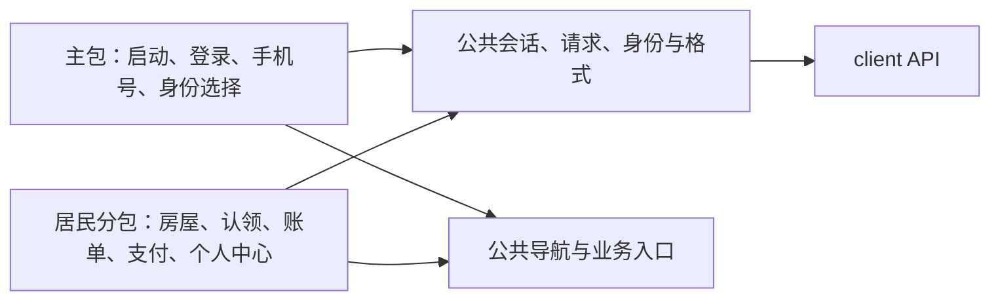
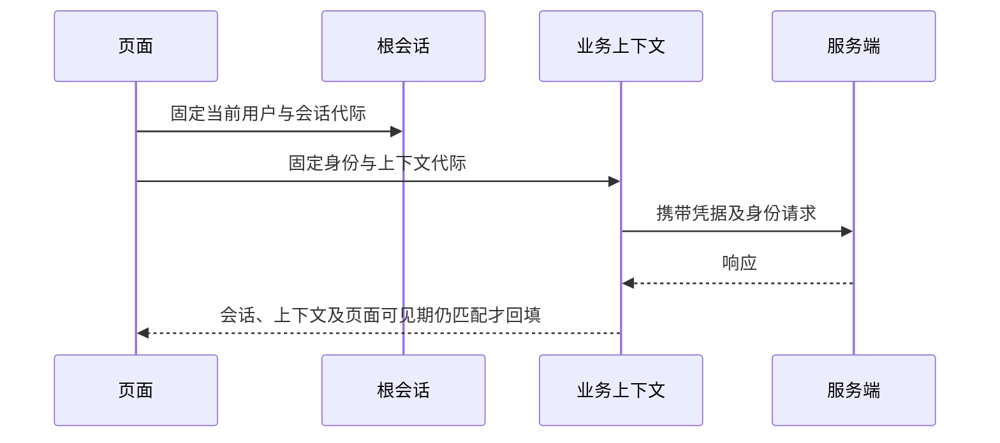

# 微信小程序架构

小程序采用原生页面、模板、样式及 TypeScript，统一微信账号与业务身份框架。当前只有居民业务分包，没有物业、商家占位入口。身份、手机号和选择规则见[客户端身份](../modules/identity/client.md)。

产品名称为“美好社区”，使用自定义导航、浅色卡片和中文系统字体。

## 主包与居民分包

| 范围     | 当前职责                                                         |
| -------- | ---------------------------------------------------------------- |
| 主包     | 公共账号入口、微信登录、手机号及身份选择，不依赖居民分包实现。   |
| 公共能力 | 根会话、公共请求、身份目录、业务上下文、格式化及允许的业务导航。 |
| 居民分包 | 首页、缴费、房屋、我的，以及认领、申请、房屋、账单和支付详情。   |
| 业务入口 | 只注册 `resident`；未知身份类型不能进入业务页。                  |

各包只消费明确公共能力，公共层不反向导入业务分包。房屋认领和绑定规则见[居民房屋授权](../modules/property/resident.md)，资金结果及支付行为见[支付](../modules/payment/README.md)。

## 根会话与业务请求

- 根会话只认证微信用户。
- 本人资料、手机号、会话与身份目录使用公共请求；居民业务另固定身份键 `resident` 并发送 `X-Client-Identity`。
- 额外身份使用本人关联 UUID，不能把身份理解为根会话中可变的当前公司。

| 变化                         | 隔离结果                                                                         |
| ---------------------------- | -------------------------------------------------------------------------------- |
| 登录、凭据替换、退出、换用户 | 根会话代际变化，取消旧请求并清理所属身份、视图和敏感草稿。                       |
| 身份切换或关联失效           | 业务代际变化，取消旧业务请求和轮询、重建业务导航；公共手机号请求仍属于当前用户。 |
| 页面隐藏或卸载               | 停止轮询、废弃旧页面读取，重新显示后按当前身份加载。                             |
| 当前根会话 401               | 即使来自旧业务上下文也处理认证失效；旧会话的迟到 401 不能清理新登录。            |
| 普通业务拒绝或网络故障       | 展示无权或错误，不清空所有仍有效身份。                                           |

会话恢复须服务端核对当前用户。目录完整性、身份核验及失效语义由身份模块维护；选择中的页面离开后，迟到结果不能恢复已取消的选择。

## 导航与恢复

居民底部入口为首页、缴费、房屋、我的，根级切换重建页面栈，详情与操作使用业务内导航。登录回跳只接受允许的原生页面及必要资源标识，不接受任意 URL、身份或支付参数。

公共手机号页可以在没有业务选择时使用；业务回跳必须匹配当前已核验身份，目标不适用时进入该身份首页，未选择时进入身份选择。返回或重新显示时读取当前资源，不信任旧页面中的房屋与授权快照。

## 本地资料白名单

| 资料         | 保存与读取边界                                                                                    |
| ------------ | ------------------------------------------------------------------------------------------------- |
| 根凭据       | 按 API 环境保存 Token、用户标识及期限，恢复时由服务端重新核验；不沿用旧居民凭据。                 |
| 身份偏好     | 按环境与用户保存选择键，只作下次核验的候选，不作授权证明。                                        |
| 房屋偏好     | 保存绑定标识，在服务端核实当前用户后读取，按当前有效绑定重新选择。                                |
| 支付恢复     | 按环境、用户及业务保存原幂等键、账单及预期版本、已有订单标识和必要未知标记。                      |
| 敏感临时资料 | 微信 code、认领草稿、号码表单、签名和调起支付参数只在适用内存生命周期，不写 URL、日志或持久草稿。 |

跨 API 地址恢复只使用明确允许来源，且限已核实的同一用户。资料异常、来源冲突或保存失败时停止恢复，不静默覆盖原记录，也不换键创建新付款。

## 支付与后台处理的边界

页面负责展示和生命周期，居民支付协调负责原请求恢复、调起和查询；授权及资金结果由服务端决定。普通 GET 读取本地事实，调起参数通过专门写接口取得，签名和预支付凭证只留内存。

支付面板成功、取消、未知均核实原订单，不能直接显示已入账。身份切换、重新认证或重开页面不换键再次下单；隐藏页面的迟到参数不能再调起面板。Webhook 和 Worker 继续处理已经发生的收款，不受页面卸载影响。

## 构建与验证边界

构建先生成契约类型、检查主分包依赖，再编译并复制原生资源；输出从干净产物重新生成，避免残留已删除页面。产物校验页面、资源和分包使用关系，注入明确的 API 地址及构建版本。

仅供单个分包使用的模块不能滞留主包。当前工程预算要求主包及各分包分别小于 2 MiB、总量小于 20 MiB，正式打包仍由微信工具校验。

生产模式要求 HTTPS，API 地址不能带凭据、查询参数或片段；存储迁移来源必须显式配置并指向当前 API 地址。配置和稳定命令见[本地准备](../development/local-setup.md)。

类型、边界及替身测试、原生模板和样式编译分别验证。原生检查使用微信编译器，不能仅以路径存在判定通过；替身或原生编译不能替代真机登录、手机号、网络域名和真实支付验收。具体检查入口见[质量检查](../development/verification.md)。
