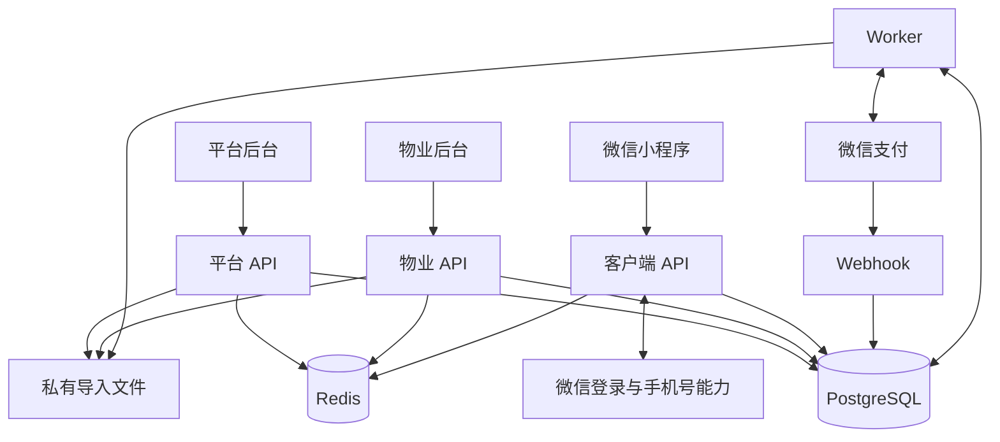

# 系统架构

系统采用单仓库、共享后端能力和独立运行进程。技术边界见[后端](backend.md)、[管理后台](admin-web.md)和[小程序](miniapp.md)，当前业务见[模块手册](../modules/README.md)。

## 组件与数据

| 组件                   | 当前职责                                                   |
| ---------------------- | ---------------------------------------------------------- |
| 平台后台与 API         | 平台账号角色、物业接入、收款配置、资金读取与异常处理       |
| 物业后台与 API         | 本公司账号角色、资料、房产、账单、居民授权、导入与资金只读 |
| 微信小程序与客户端 API | 统一微信账号、本人手机号、身份目录及当前居民业务           |
| Webhook                | 接收渠道通知，验签、可靠保存并安排异步处理                 |
| Worker                 | 支付和导入任务执行、租约接管、周期核对与保留清理           |
| PostgreSQL             | 业务数据、账务、审计、幂等、渠道证据和持久任务             |
| Redis                  | 分端会话、限流与微信调用协调，不承担业务任务队列           |
| 私有文件目录           | 导入源文件与派生文件，后台 API 和 Worker 共用，不公开托管  |

## 运行边界

| 独立进程             | 默认本地端口 | 外部业务入口     |
| -------------------- | ------------ | ---------------- |
| `platform-admin-api` | 8001         | `/api/platform`  |
| `property-admin-api` | 8002         | `/api/property`  |
| `client-api`         | 8003         | `/api/client`    |
| `webhook`            | 8004         | 渠道约定路径     |
| `worker`             | 无 HTTP 端口 | 从数据库领取任务 |

- 后端共享一个应用包，各进程只装配本端接口和用例；会话与授权不跨端合并。
- 两后台共用前端构建，但域名、路由、会话、权限和缓存隔离。
- 客户端会话只认证微信用户，业务请求单独解析身份与资源范围；后台凭据不可复用。
- PostgreSQL 保存持久事实；Redis 会话丢失允许重新登录，不能因此清除资金或任务历史。

## 依赖与运行判断

- 应用使用 FastAPI、同步 SQLAlchemy、PostgreSQL 与 Redis；后台使用 React、Umi Max、Ant Design 与 ProComponents；小程序使用原生组件和 TypeScript。
- API 存活与依赖就绪分别检查；Worker 探测支付及导入任务源后进入调度。进程就绪不证明微信材料、渠道资金或真机流程可用。
- 配置通过环境注入；密钥不进入前端产物、普通日志或文档。环境及启动见[本地开发](../development/local-setup.md)，目标环境见[部署与运行](../operations/deployment.md)。
- 项目标识使用 `ezcmty`，展示名按语境使用 Ezcmty 或当前产品名称；进程和配置使用稳定通用名称，不依赖检出目录名。
