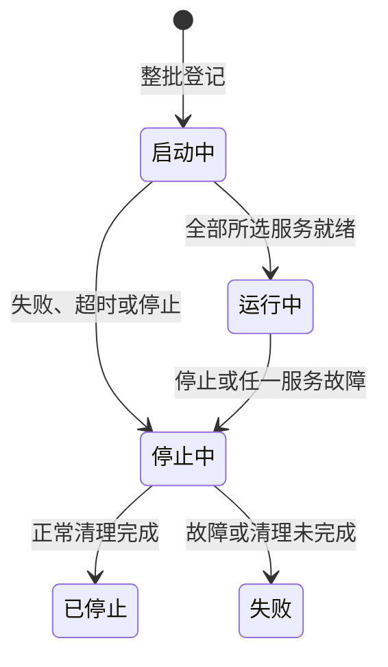

# 本地开发

本页用于准备环境、启动和停止本地应用。只做代码验证时，安装依赖后进入[检查与验证](verification.md)，无需手动迁移、填充数据或准备真实商户材料。

## 环境与配置

| 依赖               | 要求                                                                                     |
| ------------------ | ---------------------------------------------------------------------------------------- |
| 系统               | 开发进程管理支持 macOS、Linux                                                            |
| Python / uv        | Python 3.14.x，使用 uv 安装锁定的开发依赖                                                |
| Node.js / pnpm     | Node 22.22.2 及以上的 22.x、24.15.0 及以上的 24.x，或 26 及以上；默认 24.x；pnpm 10.33.2 |
| PostgreSQL / Redis | PostgreSQL 18.x、可连接的 Redis；启动入口复用已有实例                                    |
| 微信开发者工具     | 小程序页面联调、预览与原生编译使用；不属于常驻服务                                       |

命令默认在仓库根目录、待验证的分支或工作区执行。数据库的编码、排序、连接和超时要求见[数据库规范](../standards/database.md)。

| 配置入口                             | 使用规则                                                                                         |
| ------------------------------------ | ------------------------------------------------------------------------------------------------ |
| `services/backend/.env`              | 从同目录 `.env.example` 准备；后端环境变量优先于此文件，再取默认值；仓库根 `.env` 不作为后端来源 |
| `APP_DATABASE_URL` / `APP_REDIS_URL` | 指向已有开发实例和数据库；数据库协议为 `postgresql+psycopg`，URL 内凭据须正确编码                |
| `APP_ENV`                            | 按实际环境设置；清库与 seed 均要求显式为 `local` 或 `test`                                       |
| `APP_LOG_LEVEL`                      | 含 Worker 的批次必须为 `INFO` 或 `DEBUG`，否则无法观察就绪标记                                   |
| `APP_IMPORT_STORAGE_ROOT`            | API 与 Worker 使用同一私有可写目录；不要将上传材料放入公开静态目录                               |
| `apps/admin-web/.env.local`          | 参考同目录 `.env.example`；`UMI_APP_*` 会进入浏览器产物，不能存放密钥                            |
| `apps/miniapp/.env.local`            | 小程序构建配置，已有环境变量优先；修改后重新构建                                                 |
| `MINIAPP_BUILD_VERSION`              | 小程序构建版本标识，默认 `development`                                                           |

环境文件、凭据、日志和 `.dev/` 不提交 Git。修改后端环境文件后停止并重启所属批次；热重载不等于重新读取配置。

## 安装、迁移与初始化

| 顺序 / 入口                | 作用与边界                                                                                      |
| -------------------------- | ----------------------------------------------------------------------------------------------- |
| `make install`             | 按锁文件安装后端开发依赖和前端工作区依赖；不创建数据库或迁移                                    |
| 准备配置与依赖             | 自行启动已有 PostgreSQL、Redis，准备数据库、账号和权限，核对环境变量是否覆盖本地文件            |
| `make migrate`             | **写入配置指向的数据库**，迁移到当前版本；应用启动不自动迁移                                    |
| `make init-platform-admin` | 交互设置初始化密码；可指定 `LOGIN_NAME`、`DISPLAY_NAME`，已有有效超级管理员或同名账号时拒绝覆盖 |
| `make seed`                | 可选，追加开发数据；环境开关、凭据与续跑见[数据填充](seed.md)                                   |

初始化密码为 12–128 字符，首次登录必须改密。物业账号通过平台接入流程开通，见[物业模块](../modules/property/README.md)。

- 需要重建开发库时，先停止应用，再使用 `make db-reset`、`make migrate` 并重新初始化。
- `db-reset` 要求显式 `APP_ENV=local/test`、数据库所有者权限及输入实际数据库名确认，拒绝维护数据库。

**清库会删除 `public` 全部数据、结构和迁移记录，也可能级联删除其他 schema 的依赖对象。** 数据库本身、编码和排序保留；不要对既有业务库使用此入口。

## 启动与地址

| 入口                                                               | 行为                                                   |
| ------------------------------------------------------------------ | ------------------------------------------------------ |
| `make dev`                                                         | 前台启动四个 API、Worker、管理后台，持续显示服务日志   |
| `make dev-bg`                                                      | 后台启动同一组合，全部就绪后返回，关闭终端后继续运行   |
| `make platform` / `make property` / `make client` / `make webhook` | 前台启动对应 API                                       |
| `make worker` / `make admin`                                       | 前台启动 Worker 或管理后台；单独管理后台不检查后端依赖 |
| `make miniapp-build`                                               | 构建小程序；在微信开发者工具中打开小程序项目运行       |
| `make stop`                                                        | 停止本仓库登记的全部批次；前台 `Ctrl+C` 只停止本批次   |

全部监听 `127.0.0.1`，端口固定；冲突时拒绝启动，不接管占用者或自动换端口。

| 服务                               | 本地入口 / 就绪条件                                                                                                               |
| ---------------------------------- | --------------------------------------------------------------------------------------------------------------------------------- |
| 平台 / 物业 / 客户端 API / Webhook | 端口依次为 8001 / 8002 / 8003 / 8004，接口浏览入口 `/docs`；`/readyz` 返回 200、服务标识匹配、状态正常且 PostgreSQL、Redis 均正常 |
| 管理后台                           | 5173，直连页面为 `/platform`、`/property`；首页返回 200 和非空 HTML                                                               |
| Worker                             | 无 HTTP 端口；依赖及实际任务表读取正常，日志输出 `worker_ready`，调度运行且已注册业务处理器数量为正                               |

启动只读检查依赖，不启停系统服务、建库、创建账号或改写业务数据。服务启动后，Worker 会消费目标环境的任务，因此联调应使用独立资源。Worker 就绪不证明真实渠道材料可用或资金操作成功。

## 批次、故障与安全停止

- 与已登记或启动中的服务重叠时，整批拒绝，原批次继续；不同服务可分批启动，停止期间不受理新批次。
- 启动总期限 60 秒，单次探测 10 秒；API 热重载须在 20 秒内恢复，连续编辑不延长期限。实际子进程异常退出，即使退出码为零，也使所属批次失败并清理。
- 正常停止等待 10 秒，再对确认归属的剩余进程强制终止并等待 5 秒。只清理登记且身份仍匹配的当前用户进程，不按端口或模糊名称批量终止。
- 日志与批次状态位于 `.dev/run/<批次标识>/`，先查看 `coordinator.log` 和对应服务日志；活动登记位于 `.dev/run/state.json`。
- 无服务或重复停止可安全返回。登记损坏、身份无法核实或清理超时时保留记录并报错，不删除登记来绕过校验。升级 Python 或进程管理依赖前，先用原工具版本停止全部批次。

## 后台与小程序联调

- 后台默认同源 API 前缀为 `/api/platform`、`/api/property`，分别代理到 8001、8002。可信 Origin 必须包含页面实际来源，Cookie 路径须匹配各自 API 前缀并互不包含，见[后台架构](../architecture/admin-web.md)。
- 本地后台 HTTPS 可使用 `platform.ezcmty.test:8443`、`property.ezcmty.test:8443`，解析到回环地址并转发至 5173；普通 HTTP 的 `.test` 域名不属于安全上下文。证书、代理与恢复见[部署与运行](../operations/deployment.md)。
- 小程序 `MINIAPP_API_BASE_URL` 默认 `http://127.0.0.1:8003`；网关地址包含 `/api/client`，不包含 `/v1`，不得含凭据、查询串或片段；生产构建必须 HTTPS。
- API 地址调整时，仅在确认同一环境、同一用户及业务数据后配置 `MINIAPP_API_STORAGE_MIGRATIONS`；它是含 `from`、`to` 的显式映射数组，不按地址相似推断，也不迁移旧令牌或权限。
- 微信开发者工具打开 `apps/miniapp/`，输出为 `dist/`；手动编译、预览和上传会预构建，文件热更新不触发预构建。直接打开输出目录只使用已有产物。
- 实际登录需前后端使用匹配的统一 AppID，后端注入 AppSecret；开发者工具 IP 联调可关闭合法域名校验，真机仍需可达 HTTPS 与微信合法域名配置。会话与地址迁移边界见[客户端身份](../modules/identity/client.md)和[小程序架构](../architecture/miniapp.md)。

构建、原生编译与真实渠道验收的区别见[检查与验证](verification.md)；支付联调材料和新单开放条件见[支付模块](../modules/payment/README.md)。
