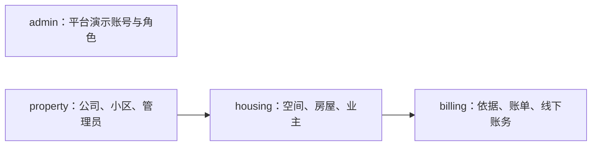

# 开发数据填充

seed 在已有开发库中**追加新批次**，用于账号、物业、房屋和账单联调。通过正常业务权限、事务和审计写入，只操作本批次新建对象，不替代迁移，也不生成微信登录、居民认领或真实支付渠道事实。

## 前提与操作入口

- 已安装开发依赖，配置好 PostgreSQL、Redis，数据库已迁移到当前版本；不需要启动 HTTP 服务。
- 在后端配置中**显式**设置 `APP_ENV=local` 或 `test`，并启用 `SEED_ENABLED=1`；缺少任一条件即拒绝写入，没有绕过开关。配置位置与优先级见[本地开发](local-setup.md#环境与配置)。
- 工具仅用于开发环境，不随应用发布包分发；执行前核对数据库目标和环境变量覆盖，不能指向既有业务库。

| 仓库根目录入口                           | 作用                                                           |
| ---------------------------------------- | -------------------------------------------------------------- |
| `make seed-list`                         | 列出场景、数量参数及默认值，不连接数据库                       |
| `make seed-plan`                         | 解析参数并估算规模，不连接数据库，不证明目标环境可写           |
| `make seed`                              | 默认全部场景，每次追加一批；写入前检查迁移版本、表覆盖和 Redis |
| `make seed SCENARIOS="property housing"` | 选择多个场景，空格分隔；`all` 为全部                           |
| `make seed-resume RUN_ID=<批次标识>`     | 固定原参数恢复该批次，不能借续跑改变规模                       |
| `make seed-coverage`                     | 连接目标数据库，只读核对迁移版本与表覆盖；不生成数据           |

- 用 `SEED_ARGS` 传入 `--config <TOML路径>`、`--set 场景.参数=值` 或 `--workers=2`。
- 数量优先级为默认值、TOML、`--set`；配置路径相对后端工作目录。
- 密码不进入这些参数或可提交的配置。

## 场景与规模

箭头表示前置依赖，共享依赖每批只运行一次。仅选择 `admin` 不生成物业；隐式依赖的 `property` 默认只建一家物业、一个小区和一个管理员，仍可覆盖其前置参数。配置只能包含已选择或依赖的场景。

| 场景     | 参数与默认值                                                       | 允许范围 / 含义                                            |
| -------- | ------------------------------------------------------------------ | ---------------------------------------------------------- |
| admin    | `accounts=3`；`roles=2`                                            | 账号 0–100000，角色 1–10000；初始化执行账号和系统角色另计  |
| property | `companies=2`；`communities_per_company=2`；`admins_per_company=3` | 各 1–10000；仅显式选择本场景时使用此默认规模               |
| housing  | `phases_per_community=1`；`buildings_per_community=2`              | 分期 0–100；楼栋 1–10000，统计根楼栋与分期楼栋总数         |
| housing  | `units_per_building=2`；`houses_per_unit=3`                        | 单元 0–100；每单元房屋 0–100000                            |
| housing  | `houses_per_building=1`；`owners_per_house=2`                      | 直属楼栋房屋 0–100000，与单元房屋相加；每房业主 0–100      |
| 执行     | `--workers=1`                                                      | 1–8 个公司并发填充房屋及账单；同公司有序，物业接入顺序执行 |

数量会乘积增长，先看 `seed-plan`。演示数据覆盖正常、待改密、直接停用和祖先停用；房屋及祖先的演示停用在账单生成后执行。小规模不能保证所有状态齐全。

### 账单参数

以下名称均位于 `billing` 下；业务含义与资金约束见[物业账单](../modules/property/billing.md)，这里仅说明填充控制项。

| 参数                                                                              | 默认值与限制                                                                             |
| --------------------------------------------------------------------------------- | ---------------------------------------------------------------------------------------- |
| `start_month` / `end_month`                                                       | `YYYY-MM` 闭区间，默认当月前两月至后两月，按先后包含 1–120 个月；解析后随批次固定        |
| `basis_versions_per_house`                                                        | 4，范围 0–100；0 时只生成手填账单                                                        |
| `bill_months_per_house`                                                           | 默认 `all`；0–120 且不超过月份范围，从起始月连续取值；0 时只生成依据                     |
| `min_receivable_cents` / `max_receivable_cents`                                   | 默认 10000 / 50000 分，允许 2–9007199254740991，最小值不超过最大值；零元样例另计         |
| `unpaid_weight` / `partially_settled_weight` / `settled_weight` / `voided_weight` | 默认 4 / 2 / 3 / 1，各 0–100且不能全零；结清含零元，重建另加作废行，因此不是最终行数比例 |
| `additional_receipts_per_bill`                                                    | 2，范围 0–20；适用正金额且并非建账即全额结清的样例；0 时建账登记目标已缴金额             |
| `amount_corrections_per_bill`                                                     | 1，范围 0–20；纠正适用样例最后一笔收款，最终达到目标已缴金额                             |
| `date_corrections_per_bill`                                                       | 1，范围 0–20；对有收款的正金额账单改日期，金额不变                                       |
| `reversals_per_bill`                                                              | 1，范围 0–20；待缴或部分结清样例误收后撤销，净已缴不变                                   |
| `rebuilds_per_bill`                                                               | 1，范围 0–10；对无有效已缴的待缴月份作废重建，增加旧作废账单，保留一张有效账单           |

正金额最小值还须至少为追加收款次数加一后再乘四，确保可分拆收款与纠错。依据样例覆盖面积单价、固定金额、同月纠错和未来零元；已生成账单保留原依据与金额。收款日期不晚于批次固定业务日期，跨日续跑不改变该日期。

## 执行账号与凭据

| 目标状态                 | 处理                                                                                                                  |
| ------------------------ | --------------------------------------------------------------------------------------------------------------------- |
| 空库                     | 正常初始化开发执行账号并完成首次改密；凭据保存在 `.dev/seed/operator-<数据库指纹>.json`，后续批次复用                 |
| 已有平台账号且无工具凭据 | 同时提供 `SEED_LOGIN_NAME`、`SEED_PASSWORD`，使用已完成首次改密且有相应权限的平台执行账号；完整场景使用平台超级管理员 |
| 执行账号已被人工改密     | 提供有效凭据，工具不覆盖现有密码；恢复也不重新生成已准备的密码                                                        |
| 登录受限                 | 保留批次，等待窗口恢复，或按开发环境要求调整已有登录限制后续跑                                                        |

seed 会话与账号、来源限流使用固定 `app:seed` Redis 前缀，不与普通后台会话混用；新批次不会重置限流。Redis 隔离不隔离数据库账号和业务权限。

## 批次文件与续跑

| `.dev/seed/<批次标识>/` 内文件  | 用途                                                                               |
| ------------------------------- | ---------------------------------------------------------------------------------- |
| `state.json`                    | 固定参数、数据库指纹、版本、业务日期与批次状态                                     |
| `context.sqlite3`               | 本地步骤意图、结果和凭据；只用于恢复，不替代业务持久化                             |
| `accounts.md` / `accounts.json` | 已确认账号的批次、场景、登录端、登录名、显示名称、密码、所属物业公司；平台公司为空 |
| `report.json`                   | 实际数量、状态分布、账务一致性和缺失覆盖；不是性能或部署验收证明                   |

目录权限 0700、文件及临时文件 0600；保留完整目录，不手工改上下文或上传凭据。失败时仍导出已确认账号；清单包含待改密和停用账号，密码仅为工具最后确认值，不跟踪人工改密。

- 中断不会回滚已提交步骤；再次 `seed` 会新增数据，应修复原因后使用 `seed-resume`。同一批次禁止并发执行；已完成批次续跑只核对，不追加。
- 恢复核对数据库身份、迁移与场景版本、原参数及已生成对象。审计与业务唯一性共同确认结果，账务另核对原幂等依据；请求追踪标识本身不替代业务幂等键。
- 数据库重建、对象缺失、被外部修改或证据冲突时停止，不能猜测成功、跳过冲突或自动重建来继续。
- 账单报告的 `checks` 全为零才通过一致性核对，否则命令失败；`missing_coverage` 说明实际未覆盖样例，不为凑覆盖擅自扩增配置规模。未知业务表导致覆盖检查失败，须补场景或说明排除边界。

工具返回成功仅说明本批次填充与自检完成，真实登录、渠道支付和发布验收另见[检查与验证](verification.md)。
