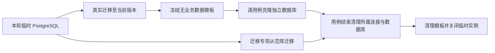

# 检查与验证

本页维护可执行入口与环境准备。测试分类、必要覆盖和门禁以[测试规范](../standards/testing.md)为准；下列能力说明不代表任何检查已执行或通过。

## 选择检查范围

命令默认在仓库根目录执行，先按[本地开发](local-setup.md)安装依赖。测试自行准备隔离资源，无需先启动应用、手动迁移、初始化账号或运行 seed。

| 入口                                        | 覆盖范围                                                                              |
| ------------------------------------------- | ------------------------------------------------------------------------------------- |
| `make check`                                | 顺序执行仓库 Prettier、后端、前端与 API 检查，任一步失败即停止                        |
| `make check-backend`                        | 后端与开发工具、仓库工具的 Ruff、格式、mypy，以及默认 pytest 范围                     |
| `make check-frontend`                       | 管理后台、小程序的类型、Lint、边界、测试和构建                                        |
| `make check-api` / `pnpm api:check`         | OpenAPI lint、类型生成、聚合与契约一致性                                              |
| `make test-unit`                            | 后端单元测试                                                                          |
| `make test-integration`                     | 后端快速集成；排除专用 PostgreSQL/Redis 并发测试和进程生命周期                        |
| `make test-contract`                        | 后端与权威 OpenAPI 的契约测试                                                         |
| `make test-postgresql`                      | 显式启用隔离 PostgreSQL/Redis 专项，依赖缺失即失败                                    |
| `make test-full`                            | 全部后端、管理后台、小程序测试，包含真实依赖与进程生命周期，输出并校验三份 JUnit 报告 |
| `make miniapp-build`                        | 小程序构建；不包含真机验收                                                            |
| `pnpm --filter client-miniapp check:native` | 重新构建并调用微信 WXML/WXSS 编译器；不包含真实登录、授权或付款                       |

- 默认后端检查排除 `postgresql`、`slow` 标记；“快速”不等于全部使用内存替身，普通数据库集成仍需要本地 PostgreSQL 工具。
- 开发中按变更范围验证，PR 执行默认质量检查，合并前补齐完整测试；发布边界见[部署与运行](../operations/deployment.md)。

## 工具与资源准备

| 验证范围               | 必需条件                                                                                               |
| ---------------------- | ------------------------------------------------------------------------------------------------------ |
| 普通数据库 / API 集成  | `initdb`、`postgres`、`pg_ctl` 在 PATH 中，具备创建临时目录和回环端口的权限                            |
| 专用真实依赖及完整测试 | 上述工具，加 `redis-server`；支付恢复验证还需要 `pg_dump`、`pg_restore`                                |
| 前端检查               | 满足项目版本要求的 Node、pnpm 与已安装的工作区依赖                                                     |
| 小程序原生编译         | 已安装微信开发者工具；默认发现 macOS 安装，其他位置用 `MINIAPP_WCC`、`MINIAPP_WCSC` 指定编译器绝对路径 |
| 真实渠道 / 真机        | 经授权的独立环境、匹配 AppID、合法 HTTPS 域名及相应真实材料，另行验收                                  |

专用 PostgreSQL/Redis 测试由 `APP_RUN_POSTGRESQL_TESTS=1` 显式启用，Make 的专项与完整入口已设置。直接运行测试而未启用时会说明原因并跳过，不能将跳过记为通过。

数据库测试使用独立临时实例、随机端口和数据库，Redis 专项使用所属临时实例。不得改为既有开发库或生产库，也不得扩大清理范围；连接、事务和真实数据库保证见[数据库规范](../standards/database.md)。

## 数据库与账号准备

- 模板只含迁移结构和必要初始数据，不含测试账号、会话或业务数据，不跨测试进程或代码版本持久缓存。
- 普通用例仍有独立数据库及真实事务，可验证提交、回滚、行锁和多连接；模板克隆不替代这些保证。
- 空库迁移、历史升级和结构一致性专项使用从空库真实迁移的准备，不能以已迁移模板绕过待验证过程。
- 准备和切换数据库时同步更新环境与清理配置、连接缓存；失败也释放所属资源，不能依赖下一用例清理。

| 用例目标                               | 账号与会话准备                                                                          |
| -------------------------------------- | --------------------------------------------------------------------------------------- |
| 认证、密码、会话、初始化审计及相关事务 | 保留真实初始化、登录和首次改密流程                                                      |
| 普通业务                               | 工厂准备最小合法账号、角色、关联及必要公司小区，创建真实会话并写入所属端 Cookie         |
| 所有业务请求                           | 继续执行真实身份、会话版本、权限、公司范围和 Origin/CSRF 校验，不能直接替换管理员上下文 |

只复用不可变密码哈希，可变记录和会话按用例隔离；不全局模拟密码算法。公共准备集中共享，业务准备放所属范围，测试文件之间不互相导入。

## 契约与前端类型

- [OpenAPI](../../../openapi/openapi.yaml) 是精确接口权威；运行端契约检查覆盖接口集合、归属、版本、输入输出、状态和安全，不仅比较文档格式。
- `pnpm api:generate-types` 刷新本地声明；安装、开发和检查入口在消费前生成，失败停止后续步骤。生成声明不手改、不提交，契约变更后核对两个前端消费者。
- 错误目录变更后执行 `pnpm api:generate-errors`，再运行完整 API 检查，不手改运行目录或用配置版本掩盖差异。
- 契约测试使用当前聚合结果。`pnpm api:bundle` 可单独生成聚合产物，但不能替代完整契约检查；规则见[API 规范](../standards/api.md)。

## 测试替身与真实验收

| 已验证的层次                 | 仍需单独确认的边界                                                     |
| ---------------------------- | ---------------------------------------------------------------------- |
| 普通 API 流程                | 常用内存 Redis 与微信替身，不能证明真实 Redis 原子脚本、过期或微信行为 |
| 真实 PostgreSQL/Redis 专项   | 证明相应事务、约束、并发和协议；不能证明目标环境配置或真实渠道可用     |
| 本地进程生命周期             | 验证批次、就绪、重载与安全清理；不能证明部署机器健康                   |
| 前端交互、构建和微信原生编译 | 不能替代真机登录、手机号授权、支付 SDK 及体验版交互验收                |
| 支付渠道替身或本地恢复验证   | 不能替代真实商户付款、分账、解冻、账单核对或新单开放条件               |

真实外部请求、资金操作和目标环境变更按授权执行，渠道条件见[支付模块](../modules/payment/README.md)。本地服务启动和 seed 不提供模拟成功的渠道事实。

## 结果与报告

- Make 后端测试入口要求选中测试全部完成；跳过、预期失败、收集跳过或未收集测试均不能通过完整门禁。未被选中的专项单独记录为未执行。
- `make test-full` 在 `build/test-results/` 输出 `backend.xml`、`admin-web.xml`、`miniapp.xml`，拒绝缺失、空报告，以及跳过、失败或错误记录；保留报告和脱敏失败日志。
- 报告区分通过、失败、跳过和未执行，注明实际命令、选择范围、依赖与环境。失败后重跑不能抹去尚未解释的故障，也不能将局部成功推为全部通过。
- 纯文档变更执行格式、链接、图表和事实检查即可；是否运行更广测试按实际变更风险确定，不机械新增业务测试。
