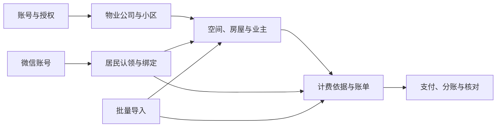

# 业务模块

本目录描述当前实现的业务规则。精确接口以 [OpenAPI](../../../openapi/openapi.yaml) 为准，开发要求见[通用规范](../standards/development.md)。

## 阅读入口

| 业务       | 入口与职责                                                                                                              |
| ---------- | ----------------------------------------------------------------------------------------------------------------------- |
| 身份与授权 | [账号、岗位、权限和审计](identity/README.md)，[后台会话](identity/admin.md)，[微信账号与客户端身份](identity/client.md) |
| 物业组织   | [公司、小区接入与工作台](property/README.md)                                                                            |
| 房产资料   | [空间、房屋与业主登记](property/housing.md)                                                                             |
| 物业费账务 | [计费依据、账单、线下收款与纠错](property/billing.md)                                                                   |
| 居民授权   | [认领、审核、房屋绑定与读取](property/resident.md)                                                                      |
| 批量导入   | [类型、模板与预检](imports/README.md)，[执行与恢复](imports/execution.md)，[数据与文件](imports/data.md)                |
| 支付资金   | [收款配置、居民支付](payment/README.md)，[数据与事务](payment/data.md)，[资金恢复与核对](payment/recovery.md)           |

## 业务关系

- 业主档案与居民访问授权分别管理，不能用手机号相同或导入成功替代房屋授权。
- 账单与支付分别维护应收和渠道资金事实，分账不是居民返利或物业费抵扣。
- 消费返利、积分、抵扣、商家业务和额外客户端业务身份当前没有生产业务入口，不列为已实现能力。
- 已实现能力、页面开放、依赖就绪与真实环境验收分别判断；具体边界归所属模块，不将替身测试视为真实渠道验收。
