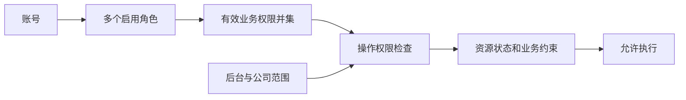

# 身份、岗位与授权

后台使用账号、角色和业务权限管理人员职责；小程序使用独立的微信账号与客户端会话。后台和客户端身份不能互用。

| 主题                               | 阅读入口                                                                                                            |
| ---------------------------------- | ------------------------------------------------------------------------------------------------------------------- |
| 后台登录、会话、管理页面与开放状态 | [后台身份](admin.md)                                                                                                |
| 微信登录、手机号、业务身份及切换   | [客户端身份](client.md)                                                                                             |
| 公司、小区、房产与居民房屋授权     | [物业模块](../property/README.md)                                                                                   |
| 精确接口、权限码和错误             | [后台契约](../../../../openapi/modules/admin.yaml)、[客户端契约](../../../../openapi/modules/miniapp-identity.yaml) |

## 归属与数据范围

| 对象           | 当前约束                                                                                          |
| -------------- | ------------------------------------------------------------------------------------------------- |
| 平台账号、角色 | 只属于平台后台，没有物业公司归属。                                                                |
| 物业账号、角色 | 必须归属一家物业公司，账号只能关联本公司角色；同一人跨公司任职使用不同账号。                      |
| 登录名         | 按 ASCII 格式校验后转小写，在所属后台内唯一；物业登录名在整个物业后台唯一。两端同名不是同一账号。 |
| 角色编码       | 平台内唯一，物业公司内唯一；创建后固定。                                                          |
| 数据范围       | 后台和公司由服务端身份解析。物业覆盖本公司全部小区，不配置逐小区授权；权限不能扩大公司范围。      |

账号和角色采用启停管理，保留关联及审计历史。越界对象按不存在处理；列表、总数、选项和详情使用一致范围，不能通过客户端公司参数扩大查询。

## 角色与业务权限

未授权默认拒绝。不提供账号直接授权、角色继承、通配权限或自定义依赖表达式；只接受所属后台固定目录项。普通维护合并同职责步骤，不合并各动作的审计事实。

- 系统角色 `super_admin` 使用所属后台完整目录，不允许编辑、启停或修改权限。
- 账号、角色、授权和他人密码管理写入只允许所属范围超级管理员，系统管理能力不可分配给普通角色。
- 本人资料、本人密码按完整本人身份访问，不需要岗位权限。

超级管理员可授予或撤销他人的超级管理员资格，但不能停用自己或撤销自己的资格。平台按后台、物业按公司保护最后一个有效超级管理员；公司停用不解除保护。资格变更重新核验当前操作者与有效人数，防止并发绕过。

| 后台 | 业务模块                             | 授权边界                                                                             |
| ---- | ------------------------------------ | ------------------------------------------------------------------------------------ |
| 平台 | 物业接入：查看／维护                 | 公司、小区资料，不包含公司启停或公司管理员管理。                                     |
| 平台 | 支付资金：查看；资金核对：查看／经办 | 经办含重新核对，不含资金异常处理。                                                   |
| 平台 | 收款配置：查看／维护                 | 商户和费率等配置，遵守不可变版本及并发约束。                                         |
| 物业 | 房产资料：查看／维护                 | 空间、房屋和业主档案，不授予居民身份或房屋访问权。                                   |
| 物业 | 物业费账单：查看／经办               | 账单、依据、试算及收款历史；经办含建账和普通资料修改。                               |
| 物业 | 计费依据：维护；线下收款：登记       | 分别授予；不改历史依据，不包含收款纠正、撤销或作废。                                 |
| 物业 | 居民房屋授权：查看／审核             | 查询申请、绑定及认领审核，不包含撤销已有绑定。                                       |
| 物业 | 线上收款：查看                       | 本公司支付、资金、核对和配置的受限只读结果。                                         |
| 两端 | 系统资料：查看；操作日志：查看       | 平台可读平台系统及公司管理员资料；物业限本公司。日志限所属后台来源，不授予管理写入。 |

### 独立关键操作

| 后台 | 操作           | 必需查看能力与限制                                                                             |
| ---- | -------------- | ---------------------------------------------------------------------------------------------- |
| 平台 | 公司启停       | 包含接入查看；启用须有有效公司超级管理员。                                                     |
| 平台 | 资金异常处理   | 包含支付资金查看及核对查看；恢复原业务或记录外部处置，不强制成功、改写资金事实或产生退款能力。 |
| 物业 | 账单作废       | 包含账单查看，仍检查收款、支付占用与状态。                                                     |
| 物业 | 收款纠正或撤销 | 包含账单查看；限线下登记，不冲正真实线上收款或代替退款。                                       |
| 物业 | 房屋授权撤销   | 包含房屋授权查看；结束绑定，不改变居民账号或房产档案。                                         |

关键操作不随普通维护、经办或审核授予。收款配置维护和计费依据维护已是单独选择的能力，不增加同义开关。业务限制见[物业](../property/README.md)、[支付](../payment/README.md)。

## 固定依赖与最小查询

- 维护、经办、审核包含对应查看；计费依据维护、线下收款及账务关键操作包含账单查看，不隐含其他写权限。
- 完整物业登录可取得公司标识、名称及可访问小区选项；受限改密会话不能读取。完整业务资料仍按实际业务权限返回。
- 建账、试算和审核所需房屋选项只提供定位、位置及必要状态，不要求完整房产查看，不返回业主姓名、手机号或完整档案。
- 平台资金、配置和系统资料所需公司选项不要求完整接入查看，不能借此读取公司其他区块。
- 初始正金额收款额外要求线下收款登记；已能判定的权限需求不因其他字段错误跳过，不能通过排除错误行绕过。

权限保存时校验本端目录和可分配性，补齐必要查看。删除必要查看时同步移除依赖操作或阻止不一致保存。角色摘要与账号最终并集分别展示，移除一个角色不代表其他角色授予的同一能力已撤销。

导入跟随目标业务：房屋、业主使用房产查看／维护，账单使用账单查看／经办。历史、行结果和错误文件生成下载按业务查看，处理批次按维护或经办；请求、执行及结果复用都重验当前权限和范围，不另设导入动作权限。生命周期与文件限制见[导入](../imports/README.md)。

## 岗位模板与管理提交

| 后台 | 模板       | 默认职责                                     |
| ---- | ---------- | -------------------------------------------- |
| 平台 | 接入运营   | 物业接入维护。                               |
| 平台 | 财务查询   | 物业接入、支付资金、资金核对、收款配置查看。 |
| 平台 | 财务经办   | 财务查询全部能力，加资金核对经办。           |
| 物业 | 资料专员   | 房产资料维护及对应导入。                     |
| 物业 | 收费员     | 账单经办、线下收款登记、线上收款查看。       |
| 物业 | 客服审核员 | 房产资料查看、账单查看、居民房屋授权审核。   |

模板仅是创建普通角色的预填，保存后独立维护，不订阅模板升级；未列出的能力默认无权限。角色及初始权限、账号及初始角色均可一次提交，和审计保持原子性。角色分配完整替换最终集合，不能新增停用角色，已有停用角色可保留或移除。

配置展示模块级别和关键操作、自动包含原因、能力增减、实际受影响账号数量及重新登录要求。界面预览不替代保存时对操作者、资源和权限的复核。

## 审计与一致性

账号、角色、权限、本人资料和密码变更与对应审计同事务提交；授权及状态变化同时更新受影响账号会话版本，失败整体回滚。登录成功与失败分别记录。

| 来源     | 公司归属与读取范围                                           |
| -------- | ------------------------------------------------------------ |
| 物业操作 | 从认证上下文取得公司，只查本公司物业来源。                   |
| 物业登录 | 可识别账号时取其公司，未知账号失败登录允许公司为空。         |
| 平台操作 | 公司业务从目标资源确定公司，全局操作允许为空；只查平台来源。 |

审计保存操作者、动作、目标、结果、请求标识及白名单元数据。密码、Cookie、会话标识、CSRF Token 及未授权个人信息不进入日志；列表与总数使用一致范围。管理写入结果未知时先重读对象与审计，不盲目重复提交。
