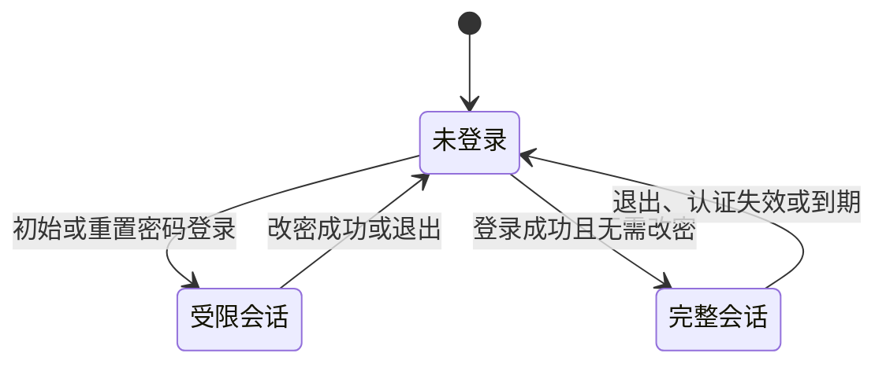

# 后台认证与页面边界

后台角色、公司范围、岗位和审计规则见[身份授权](README.md)，精确输入和响应见[后台契约](../../../../openapi/modules/admin.yaml)。

## 登录与密码

登录要求账号启用、密码正确；物业另要求所属公司存在且启用。失败不区分不存在、密码错误或停用。登录按所属后台的规范化登录名和来源 IP 限流。

受限会话仅允许读取当前会话、修改本人密码和退出，权限集合为空；不能读取本人资料、公司上下文或业务数据。完整本人资料只允许修改显示名称，不能改变登录名、后台、公司或角色。

- 初始、重置和新密码采用同一设置规则：12～128 个 Unicode 码点、禁止 CR/LF，不强制字符组合。
- 保留原文和首尾空格，不自动截断、转换大小写或规范化。
- 本人改密核验当前密码，新旧密码不同；旧密码错误是操作冲突，不撤销会话。
- 重置面向他人，本人通过个人中心改密。
- 精确约束见[密码规格](../../../../openapi/components/admin-schemas.yaml)。

密码只保存不可逆哈希，不进入日志、URL 或持久表单。确认项只作前端一致性校验，带换行的粘贴被拒绝，不先清除换行再提交；登录和当前密码校验兼容既有凭据。

## 会话与请求保护

| 事项        | 当前行为                                                                                                             |
| ----------- | -------------------------------------------------------------------------------------------------------------------- |
| 会话隔离    | 两后台使用独立空间；Cookie 为 Host-only、HttpOnly、SameSite=Lax，默认 Path 分别为 `/api/platform`、`/api/property`。 |
| Cookie 安全 | staging、production 开启 Secure；设置和清除使用相同 Path，会话响应不缓存。                                           |
| 期限        | 默认空闲 30 分钟、绝对 12 小时，可配置；续期不超过绝对期限。                                                         |
| 多设备      | 允许同时登录，退出只撤销当前会话。                                                                                   |
| 写请求      | 校验可信 Origin；已认证写请求另校验当前会话 CSRF Token。                                                             |

账号启停、改密、重置密码及角色变化撤销其全部旧会话；角色权限或启停变化撤销关联账号旧会话。公司停用撤销其物业账号旧会话，不改账号自身启停；重新启用不恢复旧会话。

每次认证核对数据库账号版本和状态，物业另核对公司；撤销不依赖旧会话缓存是否已删除。物业登录、资料修改及改密与公司／账号变更协调，等待后重新读取状态，不能沿用旧资格提交。

## 页面入口与认证结果

登录和强制改密独立于业务工作区，个人中心属于当前账号。平台与物业各有账号、角色和操作日志入口；查看系统资料不显示管理写操作，系统角色始终只读。当前导航、布局与页面开放由[后台架构](../../architecture/admin-web.md)维护。

| 场景       | 保护与反馈                                                               |
| ---------- | ------------------------------------------------------------------------ |
| 会话初始化 | 只有 401 判为未登录，网络或服务失败可重试，不提前展示业务数据。          |
| 登录回跳   | 仅接受本端已开放且有权访问的页面，排除认证页和循环跳转。                 |
| 身份失效   | 只清理所属后台请求、缓存及表单，旧响应不能回填新身份，另一后台不受影响。 |
| 安全变更   | 重新核实会话；授权预览与只读页面不能替代服务端资格检查。                 |

受限会话进入其他已知页面时回到强制改密；完整会话访问登录页进入有效回跳或首页，访问强制改密页进入本人改密。未知或关闭页面按不存在展示，不能绕过开放状态进入业务页。

表单关闭、未保存保护、分页、反馈和时间转换统一遵循[后台前端规范](../../standards/admin-frontend.md)。业务异步状态与恢复限制由[导入](../imports/README.md)、[支付](../payment/README.md)和[物业](../property/README.md)维护；受理不等于业务成功。
