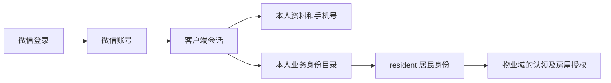
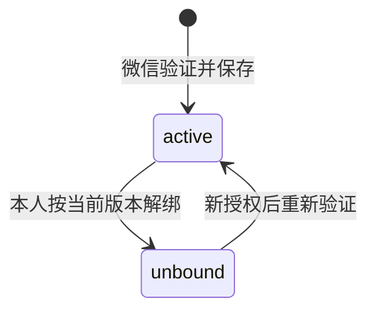

# 微信账号、手机号与业务身份

小程序使用独立客户端会话，当前内置适配只有居民，没有物业或商家小程序业务入口。公司、房产及居民认领授权见[物业](../property/README.md)，支付状态见[支付](../payment/README.md)；精确契约见[微信账号与身份](../../../../openapi/modules/miniapp-identity.yaml)。

## 账号与身份目录

| 对象         | 当前含义与边界                                                                        |
| ------------ | ------------------------------------------------------------------------------------- |
| 微信账号     | OpenID 唯一，并发首次登录只建立一个用户；不承载互斥角色、物业公司或全局实名姓名。     |
| 客户端会话   | 只认证微信用户，使用 Bearer Token，与后台 Cookie 会话分离。                           |
| 居民身份     | 从有效用户直接派生，选择键为 `resident`，不创建或回填居民关联；无需先绑定号码或房屋。 |
| 额外身份关联 | 关联用户、类型和业务主体，只有已注册类型及有效主体可用；关联存在不表示业务已开放。    |
| 房屋授权     | 由物业业务独立判断；居民身份有效不能访问任意房屋。                                    |

本人资料、手机号、会话及身份目录不要求业务选择。居民请求另要求 `X-Client-Identity: resident`，关联 UUID 不能代替居民选择键。切换业务不重新签发根会话。

- 目录过滤本人有效关联及业务主体，再统一排序、计数、分页，居民项固定在前。
- 当前默认目录只派生居民；未注册或他人关联不能成为可用能力。
- 额外身份仅通过可信业务授权或撤销，写入重新核验用户、关联、上级和主体当前状态；撤销后再次授予使用新关联，不复活旧选择键。

## 会话与失败边界

- 微信登录先保存或更新账号，再签发会话。
- 默认空闲期限 7 天、绝对期限 30 天，可配置，续期不超过绝对期限。
- 每次请求核对会话、用户启用及数据库会话版本；退出只撤销当前 Token，账号停用或全局版本失效影响所有业务身份。
- 敏感本人及会话响应不缓存，登录和号码验证分别限流。

| 结果                 | 处理                                               |
| -------------------- | -------------------------------------------------- |
| 401                  | 根会话或用户失效，清理凭据并重新登录。             |
| 身份不可用           | 停止该业务上下文、重新选择，不撤销仍有效的根会话。 |
| 类型不匹配           | 拒绝目标业务，不以其他身份扩大授权。               |
| 未知或他人身份       | 按不存在处理，不泄露他人资料。                     |
| 选择头缺失或格式错误 | 按参数错误处理，不默认为居民。                     |
| 网络或服务故障       | 保留会话并提供重试，不当成退出登录。               |

## 本人手机号

手机号是可复用的验证资料，不是登录前提或账号身份。一人可绑定多个号码，同号码可分别由不同用户验证，不能跨用户读取、引用或解绑。

| 事项         | 当前规则                                                                                   |
| ------------ | ------------------------------------------------------------------------------------------ |
| 来源与格式   | 微信快速验证；手工号码仅作预期核对。大陆号码及 `+86`、`0086` 前缀统一为 11 位号码。        |
| 不一致       | 预期号码与微信结果不同则拒绝，不自动替换输入。                                             |
| 保存与有效期 | 同用户同号码复用记录，绑定与成功验证证据同事务提交；当前不按时间自动过期。                 |
| 解绑         | 校验本人、有效状态与预期版本，保留历史；不撤回已提交认领或撤销已有房屋授权。               |
| 重放         | 同键同输入返回号码当前状态，异输入或重复挪用原授权冲突；成功后已解绑的旧请求不能重新启用。 |
| 重新启用     | 须新的微信授权。                                                                           |

外部兑换期间不持有数据库写事务；同用户并发受协调保护，不缓存 code、号码或兑换结果作为临时凭证。提交未知先恢复原键和输入，成功记录是持久依据；已兑换但无成功记录时重新授权，code 失效不能证明提交结果。

号码页面区分有效与已解绑，授权不一致保留输入并提示重新选择。进行中禁止重复提交，未知时只允许原请求恢复；原 code、键及预期号码仅留当前页面内存，卸载或会话变化后清理，取消授权不改变原绑定。

## 身份选择与回跳

- 未登录首页可展示引导，不读取私人业务；进入居民功能先完成根会话及身份核验。

- 完整加载目录、核验详情后才恢复选择；只有居民一项时自动选择，其他情况优先恢复本人上次有效选择。
- 目录不完整、重复项或分页总数变化时停止自动选择；未知类型不进入业务页。

请求生命周期、安全回跳、本地存储与支付恢复的工程边界统一见[小程序架构](../../architecture/miniapp.md)。
