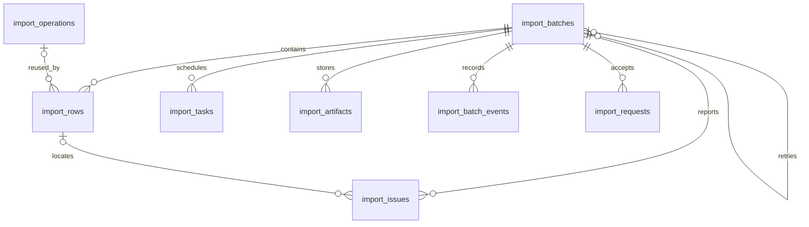

# 导入数据及文件

批次事实、跨批共享操作及本批行结果分别保存。精确 HTTP 投影见 [OpenAPI 导入数据](../../../../openapi/components/import-schemas.yaml)，执行边界见[执行机制](execution.md)。

| 表                    | 职责与约束                                                               |
| --------------------- | ------------------------------------------------------------------------ |
| `import_batches`      | 固定公司、小区、后台、模板和摘要，保存阶段、策略和本批统计；父批须同公司 |
| `import_rows`         | 原行号、原值、准备快照、预检和本批结果；同批行号唯一                     |
| `import_operations`   | 跨批逻辑操作、指纹和成功目标；公司内操作键唯一                           |
| `import_tasks`        | 同批同阶段唯一，保存租约、代次和断点                                     |
| `import_requests`     | 成功请求指纹、首次状态和安全响应；追加后不可改                           |
| `import_artifacts`    | 私有源文件及错误文件的摘要、代次和到期元数据；同批源文件唯一             |
| `import_issues`       | 文件或行问题、预览版本、错误码及位置；引用行必须同批                     |
| `import_batch_events` | 有序安全事件；同批序号及事件键唯一，追加后不可改                         |

模板随应用发布，没有模板版本表；历史固定原版本和摘要，停止新建不等于丢弃历史配置。

## 不可变事实

- 固定范围、模板、创建身份、原输入和保留截止时间不可改；已确认策略及时间不能覆盖。
- 普通未确认批次可在新预检代次重建准备；已确认、子批及终态不能借此替换输入或结果。
- 操作身份、指纹和成功目标不可改；敏感值清空须有清理标记。数据库约束与历史保护共同执行。

## 文件与清理

| 对象        | 限制或行为                                                                                                       |
| ----------- | ---------------------------------------------------------------------------------------------------------------- |
| 源文件      | CSV/XLSX，最多 10 MiB、50,000 数据行、200 列，按固定模板校验完整表头                                             |
| 解析        | CSV 按 UTF-8 记录读取；XLSX 拒绝宏、外链、公式和异常压缩包，解压总量最多 100 MiB，资源有界                       |
| 存储与下载  | API 与 Worker 共用私有持久文件；拒绝越界及符号链接，摘要核验、原子发布；鉴权下载、安全文件名、禁止缓存和公式注入 |
| 错误文件    | 固定预览版本、批次业务版本和代次；结果变化使旧文件失效，完整生成后复核发布                                       |
| 草稿 / 输入 | 草稿创建 24 小时后失效；敏感输入创建后 30 天清理，子批继承原截止时间，重跑不续期                                 |

先删除全部文件，再分块清空原值和准备快照；删除失败保留元数据及行值等待重试。文件名随删除清空，最小历史、结果和幂等证据保留。

活动或暂停任务、未知结果和在途共享操作保护整批证据；共享自然键等全部引用批次不再需要后才清理。孤儿扫描有等待窗口，并保护活动输出代次。

到期后外部明细、文件和普通重跑关闭；未知可凭必要内部证据核实原操作，不安排替代创建。原已确认任务可安全结束；过期未知恢复核实后停止剩余输入。
