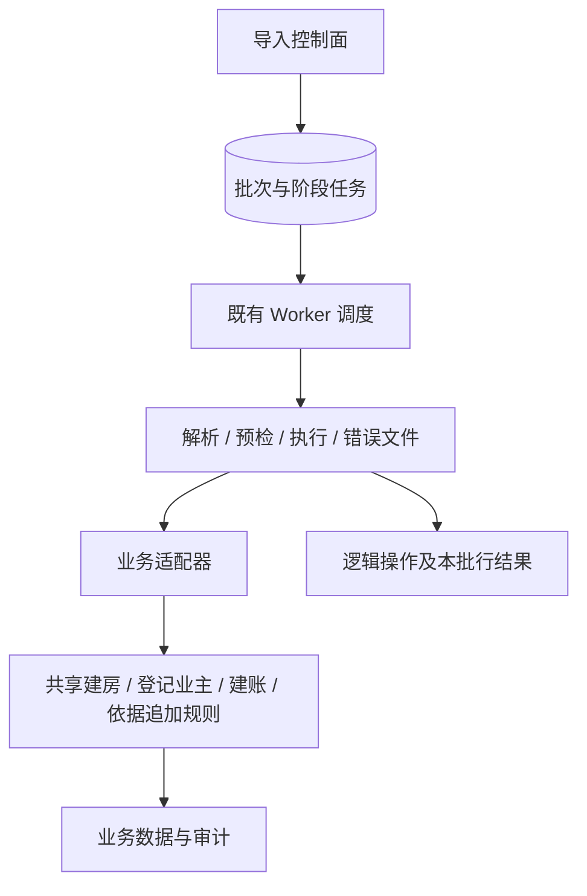
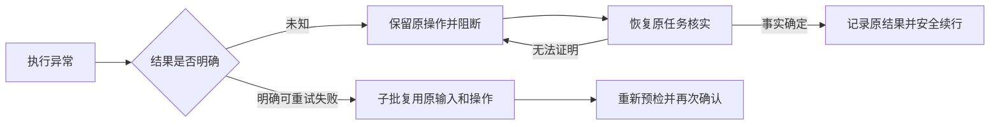

# 导入执行与恢复

业务输入及确认见[批量导入](README.md)，保留期见[数据及文件](data.md)。

## 准备与事务

| 环节       | 保证                                                                                                 |
| ---------- | ---------------------------------------------------------------------------------------------------- |
| 输入准备   | 校验后保存普通业务输入、原位置、自然键和指纹，不创建正式实体                                         |
| 发布预览   | 同文件内可识别的同自然键全部报重复，含其他字段有误的重复行；完整预检后发布版本、摘要与统计           |
| 普通重预检 | 仅限未确认、无活动或暂停处理任务、无未知结果的批次；新代次可按当前事实重新准备，不改文件、范围和模板 |
| 确认与重跑 | 确认后输入、位置和目标固定；失败重跑仍用原准备输入，不能按同一文字位置改绑替代房屋                   |
| 正式写入   | 共用手工业务规则，业务锁内复核；业务数据、审计、操作结果、本批行结果、统计和断点共同提交             |

每轮最多处理 200 行，每行独立事务；单行失败不撤销已成功行。执行复核当前权限和完整范围。适配器负责业务转换及复核，不管理事务提交、HTTP 身份或任务租约。

## 幂等与租约

| 机制         | 作用                                                                                                         |
| ------------ | ------------------------------------------------------------------------------------------------------------ |
| 请求幂等     | 公司、后台、操作者及动作范围内，同键同输入恢复首次成功状态和安全响应，同键异输入冲突；失败且无成功动作不占键 |
| 逻辑操作幂等 | 公司、模板、操作类型、自然键及输入指纹确定稳定操作，跨批、重跑和接管共用                                     |
| 业务唯一性   | 手工及导入共同校验，数据库防止不同操作键重复创建同一实体                                                     |

重放仍复核权限。成功操作复用前还核验原目标；条件不再满足只记录本批问题，不改旧成功、不创建替代目标。终态历史不随其他批次重跑改变。

计费依据操作将预检时全房屋最新版本基线纳入输入指纹；新批次主动调回旧标准与原任务重试因此不同。新执行的新增和跳过均在房屋保护内复核固定基线，版本变化即冲突；已成功操作只核验原具体依据、权限及目标条件，不要求原依据仍最新。确认后冲突须新建批次重新预览，失败子批不刷新基线。业务判同见[计费依据导入](../property/billing.md#计费依据导入)。

领取依次协调批次及任务并跳过已锁资源；租约到期可接管，代次、心跳和提交前复核阻止旧 Worker 回写。业务结果与断点共同提交，不能由游标推断成功。

## 恢复与取消

- **恢复原任务**：继续暂停的原阶段；任务仍有效运行时不并发恢复。未完成解析先恢复解析，不能用重预检绕过。
- **失败重跑**：只选明确可安全重试的失败行，新建子批次并再次确认；未知行不能普通重跑，也不延长保留期。
- **未知结果**：核实原操作及持久事实；仍无法证明则保留 `uncertain`，批次 `blocked` 且无完成时间，不换键创建。
- **成功证据**：同自然键记录不足以证明原创建成功；建房及业主登记依赖持久操作事实，原跳过目标可复核；账单还可核验原操作绑定的建账事实。
- **取消**：只停止本批未提交行，不回滚成功、不取消其他批共用操作；未知先核实。已接受的取消在创建者随后失权时仍可安全收尾。

断点只存阶段版本、文件代次及行号或偏移等恢复坐标，未知格式拒绝恢复。任务事件记录生命周期，业务审计记录操作，分别保留。
