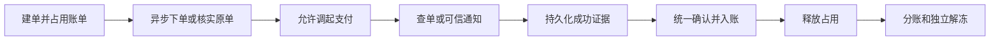

# 账单支付与资金处理

居民使用微信支付服务商模式，一次付清一张账单全部余款。物业公司收款，平台为当前唯一分账接收方；不提供合并支付、部分付款、退款、线上进件或返利抵扣。

数据和资金不变量见[数据与事务](data.md)，异常处理见[恢复与核对](recovery.md)。精确接口见[居民支付契约](../../../../openapi/modules/resident-payments.yaml)及[收款配置契约](../../../../openapi/modules/payment-configuration.yaml)。

## 入口与权限

新支付订单默认关闭；开放需实际商户材料、接收关系、渠道配置及相应验收。本文不证明真实渠道、真机或目标环境已验收上线。

| 能力                 | 当前边界                                                                                      |
| -------------------- | --------------------------------------------------------------------------------------------- |
| 居民建单、继续付款   | 有效客户端登录及居民身份，当前有目标房屋授权，完整所属路径可用                                |
| 本人历史、刷新和关闭 | 仅原付款人；解绑后仍可核实原单，不授予当前房屋或他人数据                                      |
| 物业读取             | `property.payment.read`，仅本公司支付、资金和配置安全投影；收款信息页面当前关闭，只读接口存在 |
| 平台支付 / 核对读取  | `platform.payment.read` / `platform.payment_reconciliation.read`                              |
| 平台配置读取 / 维护  | `platform.payment_config.read` / `platform.payment_config.manage`                             |
| 重新核对 / 异常恢复  | `platform.payment_reconciliation.manage` / `platform.payment.recover`                         |

物业无配置及资金恢复写能力，不读取平台完整账户账单。页面开放和服务端权限独立判断。

## 配置与建单

| 对象       | 规则                                                                                                                 |
| ---------- | -------------------------------------------------------------------------------------------------------------------- |
| 商户绑定   | 创建时停用，同公司最多一个启用绑定；启用前核验分账能力及平台接收关系，保留历史                                       |
| 分账规则   | 追加不可变版本；公开配置只接收一个比例，接收方固定为平台服务商账户                                                   |
| 配置变更   | 令牌识别并发及往返修改；渠道核验后复核权限和令牌，创建绑定及规则持久幂等                                             |
| 可用条件   | 公司启用、渠道材料齐全、商户及比例已核验、接收关系就绪且有有效规则；不可用原因明确返回                               |
| 支付输入   | 一张有效账单及预期版本；服务端确定全部正余款，无其他订单占用                                                         |
| 请求与冻结 | 付款人内同键同输入恢复原单，同键异输入冲突；恢复先于新建版本及配置检查。原单冻结付款人、商户、规则和金额，后续不替换 |

金额为整数分，比例为整数基点；逐接收方四舍五入到分，比例总和和实际舍入金额均不得超过渠道限额。

## 收款与入账

| 支付状态               | 含义                                                     |
| ---------------------- | -------------------------------------------------------- |
| `pending` / `unknown`  | 本地建单待处理 / 渠道结果未知，核实原单                  |
| `payable`              | 已有预支付结果，继续付款仍受当前授权、期限及可用操作限制 |
| `closing`              | 正在核实并关闭，不能直接释放占用                         |
| `succeeded` / `closed` | 可信成功与账单入账共同提交 / 已安全确认不可继续支付      |

有效期固定为创建后 15 分钟；过期不等于渠道关闭。刷新和关闭合并原单任务，未知响应不换键重付。

`confirmation_status` 另区分未确认、`awaiting_posting` 和已入账。待入账是可信证据通过核验的投影，保留占用并禁止再付，不能显示缴费完成。

支付面板成功、取消及失败只触发服务端核实。恢复记录按环境及本人隔离，保留原请求键和必要非敏感输入，调起参数只在内存；退出、切用户和迟到响应不得串用订单。

本人历史只给原账单摘要、金额及结果。后续解绑、停用、商户切换或前台退出，不得拒绝处理已经发生的可信收款。
