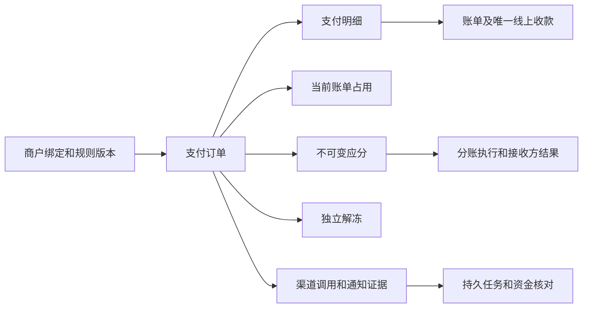
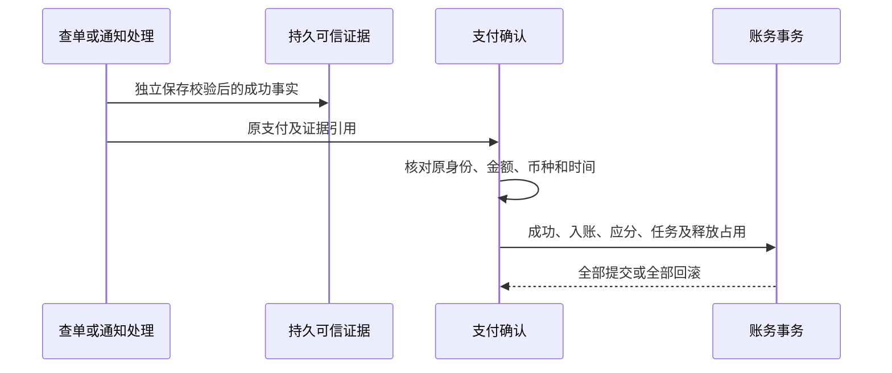

# 支付数据与事务

可见状态见[支付模块](README.md)，异常处理见[资金恢复](recovery.md)。对外字段以 [OpenAPI 资金契约](../../../../openapi/modules/payment-funds.yaml)为准。

## 数据关系

| 数据组     | 事实及约束                                                                                                                       |
| ---------- | -------------------------------------------------------------------------------------------------------------------------------- |
| 配置       | `property_merchant_bindings` 保存历史商户和核验；`profit_sharing_rule_versions` 及条目保存不可变规则；公司复合关系拒绝跨公司引用 |
| 订单和占用 | `payment_orders` 保存付款人、业务号及幂等；明细固定金额分配；`bill_payment_reservations` 每账单最多一个，关联原明细              |
| 应分和执行 | `profit_sharing_allocations` 保存义务，与逐次、逐接收方执行结果分开；同支付最多一个在途分账单                                    |
| 解冻       | `payment_unfreeze_orders` 保存可信实际结果，同支付最多一个在途解冻单，失败历史保留                                               |
| 证据和任务 | `payment_channel_requests` 保存发送意图及可信响应；通知按渠道通知号去重；固定目标任务保存租约和代次                              |
| 核对       | `payment_reconciliation_runs` 按业务日、账户及类型唯一，差异保存稳定维度及处置依据；平台账户不归属单一物业                       |

付款人内请求键唯一，支付业务号和渠道交易号分别唯一；订单金额等于明细之和。业务金额、付款人实付及手续费分别取可信事实，不互相估算。

## 原子确认

确认核对原商户、服务商、AppID、业务号、交易号、金额、人民币币种、付款人摘要及带时区成功时间；必须对应已持久化查单或通知，客户端结果不能替代。

支付成功、逐明细线上收款、账单汇总及版本、系统业务操作、应分、首个分账或解冻任务、释放占用及适用通知和任务确认共同提交。失败整体回滚，先存证据可恢复；明细只入账一次，不伪造管理员身份或审计。

## 分账和解冻不变量

- 应分按冻结金额和规则逐接收方四舍五入到分，仅保存正金额义务，累计不超支付金额或渠道限额。
- 成功累计不超对应应分；执行单 `finished` 不代表全部接收方成功，部分失败只补未履行部分。
- 分账提交不早于支付成功后一分钟；同支付最多 50 次渠道已受理执行，不用调用次数代替受理次数，也不换单绕过。
- 应分全部履行且无在途分账才解冻；任意解冻记录建立后永久禁止新增分账，失败后仍只能继续解冻。
- 合法零应分在确认事务内初始化解冻；缺少初始应分及解冻事实不能推断为零应分。
- 解冻使用可信实际金额，`no_remaining` 不证明本次解冻成功或服务费已取得，未知金额保持未知。

## 锁与网络调用

账单流程先协调公司、适用操作者或付款人、小区、空间、房屋及账单，再协调支付父记录；多资源保持稳定顺序。纯分账及解冻只协调支付父记录，不反向取账单锁。

任务领取独立提交；业务结果在业务锁后复核代次及有效租约。渠道网络调用不持有业务锁或未结束事务，发送意图、可信响应和业务结果分段保存。迟到证据保留，旧租约不能提交业务结果。

数据库共同保护公司关系、唯一性、金额、不可变历史、成功状态和解冻屏障；恢复不能靠删历史、清占用或回退成功状态。
