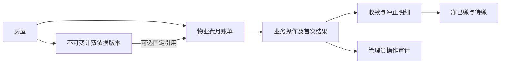

# 物业费账单与线下账务

当前按房屋、自然月建立物业费账单，追加计费依据，登记初始及后续线下收款，支持纠错、撤销和作废。线上资金流程见[支付模块](../payment/README.md)，精确接口和输入组合见[账单契约](../../../../openapi/modules/billing.yaml)及[字段规格](../../../../openapi/components/billing-schemas.yaml)。

## 账期、依据与建账

| 主题       | 当前规则                                                                                                                 |
| ---------- | ------------------------------------------------------------------------------------------------------------------------ |
| 账期与身份 | 月初至下月月初，左闭右开，允许历史、当前、未来月份；同房屋、类型、月份最多一张有效账单。作废保留历史，可重新建有效账单。 |
| 依据       | 每房只追加版本，不改删；取不晚于账单月的最近生效月，再取该月最新版本。新依据不重算旧账单或改变旧引用。                   |
| 计算       | 固定金额优先，否则正面积乘非负整数分单价，以精确十进制计算后四舍五入到分。面积最多四位小数，若填写即须合法。             |
| 自动建账   | 携带依据、计算版本和预期金额，服务端重算；变化返回冲突，不静默换价。                                                     |
| 手填建账   | 明确应收及必填原因，可不关联依据；引用时须属于同房屋且已在该月生效。                                                     |
| 初始已缴   | 可为部分或全额正金额收款，与建账共同提交；未缴不提供收款项，不能超过应收。零元账单直接结清，不生成零金额收款。           |
| 固定事实   | 房屋、账期、应收、金额来源及建账位置快照固定；普通编辑仅处理外部编号、到期日等允许资料。                                 |

- 金额为整数分，输入和计算结果均检查契约范围，不用浮点。
- 原因去首尾空白后按各操作必填，超长拒绝、不截断；收款日期可空但不能晚于北京时间当前业务日期，日期不详不能用建账日代替。
- 位置快照由服务端生成，外部编号可空、可重复，保留大小写与前导零，不作为账单身份。

## 状态与操作

| 状态维度     | 含义                                                                                          |
| ------------ | --------------------------------------------------------------------------------------------- |
| 生命周期     | `active` 有效，`voided` 已作废；已作废待缴为零、结清状态为空，不表示已付款。                  |
| 有效账单结清 | 正应收且净已缴为零为 `unpaid`，介于零和应收之间为 `partially_settled`，等于应收为 `settled`。 |
| 逾期         | 有效、有待缴且到期日早于当前业务日；未设到期日不推断逾期。                                    |

净已缴始终不小于零、不超过应收，且等于全部收款及冲正明细净额；有效账单待缴为应收减净已缴，不允许直接编辑金额汇总。

| 操作或条件           | 规则                                                                                                                 |
| -------------------- | -------------------------------------------------------------------------------------------------------------------- |
| 追加收款             | 有效账单、房屋路径可用、无支付占用；正金额不能超过待缴。                                                             |
| 纠正登记             | 仅未冲正线下收款，全额冲正原记录并追加正确金额及日期，一次提交，中间金额不可见。                                     |
| 撤销误登记           | 追加原金额负额冲正，不表示渠道退款；同一原收款不能重复冲正。                                                         |
| 作废                 | 有效、净已缴为零、无占用，原因必填；历史不删，作废后只读。                                                           |
| 小区、空间或房屋停用 | 保留历史、普通资料修正、纠错、撤销及符合条件的作废；禁止新增依据、建账和追加收款。公司停用仍按物业身份规则拒绝访问。 |
| 线上来源与占用       | 线上收款不允许线下纠错或撤销；占用阻止收款、纠错、撤销和作废，普通资料修改仍校验版本后允许。                         |

依据版本、收款、冲正和成功业务操作不可改删。支付占用建立或释放不递增账单版本、不生成账单操作；读取占用只作提示，写入须在账单保护内重新检查。已发生可信线上收款按支付确认入账，不因后来解绑或组织停用丢弃。

## 权限与读取范围

| 能力                                 | 权限                                                              |
| ------------------------------------ | ----------------------------------------------------------------- |
| 账单、全部依据、试算、流水及操作历史 | `property.bill.read`                                              |
| 建账、普通资料修改                   | `property.bill.manage`                                            |
| 追加依据                             | `property.fee_basis.manage`                                       |
| 初始或后续正金额收款                 | `property.bill_receipt.create`，建账附收款还须账单经办。          |
| 作废／纠错与撤销                     | `property.bill.void`／`property.bill_receipt.correct`，分别授权。 |

各写权限含必要读取，不互相隐含敏感能力。账务使用受限房屋选项即可选择和试算，不要求完整房产查看、不返回业主资料；房屋详情自身仍须房产查看。手工和[导入](../imports/README.md)复用同一建账及入账规则。

物业列表固定公司和小区，支持房屋、空间后代、月份、生命周期、结清、待缴、外部编号、到期日及逾期筛选；月份和日期起止包含边界。列表与总数共享快照，流水和操作独立分页；当前页合计不冒充全量，[公司工作台指标](README.md#工作台指标)另有固定口径。

居民当前账单及脱敏流水须有本人有效房屋绑定且完整路径可用。只公开金额、来源和日期，不公开管理员、他人身份、他人支付单号或审计信息；仅本人支付提供原单关联，他人占用只提示处理中。本人原支付历史另由支付模块授权。

## 并发与未知结果

按公司、账号、小区、空间、房屋、账单的适用顺序保护资源，锁后复核权限、启停、版本和占用。共同父资源共享保护，依据新增和建账独占房屋，既有账单共享房屋并独占账单，允许独立账单并行。

- 依据新增检查预期最新版本，既有账单写入检查预期行版本，每次成功操作递增版本。
- 账单、明细、业务操作及管理员审计共同提交，唯一约束防止重复月账单和重复冲正，数据库再次核对净额及版本连续性。
- 线上确认的共同提交边界遵循支付模块，不凭客户端回调改账务。

- 账单操作键在公司范围唯一；手工同操作者、同键同输入恢复首次成功快照，其他操作者同键或同键异输入均冲突。
- 成功重放先于新写入版本判断，仍复核当前会话、原操作及初始收款等条件权限。
- 未知结果按原键查询或恢复，未查到不证明失败、不换键登记；恢复后重读当前账单，不能用首次快照覆盖后来变化。

依据新增不使用账单操作结果账本，其响应未知先读取版本和内容核实，不自动换预期版本再追加。新增账单用弹窗，换房或月份使旧试算失效；冲突保留输入，重新核对后提交，不自动刷新版本继续写入。
