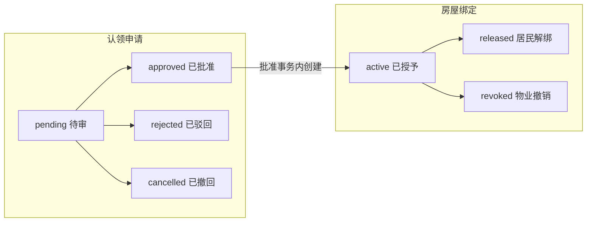

# 居民认领与房屋绑定

认领申请记录一次审核，绑定记录批准后的房屋访问资格，均保留历史。统一登录、手机号验证和身份切换见[身份模块](../identity/README.md)；精确接口及字段见[认领契约](../../../../openapi/modules/house-claims.yaml)与[输入规格](../../../../openapi/components/house-claim-schemas.yaml)。

## 状态与关系

同用户、同房屋最多一条待审申请及一条有效绑定；一人可多房，一房可多人。绑定唯一来源于已批准申请，用户、公司、小区和房屋与原申请一致；终态不复活，重新认领创建新申请与绑定。

## 提交与审核依据

| 条件   | 当前规则                                                                                               |
| ------ | ------------------------------------------------------------------------------------------------------ |
| 申请人 | 有效客户端用户及居民身份，申请限定本人。                                                               |
| 房屋   | 公司、小区、完整空间路径及房屋启用；没有本人有效绑定或待审申请。                                       |
| 资料   | 姓名、本人当前有效的已验证手机号绑定，可附说明；保存姓名、号码及当时位置快照，不接受自报号码冒充验证。 |
| 匹配   | 提交时仅对目标房屋启用的业主登记，以姓名及规范化手机号精确匹配，形成 `matched / unmatched` 参考。      |
| 边界   | 匹配成功仍须人工审批；未匹配可经核实批准，不自动更改或补建业主档案。                                   |

居民选房须有效身份，只返回可用小区、空间及房屋，不公开业主资料。本人申请与绑定不返回内部匹配结果、匹配业主标识或他人申请；物业按权限读取本公司审核所需资料。

提交后手机号解绑不撤回申请，审核使用保存的快照，不要求原手机号绑定继续存在；已有房屋资格也不因手机号解绑结束。业主资料变化不回写历史匹配结果。姓名、说明、原因去首尾空白，精确长度及组合以输入规格为准。

## 操作条件与权限

| 操作     | 条件                                                                                                                      |
| -------- | ------------------------------------------------------------------------------------------------------------------------- |
| 居民撤回 | 本人待审申请及当前版本，已审不能撤回。                                                                                    |
| 物业读取 | `property.resident_access.read`，仅本公司申请与绑定。                                                                     |
| 物业审批 | `property.resident_access.review`，含所需读取；仅待审可批准或驳回。批准时复核用户及房屋路径可用，未匹配批准和驳回须原因。 |
| 居民解绑 | 本人 `active` 绑定及当前版本，原因可选。                                                                                  |
| 物业撤销 | `property.resident_access.revoke`，含所需读取；本公司 `active` 绑定、当前版本，原因必填。                                 |

审批不隐含撤销权，档案维护也不授予审核。公司停用阻止物业访问，但有效居民仍能看本人申请/绑定历史、撤回待审及解绑；新增认领和当前房屋业务仍要求资源可用。

- 绑定状态与实际可用分开：`active` 还须用户、公司、小区、房屋及祖先启用。
- 停用不伪造解绑事件，已审申请不因绑定结束变成撤回，原申请和绑定不改删。
- 绑定结束后不能读当前房屋账务或继续付款；本人原支付历史、核实及关闭另按[支付规则](../payment/README.md)判断，不重新授予房屋权限。

## 并发、恢复与交互

创建在用户范围使用稳定幂等键，同键同输入返回原申请及其当前状态，同键异输入拒绝。未知提交保留原键和输入，核实原申请，不换键重建；唯一约束防止并发重复待审或有效绑定。

撤回、审核、解绑、撤销按当前状态及预期版本变更，只能一次成功；冲突后读当前事实，不刷新版本自动重放原决定。批准的状态、绑定、审核字段和审计共同提交，任一失败回滚；驳回、物业撤销与审计同样原子提交。

写入按公司、适用操作者、居民、房屋路径等父资源顺序保护并复核当前资格，版本及不可变保护协调批准、撤回和解绑竞争。响应未知先查原资源，冲突或取消请求不表示服务端回滚。

小程序认领为“填写资料 → 提交前核对”两步，选房即回填、取消重选保留原资料；未知提交先恢复原请求。草稿和敏感输入不写入持久化存储、URL或日志。
