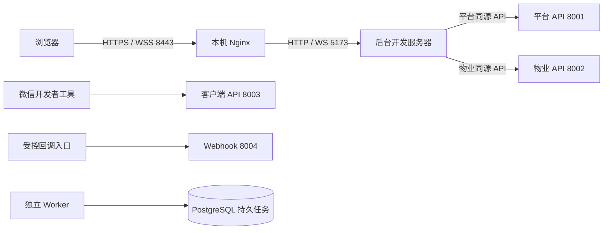

# 运行与部署边界

当前仓库提供应用构建、本地运行、数据库迁移和本机 Nginx 样例，没有服务器初始化、Ansible 发布、定时备份或恢复自动化入口。目标服务器仍需实际准备运行环境、网关、进程管理、持久目录和恢复机制，并独立验收。

本地配置、构建和运行见[开发指南](../development/local-setup.md)，质量要求见[测试规范](../standards/testing.md)，迁移约束见[数据库规范](../standards/database.md)。

## 当前本机入口

本机样例使用两个后台域名，HTTPS 只监听回环地址 8443，并保留 8080 HTTP 入口；证书须另行配置和信任。它将页面和 API 转发至开发服务器，不是生产静态站点配置，也不证明公网回调可达。

| 本机 HTTPS 配置 | 要求                                                                                                                              |
| --------------- | --------------------------------------------------------------------------------------------------------------------------------- |
| 证书与信任      | 复用本机 CA，不覆盖已有私钥；站点证书明确包含两个后台域名，有效期 365 天，续期复用 CA。macOS 系统钥匙串信任须实际完成管理员认证。 |
| 私钥保存        | 保存在用户私有配置目录，目录权限 0700、私钥 0600，不进入仓库。                                                                    |
| 代理与热更新    | 保留原始 Origin，后端可信来源包含实际 HTTPS 地址和端口；热更新使用同源 WSS，仍执行 CSRF 和双后台隔离。                            |
| 修改与恢复      | 先备份站点和本地配置，检查 Nginx 配置后重载；失败恢复备份。分别核对解析、证书信任、页面、API、WSS 和跨后台拒绝。                  |

| 组件               | 目标环境需保持的边界                                                                            |
| ------------------ | ----------------------------------------------------------------------------------------------- |
| 网关与后台         | TLS、正确域名和静态页面路由；平台只转发平台 API，物业只转发物业 API，不能因前端共用工程混合身份 |
| 四个 API           | 平台、物业、客户端和 Webhook 独立进程、独立入口，客户端与外部回调不经后台身份授权               |
| Worker             | 独立运行支付和导入任务及周期检查；须支持安全停止、重启和持久任务接管，不能只启动 API            |
| PostgreSQL / Redis | 使用目标环境受控连接与访问权限；数据库保存业务及任务事实，Redis 保存会话和限流状态              |
| 微信小程序         | 构建完成还需微信侧上传、域名和真机验证；本机编译不代表已经发布或可真实支付                      |

## 配置与持久数据

| 项目     | 要求                                                                                                   |
| -------- | ------------------------------------------------------------------------------------------------------ |
| 环境隔离 | 数据库、Redis、站点、客户端地址及渠道回调对应同一目标环境，不沿用本机地址或混用凭据                    |
| 后台安全 | 可信 Origin 精确包含协议、主机和端口；生产要求 HTTPS，保留 Origin 与 CSRF 校验及双后台 Cookie 路径隔离 |
| 秘密     | 数据连接、微信和支付密钥、证书私钥仅保存在受控配置中，不进入前端制品、仓库或日志                       |
| 导入文件 | API 与 Worker 访问同一私有持久目录；staging、production 必须使用绝对目录，不能随应用版本替换或清空     |
| 文件权限 | 实际验证运行身份可上传、原子发布、读取和删除；同一路径不自动解决不同系统账号的权限问题                 |
| 发布材料 | 保留匹配的应用、迁移和历史导入定义；排除真实配置、私有文件、开发数据及测试凭据                         |

导入保留和恢复规则见[导入执行](../modules/imports/execution.md)，资金任务暂停与原单恢复见[支付恢复](../modules/payment/recovery.md)。配置齐全与真实渠道验收分别判断。

## 就绪与质量检查

| 检查        | 通过条件                                                                                                   |
| ----------- | ---------------------------------------------------------------------------------------------------------- |
| API 存活    | `/healthz` 返回预期服务标识，只证明对应进程可响应                                                          |
| API 就绪    | `/readyz` 的 PostgreSQL 和 Redis 均正常；依赖不可用返回 503，不能只检查端口                                |
| Worker 就绪 | 支付和导入任务源可访问，调度器运行，处理器已注册；就绪后继续关注周期检查失败、积压及过期租约               |
| 应用门禁    | 格式、类型、Lint、前后端测试与构建、OpenAPI 契约检查通过；完整回归启用所需真实隔离依赖，不将未执行计为通过 |
| 环境验收    | TLS、代理边界、文件权限、迁移、回调、重启及备份恢复在目标环境实际验证；本地门禁不能替代                    |

Worker 当前没有独立 HTTP 健康接口；启动日志的就绪标记不是持续健康监控，也不代表商户材料和真实渠道可用。

## 迁移与恢复顺序

1. 明确目标环境和变更范围，取得匹配的数据库、私有文件、配置及应用备份，并在隔离环境实际验证可恢复。
2. 协调停写和在途任务，按应用兼容性安排迁移与版本切换；迁移是独立步骤，不在应用启动时自动建表或升级。
3. 启动四个 API 与 Worker，验证就绪、网关和关键流程，再按验收结果开放入口；开发填充或重置操作不作为服务器初始化步骤。
4. 回退先判断数据库和业务记录兼容性，不自动降级迁移，不以删除新记录恢复旧应用；已有真实收款时保留兼容处理能力。
5. 整库恢复前隔离回调、外部调用和任务执行；核对恢复的数据、私有文件与应用版本后，再核实备份之后的外部资金事实，按受控顺序恢复任务及流量。

Redis 会话丢失可重新登录，不能据此重建业务订单。数据库恢复不撤销渠道收款、分账或解冻；恢复成功须同时证明业务可读、一致性成立和原任务可安全继续。
