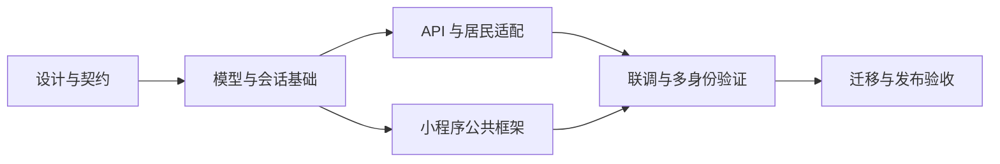

# 客户端统一身份框架实施计划

## 范围与依据

依据 [已确认框架设计](../../design/client/overview.md)、[架构](../../design/client/architecture.md)、[数据库](../../design/client/database.md)、[API](../../design/client/api.md)、[交互](../../design/client/interaction.md) 和 [OpenAPI](../../../openapi/openapi.yaml)。本计划覆盖统一 client-api、多身份框架及既有居民业务适配，物业、商家业务接入不在本计划内。

文档与契约落盘不代表后端、小程序、数据库迁移或运行入口已经实现。代码实施已获授权，按下列任务依赖推进并在验证后勾选。使用当前专用 `codex/client-api-foundation` worktree，后续同一任务继续使用它，不覆盖原工作区。

## 依赖顺序

只在对应工作完成并验证后勾选。多身份框架先提供稳定边界，额外业务通过测试装配验证，不以物业业务开发作为框架完成前提。

## 设计与契约

- [x] 落盘范围、架构、数据库、API、流程交互设计及本实施计划，检查与旧权威文档的职责和引用一致。
- [x] 更新 OpenAPI client 会话、身份目录、选择参数、安全方案、错误与运行声明；完成格式、Lint、Bundle、类型生成及 Schema 正反例检查。
- [x] 记录契约先于实现演进，以及实现阶段逐进程一致性验证要求；静态校验不作为运行端已通过的依据。

## 模型、会话与身份基础

- [x] 新增 `miniapp_user_identities` Model、Repository 和 Alembic 迁移；字段、约束、索引、终态撤销及 CAS 与数据库设计一致。
- [x] 迁移保留微信用户、手机号、房屋授权和支付 ID；不建立或回填居民关联，验证空关联表下居民登录正常。
- [x] 实现统一 `ClientSessionStore`、client Redis scope、用户版本、空闲/绝对到期及登录限流，保持后台会话隔离。
- [x] 分离纯业务用户/授权上下文与 Redis 会话数据，消除居民 Repository 对会话存储类型的依赖，保留锁内校验。
- [x] 实现派生居民、通用关联解析与有限注册表；实现可信内部授予/撤销所需校验、并发保护及审计协作边界。
- [x] 实现身份目录统一排序、计数和分页，区分未注册类型、不可用主体和依赖故障。
- [x] 通过测试装配证明多个额外身份、同类型不同主体、失效隔离与事务竞争；确认生产注册表仅居民，无自助绑定或测试入口。

## client-api 与居民适配

- [x] 将运行入口和装配演进为 `client-api`，分离公共账号与居民业务接口；健康、就绪和敏感响应 `no-store` 条件同步。
- [x] 实现 client 登录、会话恢复/退出、本人账号/手机号和身份目录；公共操作不依赖业务选择。
- [x] 居民业务要求显式 `X-Client-Identity: resident`；选择错误、额外身份失效和全局认证失效分别按契约处理。
- [x] 迁移认领、房屋、账单及支付应用与 API 归属，保持本人历史、当前房屋权限、脱敏、幂等和资金状态语义。
- [x] 更新运行标识、配置、开发服务定义、Makefile、测试 Harness 与契约检查运行端集合；端口保持 8003。
- [x] 同步错误目录和类型派生产物；逐运行端契约检查通过且无后台、物业移动或测试接口意外暴露。

## 小程序公共框架与居民接入

- [x] 公共会话改为 client 登录、恢复、退出和 `clientRequest`；本人账号、手机号及身份目录归主包，居民 API/类型归居民分包。
- [x] 增加身份目录、选择状态、session/context 两级代际、请求启动时上下文快照及旧响应丢弃。
- [x] 实现目录完整分页、单身份直达、多身份选择、上次有效身份恢复和明确的目录失败重试；未知业务类型不能拼接导航。
- [x] 身份选择按合法类型与业务首页/回跳白名单分流；切换重建导航，取消旧业务活动，不换 token。
- [x] 分离切换、身份失效、会话替换、退出及换用户的清理范围，清除敏感草稿；保留同用户原支付非敏感恢复记录。
- [x] 调整居民请求、页面守卫、选房和支付恢复；公共手机号能力不再依赖居民身份选择。
- [x] 更新分包边界、页面数量及构建检查；生产只注册居民页面，多身份页面和切换通过测试装配验收。

## 迁移、回归与交付

- [x] 用户确认尚未发布、仅开发联调；直接切换 `/api/client`，不保留旧 API 或旧 token 兼容入口。
- [x] 完成显式同环境、经服务端确认同用户的选房及支付恢复数据迁移；旧 token 不升级，迁移可重试且不丢原幂等键。
- [x] 运行相关 Ruff、mypy、pytest、TypeScript、ESLint、Prettier、Vitest、分包构建和 OpenAPI 工程检查。
- [x] 运行真实 PostgreSQL 迁移、唯一/检查约束、关联撤销与业务写入并发验证，运行真实 Redis 到期与 scope 隔离验证。
- [x] 回归所有居民本人、房屋与支付授权和未知结果恢复；Worker 已发生收款确认不受前台切换影响。
- [x] 更新开发操作指南、client 上游约定与配置说明；验证 client 进程启停、就绪及与其他运行端隔离。
- [ ] 体验版真机验证统一微信登录、手机号及关键居民流程；真实扣款等受条件限制项目单独报告，不计为通过。当前未执行真实微信授权、手机号授权及付款，原生编译和替身联调不计入此项。
- [x] 交付实际变更、检查结果、迁移及回滚方式和未完成验证；停止在框架与居民适配范围，不启动物业接入。

## 验收条件

- 每次客户端登录只维护一份统一 client 会话凭证，允许多设备分别登录；身份切换不建立子 token 或跨进程认证。
- 关联表没有居民记录，空表下启用用户目录仍包含固定 `resident`；额外身份没有物业专属字段。
- 测试多身份目录、选择、导航、上下文、失权和数据隔离形成闭环；生产没有假物业或商家能力。
- client 401 只撤销原会话，身份级拒绝不清除有效登录；旧用户、旧会话、旧上下文响应不能影响当前状态。
- 原居民功能、历史资源与付款人归属不变；切换和迁移不造成重复提交、重复付款或恢复信息丢失。
- 文档、契约、运行入口与实际实现一致，所有必需检查通过，未执行验证明确标识。

## 本次验证与限制

- 后端单元、契约及 API 回归：863 项通过；编译小程序通过真实 HTTP 和隔离 PostgreSQL 的原支付恢复联调另 1 项通过。
- PostgreSQL、Redis 及迁移扩大回归：首轮 365 项通过、6 项迁移兼容相关失败；修复空表安全降级和迁移版本断言后，包含原失败项及新增保护测试的 27 项复测全部通过，无剩余失败。未以改写 fixture 或跳过测试放宽保护。
- 开发运行与进程集成：原 36 项及新增 client 真实入口健康/就绪 3 项通过；仅使用所属测试临时目录、端口和实例。
- 小程序：19 个文件、193 项测试通过；类型、ESLint、导入边界、16 页构建及原生 21 份 WXML、22 份 WXSS 编译通过。最后的纯逻辑竞态修复完成定向及全量测试、类型、Lint和重新构建，未重复未改动模板的原生编译。
- 工程：项目配置下 Ruff、477 个文件的 mypy、仓库 Prettier、完整 `pnpm api:check` 和 `git diff --check` 通过。
- 用户已确认仅开发联调，未发布；本次不保留旧 API 或 token 兼容，不操作实际部署或已有业务数据库。数据库迁移仅在隔离测试中执行，实际环境按开发指南运行。
- 未执行真实微信登录、手机号授权或真实付款；协议替身、HTTP 联调和原生编译不能代替该验收。
